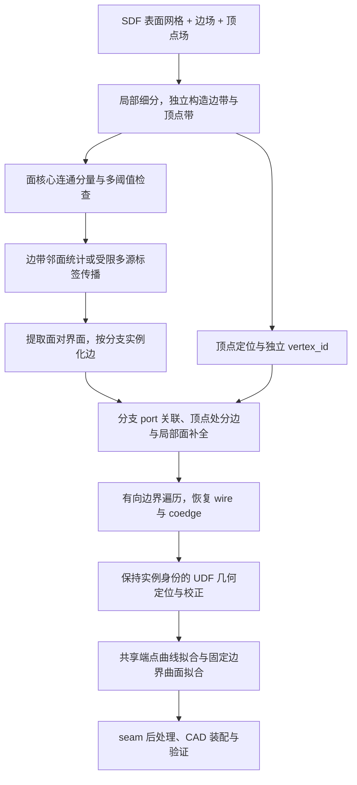

# 基于隔离带与面标签传播的 B-rep 拓扑恢复方案

本文整理一条新的后处理路线：从 SDF 表面网格和边／顶点距离场构造隔离带，先实例化面核心，再通过受限标签传播或局部邻接统计恢复边与顶点关联，最后在已确定的实例身份内精化几何并拟合参数 B-rep。

本方案是待实现与实验验证的设计，不表示仓库已经具备相应提取器。它改变的是**面分割与拓扑恢复的组织方式**；场表示、去 seam 规范及点／边／面参数化继续采用 [EdgeVertexDistanceFields.md](EdgeVertexDistanceFields.md)，本文不重新定义这些部分。

## 1. 与原方案的关系及继承范围

原文主要讨论先提取曲线图、再恢复面区域的路线，包括连续追踪和类 Marching Cubes 的网格曲线提取。本文改为先获得粗面实例，再利用面标签的局部接触关系构建曲线图。两者可使用相同的场输入和参数化后端，作为不同提取器进行比较。

以下内容以原文为准：

| 继承内容 | [原文](EdgeVertexDistanceFields.md)位置 |
|---|---|
| 固定 SDF 几何条件、边／顶点距离场、尺度与空集合约定 | §2.1、§2.3 |
| seam 过滤、必要顶点及闭环人工锚点规范 | §2.2 |
| 距离场可辨识范围与几何集合假设 | §4 |
| 阈值误差、采样覆盖、连续投影和定位精度 | §5–§7.7 |
| 顶点距离中心定位、边中心线校正 | §7.1–§7.4 |
| 共享顶点下的 Bézier／B-spline 等曲线拟合 | §8 |
| 固定边界的面参数化、pcurve、seam 与 CAD 装配 | §9 |

已确定的约定保持不变：

- SDF 提供外壳及面内部几何条件。
- 生成及拓扑提取阶段只恢复两个不同 face 之间的非 seam 边；seam 由后续参数化和 CAD 后处理建立。
- 无必要分段顶点的完整闭合曲线整体作为一条 edge，不因原 CAD 的 seam 或参数起点人为切段。
- 真实交汇点及需要保留的二度顶点仍用于分边；闭环约定不能用来跨越这些顶点合并已有边。
- 不同 face 的相切或共面边界不自动视为 seam。删除 seam 不等于合并不同 face。
- 初版沿用闭合流形实体、非退化边、无边内部重合及无未建顶点交叉等范围。

## 2. 总体流程与关键判断



三个判断贯穿全过程：

1. **面核心是暂定种子，不是无条件正确的 face。** 隔离带对面内部的作用类似腐蚀，可能造成错误分裂或种子缺失；隔离带缺口则可能使不同面的核心合并。这是 DualBrep 同类阈值分割也存在的共同局限，不妨碍复用其分割框架，详见 §4。
2. **标签传播用于实例归属与拓扑关联，点与边的几何由 UDF 确定。** 在已确定的实例归属下定位顶点和拟合曲线；传播界面不作为几何真值，其位置偏移本身不构成最终几何定位错误。这是本方案的职责分工，详见 §5.3。
3. **标签对不是 edge 的唯一身份。** 必须同时区分连通分支，并在保留顶点处分段。（考虑一个贯穿球体的通孔，两个孔的边标签一致）

## 3. 网格与隔离带构造

### 3.1 使用表面连接关系

从固定 SDF 提取表面网格 $M$，保留三角形邻接、方向和必要的半边结构。下文集合表示网格表面上的区域，实际实现可通过细分／裁剪后的三角复形或一致的图掩码表示。

面分割使用表面网格上的连接关系，推荐以共享网格边的三角形邻接为基础。不能将结果当成无序三维散点，再以空间 kNN 代替表面邻接；相近但不相连的表面可能被误连，仅在网格顶点处接触的区域也不应随意跨越。

仅删除低 UDF 网格顶点不一定构成完整屏障：真实边可能穿过三角形内部，而三个角点都没有落入阈值带。对候选三角形应补充内部查询、检查跨带连接，必要时细分。网格分辨率与阈值应联合选择，而非靠增大带宽弥补所有漏采。

### 3.2 独立定义边带和顶点带

在表面上定义：

$$
B_E=\{x\in M:\hat d_E(x)<\tau_E\},\qquad
B_V=\{x\in M:\hat d_V(x)<\tau_V\}.
$$

由此得到：

$$
\Omega_{\mathrm{core}}=M\setminus(B_E\cup B_V),\qquad
R_E=B_E\setminus B_V.
$$

$\Omega_{\mathrm{core}}$ 用于寻找面核心，$R_E$ 是排除交汇邻域后的普通边候选带。

顶点带建议由 $d_V$ 独立检测，不强制先裁剪到 $B_E$ 内。只有在真实场、$V\subseteq E$ 且 $\tau_V\leq\tau_E$ 时，才由 $d_E\leq d_V$ 推出 $B_V\subseteq B_E$。实际中为了隔开交汇分支，顶点邻域可能需要比边带更宽；预测误差也可能破坏理想包含关系。

两类阈值可局部自适应，但应记录尺度及选取依据。顶点带需覆盖交汇的混合区域，同时避免吞掉短边或与邻近顶点带重叠。近切分支可能需要较大的隔离区域；若与短边尺度冲突，应细化采样、减小边带宽度或转入局部几何分析，不能强行合并。

顶点存在标记为假时取 $B_V=\varnothing$，闭合边仍可独立提取。边集为空时跳过边界提取，并按表面连通区域建立面候选；该分支的最终周期参数化及特殊结构处理仍遵循原文范围。

## 4. 面核心实例化与稳定性检查

### 4.1 与 DualBrep 共有的面核心条件

在 $\Omega_{\mathrm{core}}$ 上计算网格连通分量，为每个分量赋予暂定 `seed_id`。通过检查后，再确定其对应的 `face_id`；必要时一张 face 可以由多个已确认属于同面的核心种子支持。

阈值隔离带加连通分量的方法要求：每个真实 face 去掉隔离带后，仍留下一个非空、连通的核心，同时不同 face 的核心被完整隔开。DualBrep 的同类分割也依赖这些条件；它们不是本方案新增的限制。有限阈值下可能出现以下问题：

| 问题 | 对后续拓扑的影响 | 优先处理 |
|---|---|---|
| 边带有缺口 | 两张面核心被合并 | 检查三角形内部穿越，局部细分与补齐屏障 |
| 同一面的薄颈被带切断 | 一张面出现多个假实例 | 多阈值检查和局部降低带宽，验证是否存在真实边 |
| 窄面完全被带覆盖 | 没有该面的种子 | 同时提高分辨率、调整局部阈值，重新分割 |
| 顶点带过大 | 吞掉小面或短边 | 精化顶点并收缩／分离邻域，保留短结构证据 |

例如，一张哑铃形平面 face 的中间连接处宽度为 $w$。若两侧边界各向内部去掉约 $\tau_E$ 宽的带，当 $w<2\tau_E$ 时，连接处可能完全被覆盖，两端变为不同连通分量。即使 $d_E$ 完全准确，有限带宽也会导致这种分裂；它不必来自生成误差。新方案额外引入的顶点带同样需要控制覆盖范围。

不应仅按分量面积删除所有小面，也不应仅凭法向相近就合并种子，因为原文允许相切／共面 face 之间存在需要保留的边。

建议比较相邻阈值与网格细分下的种子覆盖及连接稳定性。发现不稳定区域时回退到局部隔离带构造；标签传播不能自动创造一个完全没有种子的真实 face。种子合并或拆分后，应更新相应传播结果和边实例，不能继续沿用失效的关联。

### 4.2 当前 DualBrep 分割实现及可复用部分

当前仓库默认采用 [clustering.py](../clustering.py) 的 `hierarchical_segmentation`。其实际处理单位是**三角面片**：直接推理路径在 [ae_reconstruct.py](../ae_reconstruct.py) 查询三角形中心的场值，体素输入则由 `_perface_udf_from_volume` 在三角形中心插值。默认流程并不是直接删除低 UDF 网格顶点后计算顶点连通分量。

其处理过程为：

1. 按第一阈值筛选三角面片，保留 `abs(udf) >= threshold1` 的面片作为图节点。
2. 用 `mesh.face_adjacency` 建立共享网格边的三角形邻接，只保留两端均激活的连接。
3. 计算连通分量，按大小及平均 UDF 筛选，得到第一轮标签。
4. 在部分已保留分量内使用更高阈值重新计算连通分量；仅当产生至少两个通过大小过滤的子分量时，替换原分量。
5. 输出面片标签，未保留区域为 `-1`。默认分支没有为所有隔离带面片补全面标签。

当前外层调用使用 `threshold1=0.005`、`threshold2=0.01`、`filter_size=10`，并关闭可选的小分量平面合并。这些是当前实现的设置，不是新距离场应固定采用的参数。

**邻接构造、掩码筛选、连通分量计算和标签编号可以复用。** 第一版可沿用同一三角面图，将输入替换为新场，并在其输出上增加隔离带标签传播与拓扑恢复。

第二轮提高阈值可能切断错误连接、缓解部分欠分割，但也可能切断同一 face 的薄颈。该步骤不会自动恢复第一轮已经丢失的面核心，也不能保证所有分裂都对应真实 face，因此应作为可选启发式进行比较。

### 4.3 新场接入的最小调整

沿用三角形中心采样和三角形邻接时，掩码可写为以下伪代码；`dE`、`dV` 均为对应中心位置的新场值，空顶点集按原文约定处理：

```python
edge_band = dE < tauE
vertex_band = dV < tauV
core_mask = ~(edge_band | vertex_band)
edge_region = edge_band & ~vertex_band

# G 的节点为全部三角面片，连接来自 mesh.face_adjacency。
# 对 core_mask 的诱导子图求连通分量；保留孤立的激活节点。
seed_labels = connected_components_on_induced_subgraph(G, core_mask)
```

这只改变面核心的激活条件，连通分量算法本身无需重写。如果改用网格顶点上的阈值掩码，应明确它如何裁剪三角形或切断邻接，并同步改变标签表示；不能把顶点标签直接当成当前代码的面片标签。中心采样同样可能漏掉三角形内部穿越，必要时仍需采用 §3.1 的补充查询与细分。

接入时需要保留以下区别：

| 部分 | 复用或调整方式 |
|---|---|
| 标量场及阈值 | 当前 DualBrep 使用到 Voronoi 分隔结构的 UDF，本文使用到最近非 seam B-rep 边的 $d_E$；按相同坐标尺度接入后，仍需重新选择阈值，不能认定原阈值等价 |
| 两类隔离带 | 独立保存 `edge_band`、`vertex_band` 和 `edge_region`，不要通过最终标签倒推它们 |
| 被过滤区域 | 单独记录小分量过滤、第二轮拆分弃置等原因；`label == -1` 包含这些区域，**不等同于边隔离带** |
| 小分量与二次拆分 | 初版保留小分量为待判断候选；二次拆分作为可选步骤，不把分量大小或更高阈值作为真实 face 的充分判据 |
| 外层预处理 | `process_item` 当前只保留最大网格连通分量；若目标允许多个有效表面分量，应分别处理，不能无条件删除其余分量 |
| 零分量兜底 | 当前代码会在零分割结果时把整个网格赋为一个面；本文应记录失败并调整采样或阈值，不能把该兜底当成拓扑恢复成功。已知边集为空的合法分支按 §3.2 单独处理 |
| 后续传播 | 默认分割输出的是带未标记区域的核心标签，本文 §5 的受限传播、竞争状态及边实例恢复需要新增 |

原 UDF 的语义参见 [README.md](../README.md) 的双场说明；不能仅凭分割脚本中关于“到边距离”的简写，把原结构场与本文 $d_E$ 视为同一个场。

实施顺序上，可以先复用单轮阈值与连通分量核心，保留全部掩码和候选分量，接通后续拓扑与 UDF 几何模块，再根据失败样例增加局部细分、多阈值检查或二次拆分。共同的面核心局限应作为适用条件和失败检查，无需在建立基线前重新设计整套分割算法。

## 5. 顶点带外的受限多源标签传播

### 5.1 传播状态与路径限制

对每个面核心 $F_f^{\mathrm{core}}$，从它与 $R_E$ 接触的边界启动传播。令 $S_f$ 表示这些接触种子，计算：

$$
T_f(x)=\operatorname{dist}_{R_E,w}(S_f,x).
$$

这里 $T_f$ 是受限网格路径上的到达代价，不是网络生成的逐面 UDF。最简单的 $w$ 使用表面路径长度；后续可研究局部置信度或方向约束。路径不能穿过 $B_V$ 或借道其他 face 的核心，空间近邻也不能替代网格路径。

每个候选带区域只计算有局部接触依据的面来源。保留来源标签、到达代价和竞争状态；普通边区域至少保留所需的两个竞争候选，多源歧义区域保留更多局部候选，不能预先强制为两个。没有任何有效来源的区域标记为未解释，不能凭最近空间位置强行赋值。

传播可用多源最短路或对应的表面距离求解作为原型。限制传播范围时需检查是否仍覆盖完整带区域，并将不可达状态与有限代价区分；不能直接对无穷代价做插值。

### 5.2 从面竞争提取界面

获胜面标签为：

$$
L(x)=\arg\min_f T_f(x).
$$

普通面间边的候选界面由两个来源共同最小的位置给出：

$$
\Gamma_{ab}=\{x\in R_E:T_a(x)=T_b(x)=\min_f T_f(x)\},\qquad a\ne b.
$$

离散实现从不同获胜标签相邻的位置寻找界面，并利用有限的到达代价差 $T_a-T_b$ 插值局部交点。相邻三角形共享同一网格边上的交点，保存有序连接及无序面对 $\{a,b\}$；顶点位置附近的暂时断口留给顶点带处理。

这借鉴 BR-DF 的“面分区及共同最小值界面”构造。BR-DF 使用逐面距离场，本方案使用由粗面种子构造的传播代价，因此不直接继承其场表示或 MCT 的重建结论。[1]

必须避免：

- 以单个获胜面标签定义 edge：它只表示面归属，没有两侧信息。
- 无界传播后取全部到达标签的并集：连通带可能收集大量无关来源。
- 将任意位置的前两名来源直接认作邻面：需确认存在局部前沿接触、两侧支持及低 $d_E$ 几何证据。
- 在顶点带之外出现多面竞争时直接创建任意交汇：应检查漏检顶点、面核心错误或带粘连。

### 5.3 标签确定拓扑，UDF 确定点与边的几何

本方案明确采用以下分工：

| 信息来源 | 负责的内容 |
|---|---|
| 面标签、局部接触及分支连接 | 实例归属、边两侧的 face、顶点邻域的入射分支与拓扑关联候选 |
| 顶点 UDF $d_V$ | 区分并定位顶点候选，估计共享顶点坐标，与分支信息一起确认关联 |
| 边 UDF $d_E$ | 在所属实例的支持区域内定位中心线，提供曲线拟合的几何约束 |
| 固定 SDF | 提供表面几何条件，约束点、边与后续面参数化的一致性 |

核心退缩范围、网格密度和传播代价不对称都会移动前沿相遇位置。例如局部真实边位于 $x=0$，两侧种子边界位于 $-a$ 与 $b$，等速传播在 $x=(b-a)/2$ 相遇。只要这种偏移没有改变实例与连接关系，就不必把相遇位置当成最终曲线位置。

**因此，标签传播界面偏离真实边，在上述分工下不再单独构成最终几何定位问题。** 传播界面可用于确定分支顺序、提供搜索范围或可选的几何初值；也可以直接在已归属的支持带内从 UDF 定位几何，无需强制把传播界面逐点投影成曲线。§2 的第二条表达的是这一设计原则，而非额外缺陷。

这不消除拓扑归属错误：如果两个真实面已被合并为一个标签，或两条不同边已被合并为同一实例，后续固定实例内的几何拟合不会自动恢复缺失身份。即使 UDF 中仍有对应零集，也需要显式重新检测和拆分实例。因此 §4 的面核心检查和 §6 的连通分支区分仍然必要。

“几何由 UDF 确定”应落实为距离中心拟合、梯度投影或横截面低谷定位等原文方法，而不仅是让原始带状点云按 UDF 大小加权。若某个候选分支缺乏对应边场支持，应回查种子和传播，不能将它无条件吸附到最近的另一条边。

## 6. 边实例化：面对、连通分支与顶点分段

### 6.1 实例规则

边实例由以下信息共同决定：

$$
\boxed{\text{邻面标签对}+\text{独立连通分支}+\text{保留顶点处分段}}.
$$

对具有相同面对的候选界面，沿网格界面连接组织曲线分支，在已定位的必要顶点处终止或拆分，分配独立 `edge_id`。普通边内部应呈连续链状；无法解释的分叉需要局部复核，不能仅靠标签相同将整个区域合并。

保留以下情况：

- 同一面对或同一端点对之间存在多条独立边。
- 一条边从某顶点出发又回到同一顶点，形成自环。
- 完整闭环没有生成顶点，整体作为独立 edge。
- 必要二度顶点两侧面对相同，仍应分段。
- 同一路径被重复提取时，根据路径重叠和分支一致性去重，而不是只比较端点或面对。

### 6.2 去掉 seam 后，相同面对仍可对应两条完整闭环

考虑在球体中心钻一个贯通圆柱孔：剩余外球面 $A$ 与孔内圆柱面 $B$ 都连通，上、下孔口分别形成一条完整圆环。

| 边实例 | 邻面标签对 | 是否 seam | 是否完整闭环 |
|---|---|---|---|
| 上孔口圆环 $e_1$ | $\{A,B\}$ | 否 | 是 |
| 下孔口圆环 $e_2$ | $\{A,B\}$ | 否 | 是 |

两个圆环是不同支撑曲面的真实交线，即使删除所有参数 seam 和纯参数锚点，仍是两条互不相连的 edge。闭环整体建边的约定不能把它们合并。

因此，“标签一致”只有在同时包含“属于同一个连通分支”的含义时，才可作为普通边实例化规则。seam 的判定依据同一 face 内的使用及参数接缝关系，不依据曲线是否闭合；原文 §2.2 与 OCC 的相关接口可作为依据。[2]

## 7. 顶点实例、入射分支与完整面环

### 7.1 顶点独立编号

顶点带是定位候选，不等于顶点实体。先采用原文 §7.1 的连续定位与距离中心拟合，区分局部顶点，再分配 `vertex_id`。一个顶点带连通块可能包含多个相近顶点；不同顶点也可能具有相同的邻面标签集合。

面对或面标签集合不能替代顶点身份。必要二度顶点可能只有两个邻面，高价顶点也不应被强制拆成若干三价点。空顶点集时跳过该步骤，保留已识别的闭环。

### 7.2 分支 port 与顶点带补全

对每条边进入某个顶点邻域的位置，记录独立 port，包括 `edge_id`、邻面标签对、位置、局部方向及关联置信度。利用空间位置、距离场及分支延续确认它连接哪个顶点，不能只按最近顶点强行连接。

结合有向表面网格的局部环绕顺序，恢复入射分支之间的面扇区。顶点带只是传播阶段暂时屏蔽的区域：需要据此补全面标签及局部网格，将各分支接到同一个共享顶点，避免留下未归属的孔洞。

不能简单把顶点带内所有候选归为同一顶点，或删除整个邻域后忽略短边。若无法形成与面标签、顶点定位和入射分支一致的局部结构，返回局部检测而非任意配对。

### 7.3 从关联到 wire/coedge

边与顶点的标签关联仍不足以构成完整 B-rep。应在一致的有向界面上为每个面遍历边界，记录每次 edge 使用的方向和顺序，形成各个 boundary cycle，再与后续参数域结合确定外环、内环及周期使用。

不能仅按三维环面积大小判定外环／内环。一个 face 可以有多个边界环，同一标签也可能在顶点邻域多次出现；这些使用关系应作为独立 coedge／扇区记录，不能只保存去重后的标签集合。

去 seam 阶段的面间边应关联两个不同 face。最终装配新增 seam 后，同一个 face 使用某条 seam 两次属于合法情况，验证规则遵循原文 §9。

## 8. 几何精化与参数化接口

本方案不另设点、边、面的拟合形式，使用原文方法，按以下顺序衔接：

| 阶段 | 本方案提供的数据 | 采用的方法 |
|---|---|---|
| 顶点精化 | 顶点候选、原查询点和距离、关联分支 | 原文 §7.1：多点定位与距离中心拟合 |
| 边中心线定位与校正 | 独立 edge 的支持带、有序连接、原查询点及距离；可选界面初值 | 原文 §7.2–§7.4：投影、切向与横截面低谷校正 |
| 参数曲线拟合 | 精化有序点、共享顶点、闭合标记 | 原文 §8：共享端点的曲线拟合与误差验证 |
| 面参数化 | 完整面标签、面内样本、wire/coedge、共享三维边 | 原文 §9.5–§9.10：DualBrep 式初始化及固定边界求解 |
| CAD 装配 | 共享拓扑对象、参数曲面和 pcurve | 原文 §9：周期参数化、seam 后处理及实体检查 |

UDF 大小可以参与采样权重或置信度控制，但不能只用加权均值定位顶点，也不能仅对非对称带状点云做加权曲线拟合。保留原查询位置、距离和可用梯度，通过距离关系或连续校正定位中心；小 UDF 值也不自动意味着预测可靠。

几何校正必须保持已确认的分支身份、覆盖及端点关联。校正后将共享边在容差内重新一致地嵌入面网格，更新边界附近三角形和面内采样，不能让面标签仍引用旧界面而曲线已经移到别处。超出原支持带或导致错误穿越时，回查拓扑或局部场。

先完成顶点和共享曲线精化，再冻结其几何，进入固定边界曲面拟合。无顶点闭环不凭空增加生成顶点；必要参数锚点及 seam 由后处理创建。相邻面不得各自重新拟合一份不同的共享边。

## 9. 简化基线与完整传播路线

在边带分离清楚、顶点带有效隔开交汇、面核心可靠的情况下，$R_E=B_E\setminus B_V$ 的连通分量本身可以作为 edge 的初始候选：

1. 对 $R_E$ 求表面连通分量。
2. 统计每个分量直接接触的面核心标签。
3. 检查是否有两个不同邻面、是否只支持一条连续曲线、是否存在粘连或缺口。
4. 结合已定位顶点和分支 port 建立端点关联，或保留无顶点闭环。

“只接触两个面”仍非充分条件：两条面对相同的邻近边可能被厚带误粘。需要局部分离与中心线结构检查。

| 区域情况 | 推荐处理 |
|---|---|
| 带分离清楚、核心和邻面关系稳定 | 连通分量＋邻面统计作为低成本基线 |
| 局部接触有歧义，需要恢复带内面归属及分支连接 | 受限多源传播＋界面提取＋UDF 定位 |
| 核心缺失、错误合并或错误分裂 | 回退网格细分与隔离带构造，重新确认种子 |
| 局部场无法分辨相近结构 | 保留失败／低置信度状态，不能以传播保证正确 |

这两种实现输出相同的实例和拓扑接口，便于按相同查询预算比较。传播主要补充带内的面分区和界面连接，不提供凭空恢复缺失 face 身份的能力。

## 10. 建议输出的数据结构

| 对象 | 关键字段 |
|---|---|
| 网格与掩码 | 稳定三角形索引、表面邻接、独立边带／顶点带／面核心掩码、过滤与未标记原因 |
| 面核心 | `seed_id`、支持三角形、阈值与尺度、暂定／确认状态、对应 `face_id` |
| 面 | `face_id`、有效网格区域、核心列表、有序 boundary cycles、面内样本 |
| 顶点 | `vertex_id`、位置、查询支持、incident ports、定位残差及置信度 |
| 边 | 独立 `edge_id`、两个邻面 id、有序界面／中心线点、支持带、闭合标记、端点关联 |
| Port | `vertex_id`、`edge_id`、入射位置与方向、局部面扇区 |
| Coedge | 所属面／wire、`edge_id`、使用方向、环内顺序；参数化后增加 pcurve |

无顶点闭环的端点关联可以为空，自环的起止顶点 id 相同。同一面对和同一端点对均允许多个 `edge_id`。原始查询数据、传播代价与局部失败原因应保留用于诊断，不能只保存最终整数标签。

## 11. 验证、消融与失败处理

### 11.1 分阶段验证

先按原文去 seam 规范从真值 CAD 构造距离场，固定几何，改变网格分辨率、阈值及网格相对位置，验证确定性提取。之后再加入可控场误差，最后接入生成场与完整参数化。

分别统计面核心、传播界面、边实例、顶点关联、wire/coedge 和参数化阶段的错误。有效 CAD 实体不等于正确恢复目标拓扑，较低几何距离也不能掩盖错误的实例合并。

### 11.2 必须覆盖的结构

| 测试结构 | 主要检查 |
|---|---|
| 普通多面体 | 面核心、面对界面及共享顶点 |
| 细边穿过三角形内部 | 顶点阈值掩码是否漏掉连续屏障 |
| 窄面与带薄颈的面 | 种子丢失和单面错误分裂 |
| 短边、近邻顶点、近切分支 | 顶点带吞边及交汇隔离尺度冲突 |
| 球体贯通圆柱孔 | 同一面对的两条非 seam 完整闭环 |
| 完整圆柱且无生成顶点 | 无顶点闭环保留和后续 seam 建立 |
| 必要二度顶点、多重边及自环 | 标签对之外的分段和实例身份 |
| 高价顶点、重复局部面扇区 | port 关联与环绕顺序，不预设三价 |
| 相切／共面 face 边界 | 不因法向接近而丢掉拓扑边 |
| 孔洞与周期面 | 多环、coedge、参数化和 seam 约定 |

### 11.3 指标与消融

指标包括面核心覆盖和分裂／合并错误、边和顶点数量、edge–face 与 edge–vertex 关联、闭环／自环／多重边、wire/coedge 正确性、几何精度、查询量和最终装配成功率。

评价生成拓扑时使用统一去 seam 的真值。包含无顶点闭环和多环面的表示不能直接套用简单的 $V-E+F=2$ 作为通用验收；完整网格或最终 CAD 的拓扑检查应采用相容的分解和实体类型。

建议比较：

- 固定阈值与多阈值／局部尺度调整；
- 单轮面核心提取与 DualBrep 式二次拆分，以及保留小分量候选与直接过滤的影响；
- 只查询网格顶点与增加三角形内部查询；
- 顶点带裁剪到边带内与独立顶点带检测；
- 边带连通分量基线与受限多源传播；
- 仅标签对分组与标签对＋连通分支＋顶点分段；
- 仅 UDF 加权拟合与距离中心／中心线校正后拟合；
- 本文的面核心优先路线与原文的直接曲线图提取路线。

失败时优先回到最早出现证据冲突的阶段：核心缺失回到采样与隔离带，面对异常回到种子和传播，顶点关联异常回到局部 port／距离定位，几何残差异常回到固定实例内的精化。不要用任意最近邻连接、删除小实例或放大 CAD 容差掩盖问题。

## 参考资料

- [EdgeVertexDistanceFields.md](EdgeVertexDistanceFields.md)：场定义、去 seam 规范、连续定位及点／边／面参数化的主文档。
- [BRepTopologyRecovery.md](BRepTopologyRecovery.md)：当前 DualBrep 拓扑恢复、seam 及特殊边处理背景。
- [clustering.py](../clustering.py)：现有阈值和网格连通分量分割流程的实现参考；新的边／顶点距离场输入仍需适配，不能直接将现有结构场视为本文的 $d_E$。
- [ae_reconstruct.py](../ae_reconstruct.py)、[README.md](../README.md)：当前三角形中心场采样路径与原 Voronoi UDF 的语义说明。
- [1] [BR-DF: B-Rep Distance Functions](https://arxiv.org/html/2511.14870v1#S4)：逐面距离场竞争及 Marching Cubes and Triangles。本方案借鉴分区构造，不直接复用其表示保证。
- [2] [Open CASCADE — BRep_Tool](https://occt3d.com/dev/doc/refman/html/class_b_rep___tool.html)：`IsClosed(edge, face)` 与边在同一面上的参数接缝表示。
