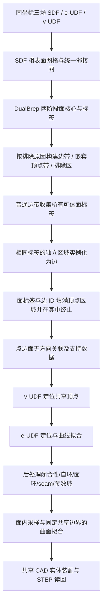

# 隔离带多标签三场 B-rep 重建：方案与代码实施

更新日期：2026-10-15。当前实现为 `band_brep_reconstruction` v0.3.0。本文合并原隔离带方案与旧实施设计中仍适用的 provider、固定端点/边界约束、CAD 装配、缓存和验收内容；数据审查记录移入预处理文档 §14。

主流程使用 DualBrep 两阶段面核心提取，在同一三角形中心图上收集全部标签，顶点域吸收但不向普通边带回传。旧版多源竞争、代价下包络、前置 port 验证及递归近带细分不属于当前流程；对应历史设计原文已归档。本文独立包含场定义、目标过滤、关联与几何契约。

当前默认参数的 30 模型结果为 1/30，完整证据见 [实验汇总](ThreeFieldReconstructionExperiments.md)。数学约束、扩展建议与当前已实现的范围在 §16–17 区分说明。

## 0. 请优先核对的方案定义

1. 保留 SDF 作为几何条件，同时输入到有效 B-rep 边、顶点的欧氏距离 e-UDF、v-UDF。三场共用坐标和尺度。
2. 从 SDF 得到粗表面网格，不要求粗网格已经精确经过真实棱边；隔离带负责实例和关联，UDF 负责后续精确定位。
3. 先执行两阶段面核心提取，再由距离阈值排除原因构建边带，最后在边带内建立嵌套顶点带；大小/均值过滤区独立记录，见 §3–4。
4. 面核心复制 DualBrep 的两阶段阈值、共享边邻接、连通分量及过滤逻辑；不额外加入面粘连修复或以真值面数为目标的调参。
5. 普通边带上的点可以收集任意数量的面标签，没有唯一获胜标签，也不在传播时截断为两个标签。
6. 标签进入顶点带后，要覆盖该顶点候选区域内的全部采样点，然后在这个区域内终止。后续新到达的标签仍需覆盖整个区域，不能在首次到达后冻结。
7. 顶点带不能把已收到的标签继续转发到其他普通边带。否则不同边会通过顶点区域交换标签。
8. 普通边带根据标签集合及独立连接区域实例化；顶点区域同时收集面标签与边实例 ID，得到点—边、点—面关联。边—面关系来自普通边带标签。
9. 先完成无方向、无使用次数的实例关联；seam、闭合曲线的参数开口、自环端点使用、wire/loop、顺序、方向及 pcurve 留给后处理。
10. 先用 v-UDF 定位共享顶点，再用 e-UDF 定位和拟合曲线；面从所属区域采样并参数化，受已拟合共享边界约束。所有结果最终经 CAD 装配和 STEP 读回检查。

**本版“在顶点带停止”的唯一含义是：进入、填满、继续收齐新标签，但不穿出。不是只标记顶点带边界，也不是碰到一个顶点带就停止其他分支的传播。**

## 1. 输入场、数据目标与预处理

### 1.1 三场定义与通道

设实体表面为 S，有效非 seam 面间边的几何并集为 E，保留的必要顶点集合为 V：

$$
s(x)=\operatorname{SDF}_S(x),\qquad
 d_E(x)=\inf_{y\in E}\|x-y\|,\qquad
 d_V(x)=\min_{v\in V}\|x-v\|.
$$

输入通道固定为：

$$
F(x)=[s(x),d_E(x),d_V(x)].
$$

SDF 内负外正；两个 UDF 非负。SDF 提供表面外壳和面内部几何，e-UDF 定位面间边，v-UDF 定位必要顶点。后两者本身不描述完整面内部形状。

三个通道使用同一归一化坐标及距离尺度。若存储时按不同截断上限归一化，查询后先还原 metric 距离再应用阈值、梯度和拟合。

优先使用连续查询接口 `evaluate(xyz) -> [sdf, e_udf, v_udf]`，允许对坐标求梯度或有限差分。只有离散数据时允许插值，但记录插值方式与误差；不能把离散插值等同于真实连续场。

### 1.2 监督数据与重建输入分离

ABC STEP 数据预处理按以下顺序执行：

1. 读取 CAD，做一次统一平移、等比例缩放，保存变换。
2. 遍历 face、edge、vertex 及边在面上的使用关系，建立有效 E、V。
3. 在同一查询位置 `query_points[N,3]` 上计算三场，保存 `query_fields[N,3]`，通道顺序如上。
4. 采样覆盖空间内部/外部、表面附近、边附近和顶点附近；短边也保留最低采样覆盖。
5. 保存截断值、有效标记、`edge_present`、`vertex_present`、归一化变换和预处理版本。
6. 原 CAD 实例 ID、最近实体 ID、真实关联仅保存为离线评估数据，不输入重建流程。

三场满足理想集合关系 `V ⊆ E ⊆ S` 时有 `|s| ≤ dE ≤ dV`；近似 SDF、预测误差和通道截断会影响数值比较。它是诊断关系，不是有效 B-rep 的充分证明。

### 1.3 边和顶点的过滤规则

| 对象 | 生成目标处理 |
|---|---|
| 同一面上的参数 seam | 排除出 E，交给参数化后处理建立 |
| 两个不同面共享的普通非退化边 | 保留，包含相切、共面边 |
| 两个不同面之间的完整闭合曲线 | 保留为真实面间边；闭合不等于 seam |
| 短边 | 不因长度短而删除 |
| 只服务于已删除 seam 的顶点 | 从 V 排除 |
| 仅用于光滑闭环参数开口的人工锚点 | 不作为生成顶点，由后处理建立 |
| 真实交汇点、真实转折或必要分段点 | 保留 |
| 二度顶点 | 不按度数统一删除；只有可确认的人工分段才合并 |
| seam 与真实边共享的顶点 | 根据去 seam 后的真实作用判断，不因接触 seam 就删除 |
| 退化边、开放壳、非流形或重合多重实体 | 不属于首版普通闭合实体范围，预处理单独记录或拒绝 |

seam 根据 CAD 使用关系/参数接缝属性判断，不能用三维曲线首尾是否闭合代替。删除 seam 时不能在保留曲线上挖掉交点。

先过滤边，再构造顶点目标及关联。任何人工分段合并都需同步更新目标 edge、vertex 和离线真值映射，不能只删除 v-UDF 的点而保留不相容的目标边身份。

允许 `E` 非空而 `V` 为空，例如不含必要生成顶点的完整面间圆环。空集合采用截断上限及显式存在标记，不能用全零距离表示“无顶点”。

### 1.4 可复用的预处理代码

优先复用现有 `edge_vertex_preprocessing/evudf/` 的 STEP 读取、归一化、目标遍历、表面/边采样、距离查询、字段存储与校验。

DualBrep 的 `Voronoi/calculate_voronoi/calculate_voronoi.cpp` 可作为 seam/同面边过滤与关联收集的参考。但其 GVD 距离不等于本方案到真实有限边曲线的 dE，不能直接把旧 GVD-UDF 改名为 e-UDF。

最终可迁移模块需要将复用源码和依赖说明放入模块目录，不在运行时导入外部 DualBrep 项目目录。本计划不因文档更新而宣称现有数据过滤策略已全部改动。

## 2. 全流程与阶段边界



图中 E/F/G 分开执行，是完整多标签传播的等价实现：先在普通边带完成面标签收集并得到稳定 edge_id，再将标签及 edge_id 注入顶点带。它不把顶点带当成禁止进入区。

本计划区分三个输出层次：

- **关联层：**face、edge、vertex 候选实例，及 E–F、V–E、V–F 无方向集合；当前多标签步骤负责这一层。
- **几何层：**共享顶点位置、完整边曲线、面内部点与参数曲面。
- **CAD 层：**方向、端点使用次数、闭合/自环、wire/loop、seam、pcurve、shell/solid。

“关联层完成”不要求 CAD 层已经完成。一个实例关联到多少不同顶点，与它的端点使用次数是不同信息，后者延后处理。

## 3. 粗表面、采样图与隔离带

### 3.1 统一离散表示

由固定 SDF 提取粗表面三角网格 `mesh_vertices / mesh_triangles`，保留三角形共享边邻接。

**本文首版的具体实现选择：以三角形为图节点，在三角形中心查询三场。** 文中的“采样点”在这一版对应这些中心；三角形及其原网格顶点仍保存为几何支持。这与本地 DualBrep 的面核心输入方式一致。

边带、顶点带、面核心、源接触与传播都在同一张图上定义。后续补采样可查询网格顶点、边中点及三角形内部，但不能只改核心掩码后又切换到不相容的顶点所有者图。

如果以后改用网格顶点图，需同步改动全部掩码、接触和传播定义；不能将三角形核心硬转换成要求单一 `core_owner` 的顶点源。

图连接依据表面共享网格边，不用无约束空间 kNN 代替，以免把空间接近但表面不相邻的区域连接起来。

### 3.2 根据最终核心建立互斥掩码

先在固定三角形图上执行 §4 的两阶段分割。设最终标签为 `face_id`，每个节点另有排除原因：

| 原因码 | 含义 | 用途 |
|---:|---|---|
| 0 | 最终保留核心 | 面标签来源 |
| 1 | 第一阶段低于距离阈值 | 边带候选 |
| 2 | 成功拆分父域时低于第二阶段阈值 | 边带候选 |
| 3 | 第一阶段分量太小 | 独立排除区 |
| 4 | 第一阶段平均 UDF 不合格 | 独立排除区 |
| 5 | 第二阶段子分量太小 | 独立排除区 |

定义：

$$
\Omega_F=\{x:\mathrm{face\_id}(x)\ge0\},\quad
B_E=\{x:\mathrm{reason}(x)\in\{1,2\}\},\quad
B_V=B_E\cap\{x:d_V(x)<\tau_V\},\quad
R_E=B_E\setminus B_V.
$$

剩余 `U = G - (Omega_F ∪ B_E)` 为独立排除区，不参与传播、不自动实例化为边。核心、普通边带、顶点带和排除区共同构成互斥分区。**当前核心不等于边带补集**，边带也不再由统一 `dE<0.025` 定义。

始终有 `B_V⊆B_E`，不要求顶点阈值小于面分割阈值。`vertex_present=false` 时顶点带为空；`edge_present=false` 时无边带，核心按表面连通性及相同分量过滤规则产生。存在性未知或相互矛盾时报告输入问题，不能凭一次阈值漏检宣告为空。

### 3.3 阈值与粗几何的职责

阈值选择候选区域，不决定最终点/边坐标。允许粗网格削平棱、带中心偏移和一定的场误差，后续用连续 UDF 定位。

首版先在固定网格上运行，不把近带所有边强制细分到统一极小长度。保存采样间距、阈值、带内样本数量及覆盖情况，以便后续比较局部补采样。

若带为空、分支断裂、顶点区合并或存在混合标签，保留诊断。鲁棒带构造和几何局部修正属于后续增强，不在本版强制加入全局精确重网格化。

## 4. 面核心：DualBrep 两阶段提取

### 4.1 实际默认值与第一阶段

`face_threshold1=0.005`，`face_threshold2=0.01`，`face_filter_size=10`，`face_avg_udf_threshold=0.003`。单位为归一化长度；使用原脚本的实际调用值，不能混用原函数签名里不同的默认值。

在 `dE>=0.005` 的共享边诱导图上计算连通分量；删除小于 10 个三角形、或平均 UDF 不大于 0.003 的分量，并记录原因。构图仍须包含没有 active 邻边的单个节点，随后再按大小规则过滤；不能在构图时直接漏掉孤点。

### 4.2 第二阶段与回退

在每个合格父核心内，仅保留 `dE>=0.01` 再计算连通分量。只有至少两个子分量满足最小大小时，才用它们替换父核心；否则完整保留原父核心。最后重编号连续 face_id。27/30 个实际模型触发了成功父域拆分，但不保证分割正确。

第一阶段保留点本来就满足 dE>=0.005，因此默认均值大于0.003不产生额外过滤；该检查保留原函数语义，在调整参数时仍可能生效。

### 4.3 与复制源码及剩余限制的关系

实现复制到 `bandbrep/vendor/dualbrep_segmentation.py`，仅增加排除原因和诊断输出；标签决策与原 `clustering.py::hierarchical_segmentation` 一致，已比较100组随机图。运行时不依赖上级仓库。

不额外启用平面合并、标签回填、多阈值核心合并、自动面粘连修复或真值面数调参。一个真面碎成多核心、多个面合并、面没有核心等情况仍须单独评估。当前到真实边的距离与原GVD-UDF定义不同，复制数值不是精度保证。

`tau_edge=0.025` 继续供现有几何定位半径和覆盖探针检查使用；它不定义当前面核心和传播带。若默认窄带没有被粗网格采到，后续完整标签传播无法补造边带。

## 5. 多标签传播的精确定义

### 5.1 标签数据

每个普通边带节点保存集合：

$$
L_F(x)\subseteq\{\text{face_id}\}.
$$

集合大小不设为 1 或 2，不计算 winner，不以“已有标签”为由阻止另一个标签进入。

顶点带节点保存两个集合：

$$
L_F^V(x)\subseteq\{\text{face_id}\},\qquad
L_E^V(x)\subseteq\{\text{edge_id}\}.
$$

后者是恢复点—边关联所需的实例身份。仅比较面对集合无法区分具有相同邻面的不同边。

### 5.2 允许和禁止的转移

| 来源 → 目标 | 规则 |
|---|---|
| 面核心 → 相邻普通边带 | 注入该面标签 |
| 面核心 → 直接相邻顶点带 | 注入该面标签，不产生虚构 edge_id |
| 普通边带 → 普通边带 | 沿图邻接传播全部新增面标签 |
| 普通边带 → 顶点带 | 注入面标签；边实例化后同时注入该 edge_id |
| 顶点带 → 同一连通顶点区域内的节点 | 继续传播新增面标签及 edge_id，直到整片区域覆盖 |
| 顶点带 → 普通边带 | 禁止 |
| 顶点带 → 面核心 | 禁止 |
| 普通边带 → 面核心 | 不回写或借道核心；核心仅作为来源 |
| 一个顶点区域 → 另一个不相连顶点区域 | 不通过普通边带转发 |

面核心直接接触顶点带时，本文采用直接注入面标签的规则；它补充 V–F 关系，不替代实际边带提供的 V–E 关系。

进入 V 后的停止是**域内吸收**：这个来源在此顶点区域内传播结束后不能穿出，但其他普通边分支上的传播仍正常进行。

### 5.3 增量更新与结束条件

若逐点实现，队列状态需要包含节点与标签类型/ID。只有 `(node, label)` 已经传播过时才能跳过该消息，不能只用一个 `visited[node]`。

例如一个顶点区域先收到 A，全部点获得 A；之后收到 B，仍须让全部点获得 B。算法结束时，区域内各点都具有 `{A,B}`。不能在首次 A 填满时永久关闭该区域。

结束条件为所有允许转移上的标签集合不再增长。遍历先后顺序不应改变最终集合。

### 5.4 连通分量等价加速

对于普通带的任一连通分量 C：

$$
L_F(C)=\{f:\text{面核心 }f\text{ 与 }C\text{ 有图邻接接触}\}.
$$

全部节点最终得到这个集合。因此可一次求 C 的连通分量和接触集合，直接完成普通带传播，而不是逐面做最短路。

顶点区域同理：先求 `B_V` 连通分量 Q，收集所有进入 Q 的面标签和边 ID，然后广播至 Q 的全部节点。由于禁止 `Q -> R_E`，这个广播不会污染其他边带。

可让每个点引用组件的不可变标签集合，避免重复复制大集合。计算量与图遍历、组件接触和实际标签集合规模相关，无需构建全体 face × 全体网格节点的稠密代价矩阵。

## 6. 普通边带实例化

### 6.1 实例规则

在完成普通带面标签收集后，将 `R_E` 内**标签集合相同且相连**的节点归为一个候选边实例，分配独立 `edge_id`。

完整传播后，一个 `R_E` 连通分量本来就具有相同集合，故首版可直接给每个普通带分量一个 edge_id。

需要满足的编号规则：

- 不用 `face_pair` 作为 edge 的唯一键。
- 相同面对但不相连的带得到不同 edge_id。
- 只在 `R_E` 上实例化，不把顶点区域并入边分量；顶点内部标签的并集不能反过来合并各条入射边。
- 每个实例保存支持三角形/采样点与原场值，后续从这些支持区域提取曲线。

普通流形边通常对应两个不同邻面，这是待验证的关联条件；传播数据结构本身不限制标签数量。0、1 或超过 2 个标签的组件记录 `unresolved` 及完整集合，其他组件继续处理，不强制取最近两个标签。

首版暂不修复由面分割错误造成的混合标签；不能把诊断成“超过两个候选标签”误写成传播代码不支持多标签。

### 6.2 闭合与复杂情况的阶段处理

本阶段不要求边具有两个不同端点，也不计算闭合标记、端点顺序、自环次数或 wire 顺序。一个完整环状支持区域可以直接获得 edge_id，即使没有任何生成顶点。

例如球体通孔的上下两个圆环均接触面 A/B：保存两个独立支持区域及两个 edge_id，两者的邻面集合都为 `{A,B}`。参数闭合、开口锚点及后续 seam 的安排留给后处理。

若几条真实边已经在 `R_E` 中误粘，仅标签并集不保证能拆开。首版保留该支持区域和混合状态；分支修复是独立扩展，不利用竞争界线偷偷替换主方案。

## 7. 顶点带完整传播与点边面关联

### 7.1 顶点候选区域

在 `B_V` 的诱导图上求连通分量 `Q_j`，首版每个分量分配一个 `vertex_candidate_id`。这是定位之前的候选区域，不要求其代表点已等于真实 CAD 顶点。

初版按“一片连通顶点区域对应一个必要顶点候选”处理。若后续 v-UDF 定位显示多个中心，保留数据并报告需拆分，不在标签阶段加入近邻顶点拆分或复杂端口算法。

### 7.2 汇总进入区域的标签

设 `TouchE(Q_j)` 为与 Q_j 直接图邻接的普通边实例集合，`TouchF(Q_j)` 为与 Q_j 直接接触的核心面集合：

$$
\operatorname{Edges}(Q_j)=\operatorname{TouchE}(Q_j),
$$

$$
\operatorname{Faces}(Q_j)=\operatorname{TouchF}(Q_j)
\cup\bigcup_{e\in\operatorname{TouchE}(Q_j)}L_F(e).
$$

随后将两个集合广播至 Q_j 的全部节点：

$$
\forall x\in Q_j:\quad L_E^V(x)=\operatorname{Edges}(Q_j),\qquad
L_F^V(x)=\operatorname{Faces}(Q_j).
$$

这正是“整个顶点隔离带采样点传播完后再停止”。一个顶点域中收到的 edge_id 不会被发送到另一条普通边带。

**V–E 关联来自实际接触的 edge_id，不由 `edge.faces ⊆ vertex.faces` 反推。** 不同边或不同顶点可能具有相同面标签集合；集合包含关系不能代替接触来源。

### 7.3 当前阶段输出的关系

生成以下无方向集合：

- `edge_faces[e] = L_F(e)`；
- `vertex_edges[v] = Edges(Q_v)`；
- `vertex_faces[v] = Faces(Q_v)`；
- `edge_vertices[e]` 为 `vertex_edges` 的反向关系；
- `face_edges[f]`、`face_vertices[f]` 为对应反向关系。

集合在本阶段不包含端点使用次数。某条边与一个顶点区域多次接触，先保存一次无方向关联；原网格和原始接触邻接仍保留，后处理可据此及拟合曲线恢复重复使用信息。

这里不建立 port 编号、局部扇区顺序、顶点固定价数、自环判定或面环遍历，也不以缺少这些信息阻断关联输出。

### 7.4 三边交汇示例

假设三个普通边带分别已收到：

```
e0 -> {A, B}
e1 -> {B, C}
e2 -> {C, A}
```

三条边都接触同一个顶点区域 Q。传播完成后：

```
Q 内每个采样点：face_labels = {A, B, C}
Q 内每个采样点：edge_labels = {e0, e1, e2}

e0 普通带仍为 {A, B}
e1 普通带仍为 {B, C}
e2 普通带仍为 {C, A}
```

Q 已经收齐标签，但不能把 C 传回 e0，不能把 A 传回 e1，也不能把 B 传回 e2。顶点集是终端收集结果，不是连接所有普通带的转发枢纽。

## 8. 等价实现伪代码

下面给出可优先实现的组件版本。`connected_components` 返回各分量的节点集合；`adjacent` 返回组件外的相邻节点，始终使用同一张三角形共享边图；集合广播指所有成员点均可读取该集合。

```python
# 输入：图 G；节点上的 metric sdf, e_udf, v_udf；存在性标记
# A. 两阶段核心，同时输出低距离与分量过滤的不同原因
face_id, reason = two_pass_face_cores(G, e_udf, 0.005, 0.01, 10, 0.003)
face_core = face_id >= 0
edge_band = edge_present & isin(reason, [1, 2])
vertex_band = edge_band & vertex_present & (v_udf < tau_vertex)
regular_band = edge_band & ~vertex_band
excluded = ~(face_core | edge_band)  # 不参加下面的标签传播

# B. 在普通边带收集全部面标签，相当于完整传播
regular_components = connected_components(G.induced(regular_band))
edges = {}
edge_id = full_node_array(default=-1)
for C in regular_components:
    labels = set(face_id[u] for u in adjacent(C) if face_core[u])
    e = new_edge_id()
    edges[e] = Edge(e, support=C, face_labels=labels)
    broadcast_face_labels(C, labels)
    assign(edge_id, C, e)

# C. 顶点带内部完整传播，但没有向普通带发出的消息
vertex_components = connected_components(G.induced(vertex_band))
vertices = []
for Q in vertex_components:
    incoming_edges = set(edge_id[u] for u in adjacent(Q)
                         if regular_band[u])
    incoming_faces = set(face_id[u] for u in adjacent(Q)
                         if face_core[u])
    for e in incoming_edges:
        incoming_faces.update(edges[e].face_labels)

    v = new_vertex_candidate_id()
    broadcast_face_labels(Q, incoming_faces)  # Q 的全部节点
    broadcast_edge_labels(Q, incoming_edges) # Q 的全部节点
    vertices.append(VertexCandidate(v, support=Q,
                                    face_labels=incoming_faces,
                                    edge_labels=incoming_edges))
    # 不存在 Q -> regular_band 的转发

# D. 输出无方向关联；反向关系通过 ID 显式建立
incidence = build_unordered_incidence(edges, vertices)
save_mesh_masks_supports_labels_and_contacts()

# E. 独立阶段：UDF 定位/曲线拟合/面参数化与 CAD 后处理
```

该伪代码不对顶点域外的普通边带强加单来源约束。因 R 和 Q 均为固定域内连通分量，直接汇总与逐标签增量洪泛的最终集合一致；其前提是逐点版本也遵守 §5 的有向转移规则。

## 9. 中间结果与数据结构

| 文件/对象 | 当前保存内容 |
|---|---|
| `sdf_surface.npz` / `SurfaceMesh` | 固定有向SDF网格顶点、三角形；邻接由共享边构建 |
| `bands.npz` / `BandState` | 中心坐标、三场值、E/V/普通带/核心掩码、face_labels、exclusion_reasons |
| `face_seeds.npz` | 最终面核心标签 |
| `topology_labels.npz` / `BandTopology` | 节点到面/边/顶点实例映射、跨域contacts |
| `incidence.json` | 候选域成员、完整面标签、E–F/V–E/V–F及反向关系、未决诊断 |
| `vertices.json` / `VertexNode` | v-UDF定位位置、残差、支持半径 |
| `logical_graph.json` / `EdgeInstance` | 几何阶段曲线支持和共享端点使用 |
| `curves.json` / `CurveRecord` | 唯一共享三维曲线参数 |
| `cad_graph.json` | 后处理补齐的方向与面环 |
| `face_patches.json` / `FacePatch` | 参数曲面和约束误差 |
| `logical_to_cad.json` | seam、辅助锚点及逻辑到CAD映射 |
| `reconstruction.step` | 完整CAD及读回验收通过后的输出 |
| `run.json` / `quality.json` | 配置、阶段、错误、耗时和artifact哈希 |

每条edge具有独立ID，不能以面对或端点对为唯一键。支持点、邻接和场值与标签集合一起保留，不能仅输出无序标签并集。后处理辅助元素单独标记来源。旧arrival/interface缓存不属于当前输出。

## 10. 使用 v-UDF 定位顶点

### 10.1 候选区域与权重

每个 Q_j 的样本只用于定位该候选顶点。小 v-UDF 可赋较大权重，例如：

$$
w_i=\frac{1}{(d_V(x_i)+\epsilon)^p},\qquad p>0,
$$

实际使用时限制最大权重，结合置信度与空间覆盖，避免单个异常小值主导。

加权质心可以作为初值，但不能当成最终距离中心。表面采样偏在某一侧时，平均坐标可能始终偏离真实顶点。

### 10.2 多点距离中心拟合

从属于同一候选的原始查询位置与距离值拟合：

$$
v_j^*=\arg\min_v\sum_i w_i\rho\!\left(\|x_i-v\|-d_V(x_i)\right)
+\lambda_S s(v)^2.
$$

这里 rho 为鲁棒损失，SDF 是几何参考项，不把粗网格采样位置固定为顶点位置。SDF 存在误差时不强制所有场残差严格为零，分别记录误差。

可以在初值附近追加少量三维查询，改善仅有单侧或近共面表面点造成的定位不稳定。若候选域内含多个真实顶点，不能把混合距离强拟合成一个中心；本版报告歧义并保留支持，复杂拆分后续扩展。

对于可微且最近点唯一的理想距离场，`x - dV(x) * grad(dV(x))` 可产生顶点位置投票。预测场采用有限步、阻尼及位移限制，投影只作初始化。

## 11. 使用 e-UDF 定位并拟合边曲线

### 11.1 保持实例支持

每条边的支持来自普通带实例及其相邻顶点区域。普通带先提供主体曲线；进入共享顶点区时，结合本边的已有方向、相邻几何和 v-UDF 定位结果补齐端部。

不能把顶点区域的全部低 e-UDF 点同时当作每条入射边的点，因为聚合边场在那里包含多条分支。标签填满顶点域用于关联收集，不等于顶点域所有样本都属于每条边的几何。

在最近点唯一、理想距离可微时，可用：

$$
q_i=x_i-d_E(x_i)\nabla d_E(x_i)
$$

获得靠近曲线的初值。预测场使用阻尼、多起点和局部横截面低谷校正；查询可离开原粗网格，不吸附回最近采样点。

根据本实例支持范围组织曲线点列，可用局部 PCA/几何追踪估计方向。这里的点列排序是曲线拟合的参数化需要，不是提前恢复全局面环顺序。

### 11.2 共享顶点与固定端点 Bézier

对端部关联已经在几何阶段确认的普通边，使用全局共享顶点 v_a、v_b：

$$
C(t)=(1-t)^3v_a+3(1-t)^2tP_1+3(1-t)t^2P_2+t^3v_b.
$$

固定两个端点，优化内部控制点。所有相邻边引用同一个顶点变量，从而保证已确认关联下端点相交；不由“先拟合的第一条边”独自决定其他边的交点。

边点误差较大时采用逐段拟合，相邻段共享拼接点。内部拟合接点不是新增 B-rep 顶点。必要时对同一光滑边的内部段施加切向约束，真实角点不强制光滑。

直线、圆弧或有理曲线可以作为低复杂度模型；一般曲线采用 Bézier/B-spline。多项式 Bézier 近似圆弧时按误差控制，不宣称精确表示。

关联阶段不要求每条边有两个不同顶点。无顶点、单个不同顶点或端点使用有歧义的实例先保留曲线支持，由后处理判断闭合/自环并设置参数锚点，再完成约束拟合。

### 11.3 拟合目标

同时使用本实例的点列覆盖、距离模型残差、曲线上 e-UDF/SDF 残差，以及已确认端点约束。e-UDF 小的点可给较大权重，但不能只最小化全局 e-UDF，否则可能吸附到邻近其他边。

如果在几何阶段联合优化顶点和曲线，所有关联边必须同步更新共享顶点变量。曲线冻结后，两侧曲面引用唯一同一条三维曲线。

## 12. 后处理与面的参数化

### 12.1 后处理负责的结构

以下内容在关联层不处理，在拟合/CAD 阶段根据保存的几何支持和关联补齐：

- 曲线闭合性、闭合曲线的参数起点；
- 自环及同一顶点的重复端点使用；
- 边在每个面中的排列、方向、外环和内环；
- 周期面 seam、辅助顶点与 seam 的重复使用；
- 支撑曲面的参数域、二维 pcurve、裁剪关系；
- CAD shell/solid 装配及必要修复。

不要求重建原始 seam 的位置和编号。后处理新建的辅助元素与三场监督的真实面间边/必要顶点区分保存。

后处理可分步骤与曲面初始化交替进行：先用曲线和共享顶点组织可确定的边界，再初始化曲面/UV，随后处理周期接缝、pcurve 与完整裁剪。这里不假定所有 wire 都必须在曲面初始化前一次性完成。

### 12.2 面采样与 DualBrep 式初始化

保留每个 face 的核心区域与邻接边支持。核心采样用于初始面拟合；边带的多标签不是给每个带点选择唯一面。

在拟合边界和参数域逐步确定后，结合原表面邻接及面侧关系，扩展到完整面内部采样区域。不能把收到 `{A,B}` 的整片边带全部视作 A 的内部点，再全部视作 B 的内部点；那会把两侧不同曲面混进同一拟合。

借鉴 DualBrep 的“从面上采样点得到参数曲面初值”，并增加共享边界约束。面内点覆盖面积及曲率变化，SDF 提供表面参考；解析平面/圆柱等可以作为初始化或可选模型。

### 12.3 曲面必须经过完整共享边

仅固定曲面角点不能保证整条边落在曲面上。要求每条关联边 C_e 与该面的 pcurve gamma_fe 满足：

$$
S_f(\gamma_{fe}(t))\approx C_e(t)
$$

并按指定几何容差检查完整边界。

对相容四边 Bézier 曲面，统一边界参数后固定四排边界控制点，优化内部控制点；这样直接保留整条边界。一般多边、带孔或周期面采用支撑曲面加裁剪/pcurve，不能全部强行套四边模板。

一般样条曲面可交替优化面内 UV、pcurve 与控制点，以等式约束或消元固定离散边界对应，再自适应加密边界检查。离散约束满足不代表已证明连续全边界误差界，工程报告需说明验证方式。

相邻面始终引用同一条三维边；不能各自重新拟合边界曲线，再靠较大容差拼接。共享边与曲面不相容时，先调整支撑曲面自由度/参数对应，必要的联合几何协调必须同步所有邻面。

### 12.4 最终装配

构造共享 OCC 顶点和边、面内 pcurve、wire、face、shell/solid；补建 seam 与参数锚点；执行有记录的修复和 STEP 导出/读回。

最终检查曲线覆盖、共享端点、完整边界相容、参数域有效性、实体闭合与读回关联。CAD 修复不能以静默合并真实面间边或任意放大容差掩盖问题。

## 13. 代码复用与当前模块职责

| 模块 | 职责 |
|---|---|
| `field_provider.py`、`neural_fields.py` | metric三场、存在性、误差、梯度及输入模式 |
| `surface_mesh.py` | SDF提面、方向/闭合/预算检查、共享边邻接 |
| `vendor/dualbrep_segmentation.py` | 独立复制的两阶段连通分量过滤 |
| `bands.py`、`face_seeds.py` | 中心查询、一次分割、原因掩码与核心验收 |
| `topology.py` | 普通域收集全部面标签；顶点域完整吸收面和edge_id，禁止回传 |
| `vertex_localization.py` | 独立距离观测定位共享顶点 |
| `edge_geometry.py`、`curve_fitting.py` | e-UDF定位、实例内排序、固定端点曲线 |
| `postprocess.py`、`boundary_cycles.py` | 曲线拟合后确定方向与面环 |
| `surface_fitting.py` | 面核心采样、解析/样条/可选网络初始化、固定完整共享边约束 |
| `occ_assembly.py` | 共享实体、pcurve、seam、shell/solid、STEP读回 |
| `cache.py`、`reconstruct.py` | 不可变缓存、分阶段执行和失败输出 |

旧 `propagation.py`、`interfaces.py`、`edge_graph.py` 已删除。竞争界线的历史报错属于旧实验，不是本版关联层验收条件。复用的源码必须复制进独立目录并记录来源；不能直接调用旧后处理总入口重新预测或移动已冻结的边。

## 14. 实施步骤与验收

### 14.1 当前阶段划分与后续扩展

1. 在统一三角形图上执行两阶段面核心及互斥掩码。
2. 实现普通带多标签收集、独立 edge_id 与完整支持保存。
3. 实现顶点区域内全部节点的面/边标签收集，显式禁止向普通带回传。
4. 输出 E–F、V–E、V–F 及可视化，先检查是否符合本计划。
5. 接入 v-UDF 定位、e-UDF 曲线拟合及共享顶点。
6. 接入后处理、面采样参数化、边界约束与 STEP 验收。

当前不加入基于真实面数的参数搜索、额外面粘连自动修复、多阈值核心合并或强制全局加密。每项后续增强应与本基线单独比较。

### 14.2 传播语义的必要小测试

| 输入情形 | 预期结果 |
|---|---|
| A/B 两面接触一条普通带 | 整条带所有点得到 `{A,B}` |
| A 先到顶点域，B 后到 | 顶点域全部点最终得到 `{A,B}`，后到标签没有丢失 |
| AB、BC、CA 三条带接触同一顶点域 | 顶点域收齐三面和三条 edge_id；普通带各自标签保持不变 |
| 一个面核心直接接触顶点域 | 顶点域得到该面标签，不凭空产生 edge_id |
| 两条不相连的 AB 带 | 两个独立 edge_id，即使标签相同 |
| 没有生成顶点的环状带 | 正常保存边实例，不要求创建人工 v-UDF 顶点 |
| 一条边多次接触同一顶点域 | 当前输出无方向关联并保存原始接触；重复使用交给后处理 |
| 改变队列/组件遍历顺序 | 允许实例 ID 重新编号；按支持成员对应后，标签来源与关联结构不变 |

### 14.3 分阶段报告

分别报告：面核心数量、E/V/普通带覆盖、独立组件数、每组件标签集合、无源或混合组件、顶点域完整覆盖、E–F/V–E/V–F 关系、查询量、内存与耗时。

顶点域完整覆盖检查应比较每个成员点的标签是否与该域全部入射来源的并集一致，同时检查普通带未因顶点广播得到额外标签。

暂不把面纯度/真实面数不符作为“传播算法错误”，但离线评估应记录。几何阶段再报告顶点/曲线/曲面误差，CAD 阶段再报告 loop/seam/方向及 STEP 有效性；不能用“关联层结束”代替“有效 B-rep”。

## 15. 本版明确留待后续的扩展

- 分割错误导致的面粘连、同面碎核心自动识别与修复。
- 混合普通带的自动分支拆分，以及短边被整个顶点区域吞掉后的恢复。
- 多个真实顶点落入一个 V 分量时的自动拆分。
- 对预测噪声的局部阈值调整、不确定区域补采样和几何修正。
- 不在首版范围内的非流形、退化或重合多重结构。

这些情况保存诊断和原始支持数据，其他独立实例可以继续处理；不为了维持流程而伪造邻面、顶点或曲线。它们不改变本计划已确定的多标签收集语义。


## 16. 当前实现与验证状态（v0.3.0）

关联与几何完整流程已接入独立模块。42项测试通过，包含完整吸收/禁止回传、晚到标签、同面对多边、分割源码一致性、固定端点/完整边界和缓存恢复。

v0.2单阶段解析样例5/5完成STEP；v0.3默认0.005/0.01在初始65分辨率下2/5。完整CAD回归测试使用显式较宽0.025/0.05和最小分量1，不意味着默认配置全部成功。真实30模型最新结果1/30。所有次数和失败条件见[统一实验报告](ThreeFieldReconstructionExperiments.md)。

主要未完成项是局部稳健带构造、碎核心/面粘连修复、混合/重复顶点域消解、逐实例容错诊断及复杂曲面的普适保证。独立覆盖检查仍可能因探针为空拒绝；本次合并文档不修改算法或声称这些问题已经修复。完整配置和使用命令见[模块README](../band_brep_reconstruction/README.md)。


<a id="implementation"></a>
## 17. 代码实施与几何约束细节

本节吸收旧实施设计中仍适用的工程内容。具体入口对应当前代码；一般裁剪面、全局自交认证与连续全边界误差证明仍是设计/验收目标，不把示例片段和目标清单视为全部已实现。

### 17.1 连续查询接口与输入隔离

`FieldProvider.evaluate(xyz)` 返回metric三通道、有效/饱和标记及误差信息；`gradient(xyz,channel)` 返回梯度与有效性；`presence()` 返回present/absent/unknown。输入归一化矩阵只使用一次。训练截断输出要先恢复尺度；截断平台不包含可恢复的远场距离，梯度与距离使用同一尺度。

| 入口 | 用途和边界 |
|---|---|
| `CadOracleProvider` | 用CAD求真实场；主算法只得到场、梯度和存在性，不得到面/边ID或源曲面 |
| `SampledFieldProvider` | 当前为局部仿射插值，唯一坐标留出误差诊断；不等同于连续oracle |
| `NeuralFieldProvider` / `fit_fields` | 拟合或加载MLP，单列场近似误差；唯一坐标划分避免重复点泄漏 |
| `CallableFieldProvider` | 接入生成模型或解析查询函数，调用者声明尺度、存在性和指纹 |

原`topology.json`、surface_face_id、edge_point_id、vertex_points、nearest/closest实体数据只供评分，不能参与核心、实例或曲面初始化。原CAD分面网格也不能直接当成算法已经恢复的分割；正式路径从SDF提面。`unknown`不能因未采到低谷自动变成`absent`。

### 17.2 阶段顺序、状态和缓存

```text
surface → bands → seeds → graph → vertices → curves → postprocess → surfaces → cad
```

`bands`阶段只执行一次两阶段分割，缓存最终标签及排除原因；`seeds`阶段验收并输出核心标签。`graph`输出无方向关联，`vertices`定位共享点，`curves`处理实例几何与覆盖，`postprocess`补方向/面环，再拟合曲面和装配CAD。

`--stop-after`支持seeds/graph/vertices/curves/surfaces/solid。`logical_graph_ready`可包含未决候选，不表示CAD通过；只有`solid_validated`表示完整CAD与STEP读回通过。部分检查可在明确的实验worker中降为告警，必须查看quality_warnings，不把告警策略隐藏在成功率中。

缓存键含provider/输入指纹、配置（停止阶段除外）与源码哈希；resume校验已有artifact哈希。历史实验清理过的缓存不可resume，须使用保留输入新建输出，不能删除哈希记录绕过校验。场、核心身份、曲线或参数对应变化后，后继结果失效。

### 17.3 固定端点曲线的求解细节


当前入口为 `fit_shared_curves(graph, provider, cfg)`；排序结果由graph中的edge.samples提供。下面的最小二乘片段解释约束原理，不是另一个重建总入口。

对有端点的三次 Bézier，只优化内部控制点：

$$
C(t)=(1-t)^3v_0+3(1-t)^2tP_1+3(1-t)t^2P_2+t^3v_1.
$$

给定弧长初始化参数 $t_i$ 后，内部控制点通过最小二乘求解，端点不会因权重而漂移：

```python
def fit_cubic_fixed_ends(points, t, v0, v1, weights):
    b0 = (1.0 - t) ** 3
    b1 = 3.0 * (1.0 - t) ** 2 * t
    b2 = 3.0 * (1.0 - t) * t ** 2
    b3 = t ** 3
    A = np.column_stack((b1, b2))
    rhs = points - b0[:, None] * v0 - b3[:, None] * v1
    w = np.sqrt(weights)[:, None]
    interior, _, rank, _ = np.linalg.lstsq(w * A, w * rhs, rcond=None)
    if rank < 2:
        raise ValueError("insufficient curve samples")
    return np.vstack((v0, interior[0], interior[1], v1))
```

`weights` 非负且须有足够内部参数覆盖。曲线更新后再沿当前曲线求有序、单调的点参数，迭代参数和控制点；不允许最近点对应跳到不相干分支。超过误差时按局部残差／曲率自适应分段，内部段共享拼接点；光滑处施加按段参数长度缩放的 $C^1$ 或 $G^1$ 约束。

多个 Bézier 段组合成一条 piecewise B-spline／NURBS 作为一个逻辑 edge 的几何。内部拟合结点不自动创建 B-rep vertex；三次分段的重复 knot 表示和控制点转换需验证端点、导数及参数范围一致。

#### 闭环、解析类型与全局几何验收

无必要顶点的闭环优先检测圆／椭圆等解析类型，再选择有理曲线或周期 B-spline；不把单条非有理三次 Bézier 当作精确圆。若用分段 Bézier，闭合辅助锚点与首尾控制约束独立管理，不受 $d_V$ 吸引。

直线／圆弧等解析候选必须同时满足分支覆盖、固定端点和场误差要求；拟合不相容时使用更一般曲线，而不是移动共享顶点迁就解析类型。self-loop 复用同一个必要顶点的两次端点使用，并在几何/后处理保留两次端点使用；关联阶段不要求两个port对象。

拟合验收包括：到有序支持点的双向覆盖、$d_E(C(t))$、$|s(C(t))|$、端点一致性、误接近其他分支、自交及无关边相交。只优化 $d_E(C(t))$ 可能让整条曲线塌到另一条正确边上，必须保留实例支持与覆盖约束。

若进行一次全局共享顶点／曲线精化，顶点作为统一变量同时影响全部 incident edge；完成后冻结所有共享曲线及顶点版本。曲面拟合阶段不能独立移动其中任何一条边。


### 17.4 曲面初始化、UV与固定完整边界


#### 从已恢复面区域获得初始化

当前入口为 `initialize_face_surfaces(mesh, face_labels, graph, curves, provider, cfg, face_model=None)`。以下网络片段与通用约束求解描述初始化/设计原理；当前范围以实际解析/样条求解器和误差报告为准。

复用 [`rebuild.py::sample_faces`](../rebuild.py) 的 `[F,N,6]` 点／法向及 `[F,6]` bbox 格式，从重建面区域采样，而不是读取 `surface_face_id` 真值。保留窄面、高曲率和边界内侧覆盖；尖锐边附近使用各自 face 内侧法向。

已有网络仅用于曲面初值。直接调用面分支，避免 `model.inference()` 自动调用边分类／预测分支替换已恢复的拓扑：

```python
# 设计片段：模型加载、device、采样和字段检查由适配器负责。
data = {
    "face_sample_points": face_points,
    "face_input_bbox": face_bbox,
    "face_attn_mask": torch.zeros((num_faces, num_faces), dtype=torch.bool,
                                  device=face_points.device),
}
with torch.no_grad():
    encoded = model.encode(data, True)
    decoded = model.decode_face(encoded, None)
    grids = denormalize_coord0516(decoded["face_norm"], decoded["face_bbox"])[..., :3]
```

`denormalize_coord0516` 和网络约定来自 [`rebuild_model.py`](../rebuild_model.py)。可借鉴 `create_surface()` 将规则点网格拟合为支撑曲面，但这只是初始化，尚不保持共享边界。需另行支持单 face 输入，不能继承 `rebuild.py` 对 `<2 faces` 的跳过逻辑。

没有可用网络时，先对点云拟合可行的平面、圆柱等解析初值；一般自由曲面采用具有 UV 初值的样条支撑面。根据拟合残差、覆盖和拓扑域选择，不读取源 STEP 的支撑面。初始化失败作为独立状态返回。

#### 建立 UV 与曲线参数对应

对内部采样点求 $\xi_k=(u_k,v_k)$；对每条共享边的主参数 $t$，求该 face 上的 pcurve 初值 $\gamma_{fe}(t)$。可以用 `GeomAPI_ProjectPointOnSurf` 枚举投影候选，再结合相邻样本的 UV 连续性、周期展开、所属区域和环顺序选择，不能逐点只取无约束的最近 UV。[OCC 曲面投影接口](https://dev.opencascade.org/doc/refman/html/class_geom_a_p_i___project_point_on_surf.html)。

投影后的三维点不能替换 $C_e(t)$；它只是曲面参数对应初值。二维 pcurve 在不同 face 上各不相同，但三维共享曲线只有一条。

判断面域是兼容四边盘、一般裁剪区域还是周期区域。含孔洞时保存多个 UV 环；周期面保存整数周期偏移和展开区间。若一个 face 的支撑面需要周期结构，在初始化阶段就规划，不能到最后随意调用 `SetUPeriodic()` 试图补救不相容控制网格。

#### 兼容四边面：锁定全部边界控制点

对夹持的张量积 Bézier／B-spline 曲面，统一四条逻辑边界的方向、次数、结点和参数区间，直接固定四周控制点，仅优化内部控制点。若边界含有理圆弧，还需使权重和齐次控制点相容。

例如底边 $C_b(u)=\sum_iB_i^m(u)Q_i$，曲面 $S(u,v)=\sum_{i,j}B_i^m(u)B_j^n(v)P_{ij}$，令 $P_{i0}=Q_i$ 可恒等保持整条底边。只固定四个角点不能保证其他边界位置。

升阶和插结点可统一相对边基函数而不改变曲线；逻辑侧边包含多个 edge 时保留各自参数区间和必要顶点。四边构造只用于满足相容条件的面，不将任意多边、带孔或周期面强行填成一个四边面。

#### 一般裁剪面：曲面控制点与 pcurve 的交替约束求解

固定共享曲线 $C_e$，未知量为曲面控制点 $P$、内部 UV 和 pcurve。给定 UV、结点及固定 NURBS 权重时，样条对控制点是线性的。令 $A$ 为内部样本矩阵，$B$ 为边界样本矩阵，$R$ 为平滑项，求解：

$$
\min_P\|AP-X\|_W^2+\lambda\|RP\|^2,
\qquad BP=C.
$$

以等式消元／零空间法或 KKT 求解，不能只把边界权重设得很大：

$$
\begin{bmatrix}A^TWA+\lambda R^TR&B^T\\B&0\end{bmatrix}
\begin{bmatrix}P\\\mu\end{bmatrix}
=\begin{bmatrix}A^TWX\\C\end{bmatrix}.
$$

使用秩揭示分解检查 $B$ 的冗余、冲突和病态；KKT 需合适的稀疏不定系统求解器，不手写矩阵求逆。固定权重时的线性求解之后，再以受限步长更新内部 UV 和 pcurve，检查环顺序、孔洞和周期跨越；每次 UV 更新后重新满足边界约束。

SDF、可靠法向及双向覆盖可作为内部拟合的非线性残差，用受约束 Gauss–Newton／SQP 或交替线性化优化。残差只在**有效裁剪域内**评估，不强迫孔洞和外环外的支撑面延伸部分也落在 SDF 零面上。

必须检查整个曲线的边—面残差：

$$
r_{fe}(t)=S_f(\gamma_{fe}(t))-C_e(t).
$$

初始边界采样通过不代表全曲线通过。在各 knot 区间、中点和高残差区追加检查与约束点；增加控制自由度或调整 UV 后重解。只有具有有效导数／区间界时才能给连续域保证；否则报告自适应采样的最大误差及覆盖尺度。

固定边界与某个指定解析曲面／低阶样条可能不相容。优先增加同一支撑面的表示能力；仍失败则报告 `surface_boundary_incompatible`。不静默放开共享边、不独立移动相邻面的边，也不把拆成多个 CAD face 当作无影响的修复。

#### 冻结边图与面验收

03 的 SDF 本身有表面近似误差，因此面内部按相应预算拟合，不要求支撑面同时严格通过固定 CAD 精度边界、并在每个内部点精确满足有误差的 SDF。边—面误差、SDF 误差和面覆盖误差分别报告。

面验收至少检查：边界最大残差、端点、双向覆盖、面内法向、UV 环方向、局部雅可比、整体折叠和自交。局部雅可比非零不保证全局无自交；约束求解器收敛也不保证 B-rep 有效。


### 17.5 共享CAD实体、seam和STEP


#### 创建一次，全局复用

当前入口为 `assemble_brep(graph, curves, patches, cfg, output_dir)`。

先为全部必要顶点创建唯一 `TopoDS_Vertex`，再为每条共享曲线创建唯一 `TopoDS_Edge`。有端点的边使用同一 vertex 对象及正确的有限参数区间；相邻 face 引用相同 edge 的不同 orientation，而不是分别从点云重新拟合、重新建 edge。[OCC MakeEdge 接口](https://dev.opencascade.org/doc/refman/html/class_b_rep_builder_a_p_i___make_edge.html)。

无生成顶点的完整闭环按最终参数化选择辅助锚点；这些是 CAD 构造需要的点，不加入生成顶点计数。若相邻周期面需要不同的切分位置，统一规划必要的 CAD 子段，保存 `logical_edge_id → cad_edge_ids`，所有关联面同步使用相同切分，不能分别截断。

#### 为每个 face 附着 pcurve、构建有序 wire

建议按以下顺序组织，具体 pythonocc 7.7 重载在实现时以本地绑定为准：

1. 用拟合支撑曲面创建空的 `TopoDS_Face`，避免无意保留自动生成的自然边界。
2. 给每条相关共享 edge 附着该 face 上的 `Geom2d_Curve`，设定与三维曲线一致的主参数范围。
3. 按已恢复的 coedge 顺序、方向和周期展开建立 wire，加入 face；根据有效 UV 域检查内外环和面方向。
4. 完成全部相关 pcurve 后，检查三维／二维参数对应并调用必要的 `SameParameter` 修复，再复核残差及实体容差。

`BRep_Builder.UpdateEdge(edge, pcurve, face, tolerance)` 可附着单条 pcurve；同一 face 上的 seam 需要对应的两条 pcurve 重载。[OCC Builder 接口](https://dev.opencascade.org/doc/refman/html/class_b_rep___builder.html)。2026-10-13审查时已核对本地 pythonocc 7.7 绑定具有这两类重载。

`BRepLib.SameParameter` 用于协调边的三维曲线和二维表示参数，不会使一张不包含该曲线的支撑面自动经过它；也不能只设置 SameParameter 标志就当作校验通过。[OCC 参数协调接口](https://dev.opencascade.org/doc/refman/html/class_b_rep_lib.html)。修复后比较曲线、顶点、pcurve 与容差的变更，不允许超出预算。

#### seam 后处理的具体分工

周期 face 的 UV 域规划先确定周期方向和切缝位置，再生成 seam 曲线及两侧 pcurve。新增 seam 在同一 face 内正反使用两次，可关联已有必要顶点或新增辅助锚点；位置不必与原 STEP 相同。

以 07 为例，逻辑生成图应为 `F=3,E=2,V=0`。圆柱侧面的参数化会引入 seam，并为圆环选择相容起点；最终 CAD 顶点／边数量可以增加。验收时先过滤后处理 seam 和辅助锚点，再比较逻辑图；直接比较完整 STEP 的原始 V/E 数量会错误判失败。

可以借鉴 `FixMissingSeam()` 的使用，但只能在支撑面、周期域、边界和 pcurve 已相容时尝试受控修复。修复记录每个新增／替换实体及逻辑来源，不能借此删除原有面间边或任意放大容差。

#### shell、solid 与读回检查

根据共享 edge 使用和 face 朝向装配 shell，再区分外壳与内腔壳构造 solid。共享边已一致时优先直接装配；sewing 只作受控修复，前后比较逻辑关联、共享边几何及容差。

至少检查：普通面间 edge 两次反向使用、seam 同面双侧使用、每条 wire 闭合、shell 无意外自由边、实体方向和体积、CAD 有效性、再次三角化是否成功。使用 `BRepCheck_Analyzer` 并增加几何误差检查，不能仅以 `IsValid()` 作为场重建准确性指标。

导出 STEP 后重新读取，检查逻辑拓扑映射、几何误差、体积和单位；如需回到原始尺度，对整个实体使用 `normalized_to_world`，同时换算误差预算，不能分别缩放三种场或各面。


### 17.6 配置、误差预算和复验

配置以`bandbrep/config.py::Config`为准，未知键拒绝。surface使用resolution/max_resolution、surface_tolerance及网格预算；核心使用face_threshold1/2、face_filter_size、face_avg_udf_threshold；顶点带使用tau_vertex；定位、曲线、共享边界和内核分别使用localization_tolerance、curve_tolerance、boundary_tolerance、cad_tolerance。候选阈值与最终几何精度分开。

当前没有旧max_refinements/max_band_edge/stability_factors配置。tau_edge仍服务既有几何半径与覆盖检查，不定义传播掩码。save_queries记录查询，未查询通道可能为NaN，不可作为完整三通道训练标签。

验证须分层报告：场近似与饱和、SDF网格/带覆盖、核心拆分/混合/缺失、实例及E–F/V–E关联、曲线双向覆盖/端点、全边界面残差、UV局部有效性、CAD与读回。局部雅可比有效和OCC IsValid不构成全局自交或连续拓扑正确证明。生成场、离散拟合场和CAD oracle分别评价。
