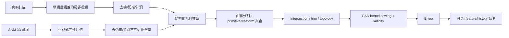
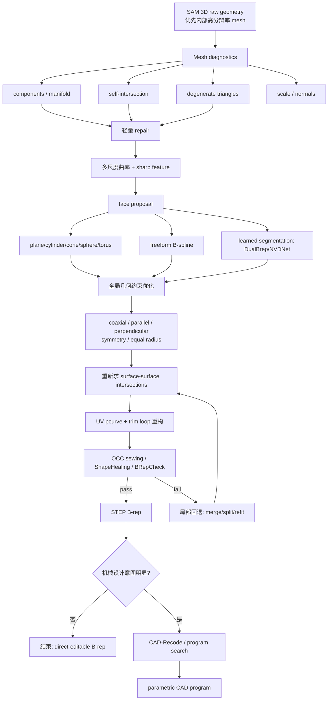

# 从真实扫描点云与生成式 Mesh 重建 B-rep：难点、方法版图与面向 SAM 3D 的工程路线

## 执行摘要

**核心结论。**“从精确点云/干净 CAD tessellation 重建 B-rep 已经比较成熟”这句话只在**输入接近 CAD 几何、采样充分、拓扑干净、曲面分区基本正确**时成立；一旦输入换成真实扫描，或 SAM 3D 这类视觉生成模型产生的 mesh，问题就从“曲面拟合”升级成了一个同时包含**逆问题、结构推断、拓扑修复、设计意图恢复和 CAD kernel 可构造性**的问题。Point2CAD 明确指出，现有方法虽然在点云分割上已有明显进展，但完整 CAD 拓扑仍是主要瓶颈；其主要定量实验也仍是在 ABC CAD 数据集上，而非原生工业扫描。

**对真实扫描而言，最难的不是把点拟合到面，而是判断“这里本来应该是什么面、哪些面本应相交、哪些边是设计边而不是测量噪声，以及缺失区域应该如何补全”。** 扫描得到的点云本质上只是测量样本，并不包含 CAD feature、face identity、trim loop、建模历史或尺寸约束；工业扫描流程通常还需要去噪、配准、mesh 化、曲面/特征识别等步骤才能进入 CAD 重建。Hexagon 对扫描逆向工程的官方说明也强调，scanner 输出的是点云而非 CAD，点云转 polygon mesh 也只是走向 CAD 的第一步。

**对 SAM 3D 一类生成式 mesh 而言，困难性质又不同。** 截至 2026 年 11 月，Meta 官方的 **SAM 3D Objects** 是单图、mask 条件的视觉 3D 重建模型，预测完整 3D 几何、纹理和物体布局；官方代码内部可同时 decode `mesh` 与 Gaussian 表示，并提供 GLB 导出，示例则直接把 Gaussian splat 保存为 PLY。它不是“从精密测量得到的 mesh”，而是一个在单图歧义下生成完整形状的视觉模型；Meta 自身列出的局限包括中等输出分辨率，以及复杂物体细节可能失真。因此，SAM 3D 输出到 B-rep 的关键不是“消除随机测量噪声”，而是**辨别哪些几何是可信观测、哪些是生成模型补全/幻觉，并将一个视觉上合理的连续表面投影到 CAD 中极低熵、强结构化的几何空间**。这是本文的**技术推断**，依据是 SAM 3D 的单视图条件、生成式完整形状目标和视觉质量评价方式。

当前最值得关注的研究路线不是纯端到端，也不是纯传统拟合，而是**“学习结构先验 + 显式几何优化 + CAD kernel 验证”三层闭环**。Point2CAD、NVDNet、Mesh2Brep、最新的 DualBrep 都不同程度走向这一方向；尤其 DualBrep 在 2026 年把 B-rep 表示为联合 SDF/UDF 连续场，再通过 neural rebuilder 输出 STEP，官方代码已经提供 mesh/point cloud → watertight parametric B-rep 的推理路径。但其最新公开复现实验中，前 100 个测试形状只有 85 个形成有效 solid，说明“训练集内 CAD 几何的 B-rep 化”也还没有达到可以无条件视为工业级的问题。

**建议面向 SAM 3D 的工程策略**不是直接把三角网格送入 NURBS 自动铺面，而是先把任务拆成两层：第一层求“**几何合理、kernel-valid 的 B-rep**”，第二层再求“**设计意图/参数化 feature 恢复**”。第一阶段优先尝试 DualBrep、NVDNet/Point2CAD 类方法作为 learned proposal，再用 OCC/CGAL 做 mesh cleaning、analytic primitive refit、intersection/trim 重算、sewing 和 validity gate；第二阶段仅对高度机械化、可由 extrusion/revolution/hole/pattern 解释的对象，使用 CAD-Recode 或自定义 program synthesis 恢复 sketch/feature history。把“普通 B-rep”与“可编辑参数化 CAD”分开，是避免项目目标失焦的关键。CAD-Recode 的输出是可执行 CadQuery/Python 建模程序，而 Point2CAD、NVDNet、DualBrep 的主要目标是几何/拓扑 B-rep；两者不是同一个问题。

## 输入域差异与 SAM 3D 的具体核实

用户所说的“扫描点云”和“生成式 mesh”不能作为同一种噪声模型处理。下面给出工程上最重要的区别。

| 属性 | 真实扫描点云 | 生成式 mesh，以 Meta SAM 3D Objects 为代表 |
|---|---|---|
| 原始信息来源 | 物理传感器对真实表面采样；常经过多视角配准 | 单张 RGB 图像 + object mask，经生成/重建模型得到完整 3D |
| 主要误差 | 测量噪声、离群点、遮挡缺失、非均匀密度、配准误差 | 单视图几何歧义、不可见面的生成补全、细节丢失或幻觉 |
| 可见面可信度 | 通常具有物理测量意义，误差可统计建模 | 视觉上合理不等于尺寸或制造几何正确 |
| 缺失区域 | 常显式表现为空洞/无点 | 往往已被模型“补满”，但补全可能错误 |
| 拓扑 | 点云本身无显式拓扑；重建 mesh 后可能有洞/非流形 | 直接有 mesh，但该 topology 是生成/后处理结果而非设计 topology |
| metric accuracy | 取决于扫描仪和标定，可做到计量级 | SAM 3D 官方目标是视觉重建；官方没有将其定位为计量 CAD 重建 |
| CAD 结构信息 | 不存在 | 同样不存在 |
| 适合的第一目标 | faithful reverse engineering | structured projection / semantic regularization |

真实扫描到 CAD 的传统工业流程本身就体现了这个区别：扫描器生成点云后，还需要 point-cloud processing、mesh、surface characterization 和 feature reconstruction；Geomagic Design X 之所以在工业界成立，正是因为它把 mesh/point-cloud preprocessing、几何特征提取、surfacing、accuracy analysis 和 history-based CAD 结合在同一个交互工作流中。

用户没有指定 “SAM3D” 的模型版本，因此从输入要求上应标记为 **“版本未指定”**。本文进一步核实后，若这里所指的是 Meta 于 2025 年发布、2026 年 CVPR 发表的 **SAM 3D / SAM 3D Objects**，官方描述为“single image → full object geometry, texture, layout”。其 inference pipeline 的 decode 接口支持 `"mesh"`、`"gaussian"`、`"gaussian_4"`；post-process 可把 `mesh + gaussian` 转成 GLB，而官方 quick start 还展示了把 `output["gs"]` 导出为 PLY。也就是说，**SAM 3D Objects 并不是只输出 mesh；其公开推理结果可以同时包含内部 mesh、Gaussian representation 和可导出的 GLB**。

需要特别注意代码里的一个工程细节：官方 GLB post-processing 示例中存在 mesh simplification，源码示例参数为 `simplify=0.95`，即对导出显示资产做强烈简化。因此，**若目标是 B-rep 重建，不应优先从默认后处理后的显示用 GLB 开始**；更合理的是取得最早阶段、分辨率最高的 geometry representation，再自行做 topology repair/remesh。这条属于**工程建议**，依据是官方代码明确在 GLB 导出阶段进行了 mesh simplification。

## 真正困难的环节在哪里

**噪声和离群点。文献事实：**传统 primitive fitting 长期依赖 RANSAC/Hough 一类鲁棒估计；SPFN、ParSeNet、HPNet 后来用学习特征改善 primitive segmentation/fitting，但这些方法仍依赖输入点对真实 primitive 的可识别性。SPFN 的 benchmark 是 ANSI 机械 CAD 数据；HPNet 使用 ANSI/ABCParts；ParSeNet 使用从 CAD 派生的参数曲面数据，而不是大规模原生工业 scanner benchmark。 **技术推断：**对扫描数据，噪声主要拉偏 primitive parameters；对生成式 mesh，所谓“噪声”常具有系统性，例如整个圆柱被生成为轻微椭圆、原本共轴的孔发生偏移，这类误差不能用简单 statistical denoise 解决，因为它已经改变了几何语义。

**缺失、孔洞与不可见面。文献事实：**扫描 mesh 的缺口是标准 mesh-repair 问题，CGAL 明确提供 polygon-soup repair、border stitching、degenerate-face removal 和 hole filling；但这些算法解决的是“得到可用 manifold mesh”，并不会恢复 CAD 原本的 plane/cylinder/fillet 等设计结构。对 SAM 3D，情况更隐蔽：模型会从单图恢复完整物体，因此不可见区域往往不是 hole，而是模型猜出的 surface；Meta 同时强调其优势之一就是处理遮挡，而这恰恰意味着输出包含 learned prior。 **技术建议：**因此生成式 mesh 上应引入 per-face/per-region confidence，而不是只检测几何孔洞。

**拓扑错误：非流形、自交和错误邻接。文献事实：**CGAL 将 inconsistent orientation、gaps、non-manifold features 和 self-intersections 都列为常见几何模型缺陷，并提供对应检测/repair，但也指出某些 repair 前提要求输入已经是 manifold surface。 ComplexGen 尝试直接联合预测 B-rep vertices、edges、surfaces 和 incidence，并再做 global optimization；Point2CAD 则反过来认为 topology prediction 是薄弱环节，采用 surface fitting 后显式求交来恢复 edge/corner。 **技术推断：**对于生成式 mesh，最危险的并非 mesh 非流形本身，而是“mesh topology 是合法的，但与应有 B-rep topology 不同”，例如原本应由一个圆柱面组成的区域被连续几何起伏分裂成多个 patch。

**几何精度与设计意图缺失。文献事实：**CAD-Recode 将逆向工程目标改写成 point cloud → executable CadQuery/Python program，恢复 sketch/extrude 建模程序；它在 DeepCAD、Fusion360 和 CC3D 上报告优于已有 CAD-sequence 方法。但 CC3D 的官方说明很关键：它包含 CAD 与“scan”配对，不过这些 scan 是通过 Artec3D 的**虚拟扫描 pipeline**生成的，不等同于现场真实传感器数据。因此，CAD-Recode 给出了设计历史恢复的重要方向，但不应把其 CC3D 结果直接解读成“已解决任意工业扫描”。

**曲面分割与拟合。文献事实：**ParSeNet 支持 plane/sphere/cylinder/cone 以及 B-spline patch；HPNet 强化 primitive segmentation；SED-Net 显式联合 surface 与 edge detection；Point2CAD 则将 segmentation backbone 与 analytic/freeform fitting 解耦。这实际上说明：**在 clean CAD 上，拟合单个面不是最大问题；决定一个 point/triangle 属于哪个 B-rep face 才是更高杠杆的步骤。** Point2CAD 的公开代码甚至直接要求输入 `(x,y,z,surface_id)`，其仓库自身也说明代码核心是 segmentation 之后的部分。

**交线与 trim。文献事实：**一个 CAD face 并非只有 underlying surface，还必须有 trimming loops；Point2CAD 通过延拓拟合 surface 后求 pairwise intersection，再用拓扑关系完成裁剪。 Mesh2Brep 进一步指出，平滑 blend 区域的 primitive 区分及 primitive 之间的正确 intersection 关系仍需大量人工修正，因此引入 intersection-aware tangency/collinearity constraints。 **技术推断：**在真实/生成 mesh 到 B-rep 的整个 pipeline 中，trim 往往比 surface fitting 更容易使最终 STEP 失效，因为单个 surface 可以“看起来很准”，但相邻 p-curve、3D edge 和 vertex tolerance 只要不同步，CAD kernel 就无法形成合法 shell。

**容差、watertightness 与 solid validity。文献事实：**OpenCASCADE 的 sewing 明确依赖 working tolerance；官方建议使用尽可能小的 sewing tolerance，因为过大的 tolerance 会错误缝合本不应相连的边，尤其当 open boundary 的尺度与 tolerance 可比时。Shape Healing 又专门处理 wire consistency、3D curve/p-curve consistency、gaps 和 tolerance。这说明“watertight mesh”与“valid B-rep solid”是两件不同的事情：前者是三角网格的局部拓扑条件，后者还要求 edge/face parameterization、orientation、loops 和 tolerance 全部满足 kernel 规则。

## 现有解决方案版图与实证范围

下表将“真实扫描”“合成扫描/扰动”和“干净 CAD”严格区分。这里的“真实扫描”只在原论文或官方 artifact 明确提供物理 scan 证据时标为是。

| 方法/类别 | 输入与输出 | 核心思想 | 对噪声/缺失 | 恢复设计意图 | 可编辑输出 | 主要验证域 | 关键局限 |
|---|---|---|---|---|---|---|---|
| 传统逆向工程：Geomagic Design X | scan/mesh → feature-based CAD | mesh cleaning、feature extraction、surface fitting、history CAD，强人工交互 | 高，依赖人工/工具链 | **是**，可重建 history tree | **是** | 工业真实扫描案例 | 商业软件；自动化程度有限 |
| SPFN | point cloud → primitives | per-point prediction + differentiable primitive estimation | 中等 | 否 | primitive 参数 | ANSI CAD sampling | primitive 类有限，不构成完整 B-rep |
| ParSeNet | point cloud → analytic/B-spline patches | segmentation + differentiable spline fitting | 对 CAD 扰动有一定鲁棒性 | 否 | 参数曲面，但非完整 CAD history | CAD-derived dataset | patch 连接和完整拓扑较弱 |
| HPNet | point cloud → primitive segmentation | semantic + spectral + sharp-edge features | 中等 | 否 | 否 | ANSI、ABCParts | 核心是分割，不负责完整 surface/B-rep |
| SED-Net | point cloud → surfaces + edges | joint surface/edge detection，再拟合 | 较 HPNet 更强调边界 | 否 | 接近 CAD patch | CAD-based benchmark | 对真实 scan / generative mesh 的公开证据有限 |
| ComplexGen | point cloud → B-rep chain complex | vertex/edge/surface 联合检测 + global structure optimization | 有一定学习鲁棒性 | 否 | B-rep-like structure | 预处理 ABC point cloud | geometry/topology consistency 仍是难点 |
| Point2CAD | point cloud → surfaces/edges/corners | learned segmentation + analytic/INR fitting + explicit intersections | 对合成 noise 做过分析 | 否 | 普通参数化 B-rep | **ABC 为主；不是大规模真实 scan** | 强依赖 segmentation；公开代码要求 surface id 或外部分割 |
| NVDNet / Split-and-Fit | point cloud/distance field → B-rep | 学习 generalized Voronoi partition，top-down split 后 primitive fit | 结构先验较强 | 否 | 参数 surfaces/curves/vertices | CAD benchmark | 仍以 clean/synthetic CAD 为主 |
| Mesh2Brep | mesh → B-rep | robust primitive fitting + intersection-aware constraints | 针对 noise/outlier 与 blend | 否 | 普通 B-rep，可几何编辑 | paper 以 mesh reconstruction 为中心；公开真实扫描证据有限 | 主要适合可 primitive 化机械面；freeform 范围有限 |
| CAD-Recode | point cloud → CadQuery/Python | point encoder + LLM decoder，生成 sketch/extrude program | 有 domain generalization | **是** | **是，程序级** | DeepCAD、Fusion360、CC3D | feature vocabulary / program prior 会限制复杂 freeform；CC3D scan 是虚拟扫描 |
| SolidGen | condition → direct B-rep | autoregressive vertices→edges→faces | 不是专门的 scan repair 模型 | 否 | 直接 B-rep | CAD distribution | generation 为主，非高精度 reverse engineering |
| BrepGen | latent/condition → B-rep | hierarchical structured latent diffusion | 不是扫描噪声专用 | 否 | B-rep | CAD/furniture 数据 | validity 与 geometric fidelity 仍受生成误差影响 |
| HoLa | point cloud/image/sketch/text → B-rep | surface-only holistic latent + neural intersection | 对多模态 conditioning 更灵活 | 否 | B-rep | CAD distribution | 报告 validity 提升到 82%，仍非 100%；非计量级 scan 论文 |
| DualBrep | mesh/point cloud/image → STEP B-rep | SDF + topology UDF 连续 dual field + neural rebuilder | 对形状和拓扑联合建模 | 否 | **STEP、参数曲面** | 4150 CAD test shapes；公开 point-cloud pipeline | 公开复现实验首 100 个仅 85 valid solids；真实扫描证据仍不足 |
| Topology-Constrained NeuroB-Rep | industrial point cloud → STEP | analytic + neural implicit surfaces，contact/tolerance optimization | 明确针对扫描、contact 和 gap | 否 | STEP | **作者声称工业 impeller/shaft/casing 扫描** | core solver 与多数 raw scans 未公开，独立验证受限 |

这里需要特别纠正一个容易出现的结论：**“在 real scan 上验证过”不等于“结果可以被公开复现”。** Topology-Constrained NeuroB-Rep 的公共 artifact 明确写明 shaft 与 casing 的原始扫描数据以及 solver 属于 proprietary，只公开了 impeller 的代表性 mesh 和 evaluation 脚本，因此可以把它列作“存在工业扫描实证”，但不能与 ABC/CC3D 那种可复现 benchmark 放在同一证据等级。

同样，Point2CAD 的论文文字经常谈及真实 sensor noise，但其论文核心量化 benchmark 是 ABC；仓库描述也要求 surface segmentation，并推荐 ParseNet/HPNet 产生标签。因此它更准确的定位是**针对 scan-to-CAD 问题设计、在 CAD-derived point cloud 上验证成熟度较高的 hybrid pipeline**，而不是“已被系统验证可处理任意现场扫描”。

### 普通 B-rep 与可编辑参数化 CAD 必须分开

这是整个领域最容易混淆的概念之一。

**普通 B-rep 重建**恢复的是 faces、edges、vertices、underlying surfaces、trim curves 及其 incidence，例如一个孔最终可能只是“两个 cylindrical faces + 若干 planar faces + loops”。这种模型在 CAD kernel 中可以合法显示、Boolean、测量，也可以通过 direct modeling 修改，但它并不知道这个孔原来是一次 `Hole(d=8 mm)` 操作。Point2CAD、ComplexGen、NVDNet、DualBrep、HoLa 主要属于这一层。

**参数化/程序化 CAD 重建**要进一步恢复 sketch constraints、dimensions、extrude/revolve/fillet/hole/pattern 等 feature 和历史依赖。Fusion 360 Gallery 与 DeepCAD 专门提供 CAD construction sequence；CAD-Recode 则直接生成 CadQuery Python code。这类表示才接近 Grasshopper、Feature Tree 或程序化 CAD 所说的“可编辑参数化模型”。

因此，**一个 STEP 文件可编辑，并不意味着它是参数化 design history。** 反过来，一个正确的 CadQuery program 执行后通常会产生 B-rep，但它还包含 B-rep 本身没有的设计语义。

## 面向 SAM 3D / 生成式 Mesh 的可落地 Pipeline

对生成式 mesh，我更推荐把 pipeline 设计成**“可信几何清洗 → 结构假设生成 → 几何优化 → kernel 验证 → 可选程序化重建”**，而不是直接自动 NURBS surfacing。

**输入选择。** 对 SAM 3D Objects，建议尽量绕过默认可视化 GLB 的 aggressive simplification，直接使用更高分辨率内部 mesh 或自行修改 post-processing；Gaussian PLY 适合作为 appearance/render representation，不适合直接充当 CAD reconstruction source。前半句由官方源码中的 GLB simplification 得到，后半句属于**技术建议**。

**Mesh diagnostics。** 第一关只做 topology hygiene，不做大规模 geometric smoothing：检查 connected components、zero-area triangles、orientation、boundary loops、non-manifold vertices、self-intersections。CGAL 的 `Polygon_mesh_processing` 已覆盖 repair polygon soup、stitch borders、remove almost-degenerate faces、self-intersection refinement 与 hole filling，可作为这一层的开源基座。

**不要默认 hole filling。** 对扫描点云，hole 可能是真实遮挡；对 SAM 3D，反而更多是“错误补全”而非 hole。因此只对明显的 mesh artifact 做小孔修复，大范围缺失最好进入后续 structural completion。这个结论是**技术建议**，不是文献直接结论。

**曲面 proposal。** 先用低成本 analytic model selection：plane、cylinder、cone、sphere、torus；只有 residual 显著不满足 analytic primitive 时才进入 B-spline/freeform。Point2CAD 的经验也支持对不同 primitive 进行拟合比较，而不是完全相信网络的 surface-type prediction。对有 GPU 的 pipeline，可以同时跑一个 learned proposal，例如 DualBrep 或 NVDNet，再与 geometric segmentation 做 consensus。DualBrep 尤其适合这里，因为官方推理接口直接接受 mesh 或 point cloud，最后可输出 STEP。

**全局 design regularization。** 这是生成 mesh 与扫描 mesh 最应该区别处理的地方。对 SAM 3D，建议显式加入平行、垂直、共轴、同半径、镜像/旋转对称等约束，因为生成模型往往产生“小而系统的偏差”；Mesh2Brep 已证明 intersection-aware tangency/collinearity constraints 对 B-rep reconstruction 很关键。这里不要把优化目标写成单纯 Chamfer 最小化，而应使用
\[
L=\lambda_d L_{\mathrm{data}}
+\lambda_n L_{\mathrm{normal}}
+\lambda_s L_{\mathrm{structure}}
+\lambda_i L_{\mathrm{intersection}}
+\lambda_t L_{\mathrm{topology}}
\]
其中 `L_data` 保留原始几何，`L_structure` 才负责把近似平行/共轴关系投影到设计空间。这一公式为**技术建议**。

**intersection 与 trim 必须重算。** 不建议直接把 mesh patch boundary 拟合成 B-rep edge；更稳妥的办法是先得到未裁剪的 analytic/B-spline surfaces，再根据预测 adjacency 求 surface–surface intersection，最后在各自 UV domain 中构造 p-curves 与 trim loops。Point2CAD 正是沿这一思路恢复 edges 和 corners；OCCT 对 3D curve/p-curve consistency 也有明确 validity/shape-healing要求。

### 容差策略

不要一开始设置一个“能缝上就行”的大 tolerance。OpenCASCADE 官方明确提醒，过大的 sewing tolerance 会错误连接本不应连接的边。

对归一化到单位包围盒的模型，**建议**从 `1e-4 ~ 5e-4 × bbox_diag` 的 geometric fit tolerance 起步，edge/vertex sewing tolerance 初始取同阶或稍大；只对失败边局部递增，不做全局 tolerance inflation。若模型具有真实单位，则应优先由扫描误差预算决定，例如 scanner 1σ、registration RMS 和目标制造公差，而不是从 unit-box 常数反推。这里的数值是工程起点，不是文献标准值。

建议记录三套 tolerance：`fit_tol`、`intersection_tol`、`sew_tol`。B-rep 成功不应只看 `BRepCheck` pass，还应把最终 edge/vertex tolerance 分布导出，因为一个靠 0.1 mm 甚至更大 tolerance 强行闭合的 STEP，在后续 Boolean、offset、fillet 中仍可能非常脆弱。DualBrep 的公开 repo 也专门报告“真实 face gap”和 OpenCASCADE 最终提升后的 tolerance，而不仅仅给一个 valid-solid rate，这种评估方式值得采用。

## 评估体系、数据集与“是否真的在真实数据上验证”

不要只用 Chamfer Distance。B-rep reconstruction 至少要同时评价**几何、拓扑、kernel validity 和设计语义**。

ABC 是目前最常用的 B-rep/CAD geometry benchmark 之一，提供约一百万 CAD 模型，以及 STEP、Parasolid、STL 等表示；由于它提供精确参数曲线/曲面，特别适合 surface segmentation、edge detection 和 reconstruction ground truth。但它是 CAD 数据，不是 scanner data。

Fusion 360 Gallery reconstruction split 有 8,625 条**人类实际设计的 CAD construction sequences**，适合做 program recovery、sketch/extrude reconstruction，而非直接评估真实扫描鲁棒性。 DeepCAD 则包含 178,238 个 CAD model/construction sequence，规模更大，但同样是程序化 CAD 数据。

CC3D 很有价值，因为它有 50k+ CAD–scan pair；但其官方页面明确说 scan 是 proprietary virtual scanning pipeline 生成，因此更准确的标签应是**synthetic/virtual scan domain**，而不是现场真实 scanner capture。

建议把 benchmark 划成三层：

| 层级 | 数据 | 目的 | 推荐指标 |
|---|---|---|---|
| Clean-CAD | ABC、DeepCAD、Fusion360 | 模型能力上限 | surface/edge/vertex F1、CD/Hausdorff、valid solid rate |
| Controlled corruption | ABC/CC3D 加噪、dropout、hole、自交、remesh | 单变量鲁棒性 | 指标随 noise/hole rate 的 degradation curve |
| Physical/generative | 自采 scanner、SAM 3D/TRELLIS 类输出 | domain gap | 同上 + manual intent score + reconstruction failure taxonomy |

几何指标至少包括 point-to-surface Chamfer、95% Hausdorff、normal deviation 和 primitive parameter error；拓扑指标包括 face/edge/vertex precision-recall/F1、adjacency accuracy、Euler characteristic consistency；kernel 指标包括 STEP import success、closed shell/solid、BRepCheck validity、Boolean stress test、offset/fillet stress test；参数化 CAD 再增加 program execution success、feature type accuracy、dimension error 和 program/edit complexity。DualBrep 的公开 evaluation 已经使用 surface/edge/vertex F1 并把未形成 sealed STEP 的样本计为零，这比只报告 geometry distance 更接近实际 CAD 可用性。

## 研究空白与优先实现清单

目前最大的研究空白不是再训练一个更大的 point encoder，而是**domain-appropriate supervision 与 CAD-kernel-in-the-loop optimization**。主流学术方法大量依赖 ABC/DeepCAD/Fusion360 这类 clean CAD；Point2CAD、ComplexGen、NVDNet、DualBrep 的核心 quantitative evaluation 也主要围绕这些 CAD-derived samples。真正公开、规模足够、包含 raw scanner point cloud + original feature history + manufacturing tolerances + B-rep ground truth 的 dataset 仍非常欠缺。

第二个明显空白是**“生成式 mesh → engineering CAD”专门 benchmark**。SAM 3D 的 benchmark 目标是 in-the-wild 3D reconstruction 与视觉 fidelity，而 CAD reverse engineering benchmark 通常从已有 CAD model 采样点云，两端几乎没有直接重叠。这意味着把 SAM 3D mesh 丢给 Point2CAD/DualBrep 后得到的真实表现，目前基本仍是待验证问题，而不是已有论文已经系统解决的问题。

第三个空白是**uncertainty-aware B-rep reconstruction**。对于扫描，可以由 sensor model 建立 uncertainty；对于生成 mesh，需要区分 visible evidence 与 hallucinated completion。现有 B-rep reconstruction 多把所有 input points/triangles 当作同等可信。对于 SAM 3D 场景，更合理的研究方向是让 surface fitting loss 同时依赖 source-view visibility、image consistency、generation confidence，以及 CAD structural prior。该判断是**技术推断/建议**。

第四个空白是**设计意图与几何 fidelity 的冲突控制**。如果输入圆柱半径是 9.93 mm，系统到底应输出 9.93、10.00，还是由邻近 feature 推断某个公称尺寸？这不是几何 reconstruction 能单独回答的，而是一个 Bayesian/program synthesis 问题。CAD-Recode 的 program representation 是重要方向，但目前主要覆盖 sketch/extrude 风格程序，尚不能替代一般 freeform B-rep reconstruction。

### 建议的实验验证清单

优先建立一个 **三域同物体 benchmark**：对同一批机械 CAD，保留原始 STEP/feature tree；生成高质量 tessellation 作为 clean mesh；用真实 scanner 扫描打印件/加工件；再对多视图渲染或真实照片跑 SAM 3D 得到 generative mesh。这样可以在 ground truth 不变的前提下，直接量化“sensor noise”和“generative prior”分别造成哪些 reconstruction failure。

最低限度应跑四类对比：传统 `RANSAC/primitive fit + OCC`；Point2CAD/SED-Net 类 segmentation+geometry pipeline；NVDNet 或 DualBrep 这类 topology-aware learned method；若对象可由 sketch/extrude 表达，再加入 CAD-Recode。对应的 ablation 应分别控制 Gaussian noise、outlier ratio、random point dropout、structured occlusion、mesh decimation、自交、non-manifold、SAM 3D invisible-side completion error 和 smooth-blend distortion。相关方法的公开代码分别可从官方 Point2CAD、SED-Net、NVDNet、CAD-Recode、DualBrep 仓库取得。

**优先实现的开源组件顺序**建议是：

1. **CGAL Polygon Mesh Processing**：输入检查、非流形/自交/退化面/hole/stitch 基础设施，是所有后续方法的共同前置。
2. **OpenCASCADE / pythonocc-core**：surface、intersection、p-curve、trim、sewing、ShapeHealing、BRepCheck、STEP 输出，也是最终 correctness oracle。
3. **DualBrep**：目前最值得先尝试的端到端 mesh/point-cloud → STEP baseline，尤其适合快速评估生成 mesh 的 domain gap。
4. **Point2CAD + HPNet/ParSeNet/SED-Net**：适合做模块化、可诊断的 segmentation→surface→intersection baseline，也方便替换单个组件。
5. **NVDNet**：适合评估“topology/partition prior 是否比 bottom-up segmentation 更稳”。
6. **CAD-Recode**：只在目标明确是 feature/program recovery 时优先；不要把它当成一般 freeform B-rep fitter。

综合现有证据，**针对 SAM 3D 类 mesh，最有研究价值且最可能带来实际收益的方向是：高分辨率 raw geometry → uncertainty-aware surface segmentation → CAD structural constraint projection → analytical intersection/trim reconstruction → kernel-validity driven optimization。** 与继续提高单个 surface fit 的精度相比，优先解决 face partition、邻接、intersection/trim 和 tolerance closure，更有可能显著提升最终 STEP 的 valid-solid rate；Point2CAD、Mesh2Brep、DualBrep 的演进方向都从不同角度支持这一判断。