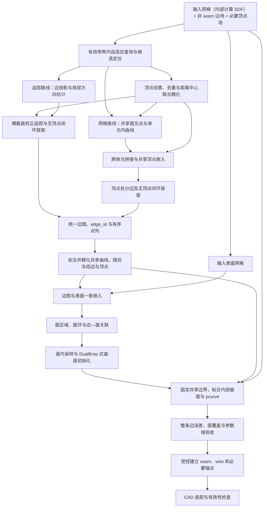

# 从边／顶点距离场恢复参数 B-rep：方案评审与设计建议

本文整理一种融合 BR-DF 与 DualBrep 思路的研究方案：用到最近 B-rep 边和顶点的距离场表达结构，直接提取边图，再拟合参数曲线并恢复完整 B-rep。

**已确定的设计约定：参照 DualBrep，seam 不参与 UDF 标签计算与生成。生成阶段只表达不同 face 之间的边及其必要顶点；seam 由曲面参数化和 CAD 后处理建立或修复。** 后处理新增的 seam、端点及分段不要求与原始 CAD 的选择一致。

**几何条件直接使用输入网格，内部保留由该网格计算的 SDF。** 当前后处理入口为网格与两个连续 E/V-UDF，不要求模型额外输出 SDF，也不经 SDF 提取初始网格。本文研究路线中的面区域由边图与输入网格共同确定，网格派生的 SDF 用于表面约束与残差检查；从各面采样点初始化参数曲面，再以已提取、精化后的唯一共享三维边和顶点约束曲面边界。曲面拟合阶段默认冻结这些边和顶点。兼容曲面采用整条边界的硬约束，一般裁剪面按明确的边—面容差验收，不能仅固定几个角点就宣称经过所有边。

文档核对：2026-11-03。此文件保留独立备选路线，直接追踪／网格提取的完整流程仍是研究设计，未作为 `bandbrep` 的另一种 CLI 模式实现。当前实现与研究方案的区别见 §2.5；共享几何与 CAD 的实际实现统一见[隔离带算法](BandLabelTopologyRecovery.md)，下文的联合优化、一般裁剪面和连续认证属于设计目标。

讨论假设扩散模型已经能够生成可查询的场，重点是**表示所包含的信息、确定性提取、拓扑恢复和参数几何装配**。本文是设计文档，不表示仓库已经实现或验证了该方案。数学推导、已有方法与建议实验在下文分别说明。

相关背景：

- [DualBrep 的 UDF 定义与处理流程](DualBrepUDFAndTopology.md#udf-flow)。
- [现有拓扑恢复、seam 与特殊边处理](DualBrepUDFAndTopology.md#topology-seam)。

## 1. 原始设想与评审结论

原始设想是：

1. 生成两个标量场：任意空间点到最近 B-rep 边的距离、到最近 B-rep 顶点的距离。
2. 通过阈值筛选顶点附近和边附近的采样点。
3. 根据顶点之间的边点，将点分组为不同 edge。
4. 采用固定端点的分段 Bézier 曲线逐条拟合。
5. 后拟合的边参考已有边确定相交顶点，使关联边相交。
6. 同时获得边几何与拓扑，减少对独立拓扑预测网络的依赖。

这个方向具有可行性，但应修改三个关键环节：

| 原始环节 | 需要修改的原因 | 建议 |
|---|---|---|
| 阈值点直接作为顶点或边点 | 阈值得到的是球状和管状邻域 | 将阈值作为候选生成，再进行中心定位与投影 |
| 由两个顶点夹住的点确定一条边 | 端点对不能唯一确定边，且存在闭环 | 通过分支追踪或网格局部重建获得曲线图，在共享顶点处分段 |
| 后一条边参考前一条边确定交点 | 产生顺序依赖，空间曲线受扰动后可能不相交 | 先建立共享顶点变量，所有关联曲线使用相同端点约束 |

目标应分为两个层次：

- **第一层：**恢复不含 seam 的面间边网络及其 edge–vertex 关联，支持无生成顶点的闭合边。
- **第二层：**恢复 face、wire、coedge 及边面几何一致性，完成周期参数化与 seam 补建，装配成有效 B-rep 实体。

第一层成功不自动保证第二层成功。

## 2. 表示定义与适用范围

### 2.1 已确定：输入网格与两个结构场，内部采用三个场

设实体表面为 $M$，按 §2.2 过滤 seam 后的面间边几何集合为 $E$，该边网络所需的顶点位置集合为 $V$。这里的 $E,V$ 不再指原始 STEP 中的全部边和顶点：

$$
s(x)=\operatorname{SDF}_M(x),\qquad
d_E(x)=\inf_{y\in E}\|x-y\|,\qquad
d_V(x)=\min_{v\in V}\|x-v\|.
$$

几何与结构的完整表示是：

$$
F(x)=[s(x),d_E(x),d_V(x)].
$$

其中 $s$ 是由固定输入网格计算的几何参考，结构场可记为 $G(x\mid s)=[d_E(x),d_V(x)]$。三个通道是内部查询表示，不表示模型必须生成三个场。当前 [`MeshFieldProvider`](../band_brep_reconstruction/bandbrep/field_provider.py) 始终以原始输入网格建立 `MeshSDFOracle`，粗、细加密产生的工作网格不替换该几何参考。结构场与网格必须使用同一空间坐标和尺度；生产模型的 condition 网格指纹必须与输入网格一致。

- $s$ 确定实体外壳，并为面区域采样、曲面内部拟合、法向及覆盖检查提供几何条件。
- $d_E$ 确定非 seam 面间边集合的位置。
- $d_V$ 单独约束该边网络所需的顶点，包括应保留的二度分段顶点；仅为 seam 或闭合曲线参数开口设置的人工锚点不作为生成目标。

仅有 $d_E,d_V$ 通常不能确定面内部形状，同一个边界环可以支撑不同的曲面。本方案使用输入网格补足面内部信息，SDF 是该网格的派生查询；参数曲面由面内采样点拟合，并受共享边界约束，具体设计见 §9。下文的“SDF 表面／几何条件”均按此来源理解。

### 2.2 已确定：生成不含 seam 的面间边网络

这里的 B-rep edge 不应默认等同于“尖锐棱线”。不同 face 之间即使共面或相切，也可能存在需要保留的拓扑边。

本方案采用以下固定规则：

1. **边监督：**只保留两个不同 face 共享的非退化边，形成 $E$。seam 不参与距离查询、近边采样、分支追踪或曲线生成目标。按拓扑边实体过滤后再取几何并集，不能把 seam 与真实面间边的交点从保留曲线上挖掉。
2. **seam 判断：**依据边相对于 face 的使用关系和参数接缝属性，不依据三维曲线是否闭合。圆柱上下圆环连接侧面与端面，仍应保留；圆柱侧面的轴向 seam 不进入 $E$。
3. **顶点监督：**先过滤边，再构造 $V$。保留非 seam 边的真实端点、交汇点及应保留的分段顶点；删除仅与已删除 seam 关联的点，排除仅用于完整光滑闭环参数开口的人工锚点。不能直接沿用原始 STEP 的全部顶点。
4. **混合关联顶点：**一个点同时关联 seam 和真实面间边时，不能仅因接触 seam 就删除。若去掉 seam 后仍是面间边的连接或分段节点，应保留；只有能够确认其作用仅为参数开口时，才将锚定移到后处理。
5. **二度顶点：**不统一删除。若某点仅由 seam 引入，并且两侧非 seam 曲线在几何及面侧关联上可安全合并，可按统一的数据规范消除该人工分段；不能仅凭度数为 2 就合并任意真实 edge。
6. **最终装配：**由闭合／周期曲面参数化及 CAD 内核按需要建立 seam、pcurve 和相关拓扑顶点，不要求复原原始 seam 的位置或编号。

例如，对侧面完整、上下端面各为一张面的圆柱，生成目标可以是两个面间圆环且 $V=\varnothing$。原 seam 与圆环相交处仅作闭环锚点时，不进入 $d_V$；后处理再选择圆环的参数起点及相容的侧面 seam。不能为了使用“从顶点出发”的提取器，强制生成两个原 seam 端点。

原 DualBrep 的 [`Voronoi/calculate_voronoi/calculate_voronoi.cpp`](../Voronoi/calculate_voronoi/calculate_voronoi.cpp) 中，`sample_points_surface()` 在过滤同面重复边及两侧同面边后建立顶点关联，并移除仅关联一条保留曲线的顶点。它是历史处理参考，不是当前 E/V 真值生成入口。当前 [`veudf` 目标过滤](../veudf/src/veudf/preprocess/cad.py) 已实现非 seam 面间边筛选及保守的圆／椭圆孤立闭环锚点移除；一般人工分段的进一步规范化仍是扩展目标，不能将其视为已实现。具体范围见 §2.4。

初版范围仍限定为闭合流形实体、非退化边、无重合边内部。当前预处理遇到多 solid STEP 时选择最大有效正体积 solid，不同时重建多个实体。退化边、开放壳、其他同面内部边及多实体联合重建需另行规定；“seam 交给后处理”不意味着这些特殊结构都会自动得到补全。

这些约定在数据预处理中的执行顺序、过滤判据及现有代码复用方式见 §2.4。直接曲线图提取与 [隔离带标签传播方案](BandLabelTopologyRecovery.md) 使用同一套目标边、顶点和真值关联。

### 2.3 理想场的一致性关系

当所有顶点都属于至少一条边、边包含端点，且所有边都位于实体表面时，有：

$$
V\subseteq E\subseteq M
\quad\Longrightarrow\quad
|s(x)|\leq d_E(x)\leq d_V(x).
$$

这里的 $E,V$ 必须使用同一套去 seam 规范。$V$ 可以只是 $E$ 上的必要顶点子集；闭合边没有生成顶点，并不违反包含关系。这些关系可作为生成结果的诊断条件，但不充分保证场描述了有效 B-rep。

上述包含关系要求 $M,E,V$ 来自同一几何表示。当前生产标签的 $s_{\mathrm{mesh}}$ 来自最终三角网格，$d_E,d_V$ 来自 CAD 曲线与顶点；三角网格不必精确包含 CAD 边，不能将 $|s_{\mathrm{mesh}}|\leq d_E$ 作为无误差预算的硬检查。当前[预处理审计](../veudf/src/veudf/preprocess/pipeline.py)以 CAD SDF 检查 CAD 表面与边的包含关系，另行记录 mesh/CAD 距离偏差。只有取得经过验证的几何误差预算 $\varepsilon$ 后，才可考虑 $|s_{\mathrm{mesh}}|\leq d_E+\varepsilon$；三角化参数本身不等于已证明的全局误差界。

若使用截断和归一化，应先在统一的物理距离尺度上解释这些关系；不同通道采用不同缩放时，不能直接比较网络输出。

对于空边集或空顶点集，距离在数学上可取 $+\infty$。当前[数据契约](../veudf/src/veudf/schema.py)及后处理使用有限哨兵值 `EMPTY_DISTANCE = 2√3`，并结合存在标记与有效标记表达缺失。后处理将缺失通道设为 `presence=absent`、`valid=false`；哨兵值不是有效几何距离，也不表示正常标签统一截断到该值。

尤其应支持 $E\ne\varnothing,V=\varnothing$：边场仍用于提取闭环，顶点场以哨兵值和缺失标记表达空集。顶点存在标记为假时跳过顶点检测与相应拟合项；不能把顶点未检出直接判定为整个样本失败。带外查询或其他无效预测也可能使用占位值，不能仅凭数值判断是否存在目标。

### 2.4 已实现的预处理与统一目标

目标过滤、闭环锚点和字段规范统一见[预处理规范](ABCEdgeVertexUDFPreprocessing.md)，实际入口是 `veudf.cli.build_dataset` 和本仓库同步的 `veudf/`，生产目录是唯一开发来源。该模块已实现 STEP 距离真值生成，不再维护本方案早期拟议的独立预处理接口。

直接边图研究和[隔离带算法](BandLabelTopologyRecovery.md)使用同一非 seam 目标。不能复用旧 GVD 标签，也不能把 EMAP 的 sharp-only 参考当作所有面间边。当前只移除符合条件的圆／椭圆孤立闭环锚点；一般人工分段仍保守保留，不能把本方案的理想规范化目标当成已实现。

### 2.5 当前实现与研究方案的区别

当前 [`bandbrep` 入口](../band_brep_reconstruction/bandbrep/cli.py)接收输入网格和可查询的两个连续 E/V-UDF；生产 condition 目录提供几何网格，TorchScript 解码器返回 `[N,2]` 的距离值，也可通过生产 VAE／Flow 适配器查询。梯度由解码器自动微分、生产适配器或有限差分获得，不要求模型单独输出梯度标签。

已实现的[主流程](../band_brep_reconstruction/bandbrep/reconstruct.py)为：

**原始网格 → 纯几何粗加密 → E/V 近场细加密 → 两阶段面域分割 → 拓扑恢复 → 顶点定位与共享曲线拟合 → 曲面拟合 → CAD／STEP。**

[代码默认参数](../band_brep_reconstruction/bandbrep/config.py)为：粗加密目标边长 `0.02`，细加密目标边长 `0.005`，E/V 近场阈值分别为 `0.02/0.03`，面域两阶段阈值为 `0.005/0.01`。粗加密不查询场，细加密只在近场切分超长边，不设细分轮数上限，受单样本总处理时间上限控制（默认 `10800` 秒）。加密只改变工作网格，SDF 始终来自原始网格。

| 环节 | 当前主流程已实现 | 本文直接边图研究路线 |
|---|---|---|
| 几何与结构输入 | 原始网格＋连续 E/V-UDF，内部计算 mesh SDF | 复用相同输入与数据契约 |
| 拓扑恢复顺序 | 先划分面域，再恢复边、顶点及关联 | 先提取边图，再嵌入表面恢复面域及面侧关系 |
| 网格处理 | 表面网格粗加密与近场细加密 | §7 的单元内曲线提取、跨格拼接及闭环检测尚待实现 |
| 顶点定位 | 梯度投票初始化、距离中心鲁棒拟合，最后检查 E/V/SDF 残差 | §7.1 的联合目标含 SDF 软约束，尚未作为当前定位目标实现 |
| 共享几何 | 固定端点的共享曲线、分段 C1 拟合及受边界约束的曲面求解 | 复用组件，新增边图与面域接口；联合优化和一般裁剪扩展仍待验证 |
| 几何验收 | 有限采样残差与 CAD 检查 | 连续边界认证和全局自交认证仍属研究目标 |

因此，后文的直接追踪、八叉树／单元图提取与边图优先流程不代表当前主流程已启用；已实现的曲面边界采样检查也不能解释为连续认证。

## 3. 与 DualBrep、BR-DF 的关系

| 项目 | 原 DualBrep | BR-DF | 本文研究方案 |
|---|---|---|---|
| 几何外壳 | SDF | SDF | 输入网格及其派生 SDF |
| 结构场 | 到面间 GVD 分界的单个 UDF | 每个 face 的独立 UDF | 到非 seam 面间边及其必要顶点的两个 UDF |
| 面身份 | 通过面内部区域分割恢复 | UDF 通道对应 face | 场中没有独立 face 身份 |
| 显式恢复入口 | 面片 | 表面上的面标签竞争 | 顶点与曲线分支 |
| 边—顶点关系 | 网络预测边后再装配 | 由分区边界及交汇提取 | 通过分支追踪或网格图分段恢复 |
| 面—边关系 | 面对分类与裁剪曲线预测 | 与面分区一起构造 | 需要把边图嵌入表面后恢复 |

BR-DF 在 SDF 表面上比较各 face 的距离，使用最小值定义面区域，通过共同最小值提取分界；MCT 输出的是 faceted B-rep，其成功率口径不包含完整参数曲面拟合。[1]

本方案与其共有的目标是“从连续场确定性提取结构”，但提取机制不同。两个聚合距离场不直接提供边身份或面标签，不能仅凭采用距离场就继承 BR-DF 的构造一致性结论。

原 DualBrep 的 GVD 流程可从以下根目录脚本核对；这些脚本不代表当前 `bandbrep` 主流程，后者见 §2.5：

- [`prepare_implicit.py`](../prepare_implicit.py)：原 UDF 监督来自到 Voronoi 网格的距离。
- [`ae_reconstruct.py`](../ae_reconstruct.py)：在重建网格三角形中心查询标量 UDF。
- [`clustering.py`](../clustering.py)：默认屏蔽低值区域，对保留的三角形邻接图求连通分量。
- [`rebuild.py`](../rebuild.py)：排除未分配区域，向网络传递各面采样点、法线与包围盒。
- [`rebuild_model.py`](../rebuild_model.py)：预测面对连接与 UV 裁剪曲线。

## 4. 两个距离场是否包含足够的边图信息？

### 4.1 理想情况下可以恢复 edge–vertex 图

精确连续场的零集给出：

$$
E=\{x:d_E(x)=0\},\qquad V=\{x:d_V(x)=0\}.
$$

在以下假设下，可以通过连续追踪或自适应网格提取重建 $E$，并在 $V$ 处组织边，恢复边—顶点图：

1. 所有非 seam 边的非周期端点和真实交汇点都包含在 $V$ 中；完整光滑闭环的人工参数起点可以省略。
2. 不同边内部不重合，不存在未建顶点的交叉。
3. 边形成有效的嵌入图，并采用一致的分段约定。
4. 对闭环采用显式处理，而不要求每条边有两个不同端点。

因此不能说两个标量场在信息上必然不足以恢复边图。这里恢复的是去 seam 后的面间边网络，而不是包含原始接缝的完整 CAD 图。实际困难是从有限采样和有误差的预测场中稳定提取这个网络。

### 4.2 不等于保存了任意原始 B-rep 的全部身份信息

距离场描述的是几何集合。如果两条不同拓扑边在空间中完全重合，聚合距离不会保存它们的多重身份；顶点距离也不会区分相同位置的多个拓扑顶点。

此外，几何边集不会直接保存 coedge 的方向和参数域布局。本方案明确不编码 seam 及其重复使用关系，这部分由后处理新建。应将“恢复与几何相容的拓扑”和“逐项恢复原文件的所有拓扑细节”区分开。

## 5. 为什么阈值不能直接给出顶点和边？

### 5.1 阈值集合的几何维度

定义邻域 $N_\tau(A)=\{x:\operatorname{dist}(x,A)\leq\tau\}$。则：

$$
\{d_V\leq\tau_V\}=\bigcup_{v\in V}B(v,\tau_V),\qquad
\{d_E\leq\tau_E\}=N_{\tau_E}(E).
$$

有限正阈值下，前者是球的并，后者是管状邻域。它们都是三维候选区域，尚不是零维顶点或一维曲线。

如果把一颗球内所有采样点都作为顶点，会产生大量重复节点；如果把整根管内所有点直接交给一条曲线拟合，在交汇和近邻边处容易混入其他分支。

顶点属于边，因此两类候选也不是互斥类别。更合理的处理方式是将顶点邻域作为交汇区，在其外追踪普通边段，再将各分支接回共享顶点。

### 5.2 噪声与阈值的作用

若预测场满足 $\|\hat d_A-d_A\|_\infty\leq\epsilon$，且 $\tau\geq\epsilon$，则：

$$
N_{\tau-\epsilon}(A)
\subseteq\{x:\hat d_A(x)\leq\tau\}
\subseteq N_{\tau+\epsilon}(A).
$$

这说明阈值候选受到误差影响，会在真实几何周围变厚或变薄。若两个不应连接的结构相距 $\delta$，条件

$$
2(\tau+\epsilon)<\delta
$$

可以防止这两个包络相互接触，但这只是局部分离条件，并非完整拓扑恢复保证。真实交汇处本来就应接触，必须另行处理分支。

阈值过大还可能合并近邻顶点；过大的顶点排除区域可能吞掉整条短边。

### 5.3 采样策略

小半径下，长度为 $L$ 的普通边管体积约随 $L\tau_E^2$ 缩放，而顶点球体积随 $\tau_V^3$ 缩放。因此均匀三维采样中，顶点尤其容易漏采。

建议使用表面附近采样、低值区域自适应细分以及连续定位。上述球／管体积描述的是三维采样；若初始点只在表面上，候选是这些邻域与表面的交集，同样不要求采样点恰好落在边或顶点上。

**阈值只负责找到定位起点，最终坐标可以离开原采样位置，通过连续场查询和优化求出。** 不应不断缩小阈值，以期留下恰好位于零集的采样点；这样可能先丢失全部候选。初始采样仍需覆盖各条分支，连续定位不能自动补回完全未发现的短边或独立闭环。

所有阈值必须相对于统一归一化尺度、采样间距及预计误差设置，本文不提供未经验证的固定数值。具体连续定位方法见 §7。

## 6. 连续 UDF 可以利用趋势提取结构

不能因为 UDF 非负，就认为它无法检测分界或恢复曲线。准确说法是：它没有可直接套用的端点符号穿越判据，但可以利用额外采样、局部形状、梯度和投影。

例如沿横穿一段结构的局部坐标 $t$，预测场可能近似：

$$
\hat u(t)=a|t-t_0|+b,\qquad a>0.
$$

即使 $b>0$、没有零点，先降后升的趋势仍可定位 $t_0$。因此，$|t|+\epsilon$ 的例子只能说明精确零值检测失效，不能说明低谷追踪失效。

需要注意，三维曲线的局部距离通常是在两个法向方向形成低谷，而沿曲线切向变化较小。单次一维扫描不足以确定完整曲线，仍需多方向信息和空间连接。

此外，低谷可能来自接近但未穿越目标结构，梯度反转也可能出现在远离零集的最近元素切换位置。实际提取应结合距离、局部方向、空间连续性和表面约束。

## 7. 建议的顶点定位与分支追踪

本节是一种待验证的直接提取设计，默认可在所需局部支撑域内追加连续场查询，并通过坐标自动微分或有限差分获取梯度。当前工程接口只接受归一化空间 `[-1,1]^3` 内且满足 $|s_{\mathrm{mesh}}|\leq\texttt{band\_width}$ 的 E/V 查询；TorchScript 默认带宽为 `0.02`，生产 bundle 使用自身配置。该范围也不保证模型预测一定有效，仍需检查 `valid`、`saturated` 及梯度有效性。追加查询、横截面校正和顶点补采样须遵守同一查询域，必要时缩小支撑或回退；有限差分的正负扰动点也必须有效。任意空间查询不是当前接口承诺；只有固定采样数据时的研究限制见 §7.6。

对真实欧氏距离场 $d_A$，当 $d_A(x)>0$、最近点唯一且场可微时：

$$
\nabla d_A(x)=\frac{x-\pi_A(x)}{d_A(x)},\qquad
\boxed{\pi_A(x)=x-d_A(x)\nabla d_A(x)}.
$$

距离值给出移动长度，负梯度给出方向，因此不必先采到零集。以局部直边为 $x$ 轴为例，查询点 $q=(t,a,b)$ 满足：

$$
d_E(q)=\sqrt{a^2+b^2},\qquad
\nabla d_E(q)=\frac{(0,a,b)}{\sqrt{a^2+b^2}},\qquad
\pi_E(q)=(t,0,0).
$$

理想场能将未命中边的采样点直接投影到边上；单个顶点附近同样有 $x-d_V(x)\nabla d_V(x)=v$。最近元素切换位置或交汇邻域可能不满足唯一性和可微性条件，不能在那里直接套用普通边段模型。

**预测场上的投影是初始化手段，不是精度保证。** 若 $\hat d=d+b$，即使梯度方向正确，按预测距离移动仍可能多走 $b$，产生过冲或反复越过低谷。实际应使用阻尼、最大位移限制及更新接受检查，并结合下面的多点拟合和低谷定位；不能假设反复投影必然收敛到真实零集。EMAP 的候选筛选和 UDF 梯度投影可作为初始化基线。[2]

### 7.1 顶点中心定位

从低 $\hat d_V$ 区域产生种子，按“多点投票、区分顶点、联合精化”的顺序处理。

若顶点存在标记为假，则跳过本步骤，直接从边候选启动闭环提取。不得因为顶点场没有有效极小值而删除已检测到的圆环。

**第一步：生成位置投票。** 可用归一化梯度更新产生初步候选：

$$
v_i^{(0)}=x_i-\alpha_i\min(\hat d_V(x_i),r_i)
\frac{\nabla\hat d_V(x_i)}{\|\nabla\hat d_V(x_i)\|+\varepsilon},
\qquad 0<\alpha_i\leq 1.
$$

其中 $r_i$ 限制最大位移，$\alpha_i$ 控制阻尼，$\varepsilon$ 仅用于数值稳定；梯度过小或方向不可靠时应停止该更新并转用其他定位方法。应检查局部目标是否改善，必要时缩小步长，不把它作为无条件收敛迭代。

同一顶点附近的种子应向相近位置投票，形成可重复的位置峰。先区分不同顶点，再分别精化；去重尺度应适应局部结构，固定大半径的非极大值抑制可能误合并真实近邻顶点。这是顶点候选的归并，不是通过面采样点的连通分量分割 face。

**第二步：联合拟合距离中心。** 保留原始查询位置及其距离值，对属于同一顶点局部支撑域的样本求解：

$$
v^*=\arg\min_v
\sum_i w_i\rho\!\left(\|x_i-v\|-\hat d_V(x_i)\right)
+\lambda_S\hat s(v)^2.
$$

$w_i$ 是样本权重，$\rho$ 是鲁棒损失，SDF 项将结果约束在表面附近。每个查询位置及其距离值给出一个球面约束，多个约束共同确定顶点。不能直接取原始阈值点的均值：其位置受表面形状和采样密度影响，通常不是距离中心。

上述局部模型要求参与拟合的样本以同一个顶点为最近顶点。靠近两个顶点的等距区时，应缩小支撑域、保留多假设或重新分配样本，不能将不同顶点的距离观测混成一个中心。

若存在局部系统偏差，可将残差改为 $\|x_i-v\|+b-\hat d_V(x_i)$，同时估计受约束或正则化的小偏差 $b$。这不是默认必加项：查询方向或半径过于单一时，位置与偏差可能难以区分。

**第三步：追加查询并检查稳定性。** 在初步顶点周围从不同方向、不同距离补充少量三维查询，再重复精化。仅靠表面点可能产生接近共面或单侧的支撑，使某些方向的定位不稳定；SDF 约束和三维查询可改善这种情况。查询需留在同一顶点的局部支撑域内，不能为增加样本数而跨入相邻顶点区域。

后续可结合入射边的位置联合调整共享顶点，但不能仅凭多个候选的均值就宣称达到真实 CAD 顶点精度。

### 7.2 边中心线定位与切向

从低 $\hat d_E$ 候选出发，先用有限步、带步长控制的投影得到靠近中心线的点集。在普通边段、最近点唯一且真实距离场可微时：

$$
\pi_E(x)=x-d_E(x)\nabla d_E(x).
$$

边是一维连续集合，不能把整条边上的候选都向同一个极小点聚拢。应保留它们沿曲线的位置分布，使用横截面校正和分支追踪组织这些点；预测场上的一次投影仍可能留下有厚度的点带。

注意：$\nabla d_E$ 是径向信息，不是边切向。普通边段可通过投影点的局部 PCA，或邻域梯度矩阵的最小右奇异向量估计切向。后一方法需要邻域梯度充分覆盖曲线的两个法向方向，并控制曲率和邻边干扰。

**仅在表面查询可能不足以唯一确定三维切向。** 例如，平面内一条直边附近的表面查询，其距离梯度可能只张成一个方向，梯度矩阵会留下二维零空间。此时可结合可靠的表面法向、投影点的局部 PCA，或追加少量三维扰动查询；在尖锐交汇处不能假设存在唯一表面法向。交汇处也存在多个边切向，应交给 §7.3 的分支处理。

如果直接使用梯度不稳定，可考虑最近点偏移等额外预测量；如果增加切向通道，宜用无向表示 $T=tt^\top$，避免把 $t$ 与 $-t$ 当作不同目标。它们属于后续增强，初版可先使用两个距离场检验提取能力。

### 7.3 顶点邻域的出射分支

在顶点周围选择局部小球面，查询 $d_E$。不同 incident edge 穿过球面的位置可形成多个低值区域，作为出射分支种子。

半径需足够离开顶点定位误差区，又不能覆盖相邻顶点。急弯、短边、近切分支和高价顶点需要单独评估。这里不能假定一个顶点恰好有三条边。

### 7.4 沿分支追踪并记录拓扑

普通边段采用“沿切向预测、在横截面校正”的过程。设当前点为 $q_k$、单位切向为 $t_k$，先预测：

$$
\tilde q_{k+1}=q_k+h_k t_k.
$$

取垂直于 $t_k$ 的两个正交方向组成 $N_k\in\mathbb R^{3\times2}$，在有界截面内求解：

$$
z^*=\arg\min_{\|z\|\leq r_k}
\hat d_E(\tilde q_{k+1}+N_kz)^2
+\lambda_S\hat s(\tilde q_{k+1}+N_kz)^2,
\qquad
q_{k+1}=\tilde q_{k+1}+N_kz^*.
$$

横截面约束减少沿曲线的无意义滑动，搜索半径限制跳到附近另一条边的风险；两者不构成分支正确性的保证。每次校正后重新估计切向，并根据曲率、近邻间距和场置信度调整 $h_k,r_k$。在尚未可靠估计切向时，应先改善局部查询或初始化。

对存在正偏差但仍保留距离形状的场，搜索低谷中心比强求 $\hat d_E=0$ 更合适。空间变化的偏差仍可能移动低谷，SDF 与边场也可能不完全相容；上述目标是在二者之间协调，而非保证同时精确满足两个零值条件。应分别记录两项残差。

若可查询连续 SDF，应直接约束 $\hat s$；把校正点吸附到最近的原始表面采样点或粗网格顶点，会重新引入采样量化误差。只有网格时，可使用网格面片上的连续位置，但精度受网格近似误差限制。

对每个出射分支：

1. 沿切向预测下一个位置。
2. 在局部横截面内寻找 $\hat d_E$ 低谷，并用 SDF 或表面网格约束所属外壳。
3. 根据曲率、场置信度和邻近分支调整步长。
4. 进入另一顶点邻域时记录对应端点。
5. 遇到已访问路径时判断是重复追踪还是闭合曲线。
6. 无法可靠继续时保留失败或不确定状态，不强行连接最近顶点。

顶点配对由追踪结果确定，而不是先按欧氏距离选两个顶点。

进入交汇邻域后，应结束普通边段的单切向模型，结合出射分支与共享顶点确定连接。不能通过继续最小化聚合边距离，让不同分支在顶点附近任意切换。

### 7.5 多重边与闭环

必须支持：

- 同一端点对之间有多条独立边；
- 首尾同顶点的闭合 edge；
- 未与已提取顶点相连的闭合曲线；
- 同一几何曲线被二度顶点分段。

例如，一个圆被两个顶点分成两条圆弧，不能因端点对相同而合并为一条边。数据结构应使用独立 `edge_id`，而不是用 `(start_vertex, end_vertex)` 作为唯一标识。

从顶点出发追踪之后，还需从未覆盖的低 $d_E$ 区域补充启动闭环追踪；$V=\varnothing$ 时直接从这些区域启动。这是去 seam 方案的必需路径，不能仅作为异常回退。

闭环使用独立 `edge_id` 和闭合标记保存，可以暂时没有端点 id。如果拟合或 CAD 内核需要参数锚点，给它单独的辅助标记，避免将其计入生成顶点。新增 seam 与闭环连接时，可在后处理统一选择或调整锚点，并让相关面引用同一拓扑顶点。

### 7.6 连续场查询与固定采样数据的区别

优先保留连续场查询接口。神经场可固定网络参数，仅对输入坐标求导；有限差分也可估计梯度，但步长需要兼顾数值误差和局部尺度。坐标求导不能放在关闭自动微分的推理包装中。距离截断的饱和区没有可用的距离梯度，应在未饱和的窄带中定位，并将归一化距离还原到与坐标一致的尺度。

如果手里只有固定查询点及其距离值，仍可用 §7.1 的距离中心模型拟合顶点，或用局部直线、圆弧、样条的距离模型拟合边；也可从足够密的网格插值获得近似连续场。这些方法依赖采样覆盖、局部几何假设和数据条件，插值不能恢复采样已经遗漏的分支或细节。

若仅保留阈值过滤后的点坐标，丢弃距离值，球面／距离模型提供的定位约束也随之丢失，只能更多依赖点分布和几何先验。因此应保留原始查询位置、距离值、可用梯度及置信信息，而不只保存二值候选掩码。

### 7.7 精度来源、停止条件与失败判据

应区分以下量，不能把候选阈值直接当作最终定位精度：

| 量 | 作用与限制 |
|---|---|
| 初始采样间距 | 影响是否发现短边、小环和相近分支 |
| 候选阈值 $\tau_E,\tau_V$ | 控制定位起点的覆盖与混入，不决定最终坐标必须落在哪个点上 |
| 连续定位的数值容差 | 控制优化终止，不代表真实几何误差 |
| 生成场的几何误差 | 可能造成中心或低谷偏移，限制最终可达到的精度 |

候选阈值可以较宽，后续定位容差可以更小。在场准确、查询条件充分的情况下，连续定位可达到小于初始采样间距的误差；不能据此承诺超越生成场本身的有效精度，也不能通过无限迭代保证 CAD 装配容差。

停止和接受结果时应综合检查：

- 坐标更新量是否足够小，而非仅检查距离值是否接近零；
- 顶点距离模型残差、边横截面目标和表面残差是否合理；
- 更换局部查询位置、从多个起点定位后，结果是否一致；
- 在可用空间中增加不同方向的查询后，中心位置是否稳定；
- 缩短追踪步长后，曲线位置、分支归属和端点关联是否稳定。

低场残差只表示与预测场相容，不直接证明接近真实 CAD。若多次查询得到不同中心、相邻分支无法分离或边场与表面冲突，应标记低置信度，追加查询、调整局部尺度或报告失败，不能仅按最近距离强行合并。

### 7.8 类 Marching Cubes 的点—曲线提取路线

除 §7.1–§7.7 的连续定位与分支追踪外，可以研究另一条主要路线：**借用 Marching Cubes 的逐单元重建、跨单元拼接思想，直接提取带连接关系的一维曲线图，再用独立定位的顶点划分 B-rep edge。** 两条路线共用距离场、连续定位方法和后续曲线拟合，但组织连接关系的方式不同。本节及后续网格算法均是待实现、待验证的设计。

标准 MC 输出的是二维等值面；这里需要输出零维点和一维曲线，因此必须修改单元内的提取规则：

| 场 | 目标零集 | 正阈值等值集的局部形状 |
|---|---|---|
| SDF $s$ | 二维实体表面 | 偏移表面 |
| 边距离 $d_E$ | 一维曲线网络 | 普通边周围的管面 |
| 顶点距离 $d_V$ | 零维顶点集合 | 孤立顶点周围的球面 |

这里的困难不只有无符号，还有零集维度不同。以单元 $[-1,1]^3$ 中沿 $x$ 轴穿过的直边为例：

$$
d_E(x,y,z)=\sqrt{y^2+z^2}.
$$

八个角点的距离均为 $\sqrt2$，但单元内部存在整段零集 $\{(x,0,0):-1\leq x\leq1\}$。仅对八个角点值做三线性插值会得到正常数，完全丢失这条边。同样，位于单元中心的顶点到八个角点的距离均为 $\sqrt3$，也无法通过普通零等值面查表定位。

因此需要增加单元内部查询、梯度或局部距离模型，不能直接对原始 UDF 套用八角点正负编码。MeshUDF 利用梯度推断局部伪符号，将 MC 扩展到无符号的曲面距离场；其提取对象仍是曲面，不能直接替代本方案的点／曲线提取。[6]

### 7.9 自适应网格内的局部重建与跨格拼接

**第一步：筛选候选单元。** 对边长为 $h$、中心为 $c$ 的立方体，其包围球半径为 $R=\sqrt3h/2$。真实距离场满足 1-Lipschitz 性，因此对 $A=E$ 或 $A=V$：

$$
d_A(c)>R\quad\Longrightarrow\quad A\cap\text{cell}=\varnothing.
$$

若预测场具有可信误差上界 $|\hat d_A-d_A|\leq\eta$，则 $\hat d_A(c)>R+\eta$ 也足以排除单元。未通过排除条件只意味着可能包含结构，不能直接判定存在边或顶点。没有可信误差界时，该筛选仅是启发式；截断距离还需确认其数值确实提供所需下界，不能把饱和值当作未经截断的真实距离使用。

可由此建立八叉树：远离结构的单元跳过，可能含结构的单元继续查询和细分。最终分辨率需要与局部曲率、顶点间距、非关联边间距及场误差协调。

**第二步：定位顶点。** 在顶点候选单元内使用 §7.1 的投影与距离中心联合拟合。顶点坐标不必落在格点上；相邻单元重复检测同一顶点时统一身份，一个单元可能包含多个顶点时继续细分或保留多假设，不能固定为一格一个顶点。空顶点集直接跳过该过程。

**第三步：寻找曲线与网格面的交点。** 普通 MC 通常在立方体的棱上定位曲面交点；本方案需要在立方体的面上定位曲线交点。在六个面上查询 $\hat d_E$，通过自适应二维搜索、局部距离模型和连续校正确定穿出位置。

低值本身不证明曲线穿过该面：曲线可能只是靠近它。应结合局部曲线延续与邻域查询确认交点，必要时追加内部查询。相切、沿面延伸或恰好穿过网格棱／角点的情况需要专门的归属与去重规则。

**第四步：重建单元内部曲线。** 当单元不含 B-rep 顶点、仅有一条普通曲线且检测到两个可靠的横截交点时，在二者之间重建一段局部曲线，并利用内部查询校正曲率与表面一致性。不能把所有非空单元一律压缩为一条线段或一个中心节点。

| 单元内情况 | 所需处理 |
|---|---|
| 多条互不相交的边经过 | 分别重建或细分，避免引入伪交汇 |
| 一条曲线多次穿过单元 | 识别交点配对，或继续细分 |
| 包含真实交汇顶点 | 结合顶点位置建立各分支关联 |
| 曲线与面相切、沿面延伸 | 用邻域查询确定单元归属与共享表示 |
| 完整小闭环位于单元内部 | 检查内部候选，不依赖面交点判断为空 |

多交点的配对需要切向、局部距离模型和内部场支持；不能任意两两连接。没有面交点也不等于没有曲线。有限查询无法无条件排除任意小闭环，应明确最小特征尺度、细分上限以及无法判定时的失败状态。

**第五步：跨单元拼接。** 共享网格面上的交点统一计算、统一编号，两侧单元引用同一节点。自适应网格还需协调粗细单元交界，不能由两侧独立生成不一致的连接。

输出的离散图由共享面交点、局部辅助节点和单元内曲线段构成；多数节点只是离散化节点，不是 B-rep vertex。单元段应保留来源、分支信息、场残差及置信度，便于后续分边和诊断。

### 7.10 将顶点插入曲线图并划分独立 edge

在 §4.1 的假设下，一条普通 edge 的内部对应 $E\setminus V$ 的一个连通分支；没有生成顶点的完整闭环也是独立分支。两个边内部点属于同一条 edge，意味着可以沿边集合连续连接它们，途中不经过任何保留的 B-rep 顶点。

这里的连通性是几何定义，实现可通过图上的路径遍历完成，不要求采用原 DualBrep 的二维面内部连通分量分割。边身份不能由距离值、空间近邻或端点对单独确定。

数值折线通常不会恰好经过独立提取的顶点。因此“用点切开边”应实现为**顶点嵌入与路径分段**：

1. 为每个精化顶点寻找附近相容的曲线分支。
2. 结合局部场、切向和分支延续确认关联，不能无条件吸附所有近邻曲线。
3. 在图中插入共享顶点节点，拆分相关局部曲线段，并协调各分支端点位置。
4. 从各入射分支出发遍历，经过普通离散节点时继续，到下一个保留顶点时终止，合并沿途单元段为一条独立 edge。
5. 对未覆盖的闭合路径建立无生成顶点的闭合 edge，输出有序点列及独立 `edge_id`。

“切开”只划分 edge 身份，几何端点仍引用同一个共享顶点。不能简单删除固定半径内的全部图节点；短边可能被两端区域吞掉，近邻但无关的分支也可能被误捕获。

必须保留二度顶点处分段、同端点多条边、自环和无顶点闭环。端点相同不意味着路径相同；重复提取应结合路径重叠与分支一致性去重。若非顶点位置出现无法解释的分叉，应复核提取或顶点检测，不随意配对消除分叉。

网格提取时可直接记录节点／单元段的 edge 归属，无需丢弃连接再对所有点重新聚类。若需加入额外无序边点，可根据其到已建立路径的距离、切向和分支支持进行归属；顶点处本来允许多条边共享，歧义点可暂不用于拟合。

### 7.11 两场协同及与追踪路线的关系

顶点和曲线可以分别定位，但交汇区域的连接应联合确定。一个单元若有四个穿出位置，不能先任意配成两条曲线，再期望后插入顶点自动修复拓扑。

建议普通区域主要使用 $d_E$ 重建，已检测到顶点的区域同时利用 $d_V$ 和精化顶点位置组织分支，最后统一进行顶点嵌入与 edge 分段。顶点是分段依据，也可以为网格内的交汇重建提供约束。

两条提取路线的关系如下：

| 路线 | 连接关系的主要来源 | 可复用的部分 |
|---|---|---|
| 连续分支追踪 | 切向预测、横截面校正和端口关联 | 连续定位、局部方向、共享顶点拟合 |
| 自适应网格提取 | 共享面交点、单元内曲线和跨格拼接 | 同样复用连续定位及局部分支判断 |

网格路线把连接判断放进提取器，仍需解决局部多分支和跨单元一致性。局部追踪可作为单元内的求解工具，两条路线并非互斥。当前没有证据证明其中一条在所有场误差和特征尺度下更可靠，应在相同查询预算下比较。

### 7.12 标准 MC 加骨架恢复的备选基线

可以先对 $d_E=\tau$ 提取管状三角网格，再做中心线／骨架恢复；对 $d_V=\tau_V$ 的球状结构拟合中心。该路线可用于原型对照，但会增加骨架恢复问题：

- 阈值较大时，邻近边的管体可能合并；
- 阈值较小时，离散网格可能检测不到管面；
- 交汇区域不能保证通过简单收缩得到正确的一维分支；
- 阈值化已经丢失的结构不能保证由骨架化恢复。

因此更值得优先验证直接输出曲线段的网格提取器；不能将标准 MC 输出的管面或球面直接视为 B-rep 边和顶点。无论采用哪条路线，生成阶段均不补入 seam 或闭环人工锚点，后处理职责保持 §2.2 的约定。

## 8. 共享顶点约束下的曲线拟合

当前隔离带实现的固定端点、分段 C1 求解和采样验收统一见[共享曲线](BandLabelTopologyRecovery.md#5-顶点与共享曲线)。直接提取路线同样先保留每条分支的实例和有序支持，再拟合唯一共享曲线，而不是让每个面独立生成边。

给定已确认关联 e=(i,j)，固定端点三次 Bézier 满足：

$$
C_e(t)=(1-t)^3v_i+3(1-t)^2t\,a_e+3(1-t)t^2b_e+t^3v_j.
$$

这只保证给定关联下的 C0 连接，不证明关联正确、没有漏边、自交或错误穿越。内部拟合接点不是 B-rep 顶点；同一光滑边可施加按参数长度缩放的 C1 约束，真实角点不强迫切向连续。

直线、圆弧、适用的有理曲线或样条按误差选型；普通多项式 Bézier 不精确表示非平凡圆弧。[4] 无生成顶点闭环可使用周期表示或辅助锚点闭合，辅助锚点不受 v-UDF 吸引。

直接提取路线可研究联合顶点／曲线优化，同时使用本实例支持的双向覆盖、曲线上 e-UDF/SDF 残差、距离中心一致性、内部平滑及无关曲线相交检查。若改变共享顶点，所有入射边须同步更新。该联合优化是候选设计，当前主库不因此自动启用；不能只最小化全局 e-UDF，否则可能贴到错误分支。

## 9. 从曲线图到完整 B-rep

### 9.1 还需要面域与使用关系

edge–vertex 图仍缺 face 身份、edge–face 关系、面内有向 coedge、外环／孔环、支撑曲面及 pcurve。直接路线需以已知 SDF 表面和边图共同划分面域，保留孔和面侧关系，不把无序曲线集合当作合法实体。普通非 seam 边应有两个相邻面，闭合曲线和高价顶点须单独检查。

这一面域恢复仍是直接提取方案需要验证的环节。[当前隔离带实现](BandLabelTopologyRecovery.md)从面核心得到 face 身份，再实例化边，两条路线不能因共享距离场而被当成相同算法。

### 9.2 固定共享边与支撑曲面

直接路线可借鉴 DualBrep 的面点参数化初始化，但最终约束为：

$$
S_f(\gamma_{fe}(t))\approx C_e(t),
$$

其中 `C_e` 是唯一共享三维曲线，`gamma_fe` 是该面上的二维 pcurve。只固定角点或各面独立重新近似边都不足以保证完整边界相容。

相容四边模板可以固定四排边界控制点；一般多边、带孔及周期面应使用支撑曲面加裁剪。固定 UV、结点及样条基时，边界控制点满足线性等式 `BP=c`，可用消元／零空间求解；很大的惩罚权重不等于硬约束。可增加控制自由度、调整 UV 或交替求解，不能在不相容时静默退回无约束拟合。

把一个逻辑面拆为多个支撑面通常新增 CAD face 和辅助边，属于显式表示／拓扑变化，需记录映射。周期参数的连续展开、seam 与辅助锚点由后处理负责，不加入生成 V。当前有限点约束与 513 点边界检查见[曲面实现](BandLabelTopologyRecovery.md#6-面环曲面与-cad)，不代表任意复杂裁剪面都已解决。

### 9.3 拟合目标与验证层次

研究设计可在固定边图下联合面内点拟合、可靠法向、SDF、覆盖及公平性项，交替更新面内 UV、pcurve 和控制点。跨锐边只要求位置相容；确认光滑后才施加 G1 条件。面内误差降低不能交换边界超差，孔洞不能被拟合数据填平。

有限约束点只保证这些点；自适应增加采样仍是工程验收。如有可验证的残差导数界 `||r'_fe||≤L`，每个参数位置到检查点距离不超过 delta，才可用“检查点最大残差 + L*delta”给出连续域上界。没有这种界时不宣称连续全边界认证。局部雅可比非零也不排除全局自交或重复覆盖。

验收应覆盖实例一对一、分支双向覆盖、端点共享、面边界最大残差、内部形状、孔环与周期使用、实体闭合及 STEP 读回，区别场误差、曲线误差、边界容差和内核容差。不能将 OCC `IsValid()` 当作相对真实拓扑正确性的充分条件。

### 9.4 对原学习式后处理的适配边界

[`rebuild.py`](../rebuild.py)、[`rebuild_model.py`](../rebuild_model.py)、[`brep_post/construct_brep.py`](../brep_post/construct_brep.py) 和 [`brep_post/utils.py`](../brep_post/utils.py) 是原学习式路线的参考：

- `sample_faces()`、面参数网格和 `create_surface()` 可提供初值；后续需独立满足固定边界。
- 原优化可能缩放／平移边或移动面，直接方案冻结边图后不能原样照用。重新 `create_edge()` 也不能替换已确认的唯一共享曲线。
- 不用面对到单边的映射替代独立 edge ID，不用三面环推断代替已提取的高价顶点关联。
- `ShapeFix`、自然 wire 替换及 sewing 可能改动几何和拓扑，须检查原边、共享点及容差；seam 可新增，但不能静默移动真实面间边。

`BRepFill_Filling` 可作原型对照，不相容约束可能被忽略，`IsDone()` 不足以验收。[9] `SameParameter` 协调三维曲线与 pcurve 参数，不会自动让支撑曲面包含原本不相容的边。[10] 独立 `bandbrep` 已实现受约束的共享实体装配；本文不要求通过修改原学习式总入口来调用它。

## 10. 推荐的整体流程

两条提取路线使用相同的去 seam 场定义，输出统一的非 seam 边图和有序边点，再进入曲线拟合与完整 B-rep 装配。网格路线作为重点验证方案，连续追踪保留为对照及可复用的局部求解工具。SDF 始终作为固定几何条件；边图精化后冻结，共享边约束下的曲面拟合接在面点参数化初始化之后。

可以保留一份嵌入表面的非 seam 离散边图作为结构依据，参数曲线拟合作为其几何近似。若拟合发生错误穿越、偏离所属分支或改变面间环结构，应增加分段、重新优化或明确报告失败，而不是静默改变拓扑。后处理为参数化增加 seam、闭环锚点及必要分段属于允许的表示变化，应记录来源及其与原面间边的映射。

各步骤的保证范围应分别报告：

| 步骤 | 可以交付的结果 | 不能据此宣称 |
|---|---|---|
| 阈值候选 | 靠近边或顶点的区域 | 已得到唯一顶点和曲线 |
| 连续定位与分支追踪 | 精化后的非 seam 候选边图及闭环 | 超越场精度的定位或原始 CAD 的完整拓扑 |
| 网格曲线提取与顶点分边 | 带连接关系的非 seam 候选边图及独立 edge | 无条件发现任意小环或消除全部局部连接歧义 |
| 共享端点拟合 | 给定关联下端点重合 | 完整 B-rep 水密有效 |
| 表面嵌入与环构造 | 离散面区域与面侧关系 | 参数曲面装配必然成功 |
| 面点参数化初始化 | 支撑曲面和 UV 对应初值 | 曲面已包含所有共享边 |
| 边界约束曲面拟合 | 兼容边界的恒等保持，或经过误差验证的裁剪面 | 固定角点即可保证整条边，或任意边界均可拟合 |
| 周期参数化与 seam 后处理 | 与当前参数域相容的接缝及使用关系 | 恢复原 seam 的位置或分段 |
| CAD 校验通过 | 满足内核检查的实体 | 原始拓扑逐项无损复原 |

## 11. 与现有工作的联系及研究区别

### 11.1 EMAP 是直接相关的提取基线

EMAP（*3D Neural Edge Reconstruction*, CVPR 2024）使用最近边 UDF，包含候选点初始化、梯度投影、邻域梯度 SVD 方向估计、方向引导连接、直线／三次 Bézier 拟合和端点合并。[2]

它支持“从边 UDF 提取参数曲线”的可行性，但其曲线提取不能直接作为完整 B-rep 有效性的保证。

因此，本方案不应仅以“边 UDF 加 Bézier 拟合”作为创新主张。更值得验证的区别包括：

- 顶点场对分支连接和交汇定位的帮助；
- 场生成与拓扑一致性提取的结合；
- 共享顶点硬约束及全局几何协调；
- 从曲线图到 face／wire／coedge 的完整恢复；
- 在短边、闭环、多重边和高价顶点上的可靠性。

这些是待研究的贡献方向，不是已经证明的新颖性结论。

### 11.2 与 DualBrep 的实验比较要控制变量

本方案改动了表示和提取器，不能把最终改善全部归因于某一个环节。应分别考察：

- 真实几何生成的距离场是否更容易提取；
- 预测场误差对两种表示的影响；
- 固定曲面拟合与后处理后，拓扑提取方式带来的差异。

现有 `decode_edge_given_topo()` 可以作为给定面对关系的参数化接口参考，但本方案首先恢复的是 edge–vertex 图，两者并非可以直接互换；仍需建立面及边—面关系。

## 12. 分阶段实验与消融设计

### 12.1 阶段 A：真值场的确定性提取

先按 §2.2、§2.4 从已知 CAD 几何过滤 seam、整理必要顶点和闭环，计算真实 $d_E,d_V$ 并完成预处理验收。固定几何而改变采样分辨率和阈值，验证提取算法。训练、验证与测试使用相同的顶点及人工分段规范。

这一步用于排除“提取器本身失败却归因于生成模型”的情况，不需要先训练新的扩散模型。

加入初始采样完全未命中边／顶点零集的设置，比较原始候选、一次投影和联合精化后的误差。独立改变候选阈值、采样间距与优化容差，验证在场准确时是否能实现小于初始采样间距的定位误差，同时记录是否漏掉短边或闭环。

对网格路线，改变单元尺度以及网格相对几何的平移、旋转，检验结果是否依赖偶然对齐。先验证普通单分支单元，再加入多分支、交汇、退化穿越和自适应粗细交界；分别统计候选筛选、单元内重建、跨格拼接和顶点分边的错误。

### 12.2 阶段 B：加入可控误差

分别加入：

- 整体距离偏移；
- 空间平滑与低频偏差；
- 高频局部扰动；
- 顶点位置偏移；
- 局部缺失或近邻结构粘连。

同时改变采样密度，绘制成功率对噪声、分辨率和最小特征间距的关系。不要只测试独立随机值噪声，因为神经场误差往往具有空间相关性。

对整体正偏差，重点比较直接求零／反复全步投影与低谷定位；对空间变化的偏差，检查低谷自身的位移。分别报告优化是否收敛、几何是否准确，避免把很小的更新量当作成功重建。

### 12.3 阶段 C：接入生成场

先单独测量场到边图的恢复，再评估曲线拟合。需要区分生成场描述了错误结构，还是提取器错误解释了已有结构。

### 12.4 阶段 D：完整 B-rep 装配

加入面区域、曲面和参数曲线恢复、seam 补建，记录每个阶段的失败原因。非 seam 曲线网络的恢复情况、周期面 seam 建立成功率和最终 STEP 实体有效率分别统计。

曲面阶段先用真值面区域和固定真值边界验证参数化与约束求解，再换成提取的边图及 SDF 面点，以区分表示不可行、初始化失败、边界有偏差和求解器误差。分别测试四边恒等约束、一般多环裁剪和周期面，不要求所有 face 使用同一种模板。

对 SDF 与边界有可控冲突的样本，记录保持固定边时的面内残差和不可行率，确认求解器不会通过移动边或放大内核容差隐蔽通过。记录装配及 STEP 导出／重读前后的边界偏移和拓扑变化。

### 12.5 必须覆盖的测试结构

| 测试结构 | 主要检验内容 |
|---|---|
| 采样未命中零集的直边与单顶点支撑邻域 | 距离与梯度是否支持连续精定位 |
| 表面查询接近共面或单侧的局部邻域 | 顶点拟合条件、切向退化及三维补充查询的作用 |
| 角点距离全正且相同、单元内部有直边或顶点 | 检验内部查询，避免只用八角点插值漏检 |
| 完整闭环藏在单个粗单元内部 | 内部检测和细分，不将无面交点判为空 |
| 多条分支或多次穿越位于同一单元 | 局部配对、多段表示及细分策略 |
| 曲线沿网格面或经过棱／角点 | 退化交点归属和跨单元去重 |
| 曲线穿过粗细网格交界 | 共享交点一致性，避免断裂与重复连接 |
| 立方体及一般多面体 | 普通交汇、端点共享、边—面关系 |
| 高价顶点 | 多分支提取，不预设三价 |
| 圆周被两个顶点分段 | 同端点对的多条边 |
| 有必要顶点的闭合 edge | 自环关联与周期参数化 |
| 无生成锚点的完整圆环 | 闭环提取、辅助锚点与生成顶点分离 |
| 完整圆柱：两圆环、无生成顶点 | 保留面间边，排除轴向 seam 及纯参数锚点 |
| 短边及近邻顶点 | 去重和顶点邻域是否吞掉结构 |
| 相近但不连接的平行边 | 阈值管合并及错误跳支 |
| 共面／相切 face 的边界 | 是否保存拓扑边而非只保存尖锐棱 |
| 自由曲线与急弯 | 切向追踪、步长和拟合分段 |
| seam 与真实面间交汇点重合 | 保留必要顶点，避免因接触 seam 而误删 |
| 周期面和 seam | 生成结果不含 seam，后处理正确补建双侧使用及 pcurve |
| 同四个角点、不同边界曲线的曲面 | 固定角点与固定整条边界的区别 |
| 四边自由曲面及有理圆弧边界 | 控制点／权重兼容、内部拟合和全边界保持 |
| 三边、多边及含孔洞的 face | 不强制四边模板，正确维护裁剪域与内环 |
| 相邻面的锐边与光滑边 | 共边位置一致，按类型选择切向约束 |
| 固定边界与 SDF 存在冲突 | 报告残差或不可行，不逐面移动共享边 |
| 初始 UV 折叠或曲面覆盖错误 | 参数域修正、覆盖与自交检查 |

### 12.6 评价指标

- **几何：**顶点定位误差、边曲线双向距离、覆盖率、切向一致性。
- **定位稳定性：**不同起点／查询集合的结果差异、缩短步长后的变化、局部距离模型与表面残差；将真实几何误差与预测场残差分开报告。
- **图结构：**顶点／边数量、edge–vertex 关联、顶点度、多重边、自环、闭环及图连通性。
- **网格提取：**漏检单元、错误局部配对、跨格断裂／重复连接及顶点嵌入失败；记录相对网格位置变化下的稳定性。
- **面结构：**face 数量、edge–face 关联、面环、coedge 使用方向。
- **曲面拟合：**逐边最大曲面残差、顶点残差、有效面域的双向几何误差、SDF 残差、参数域折叠／自交及约束不可行率。
- **边界保持：**曲面拟合、内核修复及导出前后已有边和顶点的最大偏移，新增辅助 face／边的数量及来源。
- **装配：**共享边的曲面残差、错误自交、开放边、有效 shell／solid 比例。
- **效率：**场查询次数、提取时间、拟合时间、峰值内存。

上述几何和图结构指标首先以统一过滤、规范化后的非 seam 真值网络为参照。对最终 STEP 比较时，先剔除后处理 seam，并对仅因 seam 接入而新增的锚点和分段按同一规则还原或合并；不能直接拿原始全部边／顶点数量判定提取错误，也不能将所有二度点一律消除。

最终装配指标仍检查包含 seam 在内的完整实体，不得为了提高有效率而跳过 seam 的 pcurve、使用方向和闭合性检查。可单独报告 seam 修复失败、周期性识别失败及边面不一致等原因。

单独报告几何 Chamfer 距离不足以说明拓扑正确。结构指标中的图连通性用于评价，与是否使用连通分量作为分割算法是不同问题。

建议的消融包括：

- 仅 $d_E$ 与 $d_E+d_V$；
- 阈值候选直接拟合、仅投影、加入顶点距离中心拟合及边横截面校正；
- 仅表面查询与增加局部三维查询，在相同查询预算下比较；
- 顶点局部距离模型有无受约束偏差项；
- 端点距离配对与分支追踪；
- 连续追踪、直接网格曲线提取、标准 MC 管面加骨架恢复，在相同查询预算下比较；
- 仅网格面查询与加入单元内部检测，均匀网格与自适应细分；
- 完全独立重建后插入顶点，与交汇单元提前使用顶点约束；
- 串行拟合与共享顶点联合拟合；
- 有无 SDF 表面约束（仅作消融，默认方案保留 SDF）；
- 无约束曲面拟合、仅固定角点、边界软损失和整条边界约束；
- DualBrep 式初始化与无学习初始化，在相同边界求解器下比较；
- 固定 UV 与交替更新 UV／pcurve，固定结点与自适应结点；
- 边界固定稀疏采样与自适应全曲线残差检验。

## 13. 初版实现建议

先复用当前主库的已有组件，再完成直接边图提取原型；以下建议不表示这些组件需要从零实现。

**已实现、可复用的组件：**

- §2.4 的 E/V 真值预处理及 §2.5 的网格／连续 UDF 查询接口。
- [`vertex_localization.py`](../band_brep_reconstruction/bandbrep/vertex_localization.py) 的梯度投票与距离中心定位。当前距离中心拟合目标不含 SDF 项，SDF 用于查询域与最终几何检查；§7.1 的 SDF 联合软约束需另行实现和验证。
- [`curve_fitting.py`](../band_brep_reconstruction/bandbrep/curve_fitting.py) 的共享端点曲线及分段 C1 拟合。
- [`surface_fitting.py`](../band_brep_reconstruction/bandbrep/surface_fitting.py) 的边界等式约束最小二乘、兼容四边 Bézier 边界控制点锁定及有限采样验收。四边锁定函数作为适配器接口提供，不表示当前所有面均使用该模板，也不表示已解决一般裁剪与连续认证。

**直接边图路线的待办：**

1. 按 §2.4 使用已实现的独立预处理，核对当前目标版本、空集合与数据契约；一般闭环及人工分段的进一步规范化另列扩展，不重新实现同一套真值生成器。
2. 从真值 $d_E,d_V$ 提取候选，将已有顶点定位组件接入新提取器，处理候选分组与空顶点集；若采用 §7.1 的联合目标，单独验证其收益及窄带查询可行性。
3. 重点验证 §7.9–§7.10 的网格路线：从普通单分支单元开始，实现共享面交点、单元内曲线、跨格拼接、顶点嵌入与分边；逐步加入内部闭环检测及复杂单元细分。保留横截面追踪作为对照或局部工具，两条路线均支持无顶点闭环。
4. 保存独立 `vertex_id`、`edge_id`、有序点列、闭合标记及可为空的端点关联；区分生成顶点、网格离散节点与辅助锚点，并保留查询值、单元来源、置信信息及残差。
5. 将提取的边图接入已有共享曲线拟合组件，验证图结构在拟合前后不被改变。
6. 在输入网格上恢复面区域及边界环，复用面点／法向采样与已有曲面初始化，冻结已精化的共享边和顶点。
7. 先验证已有兼容四边曲面求解器在新路线中的适用性，再扩展一般裁剪面的 UV／pcurve 联合求解；通过边界最大误差和有效面域检查后，再接入周期参数化、受控 seam 后处理及 CAD 装配。

曲面阶段应复用并按需扩展已有固定边界求解器及验收接口，保持共享边和顶点固定。顶点、曲线、面及每个 coedge 的 pcurve 需保留稳定关联；初始化网格、拟合分段、周期锚点及可选多 patch 的来源分别记录。

这一研究原型采用边图优先路线，可以不依赖当前 `bandbrep` 的面域优先分割，也不需要新增全局邻接分类网络。后续是否需要额外方向场、分支置信度或局部学习模块，应由失败案例决定。

## 参考资料

1. [BR-DF: B-Rep Distance Functions](https://arxiv.org/html/2511.14870v1)：§3 距离场表示、§4 MCT 及 faceted B-rep 输出范围。
2. [EMAP: 3D Neural Edge Reconstruction](https://arxiv.org/html/2405.19295v1#S3.SS2)：§3.2 边 UDF 的参数曲线提取。
3. [DualBrep: A Dual-Field Continuous Representation for B-rep Modelling](https://arxiv.org/html/2606.31579v1)：双场表示、面分割与学习式重建。
4. [Open CASCADE — Geom_BezierCurve](https://occt3d.com/dev/doc/refman/html/class_geom___bezier_curve.html)：有理／非有理 Bézier、端点及控制点定义。
5. [Open CASCADE — Topology training material](https://dev.opencascade.org/sites/default/files/pdf/Topology.pdf)：边的多种几何表示及 `SameParameter`。
6. [MeshUDF: Fast and Differentiable Meshing of Unsigned Distance Fields](https://bguillard.github.io/meshudf/)：通过梯度和局部伪符号扩展 MC 的曲面提取方法，作为网格提取思想参考，不直接提供本方案的点／曲线算法。
7. [Open CASCADE — Geom_BSplineSurface](https://occt3d.com/dev/doc/refman/html/class_geom___b_spline_surface.html)：控制点、结点、阶数、权重及周期曲面表示。
8. [Open CASCADE — GeomFill_BSplineCurves](https://occt3d.com/dev/doc/refman/html/class_geom_fill___b_spline_curves.html)：相容边界曲线的填充及 Coons 初始化；有理边界需注意相容性。
9. [Open CASCADE — BRepFill_Filling](https://occt3d.com/dev/doc/refman/html/class_b_rep_fill___filling.html)：边／点约束填充、误差接口及不相容约束的限制。
10. [Open CASCADE — BRepLib](https://occt3d.com/dev/doc/refman/html/class_b_rep_lib.html)：`SameParameter` 与三维曲线、pcurve 的参数一致性处理。
11. [Open CASCADE — BRep_Tool](https://occt3d.com/dev/doc/refman/html/class_b_rep___tool.html)：`IsClosed(edge, face)` 的双 pcurve 接缝语义与 `Degenerated(edge)` 标记查询。

本文的分支追踪、点—曲线网格提取、直接边图与面域恢复接口、联合优化和连续认证仍需实现与实验验证；预处理、顶点定位、共享曲线及部分固定边界曲面求解已有可复用组件，具体实现边界见 §2.5 与 §13。整条直接边图路线尚未完成，不代表当前 `bandbrep` 已实现该研究方案。
