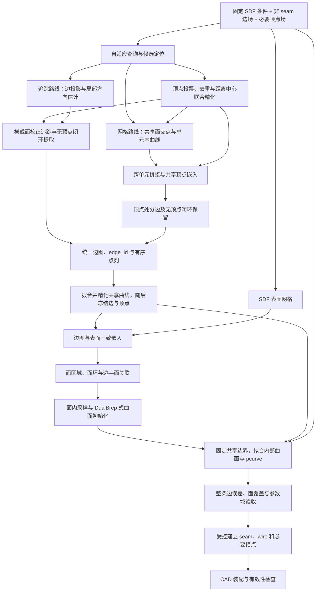

# 从边／顶点距离场恢复参数 B-rep：方案评审与设计建议

本文整理一种融合 BR-DF 与 DualBrep 思路的研究方案：用到最近 B-rep 边和顶点的距离场表达结构，直接提取边图，再拟合参数曲线并恢复完整 B-rep。

**已确定的设计约定：参照 DualBrep，seam 不参与 UDF 标签计算与生成。生成阶段只表达不同 face 之间的边及其必要顶点；seam 由曲面参数化和 CAD 后处理建立或修复。** 后处理新增的 seam、端点及分段不要求与原始 CAD 的选择一致。

**已确定保留 SDF 作为几何条件。** 面区域由边图与 SDF 表面共同确定；参照 DualBrep 从各面采样点初始化参数曲面，再以已提取、精化后的唯一共享三维边和顶点约束曲面边界。曲面拟合阶段默认冻结这些边和顶点，SDF 提供内部形状与法向参考。兼容曲面采用整条边界的硬约束，一般裁剪面按明确的边—面容差验收，不能仅固定几个角点就宣称经过所有边。

讨论假设扩散模型已经能够生成可查询的场，重点是**表示所包含的信息、确定性提取、拓扑恢复和参数几何装配**。本文是设计文档，不表示仓库已经实现或验证了该方案。数学推导、已有方法与建议实验在下文分别说明。

相关背景：

- [DualBrep 的 UDF 定义与处理流程](DualBrepUDFAndTopology.md#udf-flow)。
- [现有拓扑恢复、seam 与特殊边处理](DualBrepUDFAndTopology.md#topology-seam)。

## 1. 原始设想与评审结论

原始设想是：

1. 生成两个标量场：任意空间点到最近 B-rep 边的距离、到最近 B-rep 顶点的距离。
2. 通过阈值筛选顶点附近和边附近的采样点。
3. 根据顶点之间的边点，将点分组为不同 edge。
4. 采用固定端点的分段 Bézier 曲线逐条拟合。
5. 后拟合的边参考已有边确定相交顶点，使关联边相交。
6. 同时获得边几何与拓扑，减少对独立拓扑预测网络的依赖。

这个方向具有可行性，但应修改三个关键环节：

| 原始环节 | 需要修改的原因 | 建议 |
|---|---|---|
| 阈值点直接作为顶点或边点 | 阈值得到的是球状和管状邻域 | 将阈值作为候选生成，再进行中心定位与投影 |
| 由两个顶点夹住的点确定一条边 | 端点对不能唯一确定边，且存在闭环 | 通过分支追踪或网格局部重建获得曲线图，在共享顶点处分段 |
| 后一条边参考前一条边确定交点 | 产生顺序依赖，空间曲线受扰动后可能不相交 | 先建立共享顶点变量，所有关联曲线使用相同端点约束 |

目标应分为两个层次：

- **第一层：**恢复不含 seam 的面间边网络及其 edge–vertex 关联，支持无生成顶点的闭合边。
- **第二层：**恢复 face、wire、coedge 及边面几何一致性，完成周期参数化与 seam 补建，装配成有效 B-rep 实体。

第一层成功不自动保证第二层成功。

## 2. 表示定义与适用范围

### 2.1 已确定：保留 SDF 几何条件，采用三个场

设实体表面为 $M$，按 §2.2 过滤 seam 后的面间边几何集合为 $E$，该边网络所需的顶点位置集合为 $V$。这里的 $E,V$ 不再指原始 STEP 中的全部边和顶点：

$$
s(x)=\operatorname{SDF}_M(x),\qquad
d_E(x)=\inf_{y\in E}\|x-y\|,\qquad
d_V(x)=\min_{v\in V}\|x-v\|.
$$

几何与结构的完整表示是：

$$
F(x)=[s(x),d_E(x),d_V(x)].
$$

其中 $s$ 是保留的几何条件，结构场可记为 $G(x\mid s)=[d_E(x),d_V(x)]$。这个记号不要求三个通道必须联合生成；若 SDF 来自上游模型，重建阶段将其固定为几何参考。结构场与 SDF 必须使用同一空间坐标和尺度。

- $s$ 确定实体外壳，并为面区域采样、曲面内部拟合、法向及覆盖检查提供几何条件。
- $d_E$ 确定非 seam 面间边集合的位置。
- $d_V$ 单独约束该边网络所需的顶点，包括应保留的二度分段顶点；仅为 seam 或闭合曲线参数开口设置的人工锚点不作为生成目标。

仅有 $d_E,d_V$ 通常不能确定面内部形状，同一个边界环可以支撑不同的曲面。本方案已选择 SDF 补足面内部信息，参数曲面由面内采样点拟合，并受共享边界约束，具体设计见 §9.5–§9.10。

### 2.2 已确定：生成不含 seam 的面间边网络

这里的 B-rep edge 不应默认等同于“尖锐棱线”。不同 face 之间即使共面或相切，也可能存在需要保留的拓扑边。

本方案采用以下固定规则：

1. **边监督：**只保留两个不同 face 共享的非退化边，形成 $E$。seam 不参与距离查询、近边采样、分支追踪或曲线生成目标。按拓扑边实体过滤后再取几何并集，不能把 seam 与真实面间边的交点从保留曲线上挖掉。
2. **seam 判断：**依据边相对于 face 的使用关系和参数接缝属性，不依据三维曲线是否闭合。圆柱上下圆环连接侧面与端面，仍应保留；圆柱侧面的轴向 seam 不进入 $E$。
3. **顶点监督：**先过滤边，再构造 $V$。保留非 seam 边的真实端点、交汇点及应保留的分段顶点；删除仅与已删除 seam 关联的点，排除仅用于完整光滑闭环参数开口的人工锚点。不能直接沿用原始 STEP 的全部顶点。
4. **混合关联顶点：**一个点同时关联 seam 和真实面间边时，不能仅因接触 seam 就删除。若去掉 seam 后仍是面间边的连接或分段节点，应保留；只有能够确认其作用仅为参数开口时，才将锚定移到后处理。
5. **二度顶点：**不统一删除。若某点仅由 seam 引入，并且两侧非 seam 曲线在几何及面侧关联上可安全合并，可按统一的数据规范消除该人工分段；不能仅凭度数为 2 就合并任意真实 edge。
6. **最终装配：**由闭合／周期曲面参数化及 CAD 内核按需要建立 seam、pcurve 和相关拓扑顶点，不要求复原原始 seam 的位置或编号。

例如，对侧面完整、上下端面各为一张面的圆柱，生成目标可以是两个面间圆环且 $V=\varnothing$。原 seam 与圆环相交处仅作闭环锚点时，不进入 $d_V$；后处理再选择圆环的参数起点及相容的侧面 seam。不能为了使用“从顶点出发”的提取器，强制生成两个原 seam 端点。

当前 [`Voronoi/calculate_voronoi/calculate_voronoi.cpp`](../Voronoi/calculate_voronoi/calculate_voronoi.cpp) 的 `sample_points_surface()` 已在过滤同面重复边及两侧同面边后建立顶点关联，并移除仅关联一条保留曲线的顶点（包括同一曲线首尾重复出现的情况）。这是本方案的处理参考；新的 $d_E,d_V$ 标签管线仍需显式实现上述规范，不能认为修改文档已经修改了训练数据。

初版范围仍限定为闭合流形实体、非退化边、无重合边内部。退化边、开放壳、其他同面内部边及多实体需另行规定；“seam 交给后处理”不意味着这些特殊结构都会自动得到补全。

这些约定在数据预处理中的执行顺序、过滤判据及现有代码复用方式见 §2.4。直接曲线图提取与 [隔离带标签传播方案](BandLabelTopologyRecovery.md) 使用同一套目标边、顶点和真值关联。

### 2.3 理想场的一致性关系

当所有顶点都属于至少一条边、边包含端点，且所有边都位于实体表面时，有：

$$
V\subseteq E\subseteq M
\quad\Longrightarrow\quad
|s(x)|\leq d_E(x)\leq d_V(x).
$$

这里的 $E,V$ 必须使用同一套去 seam 规范。$V$ 可以只是 $E$ 上的必要顶点子集；闭合边没有生成顶点，并不违反包含关系。这些关系可作为生成结果的诊断条件，但不充分保证场描述了有效 B-rep。

若使用截断和归一化，应先在统一的物理距离尺度上解释这些关系；不同通道采用不同缩放时，不能直接比较网络输出。

对于空边集或空顶点集，距离在数学上可取 $+\infty$。工程上应采用截断上限及显式存在标记等约定，不能把“没有顶点”解释成任意位置存在一个顶点。

尤其应支持 $E\ne\varnothing,V=\varnothing$：边场仍用于提取闭环，顶点场全域取截断上限并标记无顶点。顶点存在标记为假时跳过顶点检测与相应拟合项；不能把顶点未检出直接判定为整个样本失败。

### 2.4 数据预处理：边／顶点过滤与 DualBrep 代码复用

本节规定待实现的数据管线。优先复用现有 STEP 读取、统一归一化、拓扑遍历、seam 检测、表面采样和边采样框架；新增目标集合筛选、必要顶点规范及两个距离查询。下述规则与接口尚不代表已修改 `prepare_implicit.py` 或重新生成训练数据。

#### 2.4.1 区分目标边排除与整份样本拒绝

当前 [`calculate_voronoi.cpp`](../Voronoi/calculate_voronoi/calculate_voronoi.cpp) 的 `sample_points_surface()` 提供以下参考：

| 情况 | DualBrep 当前 GVD 预处理 | 新 $d_E,d_V$ 管线规则 |
|---|---|---|
| 同一 face 内正反向重复使用的 seam | 跳过该边的使用记录 | 从生成目标边集合排除，记录 `seam` 原因，留给参数化后处理 |
| 两次关联属于同一个拓扑 face | 从边表删除，代码注释称 `generatrix` | 不作为面间边；确认是 seam 时按上项处理，其他同面内部结构在初版标为不支持，不能承诺后处理自动补回 |
| `BRep_Tool::Degenerated(edge)` 为真 | 报错并中止处理 | 初版拒绝该样本或进入独立特殊结构分支；不能只删退化边后声称完整支持该 CAD |
| 普通边只有一次面边界使用 | 面关联记录数不等于 2，中止处理 | 作为开放边界／拓扑异常拒绝，不静默删除后保留原 face 标签 |
| 普通边具有超过两次面边界使用 | 同上 | 作为非流形／重复使用异常拒绝，除非另行扩展支持范围 |
| 两个不同 face 之间的非退化边 | 保留 | 保留，包括闭合、相切、共面及同一支撑曲面上的不同 face 边界 |
| 短边 | 没有按最小长度显式删除；长度影响采样数 | 不因长度短而删边，保证采样覆盖；无法可靠表达时标记样本失败或调整精度 |

`generatrix` 在这里不是几何类型判据：代码比较的是两个 face 是否为同一拓扑对象，不是检查“是否圆柱母线”、法向夹角或支撑曲面是否相同。完整圆柱的轴向 seam 被排除，上下端面圆环保留；两个不同半圆柱 face 之间的轴向边也应保留。

原 C++ 的 `edge_face_map` 记录的是边在各 face 中的出现次数，不能直接把向量长度解释成不同 face 的数量。新实现同时保存**边界使用记录及方向**和**去重后的 face 身份**，按普通流形边恰好两次使用、分别属于两个不同 face 进行检查。仅检查两个不同 face 仍不足以发现额外重复使用。

#### 2.4.2 边集合的处理顺序

1. 读取 STEP，验证初版支持的闭合流形实体范围，并对同一 CAD 执行一次统一平移和等比例缩放。SDF、曲线、顶点及查询点共用该变换；保存实际变换参数。
2. 遍历原始 face、wire 和边界使用，建立稳定的 `source_face_id`、`source_edge_id`、顶点 id 及方向记录。边实体去重忽略正反向，但保留各次使用；不以坐标接近替代拓扑身份，不把两个不同 face 因几何相同而合并。
3. 在排除 seam 前检查原始边的退化标记及模型有效性，避免 seam 过滤掩盖当前不支持的退化结构。对缺失或无效的曲线表示记录失败；需要修复时重新验证模型，再建立目标映射。
4. 复用 seam 检测，结合其关联 face 的边界使用记录排除参数接缝。普通 seam 应为同一 face 内的两次相容使用；若在某 face 上检测为 seam，却还被其他 face 使用或存在额外使用，初版应报告拓扑异常，不能直接跳过。`BRep_Tool.IsClosed(edge, face)` 检查同一 face 上的双 pcurve 接缝，不能替换成仅判断边首尾闭合的 `IsClosed(edge)`。[11]
5. 对剩余边验证两次普通边界使用及两个不同 face 的关联。非 seam 的同面内部结构、开放边和非流形关联按上表处理；通过检查的边构成目标边实体列表 $\mathcal E_{\mathrm{keep}}$。
6. 以每条边的**完整有限参数区间，包括端点**构造几何集合 $E$，再执行顶点筛选和必要的人工分段规范化。seam 与保留曲线的原交点仍属于 $E$，不能在曲线上挖掉对应点或小段。

对于通过范围检查的样本：

$$
E=\bigcup_{e\in\mathcal E_{\mathrm{keep}}} C_e([a_e,b_e]),\qquad
d_E(x)=\min_{e\in\mathcal E_{\mathrm{keep}}}\min_{t\in[a_e,b_e]}\|x-C_e(t)\|.
$$

若一个目标 edge 由消除人工分段后的多条原始曲线组成，保存有序的原曲线区间列表，用其几何并集查询距离，不必为了预处理重新拟合曲线。没有必要顶点的完整光滑闭环作为一条目标 edge；仍含必要交汇或分段顶点的闭环按这些顶点分段。不能仅凭曲线闭合就合并所有原始 edge。

#### 2.4.3 顶点集合必须从保留边重新构造

复用 C++ 中“先过滤边，再建立 `vertex_edge_map`”的顺序。同时保存每个顶点关联的不同 edge 实体及各次端点出现，区分“同一闭合 edge 的首尾两次出现”和“两条不同 edge 的关联”。

| 去 seam 后的顶点情况 | $d_V$ 监督规则 |
|---|---|
| 没有任何保留边关联，仅服务于已排除的 seam | 从目标顶点集删除 |
| 一条完整光滑闭环的首尾锚点，无其他真实连接或必要分段作用 | 删除生成锚点，保留完整闭环；CAD 参数起点由后处理选取 |
| 真实交汇点，或需要表达的转折／分段节点 | 保留为一个共享 `vertex_id` |
| 两条不同保留边之间的二度顶点 | 默认保留；不能按度数为 2 统一删除 |
| 同时关联 seam 和真实面间边 | 根据保留边中的作用判断，不能因为接触 seam 就删除 |
| 可以证实仅由 seam 接入或参数开口产生的二度人工分段 | 仅在局部几何延续、邻面身份与面侧使用相容，且不改变真实连接时消除；同步合并目标 edge 身份并保存来源映射 |
| 仅出现一次的普通开曲线端点，且不能解释为合法保留结构 | 检查遗漏边、错误合并或模型范围；不套用“只有一条边就删点”掩盖问题 |

原 C++ 会删除仅关联一条保留曲线的顶点，包括同一曲线首尾重复出现的情况。可复用其关联收集和候选识别，但新 $d_V$ 必须增加“是否仅为人工锚点”的判定：若该点仍承载必要几何或拓扑分段，就应保留。无法确认人工属性时，保留为必要顶点或标记待复核，不能仅凭度数猜测。

二度人工点的消除应使用统一、版本化的规则，而不是按形状临时决定。无需追溯原建模历史，但要有可检验的闭环、几何延续和面侧关系依据；面标签对相同本身不充分。消除点时应同步更新目标边、edge–face、edge–vertex 及边界环映射，避免 $d_V$ 不再监督分界点而真值仍保留两条待区分的 edge。

顶点坐标优先来自保留 CAD 拓扑顶点；同一拓扑顶点的多次出现合为一个 id。不同拓扑顶点不能仅因距离小就合并，近邻短边应保留；顶点与关联曲线的几何相容性按统一容差检查。无必要顶点的闭环可以令 $V=\varnothing$，空集合和截断标记遵循 §2.3。

#### 2.4.4 尽量复用现有函数，仅新增必要逻辑

| 现有代码 | 复用方式 | 需要补充或调整 |
|---|---|---|
| [`brep_post/occ_utils.py`](../brep_post/occ_utils.py)：`normalize_shape`、`get_triangulations` | 复用等比例归一化和表面三角化 | 统一保存实际变换；三角化用于 SDF／面采样，不替代边与顶点的 CAD 身份 |
| 同文件：`get_primitives` | 复用原始实体枚举、方向去重及 seam 过滤开关 | 明确传入 `v_remove_half` 与 `v_remove_seam`；另行保存边界使用记录，实体去重列表不能代替 coedge 次数 |
| 同文件：`is_seam_edge` | 复用 `BRep_Tool.IsClosed(edge, face)` 检查 | 当前对任意 face 检测为 seam 即返回真，必须先核对全部使用，避免隐藏额外面关联；可缓存关联和判定，减少重复扫描 |
| `calculate_voronoi.cpp`：`sample_points_surface` 的关联逻辑 | 复用边—面、顶点—边收集及同面边排除的判据 | 这些逻辑嵌在 C++ 函数内，Python 路径需提取为共享辅助模块或等价移植；不必运行整个 GVD 构造才能筛选边 |
| [`prepare_implicit.py`](../prepare_implicit.py)：`compute_length`、`sample_edge_points` | 复用按长度分配样本、CAD 曲线求值和切向计算框架 | 输入改成保留边；为短边设置足够的最小采样数，闭环避免仅采重合端点；补充空边集、无效切向和采样失败处理 |
| 同文件：表面采样、随机查询、多尺度扰动、SDF 查询及 `.npz` 保存 | 复用数据管线框架 | 新增近必要顶点查询及 $d_E,d_V$ 通道，去掉必须依赖 `voronoi.ply` 的前提；更新字段及加载契约 |

当前 `prepare_implicit.py` 调用 `get_primitives(shape, TopAbs_EDGE, True)`，其中第三个参数仅表示去除重复方向，第四个 `v_remove_seam` 默认是 `False`。现有 `edge_points` 因而不能直接认作已去 seam 的监督。完成原始拓扑检查后，可复用已有接口生成候选：

```python
# 已有函数，可直接复用；这是 seam 过滤后的候选，不是全部检查的替代。
candidate_edges = get_primitives(
    shape, TopAbs_EDGE,
    v_remove_half=True,
    v_remove_seam=True,
)
# 后续新增：面使用次数检查、目标 edge 规范化、必要顶点筛选、距离查询。
```

最小新增模块负责：原始使用关系与来源映射、样本范围验证、必要顶点／闭环规范化，以及 $d_E,d_V$ 查询。STEP 读取、曲线求值、表面网格与采样等不重复实现。原 `sample_edge_points` 的比例取整可能为短边分配零个样本，且遇到空边集会报错，不能未经调整直接用于新场所有合法样本。

归一化也应复用同一次结果：Python `normalize_shape` 使用三角化包围盒，原 C++ 使用 `BRepBndLib`，不能假定分别运行两套归一化会完全一致。保存归一化前的中心与统一尺度，或直接保存实际变换；不要把辅助函数返回的变换后包围盒当作原始中心。

#### 2.4.5 距离真值、查询采样与输出契约

**距离真值与采样分布分开处理。** 边 UDF 查询完整的保留曲线集合，顶点 UDF 查询最终必要顶点集合；边／顶点附近增加查询点仅改善监督覆盖，不改变两个集合的定义。

- $d_E$ 可复用现有 C++ 中的 CAD 曲线投影调用方式，新增对所有候选有限曲线区间的最近点比较，并显式考虑区间端点。确认曲线的 `TopLoc_Location` 已计入查询坐标，避免局部坐标与归一化坐标混用或重复变换。多段目标 edge 对其原曲线区间取最小值；空间加速只能排除有可靠距离下界的候选。没有内部投影驻点时仍需比较端点；若求解器失败则重试或记录失败，不能忽略该边、直接填零或把最近采样点距离当成精确曲线距离。
- $d_V$ 直接对保留顶点坐标求欧氏距离最小值，可批量计算或使用空间索引。只有 $V=\varnothing$ 时使用截断上限和 `has_vertices=False`，不能把这一合法状态误当作查询失败。
- 对边监督点、近边查询、顶点监督点和近顶点查询，统一使用筛选后的目标集合。通用空间／表面查询可以覆盖任何位置，即使恰好靠近 seam，也仍按目标 $E,V$ 计算距离，不能把 seam 自动标为零距离。
- 不复用 GVD 构造中的端点避让、删近顶点采样点、面点避边或随机微扰来裁剪距离目标。它们服务于 Voronoi 采样站点布局，并没有删除 CAD 曲线；新场也不需要继承“必须生成足够 GVD 三角形”的样本限制。

特别注意：现有 `query_edge_udf` 的含义是“在近边查询点上求到 **GVD 网格** 的距离”，不是本文的 $d_E$；`query_surface_udf` 同样是 GVD 距离。不能只更改变量名或增加顶点通道，就认为已有标签已符合新定义。

建议新数据版本明确保存以下内容，具体数组布局可沿用原 `.npz` 框架：

| 内容 | 建议字段／记录 |
|---|---|
| 查询与三类场 | `query_points`、`query_sdf`、`query_dE`、`query_dV`；若按来源分组，每组都明确对应的场含义 |
| 监督样本 | 去 seam 的 `edge_points` 及所属目标 edge id，必要 `vertex_points` 及 vertex id，原表面点与法向 |
| 空集合与尺度 | `has_edges`、`has_vertices`、实际坐标变换、各通道截断和归一化参数 |
| 实例真值 | 独立 `edge_id`／`vertex_id`、邻面、端点、闭合标记及边界使用；无顶点闭环的端点为空，自环保留相同的起止 vertex id |
| 可追溯记录 | 原实体到目标实体的映射、排除／合并原因、样本失败原因、过滤规则版本及场定义版本 |

查询和几何校验阶段使用足够精度，存储压缩精度按目标定位误差选择；不能不加评估地继承原脚本所有 `float16` 转换。旧 GVD 字段与新距离字段需通过版本或显式配置区分，数据加载器和损失函数也应按新契约适配。

#### 2.4.6 预处理验收

训练、验证和测试采用同一筛选与分段规范。至少检查：

1. 每条普通目标边具有两个不同邻面；源边界使用次数、方向和目标关联一致，面标签对相同的多条边仍保留独立身份。
2. 对保留曲线上的点检查 $d_E\approx0$，对必要顶点检查 $d_V\approx0$ 且 $d_E\approx0$；在数值容差内验证 §2.3 的集合与距离关系。SDF 来自三角化近似时，误差界应包括网格近似误差。
3. 完整圆柱排除轴向 seam、保留两个端面圆环；若原端点仅为参数锚点，输出 `has_vertices=False`。seam 与圆环的交点仍满足 $d_E\approx0$。
4. 保留真实二度点、相切／共面边界、短边及近邻顶点；人工点消除后，目标 edge 分组和评估真值同步更新。
5. 含退化边、开放边或非流形关联的初版不支持样本返回明确失败原因；空边集／空顶点集则按其实际语义验证，不用 GVD 是否成功生成来替代判断。

## 3. 与 DualBrep、BR-DF 的关系

| 项目 | 当前 DualBrep | BR-DF | 本方案 |
|---|---|---|---|
| 几何外壳 | SDF | SDF | 固定 SDF 几何条件 |
| 结构场 | 到面间 GVD 分界的单个 UDF | 每个 face 的独立 UDF | 到非 seam 面间边及其必要顶点的两个 UDF |
| 面身份 | 通过面内部区域分割恢复 | UDF 通道对应 face | 场中没有独立 face 身份 |
| 显式恢复入口 | 面片 | 表面上的面标签竞争 | 顶点与曲线分支 |
| 边—顶点关系 | 网络预测边后再装配 | 由分区边界及交汇提取 | 通过分支追踪或网格图分段恢复 |
| 面—边关系 | 面对分类与裁剪曲线预测 | 与面分区一起构造 | 需要把边图嵌入表面后恢复 |

BR-DF 在 SDF 表面上比较各 face 的距离，使用最小值定义面区域，通过共同最小值提取分界；MCT 输出的是 faceted B-rep，其成功率口径不包含完整参数曲面拟合。[1]

本方案与其共有的目标是“从连续场确定性提取结构”，但提取机制不同。两个聚合距离场不直接提供边身份或面标签，不能仅凭采用距离场就继承 BR-DF 的构造一致性结论。

当前仓库的区别可从这些位置核对：

- [`prepare_implicit.py`](../prepare_implicit.py)：现有 UDF 监督来自到 Voronoi 网格的距离。
- [`ae_reconstruct.py`](../ae_reconstruct.py)：在重建网格三角形中心查询标量 UDF。
- [`clustering.py`](../clustering.py)：默认屏蔽低值区域，对保留的三角形邻接图求连通分量。
- [`rebuild.py`](../rebuild.py)：排除未分配区域，向网络传递各面采样点、法线与包围盒。
- [`rebuild_model.py`](../rebuild_model.py)：预测面对连接与 UV 裁剪曲线。

## 4. 两个距离场是否包含足够的边图信息？

### 4.1 理想情况下可以恢复 edge–vertex 图

精确连续场的零集给出：

$$
E=\{x:d_E(x)=0\},\qquad V=\{x:d_V(x)=0\}.
$$

在以下假设下，可以通过连续追踪或自适应网格提取重建 $E$，并在 $V$ 处组织边，恢复边—顶点图：

1. 所有非 seam 边的非周期端点和真实交汇点都包含在 $V$ 中；完整光滑闭环的人工参数起点可以省略。
2. 不同边内部不重合，不存在未建顶点的交叉。
3. 边形成有效的嵌入图，并采用一致的分段约定。
4. 对闭环采用显式处理，而不要求每条边有两个不同端点。

因此不能说两个标量场在信息上必然不足以恢复边图。这里恢复的是去 seam 后的面间边网络，而不是包含原始接缝的完整 CAD 图。实际困难是从有限采样和有误差的预测场中稳定提取这个网络。

### 4.2 不等于保存了任意原始 B-rep 的全部身份信息

距离场描述的是几何集合。如果两条不同拓扑边在空间中完全重合，聚合距离不会保存它们的多重身份；顶点距离也不会区分相同位置的多个拓扑顶点。

此外，几何边集不会直接保存 coedge 的方向和参数域布局。本方案明确不编码 seam 及其重复使用关系，这部分由后处理新建。应将“恢复与几何相容的拓扑”和“逐项恢复原文件的所有拓扑细节”区分开。

## 5. 为什么阈值不能直接给出顶点和边？

### 5.1 阈值集合的几何维度

定义邻域 $N_\tau(A)=\{x:\operatorname{dist}(x,A)\leq\tau\}$。则：

$$
\{d_V\leq\tau_V\}=\bigcup_{v\in V}B(v,\tau_V),\qquad
\{d_E\leq\tau_E\}=N_{\tau_E}(E).
$$

有限正阈值下，前者是球的并，后者是管状邻域。它们都是三维候选区域，尚不是零维顶点或一维曲线。

如果把一颗球内所有采样点都作为顶点，会产生大量重复节点；如果把整根管内所有点直接交给一条曲线拟合，在交汇和近邻边处容易混入其他分支。

顶点属于边，因此两类候选也不是互斥类别。更合理的处理方式是将顶点邻域作为交汇区，在其外追踪普通边段，再将各分支接回共享顶点。

### 5.2 噪声与阈值的作用

若预测场满足 $\|\hat d_A-d_A\|_\infty\leq\epsilon$，且 $\tau\geq\epsilon$，则：

$$
N_{\tau-\epsilon}(A)
\subseteq\{x:\hat d_A(x)\leq\tau\}
\subseteq N_{\tau+\epsilon}(A).
$$

这说明阈值候选受到误差影响，会在真实几何周围变厚或变薄。若两个不应连接的结构相距 $\delta$，条件

$$
2(\tau+\epsilon)<\delta
$$

可以防止这两个包络相互接触，但这只是局部分离条件，并非完整拓扑恢复保证。真实交汇处本来就应接触，必须另行处理分支。

阈值过大还可能合并近邻顶点；过大的顶点排除区域可能吞掉整条短边。

### 5.3 采样策略

小半径下，长度为 $L$ 的普通边管体积约随 $L\tau_E^2$ 缩放，而顶点球体积随 $\tau_V^3$ 缩放。因此均匀三维采样中，顶点尤其容易漏采。

建议使用表面附近采样、低值区域自适应细分以及连续定位。上述球／管体积描述的是三维采样；若初始点只在表面上，候选是这些邻域与表面的交集，同样不要求采样点恰好落在边或顶点上。

**阈值只负责找到定位起点，最终坐标可以离开原采样位置，通过连续场查询和优化求出。** 不应不断缩小阈值，以期留下恰好位于零集的采样点；这样可能先丢失全部候选。初始采样仍需覆盖各条分支，连续定位不能自动补回完全未发现的短边或独立闭环。

所有阈值必须相对于统一归一化尺度、采样间距及预计误差设置，本文不提供未经验证的固定数值。具体连续定位方法见 §7。

## 6. 连续 UDF 可以利用趋势提取结构

不能因为 UDF 非负，就认为它无法检测分界或恢复曲线。准确说法是：它没有可直接套用的端点符号穿越判据，但可以利用额外采样、局部形状、梯度和投影。

例如沿横穿一段结构的局部坐标 $t$，预测场可能近似：

$$
\hat u(t)=a|t-t_0|+b,\qquad a>0.
$$

即使 $b>0$、没有零点，先降后升的趋势仍可定位 $t_0$。因此，$|t|+\epsilon$ 的例子只能说明精确零值检测失效，不能说明低谷追踪失效。

需要注意，三维曲线的局部距离通常是在两个法向方向形成低谷，而沿曲线切向变化较小。单次一维扫描不足以确定完整曲线，仍需多方向信息和空间连接。

此外，低谷可能来自接近但未穿越目标结构，梯度反转也可能出现在远离零集的最近元素切换位置。实际提取应结合距离、局部方向、空间连续性和表面约束。

## 7. 建议的顶点定位与分支追踪

本节是一种待验证的提取设计，不是已实现算法。默认可在任意空间位置继续查询生成的连续场，并能通过坐标自动微分或有限差分获取梯度；只有固定采样数据时的限制见 §7.6。

对真实欧氏距离场 $d_A$，当 $d_A(x)>0$、最近点唯一且场可微时：

$$
\nabla d_A(x)=\frac{x-\pi_A(x)}{d_A(x)},\qquad
\boxed{\pi_A(x)=x-d_A(x)\nabla d_A(x)}.
$$

距离值给出移动长度，负梯度给出方向，因此不必先采到零集。以局部直边为 $x$ 轴为例，查询点 $q=(t,a,b)$ 满足：

$$
d_E(q)=\sqrt{a^2+b^2},\qquad
\nabla d_E(q)=\frac{(0,a,b)}{\sqrt{a^2+b^2}},\qquad
\pi_E(q)=(t,0,0).
$$

理想场能将未命中边的采样点直接投影到边上；单个顶点附近同样有 $x-d_V(x)\nabla d_V(x)=v$。最近元素切换位置或交汇邻域可能不满足唯一性和可微性条件，不能在那里直接套用普通边段模型。

**预测场上的投影是初始化手段，不是精度保证。** 若 $\hat d=d+b$，即使梯度方向正确，按预测距离移动仍可能多走 $b$，产生过冲或反复越过低谷。实际应使用阻尼、最大位移限制及更新接受检查，并结合下面的多点拟合和低谷定位；不能假设反复投影必然收敛到真实零集。EMAP 的候选筛选和 UDF 梯度投影可作为初始化基线。[2]

### 7.1 顶点中心定位

从低 $\hat d_V$ 区域产生种子，按“多点投票、区分顶点、联合精化”的顺序处理。

若顶点存在标记为假，则跳过本步骤，直接从边候选启动闭环提取。不得因为顶点场没有有效极小值而删除已检测到的圆环。

**第一步：生成位置投票。** 可用归一化梯度更新产生初步候选：

$$
v_i^{(0)}=x_i-\alpha_i\min(\hat d_V(x_i),r_i)
\frac{\nabla\hat d_V(x_i)}{\|\nabla\hat d_V(x_i)\|+\varepsilon},
\qquad 0<\alpha_i\leq 1.
$$

其中 $r_i$ 限制最大位移，$\alpha_i$ 控制阻尼，$\varepsilon$ 仅用于数值稳定；梯度过小或方向不可靠时应停止该更新并转用其他定位方法。应检查局部目标是否改善，必要时缩小步长，不把它作为无条件收敛迭代。

同一顶点附近的种子应向相近位置投票，形成可重复的位置峰。先区分不同顶点，再分别精化；去重尺度应适应局部结构，固定大半径的非极大值抑制可能误合并真实近邻顶点。这是顶点候选的归并，不是通过面采样点的连通分量分割 face。

**第二步：联合拟合距离中心。** 保留原始查询位置及其距离值，对属于同一顶点局部支撑域的样本求解：

$$
v^*=\arg\min_v
\sum_i w_i\rho\!\left(\|x_i-v\|-\hat d_V(x_i)\right)
+\lambda_S\hat s(v)^2.
$$

$w_i$ 是样本权重，$\rho$ 是鲁棒损失，SDF 项将结果约束在表面附近。每个查询位置及其距离值给出一个球面约束，多个约束共同确定顶点。不能直接取原始阈值点的均值：其位置受表面形状和采样密度影响，通常不是距离中心。

上述局部模型要求参与拟合的样本以同一个顶点为最近顶点。靠近两个顶点的等距区时，应缩小支撑域、保留多假设或重新分配样本，不能将不同顶点的距离观测混成一个中心。

若存在局部系统偏差，可将残差改为 $\|x_i-v\|+b-\hat d_V(x_i)$，同时估计受约束或正则化的小偏差 $b$。这不是默认必加项：查询方向或半径过于单一时，位置与偏差可能难以区分。

**第三步：追加查询并检查稳定性。** 在初步顶点周围从不同方向、不同距离补充少量三维查询，再重复精化。仅靠表面点可能产生接近共面或单侧的支撑，使某些方向的定位不稳定；SDF 约束和三维查询可改善这种情况。查询需留在同一顶点的局部支撑域内，不能为增加样本数而跨入相邻顶点区域。

后续可结合入射边的位置联合调整共享顶点，但不能仅凭多个候选的均值就宣称达到真实 CAD 顶点精度。

### 7.2 边中心线定位与切向

从低 $\hat d_E$ 候选出发，先用有限步、带步长控制的投影得到靠近中心线的点集。在普通边段、最近点唯一且真实距离场可微时：

$$
\pi_E(x)=x-d_E(x)\nabla d_E(x).
$$

边是一维连续集合，不能把整条边上的候选都向同一个极小点聚拢。应保留它们沿曲线的位置分布，使用横截面校正和分支追踪组织这些点；预测场上的一次投影仍可能留下有厚度的点带。

注意：$\nabla d_E$ 是径向信息，不是边切向。普通边段可通过投影点的局部 PCA，或邻域梯度矩阵的最小右奇异向量估计切向。后一方法需要邻域梯度充分覆盖曲线的两个法向方向，并控制曲率和邻边干扰。

**仅在表面查询可能不足以唯一确定三维切向。** 例如，平面内一条直边附近的表面查询，其距离梯度可能只张成一个方向，梯度矩阵会留下二维零空间。此时可结合可靠的表面法向、投影点的局部 PCA，或追加少量三维扰动查询；在尖锐交汇处不能假设存在唯一表面法向。交汇处也存在多个边切向，应交给 §7.3 的分支处理。

如果直接使用梯度不稳定，可考虑最近点偏移等额外预测量；如果增加切向通道，宜用无向表示 $T=tt^\top$，避免把 $t$ 与 $-t$ 当作不同目标。它们属于后续增强，初版可先使用两个距离场检验提取能力。

### 7.3 顶点邻域的出射分支

在顶点周围选择局部小球面，查询 $d_E$。不同 incident edge 穿过球面的位置可形成多个低值区域，作为出射分支种子。

半径需足够离开顶点定位误差区，又不能覆盖相邻顶点。急弯、短边、近切分支和高价顶点需要单独评估。这里不能假定一个顶点恰好有三条边。

### 7.4 沿分支追踪并记录拓扑

普通边段采用“沿切向预测、在横截面校正”的过程。设当前点为 $q_k$、单位切向为 $t_k$，先预测：

$$
\tilde q_{k+1}=q_k+h_k t_k.
$$

取垂直于 $t_k$ 的两个正交方向组成 $N_k\in\mathbb R^{3\times2}$，在有界截面内求解：

$$
z^*=\arg\min_{\|z\|\leq r_k}
\hat d_E(\tilde q_{k+1}+N_kz)^2
+\lambda_S\hat s(\tilde q_{k+1}+N_kz)^2,
\qquad
q_{k+1}=\tilde q_{k+1}+N_kz^*.
$$

横截面约束减少沿曲线的无意义滑动，搜索半径限制跳到附近另一条边的风险；两者不构成分支正确性的保证。每次校正后重新估计切向，并根据曲率、近邻间距和场置信度调整 $h_k,r_k$。在尚未可靠估计切向时，应先改善局部查询或初始化。

对存在正偏差但仍保留距离形状的场，搜索低谷中心比强求 $\hat d_E=0$ 更合适。空间变化的偏差仍可能移动低谷，SDF 与边场也可能不完全相容；上述目标是在二者之间协调，而非保证同时精确满足两个零值条件。应分别记录两项残差。

若可查询连续 SDF，应直接约束 $\hat s$；把校正点吸附到最近的原始表面采样点或粗网格顶点，会重新引入采样量化误差。只有网格时，可使用网格面片上的连续位置，但精度受网格近似误差限制。

对每个出射分支：

1. 沿切向预测下一个位置。
2. 在局部横截面内寻找 $\hat d_E$ 低谷，并用 SDF 或表面网格约束所属外壳。
3. 根据曲率、场置信度和邻近分支调整步长。
4. 进入另一顶点邻域时记录对应端点。
5. 遇到已访问路径时判断是重复追踪还是闭合曲线。
6. 无法可靠继续时保留失败或不确定状态，不强行连接最近顶点。

顶点配对由追踪结果确定，而不是先按欧氏距离选两个顶点。

进入交汇邻域后，应结束普通边段的单切向模型，结合出射分支与共享顶点确定连接。不能通过继续最小化聚合边距离，让不同分支在顶点附近任意切换。

### 7.5 多重边与闭环

必须支持：

- 同一端点对之间有多条独立边；
- 首尾同顶点的闭合 edge；
- 未与已提取顶点相连的闭合曲线；
- 同一几何曲线被二度顶点分段。

例如，一个圆被两个顶点分成两条圆弧，不能因端点对相同而合并为一条边。数据结构应使用独立 `edge_id`，而不是用 `(start_vertex, end_vertex)` 作为唯一标识。

从顶点出发追踪之后，还需从未覆盖的低 $d_E$ 区域补充启动闭环追踪；$V=\varnothing$ 时直接从这些区域启动。这是去 seam 方案的必需路径，不能仅作为异常回退。

闭环使用独立 `edge_id` 和闭合标记保存，可以暂时没有端点 id。如果拟合或 CAD 内核需要参数锚点，给它单独的辅助标记，避免将其计入生成顶点。新增 seam 与闭环连接时，可在后处理统一选择或调整锚点，并让相关面引用同一拓扑顶点。

### 7.6 连续场查询与固定采样数据的区别

优先保留连续场查询接口。神经场可固定网络参数，仅对输入坐标求导；有限差分也可估计梯度，但步长需要兼顾数值误差和局部尺度。坐标求导不能放在关闭自动微分的推理包装中。距离截断的饱和区没有可用的距离梯度，应在未饱和的窄带中定位，并将归一化距离还原到与坐标一致的尺度。

如果手里只有固定查询点及其距离值，仍可用 §7.1 的距离中心模型拟合顶点，或用局部直线、圆弧、样条的距离模型拟合边；也可从足够密的网格插值获得近似连续场。这些方法依赖采样覆盖、局部几何假设和数据条件，插值不能恢复采样已经遗漏的分支或细节。

若仅保留阈值过滤后的点坐标，丢弃距离值，球面／距离模型提供的定位约束也随之丢失，只能更多依赖点分布和几何先验。因此应保留原始查询位置、距离值、可用梯度及置信信息，而不只保存二值候选掩码。

### 7.7 精度来源、停止条件与失败判据

应区分以下量，不能把候选阈值直接当作最终定位精度：

| 量 | 作用与限制 |
|---|---|
| 初始采样间距 | 影响是否发现短边、小环和相近分支 |
| 候选阈值 $\tau_E,\tau_V$ | 控制定位起点的覆盖与混入，不决定最终坐标必须落在哪个点上 |
| 连续定位的数值容差 | 控制优化终止，不代表真实几何误差 |
| 生成场的几何误差 | 可能造成中心或低谷偏移，限制最终可达到的精度 |

候选阈值可以较宽，后续定位容差可以更小。在场准确、查询条件充分的情况下，连续定位可达到小于初始采样间距的误差；不能据此承诺超越生成场本身的有效精度，也不能通过无限迭代保证 CAD 装配容差。

停止和接受结果时应综合检查：

- 坐标更新量是否足够小，而非仅检查距离值是否接近零；
- 顶点距离模型残差、边横截面目标和表面残差是否合理；
- 更换局部查询位置、从多个起点定位后，结果是否一致；
- 在可用空间中增加不同方向的查询后，中心位置是否稳定；
- 缩短追踪步长后，曲线位置、分支归属和端点关联是否稳定。

低场残差只表示与预测场相容，不直接证明接近真实 CAD。若多次查询得到不同中心、相邻分支无法分离或边场与表面冲突，应标记低置信度，追加查询、调整局部尺度或报告失败，不能仅按最近距离强行合并。

### 7.8 类 Marching Cubes 的点—曲线提取路线

除 §7.1–§7.7 的连续定位与分支追踪外，可以研究另一条主要路线：**借用 Marching Cubes 的逐单元重建、跨单元拼接思想，直接提取带连接关系的一维曲线图，再用独立定位的顶点划分 B-rep edge。** 两条路线共用距离场、连续定位方法和后续曲线拟合，但组织连接关系的方式不同。本节及后续网格算法均是待实现、待验证的设计。

标准 MC 输出的是二维等值面；这里需要输出零维点和一维曲线，因此必须修改单元内的提取规则：

| 场 | 目标零集 | 正阈值等值集的局部形状 |
|---|---|---|
| SDF $s$ | 二维实体表面 | 偏移表面 |
| 边距离 $d_E$ | 一维曲线网络 | 普通边周围的管面 |
| 顶点距离 $d_V$ | 零维顶点集合 | 孤立顶点周围的球面 |

这里的困难不只有无符号，还有零集维度不同。以单元 $[-1,1]^3$ 中沿 $x$ 轴穿过的直边为例：

$$
d_E(x,y,z)=\sqrt{y^2+z^2}.
$$

八个角点的距离均为 $\sqrt2$，但单元内部存在整段零集 $\{(x,0,0):-1\leq x\leq1\}$。仅对八个角点值做三线性插值会得到正常数，完全丢失这条边。同样，位于单元中心的顶点到八个角点的距离均为 $\sqrt3$，也无法通过普通零等值面查表定位。

因此需要增加单元内部查询、梯度或局部距离模型，不能直接对原始 UDF 套用八角点正负编码。MeshUDF 利用梯度推断局部伪符号，将 MC 扩展到无符号的曲面距离场；其提取对象仍是曲面，不能直接替代本方案的点／曲线提取。[6]

### 7.9 自适应网格内的局部重建与跨格拼接

**第一步：筛选候选单元。** 对边长为 $h$、中心为 $c$ 的立方体，其包围球半径为 $R=\sqrt3h/2$。真实距离场满足 1-Lipschitz 性，因此对 $A=E$ 或 $A=V$：

$$
d_A(c)>R\quad\Longrightarrow\quad A\cap\text{cell}=\varnothing.
$$

若预测场具有可信误差上界 $|\hat d_A-d_A|\leq\eta$，则 $\hat d_A(c)>R+\eta$ 也足以排除单元。未通过排除条件只意味着可能包含结构，不能直接判定存在边或顶点。没有可信误差界时，该筛选仅是启发式；截断距离还需确认其数值确实提供所需下界，不能把饱和值当作未经截断的真实距离使用。

可由此建立八叉树：远离结构的单元跳过，可能含结构的单元继续查询和细分。最终分辨率需要与局部曲率、顶点间距、非关联边间距及场误差协调。

**第二步：定位顶点。** 在顶点候选单元内使用 §7.1 的投影与距离中心联合拟合。顶点坐标不必落在格点上；相邻单元重复检测同一顶点时统一身份，一个单元可能包含多个顶点时继续细分或保留多假设，不能固定为一格一个顶点。空顶点集直接跳过该过程。

**第三步：寻找曲线与网格面的交点。** 普通 MC 通常在立方体的棱上定位曲面交点；本方案需要在立方体的面上定位曲线交点。在六个面上查询 $\hat d_E$，通过自适应二维搜索、局部距离模型和连续校正确定穿出位置。

低值本身不证明曲线穿过该面：曲线可能只是靠近它。应结合局部曲线延续与邻域查询确认交点，必要时追加内部查询。相切、沿面延伸或恰好穿过网格棱／角点的情况需要专门的归属与去重规则。

**第四步：重建单元内部曲线。** 当单元不含 B-rep 顶点、仅有一条普通曲线且检测到两个可靠的横截交点时，在二者之间重建一段局部曲线，并利用内部查询校正曲率与表面一致性。不能把所有非空单元一律压缩为一条线段或一个中心节点。

| 单元内情况 | 所需处理 |
|---|---|
| 多条互不相交的边经过 | 分别重建或细分，避免引入伪交汇 |
| 一条曲线多次穿过单元 | 识别交点配对，或继续细分 |
| 包含真实交汇顶点 | 结合顶点位置建立各分支关联 |
| 曲线与面相切、沿面延伸 | 用邻域查询确定单元归属与共享表示 |
| 完整小闭环位于单元内部 | 检查内部候选，不依赖面交点判断为空 |

多交点的配对需要切向、局部距离模型和内部场支持；不能任意两两连接。没有面交点也不等于没有曲线。有限查询无法无条件排除任意小闭环，应明确最小特征尺度、细分上限以及无法判定时的失败状态。

**第五步：跨单元拼接。** 共享网格面上的交点统一计算、统一编号，两侧单元引用同一节点。自适应网格还需协调粗细单元交界，不能由两侧独立生成不一致的连接。

输出的离散图由共享面交点、局部辅助节点和单元内曲线段构成；多数节点只是离散化节点，不是 B-rep vertex。单元段应保留来源、分支信息、场残差及置信度，便于后续分边和诊断。

### 7.10 将顶点插入曲线图并划分独立 edge

在 §4.1 的假设下，一条普通 edge 的内部对应 $E\setminus V$ 的一个连通分支；没有生成顶点的完整闭环也是独立分支。两个边内部点属于同一条 edge，意味着可以沿边集合连续连接它们，途中不经过任何保留的 B-rep 顶点。

这里的连通性是几何定义，实现可通过图上的路径遍历完成，不要求采用当前 DualBrep 的二维面内部连通分量分割。边身份不能由距离值、空间近邻或端点对单独确定。

数值折线通常不会恰好经过独立提取的顶点。因此“用点切开边”应实现为**顶点嵌入与路径分段**：

1. 为每个精化顶点寻找附近相容的曲线分支。
2. 结合局部场、切向和分支延续确认关联，不能无条件吸附所有近邻曲线。
3. 在图中插入共享顶点节点，拆分相关局部曲线段，并协调各分支端点位置。
4. 从各入射分支出发遍历，经过普通离散节点时继续，到下一个保留顶点时终止，合并沿途单元段为一条独立 edge。
5. 对未覆盖的闭合路径建立无生成顶点的闭合 edge，输出有序点列及独立 `edge_id`。

“切开”只划分 edge 身份，几何端点仍引用同一个共享顶点。不能简单删除固定半径内的全部图节点；短边可能被两端区域吞掉，近邻但无关的分支也可能被误捕获。

必须保留二度顶点处分段、同端点多条边、自环和无顶点闭环。端点相同不意味着路径相同；重复提取应结合路径重叠与分支一致性去重。若非顶点位置出现无法解释的分叉，应复核提取或顶点检测，不随意配对消除分叉。

网格提取时可直接记录节点／单元段的 edge 归属，无需丢弃连接再对所有点重新聚类。若需加入额外无序边点，可根据其到已建立路径的距离、切向和分支支持进行归属；顶点处本来允许多条边共享，歧义点可暂不用于拟合。

### 7.11 两场协同及与追踪路线的关系

顶点和曲线可以分别定位，但交汇区域的连接应联合确定。一个单元若有四个穿出位置，不能先任意配成两条曲线，再期望后插入顶点自动修复拓扑。

建议普通区域主要使用 $d_E$ 重建，已检测到顶点的区域同时利用 $d_V$ 和精化顶点位置组织分支，最后统一进行顶点嵌入与 edge 分段。顶点是分段依据，也可以为网格内的交汇重建提供约束。

两条提取路线的关系如下：

| 路线 | 连接关系的主要来源 | 可复用的部分 |
|---|---|---|
| 连续分支追踪 | 切向预测、横截面校正和端口关联 | 连续定位、局部方向、共享顶点拟合 |
| 自适应网格提取 | 共享面交点、单元内曲线和跨格拼接 | 同样复用连续定位及局部分支判断 |

网格路线把连接判断放进提取器，仍需解决局部多分支和跨单元一致性。局部追踪可作为单元内的求解工具，两条路线并非互斥。当前没有证据证明其中一条在所有场误差和特征尺度下更可靠，应在相同查询预算下比较。

### 7.12 标准 MC 加骨架恢复的备选基线

可以先对 $d_E=\tau$ 提取管状三角网格，再做中心线／骨架恢复；对 $d_V=\tau_V$ 的球状结构拟合中心。该路线可用于原型对照，但会增加骨架恢复问题：

- 阈值较大时，邻近边的管体可能合并；
- 阈值较小时，离散网格可能检测不到管面；
- 交汇区域不能保证通过简单收缩得到正确的一维分支；
- 阈值化已经丢失的结构不能保证由骨架化恢复。

因此更值得优先验证直接输出曲线段的网格提取器；不能将标准 MC 输出的管面或球面直接视为 B-rep 边和顶点。无论采用哪条路线，生成阶段均不补入 seam 或闭环人工锚点，后处理职责保持 §2.2 的约定。

## 8. 共享顶点约束下的分段 Bézier 拟合

### 8.1 用共享变量保证端点重合

对已确定关联的边 $e=(i,j)$，三次 Bézier 可写为：

$$
C_e(t)=(1-t)^3v_i+3(1-t)^2t\,a_e
+3(1-t)t^2b_e+t^3v_j,\qquad t\in[0,1].
$$

其中 $v_i,v_j$ 是全局共享顶点，$a_e,b_e$ 是该边内部控制点。因此：

$$
C_e(0)=v_i,\qquad C_e(1)=v_j.
$$

所有 incident edge 引用同一个顶点变量，便可以用硬约束保证关联端点重合，无需依赖拟合顺序。

建议先固定 §7.1 精化后的顶点，对 §7.4 追踪或 §7.10 网格图分段得到的有序边点拟合曲线，再联合优化共享顶点与各边控制点。顶点若需微调，应同时更新所有 incident edge 引用的共享变量；不能让第一条拟合曲线单方面决定后续所有边的交点，受扰动的两条空间曲线可能根本不相交。

上述端点公式用于具有端点关联的边。无生成顶点的完整闭环可采用周期 B-spline，或首尾共享辅助锚点的分段 Bézier；辅助锚点只参与闭合和参数化约束，不受 $d_V$ 吸引。后处理建立 seam 时，再统一处理其在闭环上的连接位置。

### 8.2 约束保证的边界

共享端点只保证**给定关联下的 $C^0$ 连接**，不保证：

- 图的关联本身正确；
- 没有漏边或额外边；
- 曲线不自交，也不与无关曲线相交；
- 曲线位于正确的面上；
- 所有面形成有效实体。

在 CAD 内核中也应复用同一个拓扑顶点对象，而不只是分别创建坐标相同的对象；共享边同样应统一构建后交给相关面使用。

### 8.3 拓扑顶点与拟合分段点分开

一条 edge 可以由多个 Bézier 段组成。内部拼接点只用于控制拟合误差，不应自动增加 B-rep vertex。

- 同一光滑 edge 的内部接点，可施加 $G^1$ 或 $C^1$ 约束。
- $C^1$ 约束应考虑各段参数区间长度，不能只比较未经缩放的控制杆。
- 真实角点处通常仅要求位置连接，不应强迫不同 incident edge 切向一致。
- 用误差驱动的自适应分段控制复杂度，避免对所有边统一设置过多片段。

### 8.4 几何类型选择

普通多项式 Bézier 可以近似圆弧，但不能精确表示非平凡圆弧。可允许直线、圆弧、有理 Bézier 或 B-spline/NURBS，再对一般自由曲线使用分段拟合。OCC 支持有理 Bézier 的圆弧、椭圆弧表示。[4]

优先拟合解析类型时，应以残差和复杂度选择为依据，不能强制将自由曲线归为圆弧或直线。

### 8.5 联合拟合目标的建议

可以组合以下目标，同时将端点共享作为硬约束：

- 每条曲线与其有序点列（来自追踪或网格图分段）之间的双向几何误差；
- 曲线上采样点的 $d_E$ 与 $|s|$ 残差；
- 生成顶点与位置投票及 §7.1 局部距离中心模型的一致性；闭环辅助锚点和后处理 seam 顶点不使用此项；
- 同一 edge 内部分段的平滑性；
- 对无关曲线的错误相交检测或惩罚。

不能只最小化全局 $d_E(C_e(t))$：一条曲线可能贴到错误分支上却仍具有很小的边距离。应保留提取阶段得到的分支归属和点列覆盖约束。

对有偏差的生成场，各项用于几何协调，不应把每个场值严格为零作为成功条件。曲线拟合后还需检查对已提取分支的双向覆盖、表面残差和错误穿越。共享端点保证给定关联下的位置连接，联合数据与场约束提高几何位置精度，两者不能互相替代。

## 9. 从曲线网络到完整 B-rep

### 9.1 还缺哪些结构？

edge–vertex 图之外，还需要：

- face 身份与曲面区域；
- edge–face 关联；
- wire 的顺序及内外环；
- coedge 的使用方向；
- 后处理新建 seam 在同一 face 中的重复使用；
- 参数曲面上的二维裁剪曲线。

单纯检查每条曲线都有端点、端点都重合，不能确认这些条件。

### 9.2 利用 SDF 表面恢复面侧关系

将提取出的边图一致地嵌入 SDF 网格，在必要位置细分三角形，让相邻区域引用同一组边界节点。再通过表面上的半边结构、局部环绕顺序和边界遍历确定区域及面环。由此得到的 face 区域提供后续参数化所需的面内采样点、边界环和边—面关联。

这个步骤不必采用当前 DualBrep 的低 UDF 三角形屏蔽算法。不过，“不用连通分量函数”并不等于“不需要确定面区域”。孔洞和多个边界环仍需结合表面连接结构判断；仅在空间曲线图上枚举闭环，不能可靠确定所有 face。

生成边图不包含 seam，因此此阶段不应把原始 seam 当作分割线。圆柱侧面应保留为一个带上下边界环的面区域，其 UV 展开时所需接缝由后续参数化处理。

在生成图层面，保留边属于两个不同 face；在最终 CAD 图层面，后处理 seam 可以由同一个 face 使用两次。最终检查应针对 coedge 使用次数和方向，而不是要求每条最终边都有两个不同的 face id。

### 9.3 曲线与两侧曲面的几何协调

设共享三维边为 $C_e$，两侧曲面为 $S_i,S_j$，各自的参数曲线为 $\gamma_i,\gamma_j$。最终应在容差内满足：

$$
S_i(\gamma_i(t))\approx C_e(t)\approx S_j(\gamma_j(t)).
$$

即使边先贴在 SDF 网格上，之后独立拟合的参数曲面也未必继续经过它。本方案将“经过边”明确为完整曲线约束，而不只约束端点或少量边界样本：

$$
r_{fe}(t)=S_f(\gamma_{fe}(t))-C_e(t),\qquad
\sup_{t\in[0,1]}\|r_{fe}(t)\|\leq\varepsilon_E.
$$

可兼容表示的四边曲面可在浮点数值精度内恒等满足边界；一般裁剪面的目标是全曲线误差不超过预先设定的 CAD 几何容差 $\varepsilon_E$。离散样本残差小或优化收敛，不自动证明这一最大误差条件成立。

每条边使用统一的三维参数 $t$；每个关联面保存自己的 $\gamma_{fe}(t)$，wire 中的使用方向另行记录。顶点是共享曲线的端点；有顶点的边还应检查 $C_e(0),C_e(1)$ 及相应曲面点均与共享顶点相容。无顶点闭环不强加生成顶点约束。

因此，最终流程不应让每张面独立拟合一条“自己的共享边”。应保持唯一三维边及其拓扑身份，再协调两侧表示。

这里固定的是 §8 精化后的曲线及顶点，而非原始阈值点。进入曲面拟合前先检查边与 SDF 的一致性；之后默认仅调整曲面和 pcurve。若固定边不在 SDF 零集上，要求曲面同时严格插值该边且处处满足 $s=0$ 可能无解，因此 SDF 按几何误差容差拟合，不作为与固定边矛盾的逐点零值硬约束。

### 9.4 seam 的后处理职责与限制

参照当前 DualBrep 后处理，将 seam 作为参数曲面建面阶段的产物：

1. 在参数化初始化时规划所需的 U/V 闭合或周期结构，曲面拟合时保留相容约束；seam 不进入生成标签，但不能等拟合完成后才考虑周期性。
2. 将已生成的非 seam 边映射到参数域，得到面间边的 pcurve 及边界环。
3. 通过自然参数边界建面或缺缝修复建立 seam；必要时为其新增共享顶点或调整闭环参数起点。
4. 保持新增 seam 在同一 face 的双侧使用和参数曲线一致性，协调原有面间边的几何与拓扑。
5. 检查面、shell 和 solid 的有效性。新增元素标记为后处理来源，不回写为生成场必须预测的结构。

代码参考是 [`brep_post/utils.py`](../brep_post/utils.py) 的 `create_surface()`、周期性设置和 `create_trimmed_face_from_wire()` 中的 `SetFixMissingSeamMode(True)`／`FixMissingSeam()`。当前 [`brep_post/construct_brep.py`](../brep_post/construct_brep.py) 也会跳过预测连接中的 `face1 == face2` 边。现有修复包含可修改几何和拓扑的操作，不能不加限制地用于冻结边界的新流程，适配要求见 §9.10。

这些步骤需要拟合曲面、参数域、已有 wire 和容差相容，不是任意曲面都能自动补缝。生成模型仍需提供可重建的完整周期面几何；只删除 seam 标签并不能保证后处理成功。这里补建的是适合当前参数化的 seam，位置、分段和拓扑身份可与原始 CAD 不同。更详细的现有行为见 [DualBrepUDFAndTopology.md#topology-seam](DualBrepUDFAndTopology.md#topology-seam)。

### 9.5 借鉴 DualBrep 的参数化初始化

当前仓库提供了可复用的初始化流程：

- [`rebuild.py`](../rebuild.py) 的 `sample_faces()` 从已标注的面网格采样位置和三角法向，形成 `[F,N,6]` 输入及每面的包围盒。
- [`rebuild_model.py`](../rebuild_model.py) 的 `encode()`／`decode_face()` 从这些输入预测规则排列的曲面网格及位置尺度信息；它没有对输入边图施加整条边界硬约束，也不直接返回每个原始散点的 UV 对应。
- [`brep_post/utils.py`](../brep_post/utils.py) 的 `create_surface()` 使用 `GeomAPI_PointsToBSplineSurface` 将规则点网格近似为 B-spline 支撑曲面。

新方案保留“面采样点 → 规则曲面初始化”的思路，随后增加边界约束求解器。网络输出 $S_f^0$ 或用于拟合 $S_f^0$ 的点网格，作为参数域和内部形状的初值；不能把网络输出、增大边界损失权重或普通无约束点拟合本身视为边界保证。

已有曲线图提供边、顶点及关联，因此初始化时无需重新预测并替换这些结构。初版可使用现有面参数化网络，边界条件交给确定性求解器；后续可增加有序边界特征作为网络条件来改善初值，但其作用与几何约束分开评估。

### 9.6 面采样、边界数据与参数域准备

对每个面 $f$，准备以下数据：

| 数据 | 来源与用途 |
|---|---|
| 面内点 $p_k$、法向 $n_k$ | 从 §9.2 的 SDF 面区域采样，拟合内部形状 |
| 有序外环与内环 | 由面侧关系及 coedge 遍历得到，确定裁剪域 |
| 共享曲线 $C_e$ 与顶点 $v_i$ | 来自冻结后的边图，作为边界约束 |
| 初始支撑曲面 $S_f^0$ | DualBrep 式点云参数化或可行的解析曲面初值 |
| 面内 UV、各边 pcurve 初值 | 将面点和边点映射到 $S_f^0$，随后受约束精化 |

面内采样以面积覆盖为基础，在高曲率、狭窄区域和边界内侧加密。法向可由面网格或可靠的 SDF 梯度给出，尖锐边附近采用所属面一侧的法向，不能把不唯一的交汇法向当作光滑目标。应保留面区域身份，防止最近点对应跳到邻近但无关的面。

边界采样直接评估唯一的 $C_e(t)$，相邻面使用同一三维曲线及参数基准。不能分别把边界投影到每张初始曲面，再用投影曲线替代共享边。

先检查每个面是可四边参数化的盘状区域、一般裁剪区域，还是周期区域。规则支撑曲面的矩形参数域不等于 face 的有效区域；一般 face 应表示为 $S_f:D_f\rightarrow\mathbb R^3$，其中 $D_f$ 由 UV 外环、内环及周期识别确定。

**SDF、法向和覆盖损失只在有效裁剪区域内评估。** 支撑曲面在孔洞中或外环之外的延伸部分不属于实体表面，不能强迫整个矩形 UV 网格都满足 $s=0$。面内 UV 初值和边界 pcurve 要检查环顺序、孔洞归属、重复覆盖与折叠，不能只做互相独立的最近点投影。

### 9.7 兼容四边曲面：固定整条边界而非四个角点

“固定端点”在曲线中足以固定两端位置，但曲面需要约束一维边界。以非有理张量积 Bézier 曲面为例：

$$
S(u,v)=\sum_{i=0}^{m}\sum_{j=0}^{n}B_i^m(u)B_j^n(v)P_{ij},
\qquad (u,v)\in[0,1]^2.
$$

其一条边界为：

$$
S(u,0)=\sum_{i=0}^{m}B_i^m(u)P_{i0}.
$$

若目标边界曲线为 $C_b(u)=\sum_iB_i^m(u)Q_i$，令整排 $P_{i0}=Q_i$，即可使 $S(u,0)\equiv C_b(u)$。同理锁定其余三条边的全部边界控制点，仅优化内部控制点。只固定 $P_{00},P_{m0},P_{0n},P_{mn}$ 四个角点，不能固定四条边的形状。

该构造可扩展到端点夹持的非有理 B-spline。应统一边界方向、端点及参数范围；相对边通过升阶、插结点统一基函数，这些表示变换不改变原曲线几何。有理边界还需要兼容的权重／齐次控制点，不能只复制笛卡尔控制点就宣称严格插值。[7]

另一种等价的设计思路是先由四条兼容边界构造 Coons 初始曲面 $S_{\partial}$，再写成：

$$
S(u,v)=S_{\partial}(u,v)+u(1-u)v(1-v)R_{\theta}(u,v).
$$

残差项在四条参数边界上恒为零，因此内部拟合不会移动边界。初版可令 $R_\theta$ 使用可转换为 CAD 曲面的样条基；若使用任意神经残差，之后近似为 B-spline 仍可能引入边界误差，必须保留约束重新拟合。OCC 的 `GeomFill_BSplineCurves` 可作为相容边界填充的初始化参考，但不替代内部数据拟合和有效性检查。[8]

适用前提是边界可组织成四条相容的逻辑侧边。逻辑侧边可以包含多条已知 edge，但每条原 edge 的身份、区间和内部顶点必须保留。三边、一般多边或带孔面不能不加处理地强制塞入四边模板。即使四边恒等满足，曲面仍可能折叠、自交或内部退化；边界保持与参数化有效性需要分别检查。

### 9.8 一般裁剪面：固定三维边，联合求解支撑曲面与 pcurve

任意 B-rep face 的边通常不是支撑曲面的 $u=0,1$ 或 $v=0,1$ 等参线。对多边、多环或带孔面，采用单个可行的支撑曲面加 UV 裁剪，而不把每条 B-rep edge 都当作控制网格的最外排。

未知量是支撑曲面参数 $\theta_f$、面内点的 UV 以及各关联边的 pcurve $\gamma_{fe}$。共享三维边 $C_e$ 和顶点保持固定，求解 §9.3 的完整边界相容条件。边界点的 UV 可以改变，但三维目标始终是同一个 $C_e(t)$。

当 UV、结点和非有理样条基固定时，曲面控制点满足线性关系：

$$
\sum_{i,j}N_i(u_\ell)M_j(v_\ell)P_{ij}=C_e(t_\ell),
\qquad (u_\ell,v_\ell)=\gamma_{fe}(t_\ell).
$$

将这些边界条件写成 $BP=c$，通过变量消元、零空间方法或带等式约束的最小二乘求解，不能把一个很大的惩罚权重等同于硬约束。若固定 NURBS 权重，也可对控制点建立对应线性系统；权重、UV 或 pcurve 同时改变时，需要非线性或交替求解。

**有限个样本上的等式只保证这些样本，不能保证整条边。** 拟合后应在各曲线段、结点区间及高误差区自适应增加边界样本，重解约束并检查全曲线误差。约束不相容或系统病态时，应调整参数对应、增加结点／自由度或更换支撑曲面，不能静默退回无约束最小二乘。

固定的任意空间边界未必能被指定阶数、结点数量或解析类型的单张曲面包含。优先增加同一支撑曲面的表示能力；若仍不能满足边界与面内误差要求，则报告该 face 不可行。把它拆成多个独立支撑曲面通常会增加 CAD face 和辅助边，属于表示／拓扑变化，应作为显式可选策略，记录与原逻辑面的映射，不能当作自动且无影响的回退。

带孔面保留多个 UV 环，不能跨孔洞拟合填充面内数据。周期面在初始化时确定周期参数方向和 pcurve 的连续展开，数值上跨越周期边界的同一点可以有等价 UV；seam 的最终拓扑边及锚点仍按 §9.4 后处理建立，不加入生成顶点场。

### 9.9 曲面优化目标与分阶段求解

固定边图后，对单个 face 的建议目标为：

$$
\min_{\theta_f,\{\xi_k\},\{\gamma_{fe}\}}
\sum_k w_k\rho\!\left(\|S_f(\xi_k)-p_k\|^2\right)
+\lambda_s\sum_{q\in Q_f}\hat s(S_f(q))^2
+\lambda_nL_{\mathrm{normal}}
+\lambda_cL_{\mathrm{coverage}}
+\lambda_rL_{\mathrm{fair}},
$$

其中 $\xi_k\in D_f$，$Q_f$ 为有效面域内的参数采样；法向项使用可靠的所属面法向，覆盖项限制面内遗漏、收缩和贴向无关区域，平滑项控制控制网格振荡。对固定的 UV，点拟合和常用平滑项可构成受约束最小二乘；SDF 项及 UV 更新通常需要迭代。

边界采用 §9.7 的恒等构造，或 §9.8 的约束求解并以 $\sup_t\|r_{fe}(t)\|\leq\varepsilon_E$ 验收。它是独立的接受条件，不允许以更低的面内平均误差换取超过容差的边界偏移。点云本身来自有误差的 SDF／网格，通常不要求曲面严格插值每个面内采样点。

推荐顺序：

1. **冻结几何基准。** 完成 §8 的全局边与 SDF 一致性精化，记录唯一曲线、顶点、关联及允许误差，之后面拟合不移动它们。
2. **建立初值。** 从面点预测规则曲面或拟合可行的解析初值，建立 UV 对应和边界环。只有边界和内部均相容时才采用平面、圆柱等受限类型。
3. **先使边界可行。** 四边面固定边界控制点；一般裁剪面建立约束系统，检查秩、相容性和 UV 环结构。
4. **拟合内部形状。** 固定边界，更新内部控制点；一般面交替更新面内 UV、pcurve 和控制点，限制更新幅度并检查参数域有效性。
5. **自适应精化。** 根据边界最大残差、内部几何误差和曲率增加采样／结点；只改变表示能力，不独立逐面移动共享边。
6. **验收后装配。** 所有关联面通过同一条共享边的检查后，再创建 pcurve、wire、face 及受控 seam，装配 shell／solid。

跨真实锐边默认只要求位置相容，不强制相邻面的切平面连续；确认是光滑连接时才增加 $G^1$ 等条件。曲面内部应检查 $\|\partial_uS\times\partial_vS\|$、方向一致性、重复覆盖和自交；仅有非零局部雅可比也不足以排除全局自交。需要极点或退化参数边界的模型应另设专门规则，不能将意外退化当作正常结果。

### 9.10 验收条件与现有后处理的适配边界

为所有距离容差使用统一的物理尺度，并区分场误差、曲线拟合误差、边—面容差 $\varepsilon_E$ 与 CAD 内核容差。最终至少验证：

- **顶点：**每条关联边的端点与唯一共享顶点一致，相应曲面点在规定容差内通过它。
- **整条边：**各关联面分别满足 §9.3 的边—面最大误差；检查所有曲线段与结点区间，不能只比较平均值或端点。
- **面内部：**相对 SDF 面区域的双向覆盖、几何误差和可靠法向均合格，孔洞及邻近 face 的区域身份正确。
- **参数域：**外环、内环、使用方向和周期识别相容，无非法环交叉、折叠或重复覆盖。
- **实体：**原有非 seam 关联保持一致，最终共享边、pcurve、shell／solid 通过内核检查。

边界验证可从分段采样开始，在残差或曲率较大的区间加密。若要求严格的连续域误差证明，需要可验证的区间界或残差导数界；例如有 $\|r'_{fe}\|\leq L$ 且每个参数位置距某个检验点不超过 $\Delta$，则最大误差不超过“检验点最大残差 $+L\Delta$”。没有这种界时，应将自适应采样结果表述为工程验证，不宣称数学上的全曲线证明。

OCC 的 `BRepFill_Filling` 支持曲线和内部点约束，可用于原型对照；其文档说明不相容约束可能被忽略，因此 `IsDone()` 不足以替代上述验证。[9] `BRepLib::SameParameter` 用于协调三维曲线与二维 pcurve 的参数对应，不能使原本不包含固定边的支撑曲面自动经过该边。[10]

当前代码复用时需要以下适配，本文尚未修改这些实现：

| 现有环节 | 新方案的处理 |
|---|---|
| `sample_faces()`、`encode()`／`decode_face()` | 复用面采样与初始化，随后增加有约束曲面求解 |
| `create_surface()` 的普通点网格近似与周期性启发式 | 作为初值；最终使用边界约束拟合，周期结构由面域条件指导 |
| `construct_brep.py` 调用的 `optimize()` | 当前会对边缩放、平移及对面平移；冻结边界后应禁用或替换为只优化面与 pcurve |
| 从边点再次 `create_edge()` | 直接复用已拟合的唯一共享曲线及顶点，避免重新近似 |
| 由三面环推断顶点、面对到单边的映射 | 使用已提取的完整 incidence，保留高价顶点及同一面对的多条边 |
| `ShapeFix`、周期面的自然 wire 替换、sewing | 仅执行与固定边图相容的修复；前后检查原边、顶点和容差，不默认保形 |

上述行为可在 [`rebuild.py`](../rebuild.py)、[`rebuild_model.py`](../rebuild_model.py)、[`brep_post/construct_brep.py`](../brep_post/construct_brep.py) 与 [`brep_post/utils.py`](../brep_post/utils.py) 核对。seam／pcurve 补建及方向修复属于允许的后处理，但不得借此独立移动已有面间边或无限放大容差。无法满足约束时返回曲面求解或明确报告失败；若需要重新协调边图，应作为统一的上游精化重新执行，并同步所有关联面。

## 10. 推荐的整体流程

两条提取路线使用相同的去 seam 场定义，输出统一的非 seam 边图和有序边点，再进入曲线拟合与完整 B-rep 装配。网格路线作为重点验证方案，连续追踪保留为对照及可复用的局部求解工具。SDF 始终作为固定几何条件；边图精化后冻结，共享边约束下的曲面拟合接在面点参数化初始化之后。



可以保留一份嵌入表面的非 seam 离散边图作为结构依据，参数曲线拟合作为其几何近似。若拟合发生错误穿越、偏离所属分支或改变面间环结构，应增加分段、重新优化或明确报告失败，而不是静默改变拓扑。后处理为参数化增加 seam、闭环锚点及必要分段属于允许的表示变化，应记录来源及其与原面间边的映射。

各步骤的保证范围应分别报告：

| 步骤 | 可以交付的结果 | 不能据此宣称 |
|---|---|---|
| 阈值候选 | 靠近边或顶点的区域 | 已得到唯一顶点和曲线 |
| 连续定位与分支追踪 | 精化后的非 seam 候选边图及闭环 | 超越场精度的定位或原始 CAD 的完整拓扑 |
| 网格曲线提取与顶点分边 | 带连接关系的非 seam 候选边图及独立 edge | 无条件发现任意小环或消除全部局部连接歧义 |
| 共享端点拟合 | 给定关联下端点重合 | 完整 B-rep 水密有效 |
| 表面嵌入与环构造 | 离散面区域与面侧关系 | 参数曲面装配必然成功 |
| 面点参数化初始化 | 支撑曲面和 UV 对应初值 | 曲面已包含所有共享边 |
| 边界约束曲面拟合 | 兼容边界的恒等保持，或经过误差验证的裁剪面 | 固定角点即可保证整条边，或任意边界均可拟合 |
| 周期参数化与 seam 后处理 | 与当前参数域相容的接缝及使用关系 | 恢复原 seam 的位置或分段 |
| CAD 校验通过 | 满足内核检查的实体 | 原始拓扑逐项无损复原 |

## 11. 与现有工作的联系及研究区别

### 11.1 EMAP 是直接相关的提取基线

EMAP（*3D Neural Edge Reconstruction*, CVPR 2024）使用最近边 UDF，包含候选点初始化、梯度投影、邻域梯度 SVD 方向估计、方向引导连接、直线／三次 Bézier 拟合和端点合并。[2]

它支持“从边 UDF 提取参数曲线”的可行性，但其曲线提取不能直接作为完整 B-rep 有效性的保证。

因此，本方案不应仅以“边 UDF 加 Bézier 拟合”作为创新主张。更值得验证的区别包括：

- 顶点场对分支连接和交汇定位的帮助；
- 场生成与拓扑一致性提取的结合；
- 共享顶点硬约束及全局几何协调；
- 从曲线图到 face／wire／coedge 的完整恢复；
- 在短边、闭环、多重边和高价顶点上的可靠性。

这些是待研究的贡献方向，不是已经证明的新颖性结论。

### 11.2 与 DualBrep 的实验比较要控制变量

本方案改动了表示和提取器，不能把最终改善全部归因于某一个环节。应分别考察：

- 真实几何生成的距离场是否更容易提取；
- 预测场误差对两种表示的影响；
- 固定曲面拟合与后处理后，拓扑提取方式带来的差异。

现有 `decode_edge_given_topo()` 可以作为给定面对关系的参数化接口参考，但本方案首先恢复的是 edge–vertex 图，两者并非可以直接互换；仍需建立面及边—面关系。

## 12. 分阶段实验与消融设计

### 12.1 阶段 A：真值场的确定性提取

先按 §2.2、§2.4 从已知 CAD 几何过滤 seam、整理必要顶点和闭环，计算真实 $d_E,d_V$ 并完成预处理验收。固定几何而改变采样分辨率和阈值，验证提取算法。训练、验证与测试使用相同的顶点及人工分段规范。

这一步用于排除“提取器本身失败却归因于生成模型”的情况，不需要先训练新的扩散模型。

加入初始采样完全未命中边／顶点零集的设置，比较原始候选、一次投影和联合精化后的误差。独立改变候选阈值、采样间距与优化容差，验证在场准确时是否能实现小于初始采样间距的定位误差，同时记录是否漏掉短边或闭环。

对网格路线，改变单元尺度以及网格相对几何的平移、旋转，检验结果是否依赖偶然对齐。先验证普通单分支单元，再加入多分支、交汇、退化穿越和自适应粗细交界；分别统计候选筛选、单元内重建、跨格拼接和顶点分边的错误。

### 12.2 阶段 B：加入可控误差

分别加入：

- 整体距离偏移；
- 空间平滑与低频偏差；
- 高频局部扰动；
- 顶点位置偏移；
- 局部缺失或近邻结构粘连。

同时改变采样密度，绘制成功率对噪声、分辨率和最小特征间距的关系。不要只测试独立随机值噪声，因为神经场误差往往具有空间相关性。

对整体正偏差，重点比较直接求零／反复全步投影与低谷定位；对空间变化的偏差，检查低谷自身的位移。分别报告优化是否收敛、几何是否准确，避免把很小的更新量当作成功重建。

### 12.3 阶段 C：接入生成场

先单独测量场到边图的恢复，再评估曲线拟合。需要区分生成场描述了错误结构，还是提取器错误解释了已有结构。

### 12.4 阶段 D：完整 B-rep 装配

加入面区域、曲面和参数曲线恢复、seam 补建，记录每个阶段的失败原因。非 seam 曲线网络的恢复情况、周期面 seam 建立成功率和最终 STEP 实体有效率分别统计。

曲面阶段先用真值面区域和固定真值边界验证参数化与约束求解，再换成提取的边图及 SDF 面点，以区分表示不可行、初始化失败、边界有偏差和求解器误差。分别测试四边恒等约束、一般多环裁剪和周期面，不要求所有 face 使用同一种模板。

对 SDF 与边界有可控冲突的样本，记录保持固定边时的面内残差和不可行率，确认求解器不会通过移动边或放大内核容差隐蔽通过。记录装配及 STEP 导出／重读前后的边界偏移和拓扑变化。

### 12.5 必须覆盖的测试结构

| 测试结构 | 主要检验内容 |
|---|---|
| 采样未命中零集的直边与单顶点支撑邻域 | 距离与梯度是否支持连续精定位 |
| 表面查询接近共面或单侧的局部邻域 | 顶点拟合条件、切向退化及三维补充查询的作用 |
| 角点距离全正且相同、单元内部有直边或顶点 | 检验内部查询，避免只用八角点插值漏检 |
| 完整闭环藏在单个粗单元内部 | 内部检测和细分，不将无面交点判为空 |
| 多条分支或多次穿越位于同一单元 | 局部配对、多段表示及细分策略 |
| 曲线沿网格面或经过棱／角点 | 退化交点归属和跨单元去重 |
| 曲线穿过粗细网格交界 | 共享交点一致性，避免断裂与重复连接 |
| 立方体及一般多面体 | 普通交汇、端点共享、边—面关系 |
| 高价顶点 | 多分支提取，不预设三价 |
| 圆周被两个顶点分段 | 同端点对的多条边 |
| 有必要顶点的闭合 edge | 自环关联与周期参数化 |
| 无生成锚点的完整圆环 | 闭环提取、辅助锚点与生成顶点分离 |
| 完整圆柱：两圆环、无生成顶点 | 保留面间边，排除轴向 seam 及纯参数锚点 |
| 短边及近邻顶点 | 去重和顶点邻域是否吞掉结构 |
| 相近但不连接的平行边 | 阈值管合并及错误跳支 |
| 共面／相切 face 的边界 | 是否保存拓扑边而非只保存尖锐棱 |
| 自由曲线与急弯 | 切向追踪、步长和拟合分段 |
| seam 与真实面间交汇点重合 | 保留必要顶点，避免因接触 seam 而误删 |
| 周期面和 seam | 生成结果不含 seam，后处理正确补建双侧使用及 pcurve |
| 同四个角点、不同边界曲线的曲面 | 固定角点与固定整条边界的区别 |
| 四边自由曲面及有理圆弧边界 | 控制点／权重兼容、内部拟合和全边界保持 |
| 三边、多边及含孔洞的 face | 不强制四边模板，正确维护裁剪域与内环 |
| 相邻面的锐边与光滑边 | 共边位置一致，按类型选择切向约束 |
| 固定边界与 SDF 存在冲突 | 报告残差或不可行，不逐面移动共享边 |
| 初始 UV 折叠或曲面覆盖错误 | 参数域修正、覆盖与自交检查 |

### 12.6 评价指标

- **几何：**顶点定位误差、边曲线双向距离、覆盖率、切向一致性。
- **定位稳定性：**不同起点／查询集合的结果差异、缩短步长后的变化、局部距离模型与表面残差；将真实几何误差与预测场残差分开报告。
- **图结构：**顶点／边数量、edge–vertex 关联、顶点度、多重边、自环、闭环及图连通性。
- **网格提取：**漏检单元、错误局部配对、跨格断裂／重复连接及顶点嵌入失败；记录相对网格位置变化下的稳定性。
- **面结构：**face 数量、edge–face 关联、面环、coedge 使用方向。
- **曲面拟合：**逐边最大曲面残差、顶点残差、有效面域的双向几何误差、SDF 残差、参数域折叠／自交及约束不可行率。
- **边界保持：**曲面拟合、内核修复及导出前后已有边和顶点的最大偏移，新增辅助 face／边的数量及来源。
- **装配：**共享边的曲面残差、错误自交、开放边、有效 shell／solid 比例。
- **效率：**场查询次数、提取时间、拟合时间、峰值内存。

上述几何和图结构指标首先以统一过滤、规范化后的非 seam 真值网络为参照。对最终 STEP 比较时，先剔除后处理 seam，并对仅因 seam 接入而新增的锚点和分段按同一规则还原或合并；不能直接拿原始全部边／顶点数量判定提取错误，也不能将所有二度点一律消除。

最终装配指标仍检查包含 seam 在内的完整实体，不得为了提高有效率而跳过 seam 的 pcurve、使用方向和闭合性检查。可单独报告 seam 修复失败、周期性识别失败及边面不一致等原因。

单独报告几何 Chamfer 距离不足以说明拓扑正确。结构指标中的图连通性用于评价，与是否使用连通分量作为分割算法是不同问题。

建议的消融包括：

- 仅 $d_E$ 与 $d_E+d_V$；
- 阈值候选直接拟合、仅投影、加入顶点距离中心拟合及边横截面校正；
- 仅表面查询与增加局部三维查询，在相同查询预算下比较；
- 顶点局部距离模型有无受约束偏差项；
- 端点距离配对与分支追踪；
- 连续追踪、直接网格曲线提取、标准 MC 管面加骨架恢复，在相同查询预算下比较；
- 仅网格面查询与加入单元内部检测，均匀网格与自适应细分；
- 完全独立重建后插入顶点，与交汇单元提前使用顶点约束；
- 串行拟合与共享顶点联合拟合；
- 有无 SDF 表面约束（仅作消融，默认方案保留 SDF）；
- 无约束曲面拟合、仅固定角点、边界软损失和整条边界约束；
- DualBrep 式初始化与无学习初始化，在相同边界求解器下比较；
- 固定 UV 与交替更新 UV／pcurve，固定结点与自适应结点；
- 边界固定稀疏采样与自适应全曲线残差检验。

## 13. 初版实现建议

优先完成一个边图提取原型：

1. 按 §2.4 优先复用现有预处理函数，实现 §2.2 的 seam 过滤、必要顶点筛选及闭环规范；补充新距离标签、空集合与版本契约，保留处理来源并完成预处理验收。
2. 从真值 $d_E,d_V$ 提取候选，实现可追加查询的顶点投票与距离中心联合定位，支持空顶点集。
3. 重点验证 §7.9–§7.10 的网格路线：从普通单分支单元开始，实现共享面交点、单元内曲线、跨格拼接、顶点嵌入与分边；逐步加入内部闭环检测及复杂单元细分。保留横截面追踪作为对照或局部工具，两条路线均支持无顶点闭环。
4. 保存独立 `vertex_id`、`edge_id`、有序点列、闭合标记及可为空的端点关联；区分生成顶点、网格离散节点与辅助锚点，并保留查询值、单元来源、置信信息及残差。
5. 用共享顶点的分段曲线拟合，验证图结构在拟合前后不被改变。
6. 恢复 SDF 面区域及边界环，复用面点／法向采样与 DualBrep 式曲面初始化，冻结已精化的共享边和顶点。
7. 先实现兼容四边曲面的边界控制点约束，再扩展一般裁剪面的 UV／pcurve 联合求解；通过边界最大误差和有效面域检查后，再进入周期参数化、受控 seam 后处理及 CAD 装配。

曲面阶段应独立实现“固定边界求解器”和验收接口，不能直接沿用会缩放、平移边的旧后处理优化。顶点、曲线、面及每个 coedge 的 pcurve 需保留稳定关联；初始化网格、拟合分段、周期锚点及可选多 patch 的来源分别记录。

这一阶段可以不依赖当前 DualBrep 的面内部连通分量分割，也不需要新增全局邻接分类网络。后续是否需要额外方向场、分支置信度或局部学习模块，应由失败案例决定。

## 参考资料

1. [BR-DF: B-Rep Distance Functions](https://arxiv.org/html/2511.14870v1)：§3 距离场表示、§4 MCT 及 faceted B-rep 输出范围。
2. [EMAP: 3D Neural Edge Reconstruction](https://arxiv.org/html/2405.19295v1#S3.SS2)：§3.2 边 UDF 的参数曲线提取。
3. [DualBrep: A Dual-Field Continuous Representation for B-rep Modelling](https://arxiv.org/html/2606.31579v1)：双场表示、面分割与学习式重建。
4. [Open CASCADE — Geom_BezierCurve](https://occt3d.com/dev/doc/refman/html/class_geom___bezier_curve.html)：有理／非有理 Bézier、端点及控制点定义。
5. [Open CASCADE — Topology training material](https://dev.opencascade.org/sites/default/files/pdf/Topology.pdf)：边的多种几何表示及 `SameParameter`。
6. [MeshUDF: Fast and Differentiable Meshing of Unsigned Distance Fields](https://bguillard.github.io/meshudf/)：通过梯度和局部伪符号扩展 MC 的曲面提取方法，作为网格提取思想参考，不直接提供本方案的点／曲线算法。
7. [Open CASCADE — Geom_BSplineSurface](https://occt3d.com/dev/doc/refman/html/class_geom___b_spline_surface.html)：控制点、结点、阶数、权重及周期曲面表示。
8. [Open CASCADE — GeomFill_BSplineCurves](https://occt3d.com/dev/doc/refman/html/class_geom_fill___b_spline_curves.html)：相容边界曲线的填充及 Coons 初始化；有理边界需注意相容性。
9. [Open CASCADE — BRepFill_Filling](https://occt3d.com/dev/doc/refman/html/class_b_rep_fill___filling.html)：边／点约束填充、误差接口及不相容约束的限制。
10. [Open CASCADE — BRepLib](https://occt3d.com/dev/doc/refman/html/class_b_rep_lib.html)：`SameParameter` 与三维曲线、pcurve 的参数一致性处理。
11. [Open CASCADE — BRep_Tool](https://occt3d.com/dev/doc/refman/html/class_b_rep___tool.html)：`IsClosed(edge, face)` 的双 pcurve 接缝语义与 `Degenerated(edge)` 标记查询。

本文的分支追踪、点—曲线网格提取、顶点分边、固定边界曲面拟合、联合约束安排和实验设计属于基于上述资料及当前仓库的方案建议，尚需实现与实验验证。
