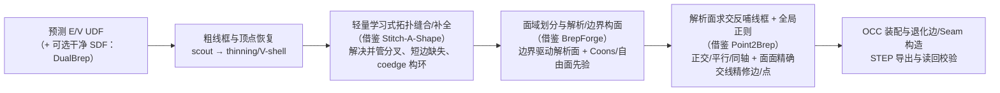

# Pipeline 优化分析（结合前沿工作）

设计稿，2026-11-21。本文档结合近期代表性 B-Rep 线框重建与距离场重建工作（**Stitch-A-Shape**、**BrepForge**、**Point2Brep**、**DualBrep**），系统梳理当前“上游 E/V 距离场生成 + 下游边优先 B-Rep 重建”流水线的可优化环节与可复用思路。退化边（Degenerate Edge）的预处理与后处理改造已合并至 [ScanPairedTraining.md](ScanPairedTraining.md)。

关联文档：
- 粗网格与扫描件边优先方案：[Post1121.md](Post1121.md)
- 边优先流程优化方案：[MCShellCenterline.md](MCShellCenterline.md)
- 非精确扫描件配对 VAE / Flow 训练与退化边处理方案：[ScanPairedTraining.md](ScanPairedTraining.md)
- 原 DualBrep 源码与 seam / 特殊边分析：[DualBrep.md](../legacy_dualbrep/DualBrep.md)

---

## 1. 当前 Pipeline 的定位与横向对比

当前整体流水线属于**混合架构**：
- **上游（`Hunyuan3D/hy3dshape`）**：连续三维近表面距离场生成（`ShapeVAE + FieldDiT Flow` 输出 E/V UDF），偏向 **DualBrep / Point2Brep** 的隐式场路线；
- **下游（`DualBrep/band_brep_reconstruction`）**：`scout → 体素细化/V球壳 → 曲线拟合 → 网格投影/切面 → 曲面拟合 → OCC 装配`，偏向 **BrepForge / Stitch-A-Shape** 的边优先（Wireframe-first）路线。

与四类代表性工作的互补关系如下：

| 代表工作 | 核心范式 | 优势 | 对当前 Pipeline 的核心启发 |
|---|---|---|---|
| **DualBrep** | 双隐式场（SDF + GVD-UDF）→ 面分割 → `Parametrizer` 预测曲面与邻接 | 用双场同步编码几何外壳与拓扑分界；用网络为自由面预测参数网格 | 同步恢复**干净几何 SDF** 作为扫描件切面/采样代理；借鉴条件 UV 网格预测器作为自由面初值 |
| **Point2Brep** | 噪声点云 → 学习引导区域生长拟合高置信解析面 → 以面为条件预测 E/V 距离场 → 显式几何推理求交定边/顶点 | 高置信解析面求交精度远高于纯距离场抽骨架，抗噪性强 | 在边优先分面与解析面拟合后，**用相邻解析面精确交线/交点反哺精修共享边与顶点** |
| **BrepForge** | 因子化二阶段：Face-aware 自回归生成闭合线框（V–E–F）→ **边界条件曲面实例化**（Coons / 几何先验填面） | 解耦高熵拓扑与低熵内部几何，不依赖稠密面内点也能构造有效曲面 | 针对扫描缺测/大偏移面，引入**边界主导解析求解与 Coons/最小能量曲面填充** |
| **Stitch-A-Shape** | Bottom-up 顺序“缝合”：点 → 边 → coedge → 面，支持残缺线框的 **Autocompletion** | 擅长处理拓扑歧义、残缺边界补全与无网格直接构环 | 引入轻量**学习式局部线框缝合与拓扑补全器**，解决分叉歧义、断边与开放扫描构环问题 |

---

## 2. 四个高优先级优化与复用方向

### 2.1 借鉴 Point2Brep：解析面求交反哺线框 + 全局 CAD 几何正则
* **当前瓶颈**：`band_brep_reconstruction` 目前是严格单向的 `UDF → wireframe（锁定曲线和顶点）→ surface_fitting（硬卡 boundary_tolerance = 0.001）`。预测 UDF 的 `0.001 ~ 0.003` 波动会造成提取的直线/圆弧轻微偏斜，下游曲面拟合为迁就偏斜曲线被迫退化为 B-spline 或直接报 `surface_boundary_incompatible`。
* **优化方案**：
  1. 保留边优先流水线用于**拓扑发现、窄面/相切边保护与粗线框提取**；
  2. 面域划分并完成高置信解析面（平面、圆柱、圆锥、球、圆环）拟合后，增加**双向精修阶段**：对两侧均为解析面的共享边，直接用两解析面的精确交线（如平面-平面交线、平面-圆柱交圆/椭圆）更新共享边；对三个及以上解析面汇合的共享顶点，用多面交点更新顶点；
  3. 增加轻量全局几何正则（检测近平行、近正交、共面、同轴关系并联合优化参数）。
* **预期收益**：将共享边与支撑面的重合误差从 `~0.002` 压缩至 `1e-6` 量级，大幅提升 `SameParameter` 与 STEP 读回通过率。

### 2.2 借鉴 BrepForge：边界条件曲面实例化（应对扫描缺测与大偏移）
* **当前瓶颈**：[surface_fitting.py](../band_brep_reconstruction/bandbrep/surface_fitting.py#L500-L561) 强依赖面内核心采样 `p_core`（无内点即报 `missing_face_region`，且内点分位硬卡在 `2 * surface_tolerance = 0.006`）。
* **优化方案**：
  1. 将曲面初始化升级为**边界主导 + 扫描内点按置信度加权**：对扫描稀疏/大偏移/局部遮挡面，优先直接由已恢复的干净三维边界环推导解析面（共面环→平面、平行双圆环→圆柱/圆锥、旋转/扫掠边→对应解析面）；
  2. 对一般自由面，先由边界环构造 **Coons Patch 或双调和最小能量曲面**作为几何初值，再按扫描局部可见性与置信度融合内点观测。

### 2.3 借鉴 Stitch-A-Shape（+ BrepForge Stage 1）：学习式局部拓扑缝合与线框补全
* **当前瓶颈**：预测 UDF 存在噪声、短边粘连或遮挡缺口时，[edge_first_graph.py](../band_brep_reconstruction/bandbrep/edge_first_graph.py) 在并管分叉处容易报 `skeleton_junction_unresolved`，[boundary_cycles.py](../band_brep_reconstruction/bandbrep/boundary_cycles.py#L23) 容易报 `face_sector_ambiguous`；同时 [edge_first_embedding.py](../band_brep_reconstruction/bandbrep/edge_first_embedding.py#L70) 强依赖闭合流形网格。
* **优化方案**：引入一个轻量级图/序列拓扑缝合模块作为后处理兜底（而非替换整个上游生成网络）：
  1. 以从 UDF 提取的候选顶点、可靠边段与未解析分叉/断口邻域特征作为输入；
  2. 学习预测歧义交汇点的边配对、补全短边/遮挡缺边（Autocompletion），并直接推理或校验三维线框的 coedge 环与 V–E–F 关联；
  3. 逐步摆脱对“闭合流形输入网格切面”的强依赖，平滑过渡到开放扫描件与原始点云输入。

### 2.4 借鉴 DualBrep：双场协同（同步预测干净 SDF）+ 自由面条件 UV 先验
* **双场协同**：在非精确扫描件偏移达到 `0.01 ~ 0.02` 时，可开启 `ShapeVAE` 几何头（或两阶段潜变量去噪）同步输出**去噪后的干净几何 SDF**，为切面拓扑划分与自由面内点采样提供干净表面载体，彻底消除“干净线框 vs. 偏移扫描面内点”的几何冲突。
* **自由面 UV 初值**：在已有精确线框与面归属的前提下，可借鉴 DualBrep `Parametrizer` 的单面条件 `16×16` 参数网格预测思路，为大曲率自由面或双连通自由面提供比纯 PCA/LSCM 更稳健的 UV 参数化初值。
