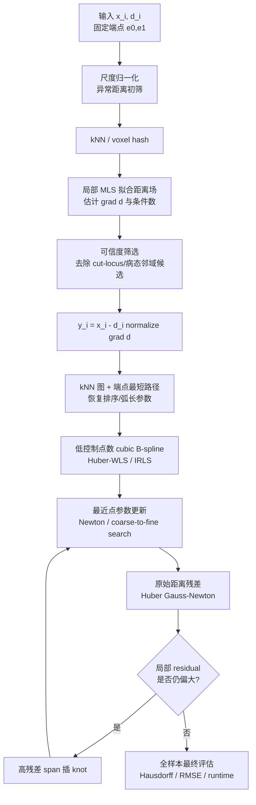
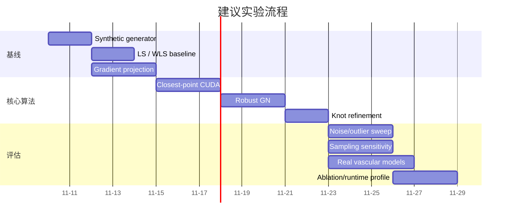

# 从三维欧氏距离场点云高精度、低成本拟合三次 B 样条曲线

## 执行摘要

问题可表述为：给定三维采样位置 $\mathbf x_i\in\mathbb R^3$ 与带噪的未知曲线欧氏距离观测 $d_i\approx\operatorname{dist}(\mathbf x_i,\Gamma)$，已知曲线两端点，恢复一条三次 B 样条

$$
\mathbf C(u)=\sum_{j=0}^{M-1}N_{j,3}(u)\mathbf P_j,\qquad u\in[0,1]
$$

使其尽可能接近真实曲线，同时控制计算成本。下文把“**三阶 B 样条**”按工程中更常见的“**三次 B 样条，degree $p=3$、order $=4$**”理解；若你的代码把 order=3 定义为二次样条，只需把以下 $p=3$ 改为 $p=2$。B 样条的关键计算优势是局部支撑：对任意参数 $u$，三次样条只有至多四个基函数非零，因此拟合矩阵和优化 Jacobian 都天然稀疏、带状。

**最推荐的工程方案不是单一方法，而是“梯度投影初始化 + 鲁棒加权 B 样条 + 直接距离场 Gauss–Newton 精修 + 自适应 knot refinement”的混合流程。** 原因是距离函数在唯一最近点存在的 tubular neighborhood 内携带非常强的几何信息：若 $d(\mathbf x)=\operatorname{dist}(\mathbf x,\Gamma)$ 可微，则

$$
\pi_\Gamma(\mathbf x)
=
\mathbf x-d(\mathbf x)\nabla d(\mathbf x),
\qquad
\|\nabla d(\mathbf x)\|=1,
$$

因此理论上一个距离样本加上其梯度就直接给出了曲线上的最近点。曲线附近存在唯一最近点的范围由曲线的 **reach** 控制；靠近高曲率区域、近自接触区域或真正自交位置时，最近点唯一性会恶化，距离场梯度也会不连续或不稳定。

但你的输入只有散乱点上的距离值、没有显式梯度，因此建议先用局部加权最小二乘/MLS 拟合距离函数，估计

$$
\widehat{\mathbf g}_i\approx\nabla d(\mathbf x_i),
$$

再生成候选曲线点

$$
\widehat{\mathbf y}_i
=
\mathbf x_i-
d_i\frac{\widehat{\mathbf g}_i}
{\|\widehat{\mathbf g}_i\|+\varepsilon}.
$$

MLS 本质是在每个局部邻域做一个小规模加权多项式最小二乘，适合散乱数据，也可直接用于导数估计。

随后不要直接把所有 $\widehat{\mathbf y}_i$ 当成精确曲线点，而应使用 Huber/Tukey 权重和局部密度权重拟合一条低自由度 B 样条。Huber 型损失保留二次损失在小残差区域的效率，同时把大残差影响降为线性；RANSAC 更适合存在大量 gross outlier 且模型有小型最小样本集的情况，而这里的样条控制点数较多、参数 $u_i$ 还未知，因此 RANSAC 更适合辅助剔除极端投影点，而不适合作为核心拟合器。

最终精度应通过**直接拟合原始距离观测**获得：

$$
\min_{\mathbf P}
\sum_i
\rho\!\left(
\operatorname{dist}(\mathbf x_i,\mathbf C_{\mathbf P})-d_i
\right)
+\lambda_s E_{\rm smooth}
+\lambda_kE_{\rm knot},
$$

而不是只优化投影点的欧氏误差。Wang、Pottmann 与 Liu 针对 B 样条点云拟合提出的 squared-distance minimization 已经表明，直接使用几何平方距离的局部二次近似，比普通“固定参数—点到点”交替拟合有更好的收敛特性；他们把该方法解释为使用距离函数曲率信息的 quasi-Newton 方法。你的问题与该思路高度一致，只是观测从“目标点在曲线上”变成了“目标点到曲线的距离等于 $d_i$”。

综合准确率、成本和鲁棒性，我建议默认使用：

1. **MLS 梯度估计 + 距离梯度投影**得到近曲线候选点；
2. **端点固定、Huber-IRLS 的加权三次 B 样条线性拟合**得到初始化；
3. **closest-point 内循环 + 距离残差 Gauss–Newton/IRLS**进行 5–15 轮几何精化；
4. 根据残差/曲率局部插 knot，只在需要处增加自由度；
5. 最终用原始距离场而非投影点做验证。

在一般的非自交、采样位于曲线 reach 内、噪声较轻的条件下，这一流程兼具非常低的每轮复杂度和较好的统计效率；由于 cubic B-spline 每个样本只依赖四个控制点，固定最近点参数后的 Jacobian 每行只有 $4\times3=12$ 个控制坐标非零项，因此法方程天然是块带状矩阵。这个结构是实现 GPU 高吞吐的核心。


## 问题建模、可辨识性与关键数学性质

设真实曲线为

$$
\Gamma^\star=\{\mathbf C^\star(u):u\in[0,1]\},
$$

观测为

$$
d_i=d^\star(\mathbf x_i)+\epsilon_i,\qquad
d^\star(\mathbf x)
=
\min_{u\in[0,1]}
\|\mathbf x-\mathbf C^\star(u)\|.
$$

已知

$$
\mathbf C(0)=\mathbf e_0,\qquad
\mathbf C(1)=\mathbf e_1.
$$

使用 clamped/open B-spline knot vector 时，可以直接固定

$$
\mathbf P_0=\mathbf e_0,\qquad
\mathbf P_{M-1}=\mathbf e_1,
$$

只优化中间 $M-2$ 个控制点；这比在损失中加“大权重端点 penalty”数值上更稳定，因为不会在 endpoint penalty 与数据项之间制造额外尺度差异。B 样条递归计算和局部支撑是经典 de Boor 算法的基础，重复端 knot 可用于端点插值。

### 距离场梯度为什么特别有价值

若 $\mathbf x$ 的最近点唯一，令

$$
\mathbf y=\pi_\Gamma(\mathbf x),
$$

则

$$
d(\mathbf x)=\|\mathbf x-\mathbf y\|,
$$

并且

$$
\nabla d(\mathbf x)
=
\frac{\mathbf x-\mathbf y}
{\|\mathbf x-\mathbf y\|}.
$$

于是

$$
\boxed{
\mathbf y
=
\mathbf x-d(\mathbf x)\nabla d(\mathbf x)
}.
$$

这意味着如果距离值与梯度完全准确，恢复曲线点只需要一次乘加；真正的困难不是 B 样条拟合本身，而是**从带噪散乱距离样本可靠估计梯度，以及正确恢复沿曲线的拓扑/排序**。距离函数只要远离 medial axis/cut locus 就具有良好的微分性质，而 reach 正是控制唯一投影邻域大小的量。

若梯度方向有误差 $\delta\mathbf n_i$，距离值有误差 $\epsilon_i$，投影误差一阶近似为

$$
\delta\mathbf y_i
\approx
-\epsilon_i\mathbf n_i
-d_i\delta\mathbf n_i.
$$

因此有两个重要工程结论：**距离过大的样本会放大梯度角度误差；距离极小的样本虽然理论投影误差小，但其局部距离变化信号也很弱，噪声下梯度估计反而可能不稳定。** 因而梯度初始化通常不应“距离越小越好”，而应选择一个中等距离 annulus，并在最终直接距离优化阶段再利用全部可靠样本。这一误差关系由上式直接得到，并与距离函数在 tubular neighborhood 内的微分结构一致。

### 距离样本提供的是一维约束

直接距离残差定义为

$$
r_i(\mathbf P)
=
\rho_i-d_i,\qquad
\rho_i
=
\|\mathbf x_i-\mathbf C(u_i^\star)\|,
$$

其中

$$
u_i^\star
=
\arg\min_u
\|\mathbf x_i-\mathbf C(u)\|.
$$

如果最近点稳定，根据 envelope theorem/一阶最优条件，可以在计算 $\partial r_i/\partial\mathbf P_j$ 时忽略 $u_i^\star$ 对控制点的隐式微分，因为最近点满足

$$
(\mathbf x_i-\mathbf C(u_i^\star))^T
\mathbf C'(u_i^\star)=0.
$$

因此令

$$
\mathbf n_i
=
\frac{\mathbf x_i-\mathbf C(u_i^\star)}
{\rho_i},
$$

有

$$
\boxed{
\frac{\partial r_i}{\partial\mathbf P_j}
=
-N_{j,3}(u_i^\star)\mathbf n_i^T
}.
$$

这是一个非常便宜的 Jacobian：每个 $u_i^\star$ 只有四个 B-spline basis 非零，因此每行只涉及四个控制点。Wang 等人的 squared-distance B-spline fitting 同样依赖最近点局部几何和距离 Hessian 的二次近似来得到高效更新。

这个 Jacobian 也揭示一个可辨识性问题：单个距离样本只沿其径向单位向量 $\mathbf n_i$ 约束曲线。如果一个局部曲线段的所有样本都集中在同一侧，则局部信息矩阵

$$
J^TJ
$$

会明显各向异性；若样本能较均匀分布在曲线法平面周围，则法向约束更完整。因此“采样点数量”不是唯一关键量，**每段曲线周围的角向覆盖程度同样重要**。

### 自交与近自交

对于真正的几何自交，欧氏距离场仍然唯一描述曲线的**点集**，但不能唯一决定“参数曲线在交点处如何穿越”。例如同一四叉交点，单靠零集合和距离值无法区分两条参数支路如何配对。因此若允许自交，必须依赖端点、切向连续性、初始化拓扑或额外先验来确定参数连接关系；在近自交区域，多个局部最近点也会使距离场梯度发生快速切换，这正对应 reach 变小和 medial-axis 接近曲线的情形。


## 候选方法比较与评估

下表中的“鲁棒性评分”是针对**本问题——近曲线散乱 UDF 样本、轻噪声、固定端点**的工程评价，而不是某篇论文的统一 benchmark。

| 方法 | 核心目标/模型 | 典型复杂度 | 噪声鲁棒性 | 优点 | 主要缺点 | 推荐场景 |
|---|---|---:|:---:|---|---|---|
| 体素骨架化/细化 | 对 $d<\tau$ 的 tube 做 skeleton | $O(V)$，$V$=voxel 数 | ★★★ | 拓扑直观；无需参数化 | 体素误差、3D 内存大、对 $\tau$ 敏感 | 已有规则体素场 |
| 等距面/medial-axis | 构造 $\{d=\tau\}$ 或 sublevel tube 的 medial axis | 通常高于直接点方法 | ★★★ | 理论上与中心线紧密相关 | surface reconstruction + skeleton 成本高 | dense field、离线处理 |
| kNN 最短路径 | 图上最小化长度+距离代价 | $O(Nk+E\log N)$ | ★★★ | 极便宜、端点天然使用 | 易切角、近自交易跳支路 | 初始化/排序 |
| Laplacian/L1 skeleton | 点云收缩至 1D skeleton | 多轮邻域/线性求解 | ★★★★ | 对不规则点云较稳定 | 解决了比本问题更难的问题，成本偏高 | 几何点云无距离值 |
| 梯度投影 | $\mathbf x-d\nabla d$ | kNN 后约 $O(Nk)$ | ★★★★ | 几何信息利用率高、极快 | 梯度噪声与 cut locus 敏感 | **首选初始化** |
| LS B-spline | $\sum\|\mathbf C(u_i)-\mathbf y_i\|^2$ | 结构化时近 $O(N)$ | ★★ | 极快、解析解 | 对 outlier 和错误参数敏感 | 干净投影点 |
| WLS/Huber IRLS | $\sum w_i\rho(\|\cdot\|)$ | LS × 数轮 IRLS | ★★★★ | 成本仍低、稳定 | 仍依赖投影点质量 | **首选初始拟合** |
| RANSAC spline | 随机子集假设+一致集 | $O(KN)$ | ★★★★★ 对 gross outlier | 能抵抗高比例极端 outlier | spline 最小样本集大、参数未知 | 只做外点预清理 |
| 直接距离场优化 | $\sum\rho(\operatorname{dist}(x,C)-d)$ | 每轮约 $O(N)$–$O(N\log M)$ | ★★★★ | 与观测模型一致、最终精度高 | nearest-point 内循环、非凸 | **最终精修** |
| SDM/quasi-Newton | squared-distance 局部二次模型 | 每轮稀疏/带状求解 | ★★★★ | 快速稳定的几何收敛 | 初始化仍重要 | 高精度拟合 |
| 多尺度 knot refinement | 低 $M$→局部插 knot | 多个小问题 | ★★★★★ | 减少局部极值和过拟合 | 需定义 refinement criterion | **强烈推荐** |
| 混合方案 | projection→WLS→field GN | 通常近线性 | ★★★★★ | 精度/速度最好平衡 | 工程量稍大 | **默认选择** |

点云 skeleton 方法本来主要针对“只有几何点，没有距离函数”的更一般问题，例如 Laplacian contraction 和 $L_1$-medial skeleton 都通过邻域收缩获得一维骨架；由于你的数据已经附带到目标曲线的距离值，这些方法丢弃了额外观测信息，因此除非需要恢复复杂拓扑，否则通常不是最经济选择。

### 中心线提取：骨架化、等距面与最短路径

若构造

$$
\Omega_\tau
=
\{\mathbf x:d(\mathbf x)\le \tau\},
$$

当 $\tau$ 小于曲线 reach 时，$\Omega_\tau$ 是围绕曲线的 tubular neighborhood；理论上它的中心结构与原曲线一致。

因此可以先把散乱距离样本插值到体素网格，然后：

```text
distance samples
    ↓ interpolation
binary tube d < τ
    ↓ thinning / medial axis
voxel skeleton
    ↓ graph pruning
endpoint-to-endpoint centerline
    ↓ spline fitting
```

但这条路线需要新增一个网格尺度 $h$，最终几何误差受到 voxelization 约束；3D dense grid 的存储和计算成本也会远高于直接处理 $N$ 个样本。

“最短路径”更适合作为低成本初始化。构造投影候选点或低距离点的 kNN 图，边权例如

$$
c_{ij}
=
\|\mathbf y_i-\mathbf y_j\|
\left[
1+\alpha\,\frac{d_i+d_j}{2s_d}
\right]
+
\beta(1-|\mathbf t_i^T\mathbf t_j|),
$$

从固定起点到固定终点运行 Dijkstra/A*。VMTK 的实际中心线流程也是在 Voronoi 结构上通过传播与回溯得到端点之间的中心路径，说明“端点 + 距离/半径加权最短路径”是成熟的中心线建模思想。

最短路径的问题是它优化“路径代价”而不是你的原始距离观测；若局部采样稀疏，它可能跨越曲率较大的弯道“切角”，近自交时也可能错误切换支路。因此建议把它仅用于**排序或参数初始化**，不用作最终几何解。

### 基于梯度的投影

局部一阶 MLS 可写成

$$
d(\mathbf x_j)
\approx
a_i+
\mathbf g_i^T(\mathbf x_j-\mathbf x_i),
$$

求解

$$
(a_i,\mathbf g_i)
=
\arg\min_{a,\mathbf g}
\sum_{j\in\mathcal N_i}
w_{ij}
\left[
a+\mathbf g^T(\mathbf x_j-\mathbf x_i)-d_j
\right]^2.
$$

二阶版本加入

$$
\frac12
(\mathbf x_j-\mathbf x_i)^T
H_i
(\mathbf x_j-\mathbf x_i).
$$

MLS/局部加权 LS 是散乱数据近似和导数估计的经典手段，已有针对 least-squares gradient estimate 的误差分析。

建议默认值：

- kNN：$k=24\sim64$；
- 低噪密集点云：$k=24\sim32$；
- 噪声更大或采样不均：$k=48\sim96$；
- 权重：Gaussian 或 compact kernel；
- 一阶 MLS 默认即可，只有采样足够密且曲率变化明显时使用二阶；
- 对局部设计矩阵条件数过大的样本直接降权；
- 对 $\|\widehat{\mathbf g}\|$ 与 1 相差很大的点降权，因为理想欧氏距离场在可微区满足 Eikonal 性质。距离函数的梯度单位模性质与最近点几何直接相关。

可定义梯度可信度

$$
q_i=
\exp\left[
-\frac{(\|\widehat{\mathbf g}_i\|-1)^2}{2\sigma_g^2}
\right]
\frac{1}{1+\gamma\log\kappa_i},
$$

其中 $\kappa_i$ 是局部 LS 设计矩阵条件数。

然后投影

$$
\mathbf y_i
=
\mathbf x_i
-
d_i
\frac{\widehat{\mathbf g}_i}
{\max(\|\widehat{\mathbf g}_i\|,\epsilon)}.
$$

这个方法的最大优势是**一步把三维距离场问题转成普通曲线点拟合问题**。

### 最小二乘和加权最小二乘 B 样条

有了投影点 $\mathbf y_i$ 与参数 $u_i$，固定 knot vector 后：

$$
\min_{\mathbf P}
\sum_i
w_i
\left\|
\sum_jN_{j,3}(u_i)\mathbf P_j-\mathbf y_i
\right\|^2
+
\lambda_s
\|D_2\mathbf P\|_F^2.
$$

矩阵形式为

$$
\min_P
\|W^{1/2}(AP-Y)\|_F^2
+
\lambda_s\|D_2P\|_F^2.
$$

正规方程：

$$
(A^TWA+\lambda_sD_2^TD_2)P
=
A^TWY.
$$

由于 cubic B-spline 行向量 $A_i$ 只有四个非零元素，$A^TWA$ 是窄带矩阵；这是比一般 dense least-squares 便宜得多的特殊结构。de Boor 的 B-spline 表达强调了基函数的局部性；SciPy 的 BSpline 官方实现也按 knot/basis 形式定义。

端点直接消元。例如令

$$
P=
\begin{bmatrix}
\mathbf e_0\\
P_{\rm int}\\
\mathbf e_1
\end{bmatrix},
$$

则把固定控制点贡献移到右端：

$$
A_{\rm int}P_{\rm int}
=
Y
-A_0\mathbf e_0
-A_{M-1}\mathbf e_1.
$$

参数 $u_i$ 可先由最短路径 polyline 的累计弧长生成：

$$
u_i=
\frac{\sum_{\ell<i}\|\mathbf z_{\ell+1}-\mathbf z_\ell\|}
{\sum_\ell\|\mathbf z_{\ell+1}-\mathbf z_\ell\|}.
$$

对于随机测量点，已有 B-spline fitting 工作专门指出合理的参数化/投影初始化对 least-squares fitting 很重要。

### 鲁棒估计

Huber loss：

$$
\rho_\delta(r)=
\begin{cases}
\frac12r^2,&|r|\le\delta,\\[1mm]
\delta(|r|-\frac12\delta),&|r|>\delta.
\end{cases}
$$

这是经典 Huber M-estimator 的形式。

IRLS 中等价权重为

$$
w_i^{\rm Huber}
=
\begin{cases}
1,&|r_i|\le\delta,\\
\delta/|r_i|,&|r_i|>\delta.
\end{cases}
$$

推荐用 MAD 估计尺度：

$$
\hat\sigma
=
1.4826\,\operatorname{median}_i
|r_i-\operatorname{median}(r)|
$$

并把 $\delta$ 初始化为约 $1.5\hat\sigma$，再在最终几轮降到 $1.0\sim1.5\hat\sigma$。这里是工程默认值而非必须常数。

Tukey biweight 更激进：

$$
w_i=
\begin{cases}
(1-(r_i/c)^2)^2,& |r_i|<c,\\
0,&|r_i|\ge c.
\end{cases}
$$

它会完全切掉大 outlier，因此在初始化不好时容易误杀真实高曲率区域；推荐先 Huber，曲线已经接近正确后再选择性切换 Tukey。Biweight/bisquare estimator 的经典研究源于 Tukey 系列鲁棒估计工作。

RANSAC 的典型迭代数满足

$$
K
\ge
\frac{\log(1-p)}
{\log(1-w^s)},
$$

其中 $p$ 是希望至少采到一次全内点模型的概率，$w$ 是内点比例，$s$ 是最小样本数。RANSAC 的设计目标正是先过滤 gross errors 再进行精确拟合。

但对于 $M$ 个控制点的 spline，$s$ 并不小，而且参数 $u_i$ 还未知，所以 $K$ 很快失控。因此建议：

- outlier < 10–20%：Huber 即可；
- 大量孤立极端 outlier：先基于 MLS 投影 residual 做轻量 RANSAC/统计 clipping；
- 不建议直接对完整 B-spline 做 RANSAC。

### 基于距离场的非线性优化

最自然的目标是

$$
E_{\rm field}=
\sum_{i=1}^N
\rho_\delta
\left(
\underbrace{
\min_u\|\mathbf x_i-\mathbf C(u)\|
}_{\hat d_i(\mathbf P)}
-d_i
\right).
$$

它直接对应测量模型，因此不存在“先投影产生的误差被当作真值”的问题。

最近点参数满足

$$
f_i(u)
=
(\mathbf C(u)-\mathbf x_i)^T\mathbf C'(u)
=0.
$$

Newton 更新：

$$
u\leftarrow
u-
\frac{
(\mathbf C-\mathbf x)^T\mathbf C'
}{
\|\mathbf C'\|^2+
(\mathbf C-\mathbf x)^T\mathbf C''
}.
$$

二维 clothoid 等 parametric curve 的 point-to-curve projection 研究也采用了把距离极小化转成参数方向 root finding 的做法；对于 B-spline，局部 cubic polynomial 及其导数都可廉价计算。

为了避免平方根在 $d\approx0$ 时数值敏感，可以使用归一化平方距离 residual：

$$
\tilde r_i
=
\frac{
\|\mathbf x_i-\mathbf C(u_i)\|^2-d_i^2
}{
2\max(d_i,d_{\min})
}.
$$

若预测距离接近 $d_i$，

$$
\tilde r_i\approx
\|\mathbf x_i-\mathbf C(u_i)\|-d_i,
$$

但不会出现 $\|\cdot\|$ 在零点附近的导数问题。

其 Jacobian 为

$$
\frac{\partial\tilde r_i}
{\partial\mathbf P_j}
=
-
N_j(u_i)
\frac{
\mathbf x_i-\mathbf C(u_i)
}{
\max(d_i,d_{\min})
}.
$$

**不要简单把 $u_i$ 和控制点同时用 Adam 自由优化而不强制 nearest-point 条件。** 因为仅满足

$$
\|\mathbf x_i-\mathbf C(u_i)\|=d_i
$$

意味着曲线只需要穿过以 $\mathbf x_i$ 为中心、$d_i$ 为半径的球面，$u_i$ 未必是最近点。更可靠的方法是：

$$
u_i\leftarrow
\arg\min_u
\|\mathbf x_i-\mathbf C(u)\|
$$

与控制点 Gauss–Newton 更新交替进行。这与经典 geometric spline fitting 中不断更新 footpoint/correspondence 再优化曲线的思想一致。

### 多尺度与逐步细化

固定很多控制点从随机初始化直接求解非线性距离目标，很容易出现波动和局部极值。更好的策略是：

$$
M=6
\rightarrow 10
\rightarrow 18
\rightarrow \cdots
$$

每次只在高 residual 或高 curvature 的 knot span 插入新 knot。Boehm knot insertion 可以在**不改变当前曲线形状**的前提下细化 B-spline 表示，因此非常适合 coarse-to-fine optimization。

建议 span $s$ 的 refinement score：

$$
R_s=
\operatorname{median}_{i:u_i\in s}|r_i|
+
\alpha\,
\operatorname{MAD}_{i:u_i\in s}(r_i)
+
\beta
\int_s\|\mathbf C''(u)\|du.
$$

只对最高 10–30% 的 span 插 knot，直到验证误差下降不足或达到最大控制点数。


## 推荐的最终算法流程

推荐整体流程如下。



该流程把“昂贵且非凸”的 direct field fitting 放到最后，使其从一个已经很接近真实曲线的状态开始；这与 squared-distance B-spline fitting 中强调良好初始形状以及局部二次几何更新的经验一致。

### 建议默认超参数

| 参数 | 默认值 | 调整原则 |
|---|---:|---|
| MLS kNN | 32 | 噪声大→48–96；点很密→24 |
| MLS 阶数 | 1 | 高密度且高曲率时用 2 |
| 初始控制点 $M_0$ | 6–10 | 曲线越复杂越大 |
| 最大控制点 | 32–128 | 依目标误差和长度决定 |
| Huber $\delta$ | $1.5\hat\sigma$ | $\hat\sigma$ 用 residual MAD |
| smoothness $\lambda_s$ | $10^{-4}\sim10^{-2}$（归一化坐标） | 稀疏/噪声大时增大 |
| kNN graph | 8–16 邻居 | 自交风险高时减小并加 tangent cost |
| projection Newton | 3–5 步 | 每几轮做一次 global reseed |
| field GN iterations | 5–15 | residual 停滞即停 |
| knot refinement | 每阶段增加 20–50% 控制点 | 只加在高 residual span |
| distance floor $d_{\min}$ | $2\sim3\sigma_d$ | 仅用于平方距离残差归一化 |

这些值是工程起点，不应替代数据驱动的 sensitivity sweep。

### 伪代码

```python
# x: [N, 3]
# d: [N]
# endpoint0, endpoint1: [3]

# ---- Stage A: normalize ----
scale = robust_scene_scale(x)
xn = (x - center) / scale
dn = d / scale

# ---- Stage B: local UDF gradient ----
nbr = knn(xn, k=32)

g, cond = local_weighted_linear_fit(
    positions=xn,
    values=dn,
    neighbors=nbr
)

gnorm = norm(g, dim=-1)

quality = (
    exp(-((gnorm - 1) / sigma_g)**2)
    * condition_weight(cond)
)

g = g / clamp(gnorm[..., None], min=1e-8)

y = xn - dn[..., None] * g

# optional annulus + quality filter
mask = gradient_reliable(dn, quality, cond)
yf = y[mask]

# ---- Stage C: ordering ----
graph = build_knn_graph(yf, k=12,
                        edge_cost="distance+tangent")
path = shortest_endpoint_path(graph,
                              endpoint0,
                              endpoint1)

u_init = normalized_arclength(path)

# associate all reliable projected points to path parameter
u = project_to_polyline_parameter(yf, path)

# ---- Stage D: robust initial cubic spline ----
P = initialize_control_polygon(path, M=8)
P[0]  = endpoint0
P[-1] = endpoint1

for _ in range(5):
    B = cubic_bspline_basis_sparse(u, knots, M)
    residual = evaluate(B, P) - yf
    sigma = MAD(norm(residual, dim=-1))
    w = quality[mask] * huber_weight(residual, 1.5 * sigma)

    P[1:-1] = solve_weighted_banded_ls(
        B, yf, w,
        fixed_endpoints=(endpoint0, endpoint1),
        lambda_smooth=1e-3
    )

# ---- Stage E: direct field fitting ----
for level in range(num_levels):

    for iteration in range(10):

        # closest point of ORIGINAL samples to current spline
        u = closest_parameter_newton(
            xn, P, knots,
            init_u=u_cache,
            steps=4
        )

        c  = spline_eval(P, knots, u)
        cp = spline_derivative(P, knots, u, 1)

        e = xn - c
        rho = norm(e, dim=-1)

        r = rho - dn

        sigma = MAD(r)
        w = huber_weight(r, 1.5 * sigma)

        # analytic sparse GN Jacobian
        J = build_distance_jacobian(
            basis=cubic_bspline_basis_sparse(u),
            normal=e / clamp(rho[:, None], min=1e-8)
        )

        deltaP = solve_block_banded_GN(
            J, r, w,
            lambda_smooth=1e-4,
            fixed_endpoints=True
        )

        P[1:-1] += deltaP

        if converged(r):
            break

    spans = residual_by_knot_span(r, u)
    if no_bad_spans(spans):
        break

    knots, P = insert_knots_without_shape_change(
        knots, P,
        select_high_error_spans(spans)
    )

return denormalize(P)
```

Boehm knot insertion 的重要性质是可以先细化控制结构而保持曲线本身不变，因此 `insert_knots_without_shape_change` 不会破坏前一阶段已获得的解。


## PyTorch/CUDA 实现与计算加速

### 不要显式构造 $N\times M$ dense basis matrix

三次 B-spline 每个参数只有四个 basis 非零，因此保存

```text
span_idx: [N]
basis:    [N,4]
```

就足够。

曲线点直接计算：

$$
\mathbf C(u_i)
=
\sum_{q=0}^{3}
B_{iq}\mathbf P_{s_i+q}.
$$

GPU 上对应

```python
cp = P[idx]                # [N,4,3]
c  = (basis[...,None] * cp).sum(dim=1)
```

这使 basis evaluation、residual、normal、Huber weight 都可以在 $O(N)$ 数据流中完成。

### LS 初始化：避免 dense QR

如果只做初始化，而且 $M<100$，直接构造 $M\times M$

$$
H=A^TWA+\lambda D^TD
$$

非常便宜。每个样本只向最多 $4\times4$ 个 block 累积贡献，因此 formation 复杂度约

$$
O(Np^2),\qquad p=4\text{ 个 active basis},
$$

随后 Cholesky solve 的矩阵只有 $M-2$ 维。

`torch.linalg.lstsq` 在 CUDA 上目前仅使用 `gels` 驱动，并假设设计矩阵 full rank；PyTorch 官方文档也明确指出，在病态矩阵上 CPU 可选择 SVD 驱动，而 CUDA `lstsq` 的 driver 选择更受限。

因此对本问题更推荐：

$$
H+\lambda I
$$

后用

```python
L, info = torch.linalg.cholesky_ex(H)
```

以及 triangular/cholesky solve。`cholesky_ex` 可以避免普通 `torch.linalg.cholesky` 在 CUDA 上的部分同步开销，并返回 factorization status。

注意：正规方程会把条件数平方，所以若初始化矩阵明显病态，不应盲目依赖 normal equation；可以：

- 增加 smoothness/ridge；
- 减少控制点；
- 重新参数化；
- 在 CPU 上用 pivoted QR/SVD 检查；
- 或对小 $M$ 直接 dense QR。

PyTorch 文档也建议 ill-conditioned least-squares 使用 QR/SVD 类驱动而不是简单逆矩阵。

### Gauss–Newton 不要生成完整 Autograd Jacobian

完整 Jacobian 尺寸是

$$
N\times 3(M-2),
$$

没有必要显式存储。

每个 residual 只影响四个控制点，因此用解析式

$$
J_{i,j}
=
-N_j(u_i)\mathbf n_i^T
$$

直接 scatter 到局部 $12\times12$ normal-equation block 即可。

相对于 `torch.autograd.functional.jacobian`，这可以显著减少内存；PyTorch 官方也说明 full Jacobian 通常涉及大量反向计算，而 `torch.func`/vmap 等工具主要是改善 Jacobian vectorization，并不能消除本问题本身已有的解析稀疏结构。

因此推荐：

```text
CUDA kernel:
  each thread / warp handles several samples
     ↓
evaluate B, B', B''
     ↓
compute C(u), normal, residual
     ↓
compute 4 local basis contributions
     ↓
scatter-add H and g
```

对于 $M<200$，最终 $H$ 做 dense Cholesky 通常比搭完整 sparse solver pipeline 更简单。

### closest-point 查询

最慢部分通常不是求解控制点，而是

$$
u_i^\star=\arg\min_u\|x_i-C(u)\|.
$$

推荐三级策略：

**第一次：粗采样。**

把 spline 每个 knot span 采样 4–8 个点，得到 polyline，通过 kNN/BVH 找最近线段。

**后续迭代：warm start。**

直接使用上一轮 $u_i^\star$，Newton 3–4 步。控制点每轮变化很小时，最近参数也变化很小。

**周期性 global reseed。**

每 3–5 轮，或发现 Newton residual 异常时重新做 coarse nearest search，防止在高曲率/近自交处落入错误局部分支。

一般的 point-to-parametric-curve 距离优化本身可能存在多个局部极小，因此全局 coarse initialization + 局部 root refinement 是合理结构。

### 分块、采样与多 GPU

若 $N$ 达到百万级，没必要每轮使用全部样本。因为每个样本只向全局 $H,g$ 提供可加的局部贡献，可以把数据切成 batch：

$$
H=
\sum_b H_b,\qquad
g=
\sum_b g_b.
$$

因此显存开销可以从 $O(N)$ 降到 $O(B)$。

建议：

- 初始化：用 5–20% stratified sample；
- direct fitting 前 3 轮：每轮随机 10–30%；
- 最后 2–3 轮：全部样本；
- 按当前 $u$ 或空间 voxel 做 stratification，避免高密度区域完全支配损失。

多 GPU 时每块独立生成 $H_b,g_b$，最后 all-reduce 两个很小的矩阵/向量即可。

### 稀疏化和局部密度补偿

采样密度不均时，普通 LS 实际优化的是“采样分布加权”的曲线误差。可加入逆密度权重：

$$
w_i^{\rm density}
=
\frac{1}
{\hat\rho(\mathbf x_i)+\epsilon},
$$

或者在曲线参数域每个 bin 固定抽样相同数量点。

更稳妥的最终权重是

$$
w_i
=
w_i^{\rm robust}
\,w_i^{\rm gradient}
\,w_i^{\rm density}
\,w_i^{\rm distance}.
$$

### `torch.compile`

basis evaluation、Newton projection 和 residual/weight 计算都是重复的大批量 tensor kernel，适合尝试 `torch.compile`。PyTorch 官方说明 `torch.compile` 使用 Inductor 等 backend 将 Python/PyTorch 图编译并融合，但首次调用存在编译成本，因此只有重复迭代场景才容易获得收益。

推荐 compile：

```text
spline_eval_and_derivatives()
closest_point_newton()
residual_and_local_jacobian()
```

不要频繁改变 tensor shape，否则容易触发重新编译。

### FP32、FP64 与 mixed precision

点级几何计算可用 FP32；但若尺度差异大或要求极高精度，最终 $H,g$ 累积和 Cholesky 建议 FP64。B-spline 控制点数量远小于样本数量，所以用 FP64 解一个小矩阵成本通常可以忽略。

不推荐 FP16/BF16 直接做 closest-point Newton 和法方程累积，因为最小距离与曲率项容易受 cancellation 影响。


## 实验设计、消融与预期趋势

### 合成数据

建议不要只测试 helix，而应构造至少以下几类曲线：

| 类型 | 测试目标 |
|---|---|
| 直线/圆弧 | 验证无偏性和数值下限 |
| 3D helix | 中等曲率、标准测试 |
| S 形空间曲线 | 曲率变化 |
| 高曲率局部 kink-like smooth bend | knot refinement |
| 两段非常接近但不相交 | reach / closest-point ambiguity |
| 真正 self-intersection curve | 拓扑歧义 |
| 长直段 + 短高曲率段 | 非均匀 knot 是否有效 |
| 非均匀速度参数化曲线 | 参数化鲁棒性 |

真实距离不要仅靠最近 dense sample 近似；推荐先 dense arc-length sampling 得到初值，再对参数使用 Newton 求最近点，以减少 ground-truth distance 本身的离散误差。parametric curve point-distance 求解本身需要区分多个局部极小。

距离噪声建议覆盖：

$$
\epsilon_d\sim
\mathcal N(0,\sigma^2),
$$

Laplace noise，以及污染模型

$$
\epsilon_i\sim
(1-\eta)\mathcal N(0,\sigma^2)
+\eta\,\mathcal U[-a,a].
$$

其中扫描

$$
\sigma/L
\in
\{10^{-4},5\times10^{-4},
10^{-3},5\times10^{-3},10^{-2}\},
$$

$$
\eta\in
\{0,0.01,0.05,0.1,0.2\}.
$$

空间采样要至少分成：

- uniform tube；
- 单侧采样；
- 局部密集/局部稀疏；
- 离曲线距离均匀；
- 离曲线距离随 $r^2$ 偏外层；
- 存在空洞。

这能区分“算法对噪声脆弱”与“观测本身缺乏几何可辨识性”。

### 真实数据

真实数据优先使用具有高质量 tubular geometry/centerline 的数据。Vascular Model Repository 提供多类人类心血管和肺血管计算模型，可与 SimVascular 配合使用；VMTK 可以从 tubular surface 计算中心线，因此可用 surface/centerline 作为几何参考，再在其周围生成真实几何距离采样。

推荐实际实验方式不是直接把“已有中心线点”拿来拟合，而是：

```text
真实 tubular surface
      ↓
VMTK / high-quality centerline reference
      ↓
在真实空间分布中采样 x
      ↓
计算 x 到 reference centerline 的距离
      ↓
模拟传感器距离噪声
      ↓
仅给算法 {x,d}
```

这样测试数据仍完全符合你的问题定义。

### 评价指标

主指标应直接对应“几何曲线恢复”，而非控制点本身。

**对称 Chamfer/平均最近距离**

$$
E_{\rm sym}
=
\frac12
\left[
\frac1{|S|}\sum_{x\in S}d(x,\hat\Gamma)
+
\frac1{|\hat S|}\sum_{y\in\hat S}d(y,\Gamma^\star)
\right].
$$

**Hausdorff distance**

$$
d_H(\Gamma^\star,\hat\Gamma)
=
\max\{
\sup_{x\in\Gamma^\star}d(x,\hat\Gamma),
\sup_{y\in\hat\Gamma}d(y,\Gamma^\star)
\}.
$$

血管中心线研究实际也常报告 Hausdorff/average symmetric distance 一类集合几何指标。

**原始距离场 residual**

$$
E_d
=
\sqrt{
\frac1N
\sum_i
[
d(\mathbf x_i,\hat\Gamma)-d_i
]^2
}.
$$

应同时报告 median、P90、P95、P99，因为 robust fitter 的优势通常主要体现在尾部。

**曲线到 ground truth 的弧长均匀误差**

$$
E_{\rm curve}
=
\sqrt{
\frac1K\sum_k
d(\mathbf C^\star(s_k),\hat\Gamma)^2
}.
$$

**控制点误差**只有当 ground truth 和预测使用完全相同 knot vector、参数化时才有意义；否则控制点并不是唯一几何表示，不能作为主要 metric。Knot insertion 本身就可以在不改变曲线形状的情况下改变控制点集合。

同时报告：

- preprocessing time；
- gradient estimation time；
- initialization time；
- field optimization time；
- total runtime；
- peak GPU memory；
- GN iteration count；
- closest-point queries/sec。

### 必做消融

建议最少包括：

| Ablation | 问题 |
|---|---|
| LS vs WLS vs Huber vs Tukey | 鲁棒损失贡献多少 |
| 无 gradient projection | 梯度初始化是否真正必要 |
| projection-only vs field refinement | direct distance optimization 增益 |
| Adam vs GN | 二阶结构价值 |
| fixed $M$ vs knot refinement | 多尺度策略价值 |
| uniform weighting vs density compensation | 非均匀采样影响 |
| random init vs shortest-path init | 初始化对非凸问题影响 |
| no smoothness vs $D_2$ regularization | bias–variance tradeoff |
| every-iter global closest vs warm-start Newton | 加速收益 |
| FP32 vs final FP64 solve | 数值精度影响 |

### 参数敏感性

优先扫描：

$$
k_{\rm MLS},
\quad
M,
\quad
\lambda_s,
\quad
\delta_{\rm Huber},
\quad
d_{\max},
\quad
\text{knot refinement threshold}.
$$

尤其应画

$$
M
\longrightarrow
(\text{geometry error},\text{runtime})
$$

的 Pareto curve，因为控制点数量通常是精度和成本之间最直接的 knob。

### 预期趋势

以下是依据数学结构和既有 geometric spline fitting 结果提出的**实验假设，不是已测得数字**：

| 噪声/数据条件 | 预计最优方法 | 预计失败模式 |
|---|---|---|
| 极低噪声、密集均匀 | projection + LS | direct GN 提升有限 |
| 轻噪声 | projection + Huber-WLS + GN | plain LS 尾误差偏大 |
| 较多 outlier | Huber/Tukey + GN | LS 明显偏移 |
| 高曲率 | multi-scale GN | 固定少量控制点欠拟合 |
| 非均匀采样 | density-weighted GN | 密集区拉偏 |
| 近自交 | tangent-aware init + global reseed | kNN shortest path 跳分支 |
| 真自交 | 拓扑先验 + GN | UDF 无法唯一决定参数配对 |
| 超大 N | minibatch GN / sufficient statistics | full autodiff Jacobian 内存过大 |

Wang 等人的比较表明，以 squared-distance 几何局部二次模型进行 B-spline fitting，在其研究的 point-cloud fitting 场景中比普通 point-distance alternating fitting 收敛更快、更稳定，因此预期 direct field Gauss–Newton/SDM 类精修会在中高精度要求下明显优于只做一次 LS。

实验时间线可设计为：




## 关键工程结论与选择建议

如果只允许实现一个**很便宜的版本**，优先做：

$$
\boxed{
\text{MLS gradient}
\rightarrow
\mathbf x-d\nabla d
\rightarrow
\text{Huber-WLS cubic spline}
}
$$

它基本只有 kNN、许多独立的小 $3\times3$/$4\times4$ LS，以及一个很小的带状 spline solve，复杂度近似随 $N$ 线性增长。MLS 对散乱数据导数估计有成熟理论，B-spline basis 又具有强局部性。

如果要求**尽可能高的最终精度**，应增加：

$$
\boxed{
\text{direct field residual}
+
\text{closest-point Newton}
+
\text{Huber Gauss–Newton}
}
$$

因为这一步重新回到真实观测方程

$$
d_i\simeq\operatorname{dist}(x_i,C),
$$

不会把 noisy gradient projection 当成 ground truth。Squared-distance minimization 的既有研究支持这种直接几何距离优化比简单 point-distance alternating fitting 更合适。

如果数据包含**高曲率、长度很长、局部复杂度差异大**，再加：

$$
\boxed{
\text{coarse-to-fine knot insertion}
}
$$

不要一开始就使用大量控制点。Boehm knot insertion 可以在不改变当前几何曲线的条件下扩展自由度，是多尺度 spline optimization 非常自然的工具。

如果允许**自交**，算法架构本身仍可使用，但必须把“几何集合恢复”和“参数拓扑恢复”分开看：距离场可以很好确定曲线点集，却不能总是确定交点的 branch pairing。实际需要 endpoint path、局部切线连续性和前一尺度拓扑共同决定连接关系；近自交区域还应周期性执行 global closest-point reseeding，而不能只依赖 warm-start Newton。reach/medial-axis 理论正说明了这些区域是最近点映射最容易失稳的位置。

如果采样密度未知或高度不均，最重要的不是增加更多控制点，而是进行**参数域/空间密度补偿**，否则最小二乘会优先拟合样本最多的区域。

最终推荐的工程优先级是：

$$
\boxed{
\textbf{梯度投影初始化}
>
\textbf{Huber-WLS}
>
\textbf{direct field GN}
>
\textbf{自适应 knot refinement}
>
\text{复杂 skeletonization}
}
$$

对于你给定的输入形式，骨架化、等距面和一般 point-cloud contraction 更适合作为 topology fallback 或对比 baseline，而不是主算法；距离场本身已经包含比普通点云更多的最近点几何信息，最经济的策略应尽量直接利用它。