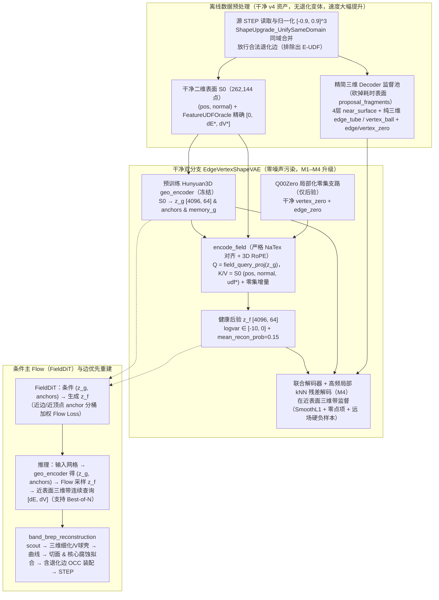

# 几何先验条件下的线框优先生成式 B-Rep 重建方案

设计稿，2026-11-22。本文档确立项目的最终主方案（**路线 1：干净双分支 VAE + 几何条件线框主 Flow + 边优先 B-Rep 后处理**，暂不引入前端几何纠偏模块）。针对 3D 生成模型网格与扫描点云等初始表示**缺乏 B-Rep 顶点与边意识**、传统“先面分割再靠面求交”路线重建成功率低的痛点，借助预训练几何先验与生成式 Flow 在近表面三维空间直接预测连续 `E-UDF + V-UDF`，**先独立于输入网格拓扑恢复完整三维线框，再引导面划分、曲面拟合与严格 OCC 装配**，同时完成数据同域规范化、三维监督池瘦身与退化边全链路支持。

关联文档：
- **v5 8D 数据集与全链路改造规范（现行）**：[Dataset.md](Dataset.md) · [VectorFieldTarget.md](VectorFieldTarget.md)
- 边优先重建与优化方案：[Post1121.md](Post1121.md)
- 历史 STEP 到点池参考：[Pre.md](Pre.md)
- 上游 ShapeVAE 与零集编码：[Hunyuan3D VAE.md](../../Hunyuan3D/docs/VAE.md) · [VAEOptimizationPlan.md](../../Hunyuan3D/docs/VAEOptimizationPlan.md)

---

## 1. 核心创新、问题定位与前沿差异化

### 1.1 核心痛点与立意
无论是 3D 生成大模型（Hunyuan3D / Trellis 等）产出的 Mesh，还是扫描重建得到的点云/网格，其初始几何表示都存在一个根本缺失：**它们只包含无拓扑意识的离散三角形或点，完全“意识不到”B-Rep 顶点和边的存在**。

现有主流逆向工程路线（如 DualBrep、Point2CAD、Point2Brep、UniBRep）大多采用 **Face-first（先分割面 → 独立拟合曲面 → 靠面面求交碰运气交出边和顶点）**，存在难以回避的脆性瓶颈：
- 只要相邻两面拟合存在微小角度偏差，**相切面求交就会数值病态甚至无交线**，三面交点错开导致拓扑环无法闭合；
- 窄面、小倒角、细槽在面分割阶段极易被大面吞并；
- 自由曲面（B-spline）难以靠外推求交定界；
- 最终导致端到端水密 B-Rep（STEP）重建成功率偏低。

**本工作的核心创新**：
1. **赋予生成模型以“B-Rep 顶点和边的拓扑/几何意识”**：借助预训练 3D 几何先验（Hunyuan3D 2.1 `EdgeVertexShapeVAE`），通过条件 **Latent Flow（`FieldDiT`）** 在近表面三维空间直接生成连续双通道 **`E-UDF + V-UDF`**，完全**不依赖输入网格的三角拓扑结构**（也不局限于输入网格上的锐边折痕，覆盖相切边、共面分界、闭环与自由面边界）。
2. **先重建线框、再构面装配（Wireframe-First），从根源提高重建成功率**：在近表面三维带内通过稀疏分层查询（`scout`）、保拓扑三维细化与 V 球壳定位，先稳健恢复共享顶点与参数化三维线框，再将线框嵌入表面划分面域、经边界腐蚀核心采样（`_core_samples`）联合拟合解析面与自由面，彻底规避“靠面求交出边/点”的脆弱环节。
3. **干净 VAE 零污染 + 完整几何先验 + 模块化可扩展架构**：VAE 严格只在 **100% 干净 CAD 数据** 上训练，完整保留精确的 `memory_g_clean` 几何先验与预训练权重，避免退化几何污染 UDF 零集精度；主 Flow 直接学习干净几何潜变量到 E/V 场潜变量的映射（$z_g \to z_f$）。后续若面向极度稀疏点云或极粗 MC 网格，可直接在前端无痛外挂独立的几何纠偏 Flow（$C_{\text{coarse}} \to z_g^{\text{clean}}$），完全不触碰已训好的干净 VAE 与主 Flow。

### 1.2 与前沿工作的清晰边界与差异化锚点

| 代表工作 | 核心范式与中间表示 | 与本工作的本质区别 |
|---|---|---|
| **Point2Brep** *(中科大)* | **Face-first**：点云区域生长先拟合解析面 → 以面为条件预测 E/V 距离场 → 显式求交 | 顺序相反：Face-first 依赖第一阶段面分割不漏面，相切面/窄倒角/自由面易失效；本工作 **先由生成式 E/V 场确定三维线框与拓扑，再拟合支撑面** |
| **DualBrep** *(SIGGRAPH 2026)* / **BR-DF** / **UniBRep** | 全局 SDF + GVD-UDF / 逐面 UDF / 表面 Feature Mesh，均为 **Face-first** 表面分割路线 | 依赖表面面分割与邻接预测（DualBrep rebuilder 易闭合失败）；BR-DF 仅导出 faceted B-Rep；本工作直接预测精确 1D 边 / 0D 顶点距离场并确定性构环装配参数化 STEP |
| **BrepForge** *(SIGGRAPH 2026)* / **Stitch-A-Shape** | 离散自回归 V–E–F 序列 / 顺序缝合生成线框 → 纯边界先验填面 | ① 离散自回归受面数/序列长度与曝光偏差制约，复杂件易空间漂移；② 纯边界填面丢弃了输入表面内部几何观测；本工作为**空间锚定连续三维 E/V 场（无面数上限）+ 面核心内点联合拟合** |
| **CLR-Wire** *(SIGGRAPH 2025)* | Attention VAE + Latent Flow Matching，定长潜空间编码 **Neural Parametric Curves** 线框 | ① **仅生成 3D 曲线线框，不构面、不装配 watertight B-Rep / STEP**；② 定长曲线槽位受复杂度上限约束，易与输入几何空间错位；本工作通过 4,096 空间锚点严格对齐并端到端出 STEP |
| **SepicNet** *(CVPRW 2023)* / **DEF** *(SIGGRAPH 2022)* / **NerVE** / **EMAP** | 贴面主曲率/表面距离场检测 **Sharp-only 棱线**（或体素/多视图边场） | ① **仅输出散落锐边曲线或线框**，不恢复相切边、完整 V–E–F 拓扑与水密实体；② 贴面确定性检测在低曲率/平滑过渡/非拓扑网格上易断边；本工作用条件 Flow 在近表面三维带生成完整拓扑边与顶点 |
| **SFCNet** *(CAGD 2023)* / **D-FRAME** *(IEEE TVCG)* | 离散输入点云上的**逐点判别式**位移学习 / 方向场提取（针对 Sharp-only 锐边），输出规整点云或 PWL 线框（配合 RPD 仅出多面体分面网格） | ① 局限于输入离散点与 **Sharp-only 锐边**，无法覆盖无几何折痕的 $G^1$ 相切 B-Rep 边；② 无连续三维隐式场（不能在任意 3D 坐标加密重查）与生成式 Flow 先验（不支持多义性与 Best-of-N）；③ 无显式 0D 顶点场与端到端参数化水密 STEP 装配（详见 [VectorFieldTarget.md](VectorFieldTarget.md) 第 7 节） |
| **PRS** *(CVPR 2024)* / **SharpNet** | 粗糙/MC 网格锐边先验修复 | 输出为锐化三角网格（Remeshing），不恢复 B-Rep 拓扑与解析/NURBS 参数化 STEP |

### 1.3 与 `BrepForge` 等线框优先工作的深度差异化与必杀实验设计

审稿人最容易提出的正面质疑是：**“BrepForge（SIGGRAPH 2026）、Stitch-A-Shape、CLR-Wire 同样先生成线框再建 B-Rep，本工作的本质差异是什么？”** 两者虽同属 *Wireframe-first* 阵营，但在**表示范式、空间对齐机制、构面信息完备性与推理期纠错能力**四个层面存在结构性分野：

| 对比维度 | `BrepForge` / `Stitch-A-Shape`（离散自回归线框合成） | **本工作（空间锚定连续三维 E/V 场逆向重建）** | 对应必杀对比实验 |
|---|---|---|---|
| **1. 线框表示与复杂度上限** | 将 V–E–F 序列化为离散 token（或定长曲线槽位）；存在上下文长度上限、拓扑枚举排序歧义与自回归**曝光偏差**（错一漏全） | 4,096 锚点空间对齐的**连续双通道 `E-UDF + V-UDF` 三维场**，`FieldDiT` 并行去噪；**无排序歧义、无面数/边数/孔数硬上限** | **Complexity Scaling 曲线**：按面数 `≤15 / 15–35 / 35–60 / 60–100+` 与孔洞数分桶，对比 Valid Rate 与漏边率 |
| **2. 空间对齐与逆向保真** | 全局/粗粒度条件引导自回归逐个输出量化坐标（“看一眼再重画”），逆向重建易出现孔位漂移、壁厚偏移与量化锯齿 | `z_g` 与 `z_f` 严格共享输入表面 4,096 个精确三维 `anchor_xyz`，经 `SurfaceRoPE` + `memory_g` + 局部 kNN 高频残差实现**亚毫米级原位空间锁定** | **逆向几何尺寸保真测试**：汇报 CD、95%/99% HD、孔心/关键顶点 3D 位置误差及 Remeshed 拓扑不变性 |
| **3. 构面阶段信息完备性** | Stage 2 依赖**纯边界先验填面**（如 Coons / 边界条件曲面预测），丢弃输入表面内部几何观测，对非平面内部属于**数学欠定** | 线框只负责界定边界与拓扑切分；切面后直接利用输入表面的**边界腐蚀核心内点（`_core_samples`）**联合拟合解析面（含退化边极点闭式恢复）与 LSCM 薄板 B-spline | **“同边界异内面”难例子集**：筛选球冠、圆锥、自由曲面穹顶/拱壳、多孔曲面（同一圆形/矩形边界可对应完全不同的内部曲面），对比内部面 CD 与法向误差 |
| **4. 推理分辨率与容错机制** | 离散 token 单次输出即锁死，近距边粘连或局部断环后无法在原模型内部做高分辨率局部重查 | 连续隐式场支持按需局部加密（[edge_first_graph.py:69-105](../band_brep_reconstruction/bandbrep/edge_first_graph.py#L69-L105) `_resolve_local_junctions` 按 `(h/2, r/2)` 局部二次查询）+ **Wireframe-Guided Best-of-N** 并行校验选优 | **窄倒角/近距边子集召回率** + 局部加密与 Best-of-N 的增量消融 |

> **一句话学术定位锚点**：`BrepForge` 面向的是 **面向合成的离散自回归 Wireframe-to-BRep（Generative CAD Synthesis）**；本工作面向的是 **任意复杂度、无输入拓扑依赖、内外部几何全保真的空间锚定连续场 Mesh-to-CAD 逆向重建（High-Fidelity Reverse Engineering）**。

### 1.4 关键设计差异：近表面三维窄带（Near-Surface 3D Band） vs. 传统贴面距离场（On-Surface）

现有绝大多数基于距离场或特征场的工作（如 DEF、Point2Brep、DualBrep 表面 GVD-UDF、SFCNet、D-FRAME 等）均将场定义在**输入表面/点云本身（On-Surface 2D 流形）**；而本工作将连续 E/V 场定义在**近表面三维窄带（Near-Surface 3D Band，`band_max = 0.04`）**内。这一设计精准落在 2D 贴面场与全空间 3D 体积场之间的黄金区间，带来五项实质性优势：

1. **对削圆/偏移输入表面的 3D 原位纠偏能力**：3D 生成网格（MC Mesh）或扫描网格的锐边与尖角普遍被削圆内缩，真实棱线往往位于输入表面 $\hat{S}$ 外侧 `0.005 ~ 0.02` 的 3D 空间内。On-Surface 方法只能把线框锁死在错误的圆钝表面上；而 Near-Surface 3D Band 覆盖了真实锐边所在的 3D 邻域，可直接跳出被削圆的输入表面，还原真实的尖锐棱线与顶点位置。
2. **彻底解耦输入网格拓扑与采样密度（Remeshing / 破洞不变性）**：不依赖输入网格的三角剖分质量、非流形边或点云稀疏度；推理期可在近表面 3D 空间做稀疏分层查询（`scout`），并在窄倒角/复杂交点处脱离输入分辨率按 `(h/2, r/2)` 局部加密重查（`_resolve_local_junctions`）。
3. **完整 3D 欧氏微分结构与 360° 立体邻域汇聚**：2D 表面在锐边/角点处法向奇异，表面梯度失效；而在 3D 体积带内，距离场满足完整的 3D Eikonal 性质，1D 边可从周围 360° 圆柱邻域汇聚定位，0D 顶点可从完整 3D 球壳汇聚定位，几何约束远比贴面单侧视角稳定。
4. **训练期 3D 体积正则化（避免“2D 薄片过拟合”与 OOD 崩溃）**：仅在测度为零的 2D 表面监督隐式解码器极易过拟合表面坐标分布，轻微噪声即触发 OOD 崩溃；在近表面 3D 带（4 层 `near_surface` + 3D `edge_tube` + 3D `vertex_ball`）监督强迫模型学会真正的 3D 欧氏空间场，显著提升对噪声/偏移网格的泛化能力。
5. **相对全空间 3D 场的容量与效率红利**：剔除了全空间 `[-1, 1]^3` 中 >90% 的远离表面无效空气与全局 Voronoi 中轴面，将 `4096 × 64` 潜空间容量与监督算力 100% 集中在表面与线框附近，兼具 3D 体积场的鲁棒性与表面级计算效率。

> **对应验证实验**：① **锐边削圆/平滑退化测试**（对输入网格施加轻度 MC 或拉普拉斯平滑使棱角内缩 `0.005 ~ 0.015`，对比 On-Surface 贴面内缩 vs. Near-Surface 3D 带跳出圆角还原锐边的边/点 CD 与 HD）；② **Remeshing / 局部破洞不变性测试**（随机重网格化或局部挖洞下的线框拓扑一致性）。

当前两套仓库分工：
- **上游（`Hunyuan3D/hy3dshape`）**：100% 干净数据训练的 `EdgeVertexShapeVAE`（`Q00Zero` + 预训练几何先验 + `VAEOptimizationPlan` M1–M4 精度升级）与 `FieldDiT` 条件 Flow（$z_g \to z_f$）。
- **下游（`DualBrep/band_brep_reconstruction`）**：边优先重建流水线（`scout → wireframe → fast_faces / split_mesh → surface_fitting → occ_assembly`），补齐退化边支持与周期 seam 装配，输出通过 OCC 读回校验的 watertight STEP。

---

## 2. 架构设计原则（为什么保持 VAE 100% 干净）

在最终定型为**路线 1（干净 VAE + 主 Flow）**的过程中，明确规避以下两类会损害上限的错误设计：
1. **不向 VAE 注入错误/退化几何先验**：在 [shapevae.py](../../Hunyuan3D/hy3dshape/hy3dshape/models/autoencoders/edge_vertex/shapevae.py#L193-L200) 中，联合解码器依赖 `memory_g` 生成几何特征 $h_g(x)$。若给 VAE 喂入棱角被削平或全局偏移的退化网格，`memory_g` 中的错误几何会直接污染干净 E/V 零集的高精度学习（且会迫使 `z_f` 编码依赖特定噪声形态的残差）。保持 VAE **100% 在干净 CAD 数据上训练**，才能最大化零集保真度（目标 `< 0.001`）并零摩擦复用 Hunyuan3D 2.1 预训练权重。
2. **不用三维近表面点池 `N` 替换编码器表面输入 `S0`**：`near_surface` 是厚度 `0.04 ~ 0.06` 的双侧对称三维点雾（局部均值泄露精确表面、FPS 退化为内外双壳、无合法二维流形法向）。编码器输入始终使用干净二维表面 `S0`，三维近表面点池专用于 Decoder 空间监督。
3. **重度粗糙/稀疏输入的解耦预留（暂不实施）**：当未来需要处理 `48³–64³` 极粗 MC 网格或极稀疏点云时，不污染干净 VAE，而是直接在前端外挂独立的几何纠偏 Flow（$C_{\text{coarse}} \to z_g^{\text{clean}}$），输出干净 `z_g_clean` 衔接本方案的主 Flow 与干净 VAE。

---

## 3. 总体架构、干净 v4 数据预处理与训练方案

### 3.1 整体数据流



### 3.2 干净 v4 数据预处理方案（`Hunyuan3D/veudf`）

相比旧版 v3（157 万点 + 极慢的二维表面特征细分），新版干净 v4 数据集**不需要生成任何退化变体**，总标注点数从 `157 万` 降至 **`~118 万`**，且砍掉最耗时的 `proposal_fragments` 表面细分，**预处理速度显著加快、三维监督密度反而翻倍**：

#### (1) 核心阈值配置
* **`udf_truncation = 0.05`（保持不变）**：全部标注直接复用 [distance.py](../../Hunyuan3D/veudf/src/veudf/preprocess/distance.py#L32-L117) 的 **`FeatureUDFOracle`**（仅对边覆盖球与顶点 `0.05` 球内点调用 OCC 精确求解，其余远场直接取 `0.05` 并标 `saturated=True`）。
* **近表面带配置（按需二选一，推荐留余量选 `0.04`）**：
  * **标准干净档**：`band_max = 0.03`，推理 `band_width = 0.02`；
  * **余量兼容档（推荐）**：`band_max = 0.04`（4 层权重 `[0.25, 0.35, 0.25, 0.15]` 不稀释内层），推理默认 `band_width = 0.02`（面对略圆钝的 3D 生成 Mesh 时可无缝放宽至 `0.026` 而零 OOD 外推，且 `udf_truncation = 0.05` 不变）。

#### (2) 同域解析面规范化合并（消除人工切分假边）
在 [veudf/preprocess/cad.py](../../Hunyuan3D/veudf/src/veudf/preprocess/cad.py#L139-L166) 归一化 STEP 之后、`collect_targets` 之前，调用 OCC 原生 **`ShapeUpgrade_UnifySameDomain`**：
```python
unifier = ShapeUpgrade_UnifySameDomain(normalized, True, True, False)  # unifyEdges=True, unifyFaces=True, concatBSplines=False
unifier.SetLinearTolerance(cfg.geometry_tolerance)
unifier.SetAngularTolerance(1e-4)
unifier.Build()
unified = unifier.Shape()
```
合并后严格校验 `BRepCheck_Analyzer(unified).IsValid()` 且相对体积变化 `< 1e-5` 才采纳。该步骤将 ABC 中大量“两块半圆锥/两块半圆柱/两块共面平面拼成的整面”自动合并为唯一规范面，彻底消除光滑无特征面上的人工拼缝歧义，同时保留真正的半圆锥与特征边。

#### (3) 精简三维点池与采样配额对比
| 点池用途 | 点池名称 | 旧 v3 配额 | **新 v4 推荐配额** | 改动说明 |
|---|---|---:|---:|---|
| **Encoder 输入 + 表面参考** | `surface`（干净 `S0`） | `393,216` | **`262,144`** | `3.2 × 81,920` 足够无放回随机抽样；训练期可抽取 10% 未进 Encoder 的剩余点混入 Decoder 监督 |
| **Decoder 三维监督池** | `near_surface` | `275,251`（3 层 `<=0.03`） | **`393,216`**（4 层 `[0,0.002,0.01,0.025,0.04]`，权重 `[0.25,0.35,0.25,0.15]` + 20% 各向同性） | 加密近表面三维体空间，外层防 OOD、内层 60% 守住核心区 |
| | `edge_neighborhood` | `558,367` *(393k 表面 + 165k 空间)* | **`327,680`（纯三维边管）** | **彻底砍掉耗时的表面 `proposal_fragments` 细分**，直接绕 `edge_zero` 按 `feature_radii=(0.002,0.005,0.01,0.02,0.04)` 采三维管点，三维近边密度直接**翻倍** |
| | `vertex_neighborhood` | `346,030` *(236k 表面 + 110k 空间)* | **`196,608`（纯三维顶点球）** | **砍掉表面细分**，绕 `vertex_zero` 采三维球壳点，三维近顶点密度**近乎翻倍** |
| **零集池** | `edge_zero` / `vertex_zero` | `65,536` / 全部顶点 | **保持不变** | 供 `Q00Zero` 后验零集支路 + Decoder 零集监督 |
| **合计 `FeatureUDFOracle` 标注点** | — | **`1,572,864`** | **`1,179,648`** *(减量 25% 且零表面细分)* | 更贴合下游三维体素查询分布，预处理速度与磁盘占用双降 |

* **训练期 Decoder 81,920 查询点配比（`field_query_ratios`）**：`surface` 未进 Encoder 剩余点 **`10%`** + `near_surface` **`25%`** + `edge_neighborhood` **`37.5%`** + `vertex_neighborhood` **`25%`** + `edge_zero` **`2.0%`** + `vertex_zero` **`0.5%`**。

### 3.3 干净 VAE 精度打穿与主 Flow 训练（`Hunyuan3D/hy3dshape`）

1. **VAE 精度打穿（衔接 [VAEOptimizationPlan.md](../../Hunyuan3D/docs/VAEOptimizationPlan.md) M1–M4/M5）**：
   * **M1 后验稳态**：`TokenDiagonalGaussian` 钳位 `logvar_clamp: [-10.0, 0.0]`，`loss.beta_f = 1e-5`，引入 `training.mean_recon_prob = 0.15`，根治高方差病态与 `mean/sample` 割裂，确保下游 Flow 预测的条件期望可稳定解码；
   * **M2 面向 `r=0.005` 管/球壳的损失重构**：改用 `SmoothL1(beta=0.01)` + 精细近场项（`tau_edge=0.006, tau_vertex=0.008`）+ 显式零集校准项（`raw_gt < 0.001`）+ 远场硬负样本惩罚（压制 `GT >= 0.015` 处预测 `< 0.008` 的假低谷），近场调度提前至 `start_fraction=0.15, end_fraction=0.45`；
   * **M3 & M4 空间局部性与高频解码**：在 `field_latent` / `field_latent_decoder` 引入 3D RoPE（冻结的 `geo_*` 保持原样不破坏 Hunyuan3D 权重）；接入 `LocalKNNFieldDecoder`（固定 `K=24` 最近锚点相对坐标高频 PE `num_freqs=10, include_pi=True` + 独立零初始化 E/V 残差头），将训练集零集误差压至 `< 0.001`；
   * **M5 局部化 E/V 分离零集编码（消融可选）**：将 `ZeroSetAttention` 拆分为独立 `vertex_zero` 支路与局部 kNN `edge_zero` 支路并前移至 MLP 之前；
   * **数据增强**：在 `SurfacePoolDataset` 训练期加入随机 SO(3) / 立方体群刚体旋转增强（同步旋转坐标、法向与零集，距离标签严格不变）+ 10%–15% Normal Dropout。
2. **主 Flow 训练与推理（`FieldDiT`，$z_g \to z_f$）**：
   * 冻结打穿精度后的干净 VAE，用多 `encoder_seed` 缓存 `(z_g_raw, anchor_xyz, z_f_mu, z_f_logvar, anchor_udf)`；
   * 在 [flow_matching.py](../../Hunyuan3D/hy3dshape/hy3dshape/models/diffusion/flow_matching.py) 中按每个 anchor 处的最小 `dE*` / `dV*` 对 Flow Matching 速度损失做**近特征分桶加权**，将容量聚焦于边/顶点管壳区域；
   * 推理支持多 seed 采样（$K=4\text{--}8$）做 **Wireframe-Guided Best-of-N**（以 `band_brep_reconstruction` 快速 `wireframe` 阶段的未解分支数与闭环完整度选优），并改进 [pipeline.py](../../Hunyuan3D/hy3dshape/hy3dshape/inference/pipeline.py#L73-L77) 的 `infer_presence`（结合下游 `scout` 三维体素复核，防止误判缺失）。

---

## 4. 退化边（Degenerate Edge）处理与 V-UDF 采样策略

### 4.1 概念厘清：什么是退化边？
在 B-Rep（尤其是 OpenCASCADE）中，**退化边**（`BRep_Tool.Degenerated(edge) == True`）是指在二维 UV 参数域中具有非零参数长度的 pcurve，但映射到三维空间后**缩成单个点（三维长度为 0、无 3D 曲线）**的拓扑边。工业 CAD 中常见三类退化边：
1. **完整解析旋转面极点**：如完整圆锥尖顶（$v = v_{\text{apex}}, u \in [0, 2\pi]$）、球冠极点（$v = \pm\pi/2, u \in [0, 2\pi]$）、完整球体南北两极。
2. **部分解析旋转面极点**：如被平面切开的半圆锥尖顶、切分球面过极点（极点连着两条及以上普通面间边，但在 UV 域中仍跨 $u \in [u_1, u_2]$）。
3. **退化 B-spline / 扫掠片收缩边**：四边张量曲面将一条参数边界的所有控制点重合为同一 3D 顶点（如三边面用四边 B-spline 表示）。

### 4.2 核心规则：不把 seam 加入 E-UDF；极点按是否连普通边决定是否入 V-UDF

1. **绝不将 seam 加入 E-UDF**：
   * 完整圆柱/圆锥/球/环面的 seam 方位角在 $360^\circ$ 上任意不可辨识，纳入 E-UDF 会污染光滑曲面预测、引入无意义的圆环伪顶点，并破坏下游“逻辑边分隔两个不同面”的拓扑契约（[occ_assembly.py:552](../band_brep_reconstruction/bandbrep/occ_assembly.py#L552)）。
   * [edge_first_grid.py:185](../band_brep_reconstruction/bandbrep/edge_first_grid.py#L185) 的 `scout` 筛块本就对 `E` / `V` 通道取并集，且全圆锥尖顶与球冠极点完全由单环解析面拟合闭式反推，无需借助 seam。
2. **圆锥顶点、球面极点是否纳入 V-UDF 采样**（按“是否有普通面间边连接”统一判定）：

| 几何情形 | 是否纳入 `V-UDF` | 原因 |
|---|---|---|
| **球冠极点 / 完整球南北极** | **否** | 光滑球面内部任意参数原点，无几何特征，无法从几何定位。 |
| **完整圆锥尖顶**（仅连退化边与 seam，无普通面间边） | **否** | ① [veudf/preprocess/pipeline.py:146-149](../../Hunyuan3D/veudf/src/veudf/preprocess/pipeline.py#L146-L149) 强校验不变量 **`dE <= dV + label_tolerance`**，孤立尖顶会直接触发 `quality_failed: dE > dV`；② 下游 `edge_first_graph.py` 不允许 degree=0 孤立顶点进入线框图；③ 单环圆锥面在 `surface_fitting.py` 拟合后直接由闭式公式 $P_{\text{apex}} = O - \frac{R}{\tan\alpha}\mathbf{a}$ 高精度反推。 |
| **半圆锥尖顶 / 切分球极点 / 退化 B-spline 收缩点**（连着 $\ge 2$ 条普通面间边） | **是（自动纳入）** | 属于普通面间边汇合端点，天然满足 $d_E \le d_V$，[cad.py:297-322](../../Hunyuan3D/veudf/src/veudf/preprocess/cad.py#L297-L322) 自动保留。 |

### 4.3 分场景恢复方案（含斜切正圆锥与斜圆锥）

* **场景 A：完整圆锥尖顶 / 斜切正圆锥 / 球冠极点（多面实体，无普通边连到极点；单面封闭体如完整球体/整环体默认由 `min_faces = 2` 排除）**
  * 底面闭合环将网格切分为底面与单环圆锥/球冠侧面；[surface_fitting.py:338-423](../band_brep_reconstruction/bandbrep/surface_fitting.py#L338-L423) 的 `revolution_candidates` 拟合任意三维轴向正圆锥，闭式求得 $v_{\text{apex}} = -R/\sin\alpha$、$P_{\text{apex}} = O - \frac{R}{\tan\alpha}\mathbf{a}$。
  * 在 [occ_assembly.py](../band_brep_reconstruction/bandbrep/occ_assembly.py#L267-L301) 中仿照 `make_spherical_cap()` 新增 **`make_conical_cap()`**：触发条件 `patch.kind == 'cone' and len(incident) == 1 and incident[0].closed`（不硬限底环必须是圆，用通用 `make_pcurve` 支持斜切椭圆/闭合自由底环）；按 `apex_above = v_apex > v_ring_anchor` 构造直线母线 `seam`（挂 $u=u_0, u_0+2\pi$ 两条 pcurve）与 `apex` 处退化边 `degen`（`builder.Degenerated(degen, True)`），组装闭合 wire 并校验朝向。
* **场景 B：半圆锥 / 切分球等部分旋转面（极点连着普通面间边）**
  * 经 `ShapeUpgrade_UnifySameDomain` 合并后，仅真正的切分半圆锥/半球进入此场景；极点作为共享顶点 `occ_vertices[vid]` 正常恢复。组装普通 wire 时，若相邻两条 coedge 在极点汇合且方位角跳变 $|u_{\text{prev,end}} - u_{\text{next,start}}| > 10^{-5}$，自动插入一条绑定到该共享顶点的退化边（pcurve 为直线段 $(u_{\text{prev,end}}, v_{\text{pole}}) \to (u_{\text{next,start}}, v_{\text{pole}})$）。
* **场景 C：一般 B-spline 自由曲面退化边与真正斜圆锥（Oblique Cone）**
  * 三边退化 B-spline 片（退化顶点连 $\ge 2$ 条普通边）：预处理排除退化边、保留顶点，后处理直接拟合裁剪张量 B-spline 曲面。
  * 真正斜圆锥（非旋转面的孤立尖点退化 B-spline）：首版预处理在 `cad.py` 中按曲面类型 `BRepAdaptor_Surface(face).GetType()` 精准放行——放行 `Cone`、`Sphere` 退化边与连有 $\ge 2$ 条普通边的退化边，暂拒极罕见的无普通边非解析孤立尖点（`unsupported_isolated_degenerate_freeform`）。后续如需扩展，可利用任意圆锥切平面过尖顶（$\mathbf{n}_i^\top P_{\text{apex}} = \mathbf{n}_i^\top \mathbf{p}_i$）做 3 变量线性最小二乘反推 $P_{\text{apex}}$ 并构造直纹退化 B-spline 锥面，同样无需修改 V-UDF。

---

## 5. 详细分仓库改造计划（精简可执行版）

按执行依赖顺序分为四个阶段，**无需编写退化变体生成模块**，直击干净数据集重跑、VAE 精度打穿、主 Flow 训练与后处理退化边闭环：

### Phase 1：干净 v4 数据预处理改造（`Hunyuan3D/veudf` → 同步至 `DualBrep/veudf`）

| 任务 | 目标文件与位置 | 具体改动内容 |
|---|---|---|
| **1.1 配置与点池配额更新** | [veudf/preprocess/config.py](../../Hunyuan3D/veudf/src/veudf/preprocess/config.py) & [configs/surface_pools.json](../../Hunyuan3D/veudf/configs/surface_pools.json) | 设 `band_max = 0.04`（或 `0.03`）、`udf_truncation = 0.05`、`feature_radii = (0.002, 0.005, 0.01, 0.02, 0.04)`、`feature_weights = (0.20, 0.28, 0.27, 0.17, 0.08)`、`unify_same_domain = True`；调整点池配额为 `surface=262,144`、`near_surface=393,216`、`edge_neighborhood=327,680`、`vertex_neighborhood=196,608` |
| **1.2 同域规范化合并** | [veudf/preprocess/cad.py:139-166](../../Hunyuan3D/veudf/src/veudf/preprocess/cad.py#L139-L166) | 在 `read_normalized` 后调用 `ShapeUpgrade_UnifySameDomain(normalized, True, True, False)`（线性容差 `cfg.geometry_tolerance`，角度容差 `1e-4`），通过 `BRepCheck_Analyzer` 与相对体积变化 `< 1e-5` 校验后采纳，并在 `metadata` 记录合并统计 |
| **1.3 放行合法退化边** | [veudf/preprocess/cad.py:231-274](../../Hunyuan3D/veudf/src/veudf/preprocess/cad.py#L231-L274) & [filtering.py:71-81](../../Hunyuan3D/veudf/src/veudf/preprocess/filtering.py#L71-L81) | `cad.py` 在 `BRepAdaptor_Curve` 前拦截 `BRep_Tool.Degenerated(edge)`：校验 `len(use_list)==1, len(fids)==1, vids[0]==vids[1]`，按曲面类型（`Cone`/`Sphere`）或连接普通边数（$\ge 2$）放行并记为 `dropped(reason="degenerate_excluded")`；`filtering.py` 的 `audit_shape` 遇到退化边跳过弧长积分 |
| **1.4 精简三维 Decoder 监督池** | [veudf/preprocess/sampling.py:310-447](../../Hunyuan3D/veudf/src/veudf/preprocess/sampling.py#L310-L447) | ① `near_surface` 法向扰动改为 4 层 `[0, 0.002, 0.01, 0.025, 0.04]`（权重 `[0.25, 0.35, 0.25, 0.15]`）+ 20% 各向同性；② 新增 `sample_feature_3d_pool()` 直接绕 `edge_zero` / `vertex_zero` 按三维半径分层采样（`|s_clean| <= band_max`），**移除耗时的表面 `proposal_fragments` 细分**；③ 统一由 `FeatureUDFOracle` 精确标注 |
| **1.5 单测与仓库同步** | `veudf/tests/` & `DualBrep/sync_veudf.py` | 新增 3 个合成 STEP 单测（全圆锥、倾斜半圆锥、两半圆锥自动合并），测试通过后运行 `python sync_veudf.py --apply` 同步到 `DualBrep/veudf` |

### Phase 2：干净 VAE 精度打穿（`Hunyuan3D/hy3dshape`，衔接 [VAEOptimizationPlan.md](../../Hunyuan3D/docs/VAEOptimizationPlan.md)）

| 任务 | 目标文件与位置 | 具体改动内容 |
|---|---|---|
| **2.1 新 v4 点池读取与增强** | [hy3dshape/data/surface_pools.py](../../Hunyuan3D/hy3dshape/hy3dshape/data/surface_pools.py) | 适配纯三维 `edge_neighborhood` / `vertex_neighborhood` 池与 `field_query_ratios`（混入 10% 未进 Encoder 的 `S0` 点）；将 Decoder 监督过滤解耦为 `supervision_band_width = 0.04`（或 `0.03`）；训练期加入随机 SO(3)/立方体群旋转增强与 10%–15% Normal Dropout |
| **2.2 P0 后验稳态与壳层损失** | [model.py](../../Hunyuan3D/hy3dshape/hy3dshape/models/autoencoders/edge_vertex/model.py)、[vae_module.py](../../Hunyuan3D/hy3dshape/hy3dshape/models/autoencoders/edge_vertex/vae_module.py)、[losses.py](../../Hunyuan3D/hy3dshape/hy3dshape/training/losses.py) | `logvar_clamp: [-10.0, 0.0]`、`beta_f=1e-5`、`mean_recon_prob=0.15`；切换 `SmoothL1(beta=0.01)` + 精细近场项 + 零点校准项 + 远场硬负样本惩罚，近场调度提前至 `0.15–0.45` |
| **2.3 P1 局部性与高频解码** | [shapevae.py](../../Hunyuan3D/hy3dshape/hy3dshape/models/autoencoders/edge_vertex/shapevae.py)、`attention_blocks.py`、新增 `local_knn_decoder.py` | 保留预训练冻结 `geo_encoder` 与 `memory_g_clean`；为 `field_latent` / `field_latent_decoder` 接入 3D RoPE（M3）；接入高频局部 kNN 残差解码器 + 独立 E/V 残差头（M4）；可选重构 `ZeroSetAttention` 为局部化 E/V 分离支路（M5）；接入 `r=0.005` 壳层 Precision/Recall/IoU 监控 |

### Phase 3：主 Flow 训练与推理适配（`Hunyuan3D/hy3dshape`）

| 任务 | 目标文件与位置 | 具体改动内容 |
|---|---|---|
| **3.1 Latent 缓存与特征加权 Flow** | [latent_cache.py](../../Hunyuan3D/hy3dshape/hy3dshape/data/latent_cache.py)、[flow_matching.py](../../Hunyuan3D/hy3dshape/hy3dshape/models/diffusion/flow_matching.py) | 冻结打穿精度后的干净 VAE，缓存多 `encoder_seed` 的 `(z_g_raw, anchor_xyz, z_f_mu, z_f_logvar, anchor_udf)`；在 `flow_objective` 中对近边/近顶点 anchor 分桶加权训练 `FieldDiT` |
| **3.2 推理与 Best-of-N 支持** | [hy3dshape/inference/pipeline.py](../../Hunyuan3D/hy3dshape/hy3dshape/inference/pipeline.py) | 改进 `infer_presence`（结合下游 `scout` 三维体素复核，防止误判顶点缺失）；支持多 seed 批量采样供下游 `wireframe` 指标选优（Best-of-N） |

### Phase 4：后处理退化边支持与精度增强（`DualBrep/band_brep_reconstruction`）

| 任务 | 目标文件与位置 | 具体改动内容 |
|---|---|---|
| **4.1 `surface_fitting.py` 3 处退化边修复** | [bandbrep/surface_fitting.py](../band_brep_reconstruction/bandbrep/surface_fitting.py) | ① 第 73-87 行：`FacePatch.uv(..., ordered=True)` 在 `cone`/`sphere` 极点（$\rho < 10^{-7}$）沿有序曲线继承相邻 `u` 修复方位角跳变；② 第 290-292 行：单/双圆环边界球面将 `axis` 对齐到圆环法向；③ 第 562-566 行：`cone`/`sphere` 折叠检查排除极点 `< 1e-4` 邻域 |
| **4.2 `occ_assembly.py` 3 处退化边装配** | [bandbrep/occ_assembly.py](../band_brep_reconstruction/bandbrep/occ_assembly.py) | ① 第 267-301, 338, 471-475 行：单环周期面支持扩展到 `cone`（通用底环 pcurve，兼容斜切圆锥），对称新增 `make_conical_cap()`；② 第 480-485 行：非单环 `cone`/`sphere` wire 增加极点 UV 跳变检测并自动插入退化边；③ 第 513-517 行：`SameParameter` 循环跳过 `BRep_Tool.Degenerated(te)` |
| **4.3 可选增项与端到端闭环验收** | `band_brep_reconstruction/tests/` & `benchmarks/evaluate_step.py` | ① 先跑通 3 个合成退化边 STEP 单测（全圆锥、倾斜半圆锥、倾斜半球冠）；② 可选在解析面拟合后对非相切解析面共享边叠加精确面面求交精修（兼得边优先高成功率与 `1e-6` 解析精度）；③ 在 ABC 测试集、任意重网格化输入与真实 3D 生成 Mesh 上完成端到端 STEP 闭环评测 |

---

## 6. 实验对照协议与核心评估指标

### 6.1 测试场景与对比基线
* **核心测试集**（严格按 ABC `family_id` 隔离 train/val/test）：
  1. **ABC 常规测试集 + 任意重网格化（Remeshed）输入**：对测试网格做各向同性重网格化以彻底打乱原始 CAD 三角拓扑，直接证明本方法**完全不依赖输入网格拓扑**；
  2. **复杂拓扑分层基准**：按面数划分为 `≤20` / `20–50` / `50–100` 面三档，验证相比离散自回归方法的高复杂度扩展性；
  3. **真实 3D 生成 Mesh & 扫描重建网格泛化测试**：直接拿 Hunyuan3D 等 3D 生成模型产出的工业件 Mesh 与消费级/工业扫描重建网格测端到端 *Mesh-to-CAD*（并在 CAD 软件中展示直接倒角/拉伸二次编辑）。
* **必比基线**：
  * **Point2Brep**（Face-first + E/V 距离场，最核心正面竞品）；
  * **DualBrep**（Face-first + SDF/GVD-UDF）与 **Point2CAD**（经典面分割 + 拟合求交）；
  * **BrepForge**（离散自回归 Wireframe-first + 纯边界填面）；
  * **CLR-Wire / SepicNet / DEF**（线框级对照：对比线框空间对齐度、相切边与窄面召回率及端到端水密 STEP 能力）。

### 6.2 核心评估指标与消融矩阵
1. **端到端 B-Rep 重建成功率（核心主打指标）**：OCC `BRepCheck` 与 STEP 读回通过率（**Valid Rate**，含退化边与周期面）及 Complexity Scaling 曲线。
2. **拓扑与几何保真度**：V / E / F 精确率、召回率与 F1，V–E / E–F 关联准确率，以及到真值 CAD 的 Chamfer Distance（CD）、Hausdorff Distance（HD）与法向误差。
3. **专项难例子集分桶汇报**（凸显 Wireframe-first 相对 Face-first 的优势）：① **窄面与小倒角**、② **相切边（Tangent Edges）**、③ **自由曲面（B-spline）**、④ **含退化边圆锥/球冠**。
4. **必做消融实验**：
   * **同源确定性回归 vs. 条件 Flow（含单次采样 `N=1` 与 `Best-of-N`）**：详细改造方案、陷阱预警与评测协议见 **6.3 节**；
   * `ShapeUpgrade_UnifySameDomain` 规范化前后对比；
   * VAE 改造（基线 vs. M1+M2 vs. M1–M4）对下游 `wireframe` / `solid` 通过率的传导增益；
   * 单向边优先 vs. 非相切解析面求交精修。

### 6.3 同源回归基线设计与生成式 Flow 优势验证消融协议

为彻底堵死审稿人关于“是否必须用生成式 Flow，直接回归 E/V 距离场不就行了吗”或“网络结构/参数量/损失函数不公平”的质疑，必须构建**直接由自身 `EdgeVertexShapeVAE` 与 `FieldDiT` 改造的同源回归基线**，并在真正暴露确定性回归缺陷的场景与指标上进行系统对照。

#### (1) 两档绝对公平的同源回归基线（最小代码改动）

1. **基线 R2：`Latent-DiT-Reg`（同潜空间、同参数量、仅改 ~5 行代码的绝对控制变量基线）**
   * **改动位置**：完全复用**同一个冻结的干净 `EdgeVertexShapeVAE`**、**同一份 latent cache** 与**参数量 100% 一致的 `FieldDiT`**（[field_dit.py:110-194](../../Hunyuan3D/hy3dshape/hy3dshape/models/denoisers/field_dit.py#L110-L194)，8 层 `SurfaceDoubleStreamBlock` + 16 层 `SurfaceSingleStreamBlock` + `SurfaceRoPE`）。
   * **核心实现**：仅在 [flow_matching.py:23-67](../../Hunyuan3D/hy3dshape/hy3dshape/models/diffusion/flow_matching.py#L23-L67) 中取消随机噪声插值与速度场目标，改为单步确定性回归：
     * 输入固定 `z_in = torch.zeros_like(z_g_norm)`、`t = torch.zeros(B)`，条件仍为 `(z_g_norm, anchor_xyz)`；
     * 监督目标改为归一化后验均值 `target = self.stats_f.normalize(z_f_mu)`，使用与 Flow 相同的近特征 anchor 分桶加权 SmoothL1 / MSE 损失，学出 $\hat{z}_f = f_\theta(0, 0 \mid z_g, \text{anchors}) \approx \mathbb{E}[z_f \mid z_g]$；
     * 推理 1 步输出 $\hat{z}_f$，送入**同一个冻结 VAE Decoder** 与**同一套 `band_brep_reconstruction` 后处理**。
   * **消融意义**：VAE、Decoder、`FieldDiT` 参数量、输入条件、训练步数全部锁定一致，**唯一变量即“条件期望回归” vs. “条件 Flow 分布采样”**。

2. **基线 R1：`Direct-Geo2UDF-Reg`（基于 `EdgeVertexShapeVAE` 改造的端到端三维场直接回归天花板）**
   * **设立动机**：回应“R2 受限于先压缩到 `z_f` 潜空间，若跳过 VAE 后验直接端到端监督三维 `[dE, dV]` 场是否更强？”的追问。
   * **改动位置**：直接复用 [shapevae.py:86-220](../../Hunyuan3D/hy3dshape/hy3dshape/models/autoencoders/edge_vertex/shapevae.py#L86-L220) 的骨架与全部 M2–M4 组件：
     * **保留**：冻结的 Hunyuan3D `geo_encoder`（`z_g`, `anchors`, `memory_g`）、`geo_query_decoder.forward_features`、`geo_feature_to_field_query`、`field_query_decoder` 以及 M4 `LocalKNNFieldDecoder`；
     * **移除**：`encode_field`（`ZeroSetAttention` 与 KL 后验采样，训练与推理均不接触真值 UDF / 零集）；
     * **替换中间骨干**：将 `(z_g, anchor_xyz)` 送入同容量的确定性 `FieldDiT`（`z_t=0, t=0`）或等效深度的带 3D RoPE 的 Transformer，直接输出 `memory_f` `[B, 4096, 1024]`（确保 R1 可训练参数量 $\ge$ `VAE Field Decoder + FieldDiT` 之和）；
     * **训练对齐**：使用完全相同的干净 v4 三维监督池、相同的 M2 壳层损失（`SmoothL1` + 精细近场项 + 零集校准项 + 远场硬负样本惩罚）与相同的旋转 / Normal Dropout 数据增强，端到端监督预测 `[dE, dV]`。
   * **消融意义**：代表**无潜空间生成瓶颈的最强端到端回归上限**；同时对比 `R1` 与 `R2` 可透明量化 VAE 潜空间压缩本身的误差贡献。

#### (2) 关键陷阱预警与 Flow 碾压回归的四大核心机理

> [!WARNING]
> **切勿只用全空间平均 MAE / MSE 评判优劣！**
> 从统计最优性看，回归模型预测的是条件期望 $\mathbb{E}[d \mid z_g]$，在全局平均 L2/L1 误差上天然具有优势甚至与 Flow 持平；但对需要提取 `r = 0.005` 精确零集管/球壳并闭合拓扑环的 B-Rep 重建而言，**条件期望平均反而是致命毒药**。必须通过以下四类机理与指标显性拉开差距：

1. **歧义区“零集抬升（Zero-Set Uplift）”与近距管壳粘连（Mode Averaging）**
   * **机理**：在相切边（法向连续、曲率变化微弱）、窄倒角、共面过渡区或略微圆钝的 3D 生成 Mesh 棱边处，条件分布 $p(z_f \mid z_g)$ 存在轻微位置或拓扑多模态性。确定性回归（R1/R2）将多个尖锐的 `0` 谷平均为底值抬升至 `0.004–0.008` 的宽浅沟槽——抬升超过 `r = 0.005` 直接**断边/丢顶点**，展宽则使近距平行边粘连触发 `skeleton_junction_unresolved`。条件 Flow 每次采样落在流形上的**单个锐利触零模态**，保持极低的零集底值与清晰管径。
   * **必报指标**：`r = 0.005` 管/球壳 **Precision / Recall / IoU**、真值零集误差高分位数 **`e_zero P90 / P95` 与 `v_zero P90 / P95`**、`skeleton_junction_unresolved` 比例。

2. **全局拓扑联合一致性（闭环、共享顶点严格汇合、对称性）**
   * **机理**：回归模型输出的是各空间位置的边缘期望，容易出现“局部边存在但端点缺失”、“面对称特征一侧有边一侧断边”等局部不自洽现象；Flow 通过多步 ODE 联合演化全部 4,096 个 token，从学习到的完整 CAD 线框流形联合采样，天然保证 V 球壳与 E 管严格共点、面环闭合。
   * **必报指标**：**Closed Wire Rate（闭环完整率）**、**V–E 端点重合率**、**端到端 `wireframe → solid` STEP Valid Rate**。

3. **真实 OOD 输入的“流形投影”纠偏能力（剪刀差曲线）**
   * **机理**：在极干净、棱角分明的简单 ABC 零件上，条件分布接近单峰，回归与 Flow 的差距偏小；一旦面对**真实 3D 生成 Mesh（Hunyuan3D / Trellis 产出）、各向同性重网格化（Remeshed）或轻度 Taubin 平滑模拟的圆钝棱角**，输入线索变得模糊，回归模型输出“灰蒙蒙的模糊平均场”导致 Valid Rate 断崖下跌，而 Flow 将模糊观测投影回干净 CAD 线框流形，保持高稳健性。
   * **必做分组评测**：按输入不确定性梯度分三档汇报——① 干净 ABC 常规集、② 干净 ABC 难例子集（相切边 + 窄倒角 + 自由面）、③ 真实 3D 生成 Mesh / Remeshed + 轻度平滑测试集，展示回归与 Flow 随输入歧义增大而急剧扩大的**性能剪刀差**。

4. **推理期多假设纠错红利（`Wireframe-Guided Best-of-N`）**
   * **机理**：确定性回归（R1/R2）对单一样本只有唯一固定输出，局部哪怕断一条边即整件失败（零容错）；Flow 只需变更初始高斯噪声即可并行采样 $N = 4 \sim 8$ 个流形候选，并用下游确定性线框诊断（`unresolved == 0`、闭环度、表面分割一致性）自动挑优。
   * **严格拆解协议（堵死“靠多抽刷分”质疑）**：
     * 必须同时汇报 **`Flow (N=1)`** 与 **`Flow (Best-of-4/8)`**：先由 `Flow (N=1) > R1 & R2` 证明**纯分布建模的净增益**，再由 `Flow (Best-of-4/8) > Flow (N=1)` 证明生成模型独有的 **Test-Time Scaling 容错红利**；
     * 可额外补充 **`R1 / R2 (Multi-Seed FPS Best-of-4)`**（更换输入 FPS `encoder_seed` 做多次推理选优），直接证明仅扰动采样锚点对确定性回归的改善极微，远不及 Flow 在条件分布 $p(z_f \mid z_g)$ 上的真实多模态探索。

#### (3) 核心消融对照表模板

| 方法配置 | 架构与参数量 | 推理采样 | 干净 ABC 常规 Valid Rate / Shell IoU | 难例子集 *(相切/窄倒角)* `e_zero P90` ↓ / Valid Rate ↑ | 真实 3D 生成 Mesh / Remeshed Closed Wire ↑ / Valid Rate ↑ |
|---|---|---|---|---|---|
| **R1: `Direct-Geo2UDF-Reg`** | 冻结 `geo_encoder` + 等容 `FieldDiT` + M4 Decoder *(端到端场回归)* | 1-step 确定性 | 基线对比 | 重点暴露零集抬升与管壳粘连 | 重点暴露模糊平均与断边断环 |
| **R2: `Latent-DiT-Reg`** | 冻结干净 VAE + 同架构 `FieldDiT` *(潜空间回归，改 5 行)* | 1-step 确定性 | 同潜空间绝对控制变量 | 隔离回归 vs. Flow 唯一变量 | 对比单峰均值解码退化 |
| **R2-MultiFPS** *(可选公平对照)* | 同 R2，换 4 个 `encoder_seed` 经线框选优 | 4× FPS 种子 | 验证换锚点增益极微 | 排除“多试几次”混淆 | 排除“多试几次”混淆 |
| **Ours: `Flow (N=1)`** | 冻结干净 VAE + 同架构 `FieldDiT` *(条件流匹配)* | 单次 ODE 采样 | 证明纯分布建模净胜 R1/R2 | **零集锐利触零，无抬升粘连** | **流形投影稳健性显著拉大剪刀差** |
| **Ours: `Flow (Best-of-4/8)`** | 同上 + 确定性 `wireframe` 诊断自动选优 | $N=4/8$ 并行采样 | 最高端到端成功率 | 局部疑难拓扑多假设自动纠错 | 真实 Mesh 端到端闭环上限 |
