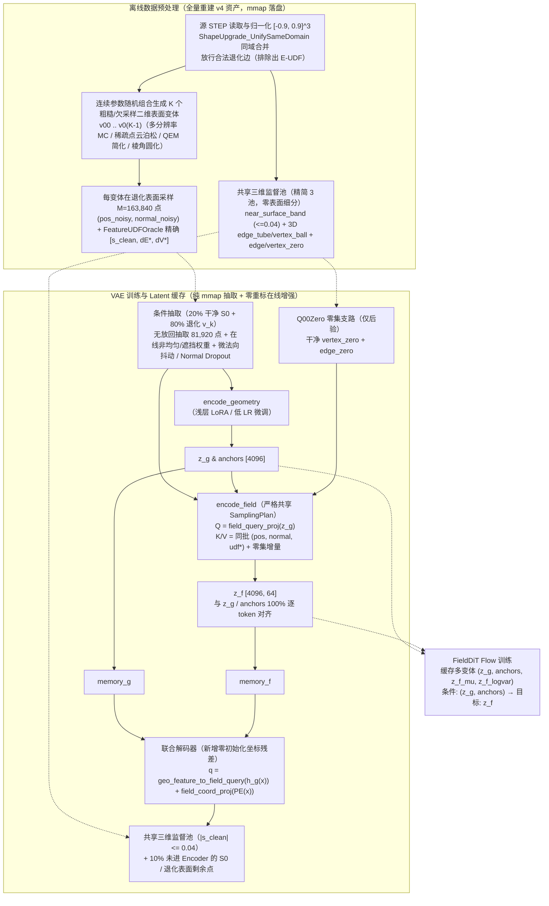

# 粗糙网格与欠采样点云的近表面锐边补全与线框优先 B-Rep 重建方案

设计稿，2026-11-22。本文档确立项目的核心定位：**面向粗糙网格与欠采样点云（如体素 Marching Cubes、稀疏点云泊松重建、QEM 粗网格及 AI 3D 生成大模型产出的圆钝网格）的离面线框优先 B-Rep 重建**。针对初始几何因分辨率不足而丢失尖锐棱角、单纯依赖面分割拟合易漏面/失真的痛点，提出在**近表面三维空间**借助生成式 Flow 补足尖锐三维线框（连续 `E-UDF + V-UDF`），同时完整保留现有 `EdgeVertexShapeVAE` 几何先验与 `band_brep_reconstruction` 后处理主干；并统一给出离线预处理、甜点档阈值、同域合并、退化边改造与实验对照协议。

关联文档：
- 边优先重建与优化方案：[Post1121.md](Post1121.md)
- 数据生产规范：[Pre.md](Pre.md)
- 上游 ShapeVAE 与零集编码：[Hunyuan3D VAE.md](../../Hunyuan3D/docs/VAE.md) · [VAEOptimizationPlan.md](../../Hunyuan3D/docs/VAEOptimizationPlan.md)

---

## 1. 核心 Idea、问题定位与前沿差异化

### 1.1 物理痛点与核心思路
低分辨率点云重建、体素 Marching Cubes（`48³–128³`）、QEM 粗网格以及 3D 生成大模型（如 Hunyuan3D / Trellis 等）产出的网格存在高度一致的几何退化特征：
- **面内部相对准确**：大片平面、圆柱面及光滑曲面核心区的几何位置与法向偏差很小（通常 `< 0.001 ~ 0.003`）；
- **尖锐特征严重丢失**：受采样分辨率限制，尖锐棱角、薄倒角、细槽被削平、圆化或向内收缩 `0.003 ~ 0.015`——**真正的 CAD 锐边和顶点在三维空间中悬空于粗糙网格表面外侧，根本不在输入表面上**。

由此确立**“近表面三维空间生成式线框补全 + 边优先 B-Rep 重建”**的完整闭环：
1. **为什么先建线框，而不只靠面分割？** 传统 Face-first 面分割方法（DualBrep / Point2CAD / Point2Brep）在粗糙网格上极易把被磨平的窄倒角、细槽误吞进大面；且相切面边界（平面接圆柱圆角）求交数值病态、自由曲面无法外推求交。先恢复三维线框可直接锁定窄面、相切边与自由面边界。
2. **为什么重建域放在近表面三维空间，而非输入表面？** 真实锐边与角点悬空在被削圆的粗糙网格外侧，贴着输入表面追边永远只能追出圆钝/锯齿假边；在近表面三维带（$w_{\text{infer}} = 0.026$）内预测连续 `E-UDF + V-UDF`，才能把缺失的尖锐线框从粗糙网格外侧直接“长”出来。
3. **为什么用生成模型（Flow）？** 一条被低分辨率抹平的圆钝棱角背后可能是锐角、小倒角或小圆角，属于典型的信息缺失病态补全问题；确定性回归会产生均值模糊导致管壳粘连，而条件 Flow 能采样出锐利、拓扑自洽的单一 CAD 线框模式。
4. **为什么能完整保留现有架构与几何先验？** 因为粗糙网格的大片面内部是准的，**Hunyuan3D 2.1 的预训练几何先验（`geo_encoder` + `memory_g`）**恰好能可靠编码两侧大面的朝向与全局结构，协助外推悬空锐边；下游 `band_brep_reconstruction` 中 [surface_fitting.py](../band_brep_reconstruction/bandbrep/surface_fitting.py#L257-L266) 的 **`_core_samples` 边界腐蚀**天生丢弃圆钝边带、只保留准确的面核心内点，与补全后的悬空锐边自然严丝合缝！

### 1.2 与最接近前沿工作的清晰边界与差异化锚点
| 代表工作 | 核心范式与中间表示 | 与本工作的本质区别 |
|---|---|---|
| **Point2Brep** *(中科大)* | **Face-first**：点云区域生长先拟合解析面 → 以面为条件预测 E/V 距离场 → 显式求交 | 顺序相反：粗糙网格抹平窄倒角/细槽时 Face-first 第一阶段即漏面，且相切面/自由面难靠求交恢复；本工作为 **Off-surface Wireframe-first + 生成式补全** |
| **DualBrep** *(SIGGRAPH 2026)* / **BR-DF** / **UniBRep** | 全局 SDF + GVD-UDF / 逐面 UDF / 表面 Feature Mesh，均为 **Face-first** 表面分割路线 | 依赖输入表面可清晰分面，缺少离面三维锐边补全；BR-DF 仅导出 faceted B-Rep |
| **BrepForge** *(SIGGRAPH 2026)* / **Stitch-A-Shape** | 离散自回归 V–E–F 序列 / 顺序缝合生成线框 → **纯边界先验填面** | ① 离散自回归受面数/序列长度与曝光偏差制约，复杂件易空间漂移；② 纯边界填面丢弃了粗糙网格准确的面核心自由曲面观测；本工作为**空间锚定连续三维 E/V 场（无面数上限）+ 面核心内点联合拟合** |
| **CLR-Wire** *(SIGGRAPH 2025)* | Attention VAE + Latent Flow Matching，定长潜空间编码 **Neural Parametric Curves** 线框 | ① **仅生成 3D 曲线线框，不构面、不装配 watertight B-Rep / STEP**；② 定长曲线槽位受复杂度上限约束，且全局生成易与输入粗糙网格空间错位；本工作通过 4,096 空间锚点实现严格三维对齐与端到端实体装配 |
| **SepicNet** *(CVPRW 2023)* / **DEF** *(SIGGRAPH 2022)* / **NerVE** / **EMAP** | 贴面主曲率/表面距离场检测 **Sharp-only 棱线** → 确定性分段拟合直线/圆/样条（或体素/多视图线框） | ① **仅输出散落锐边曲线或线框**，不恢复相切边、共享顶点拓扑图与水密 B-Rep 实体；② 贴面确定性检测在 `48³–64³` MC 或窄倒角被磨平（曲率信号消失、锐边悬空在外侧）时失效；本工作在近表面三维空间用生成式 Flow 主动补全 |
| **PRS** *(CVPR 2024)* / **SharpNet** | 粗糙/MC 网格锐边先验修复 | 输出为锐化三角网格（Remeshing），不恢复 B-Rep 拓扑与解析/NURBS 参数化 STEP |

**核心差异化四条抓手**：
1. **空间锚定连续三维双场 vs. 离散自回归 / 定长曲线槽**（vs. `BrepForge` / `CLR-Wire`）：锚定在输入表面 4,096 个 3D 锚点上的连续 `E-UDF + V-UDF` 无面/边数硬上限，在高复杂度零件（50–100 面）上保持严格空间对齐与零序列漂移；
2. **离面三维生成式补全 + 完整逻辑边 vs. 贴面确定性锐边检测**（vs. `SepicNet` / `DEF`）：覆盖非锐边（相切边、共面分界、闭环），并在极粗网格曲率信号消失处从外侧近表面空间“长”出悬空锐边与窄倒角；
3. **准确面核心先验 + 离面补全锐边的双重保真**（vs. `BrepForge Stage 2` / `Point2Brep` / `DualBrep`）：利用粗糙网格“面核心准、棱角残”的特性，以 `memory_g` + `_core_samples` 保住自由曲面与解析面内部精度，同时以离面线框补全窄面与相切边界；
4. **端到端工业级可编辑 STEP 闭环**（vs. `CLR-Wire` / `SepicNet` / `PRS`）：完整处理共享拓扑、周期 seam 与退化边（圆锥/球冠），直出通过 OCC 读回校验、可在 CAD 软件中二次编辑的水密实体。

当前两套仓库分工：
- **上游（`Hunyuan3D/hy3dshape`）**：保留 `EdgeVertexShapeVAE`（`Q00Zero` + 预训练几何先验 + 坐标残差）与 `FieldDiT` 条件 Flow，在近表面三维带内预测连续 E/V UDF（$\hat d_E, \hat d_V$）。
- **下游（`DualBrep/band_brep_reconstruction`）**：保留边优先流水线（`scout → wireframe → split_mesh / fast_faces → solid`），补齐退化边支持与窄面拟合保护，输出通过 OCC 读回校验的 watertight STEP。

---

## 2. 为什么不能“只改 Flow 条件加噪、冻结干净 VAE”

若仅在 Flow 训练阶段对控制条件点云施加 $\le 0.02$ 的扰动，同时沿用干净点云训练的冻结 VAE 与干净目标潜变量 $z_f^{\text{clean}}$，会在当前代码架构下触发五个硬性瓶颈：

### 2.1 VAE 解码器几何强耦合导致「训练-推理失配」（最核心）
在 [shapevae.py](../../Hunyuan3D/hy3dshape/hy3dshape/models/autoencoders/edge_vertex/shapevae.py#L193-L200) 中，联合解码查询路径为：
```python
h = self.geo_query_decoder.forward_features(queries=x.float(), latents=memory_g)
q = self.geo_feature_to_field_query(h)
field = self.field_query_decoder(query_embeddings=q, latents=memory_f)
```
- `field_query_decoder` **不直接接收坐标 `x`**，所有空间定位信息均经由 `memory_g` 生成的几何特征 $h_g(x)$ 传递。
- 在 [pipeline.py](../../Hunyuan3D/hy3dshape/hy3dshape/inference/pipeline.py#L325-L327) 推理时，`prepare_decode(geo.z_g, z_f_pred, geo.anchors)` 喂入的是**退化条件编码出的 `memory_g_noisy`**。
- 干净 VAE 中的 $z_f^{\text{clean}}$ 仅与 `memory_g_clean` 协同工作。即便 Flow 完美预测出 $z_f^{\text{clean}}$，将 `(memory_g_noisy, z_f_clean)` 配对解码仍会因 $h_g(x)$ 分布偏移导致 E/V 场扭曲、模糊或被拉回噪声表面；而 Flow 在 [flow_matching.py](../../Hunyuan3D/hy3dshape/hy3dshape/models/diffusion/flow_matching.py#L54-L62) 中仅在 latent 空间做速度匹配，无法感知或补偿解码器失配。

### 2.2 Token / Anchor 空间对齐被破坏（`FieldDiT` 硬约束）
- [field_dit.py](../../Hunyuan3D/hy3dshape/hy3dshape/models/denoisers/field_dit.py#L168-L188) 通过**逐 token 通道拼接** `torch.cat((z_t, z_g), -1)` 注入几何条件，并对两者共享同一组 `SurfaceRoPE(anchor_xyz)`（`rope_coord_scale = 100.0`）。
- [shapevae.py](../../Hunyuan3D/hy3dshape/hy3dshape/models/autoencoders/edge_vertex/shapevae.py#L124-L138) 中，目标 $z_f^{\text{clean}}$ 的 4,096 个 token 严格绑定在干净点云经 FPS 采出的 `anchors_clean` 顺序与位置上。
- 若对加噪点云重新跑 FPS 编码 `z_g_noisy`，4,096 个 anchor 的顺序和 3D 位置与 $z_f^{\text{clean}}$ 完全错位，逐 token 拼接直接失效；若训练时复用干净 `anchor_idx`，推理面对真实扫描件时仍须独立跑 FPS（且 FPS 天然偏好向外凸出的噪点），同样存在严重的训练-推理分布落差。

### 2.3 偏移上限 `0.02` 与查询带宽 `0.02` 的几何冲突及双重外推
- **管壳截断**：按 [Post1121.md §1](Post1121.md) 的几何预算，默认带宽 $w = 0.02$、管壳/球壳半径 $r = 0.005$、细格步长 $h = 0.003$ 时，保证完整管壳和一层细格角点不越界的保守条件为：
  $$\delta + r + \sqrt{3}h \le w \implies \delta \lesssim 0.0098$$
  偏移达到 `0.01 ~ 0.02` 时，真实边/顶点管壳会被带边界裁断（`valid=False`），导致漏边、断链或球壳残缺。
- **解码器 OOD 外推**：现有 `veudf` 空间监督点仅覆盖距**干净表面** `0.03` 以内（VAE 训练默认截到 `0.02`，见 [Pre.md §4](Pre.md#L59)）。若输入点云偏离干净表面 `0.02`，推理在退化点云 `0.02` 带内查询时，查询点距干净表面可达 `0.04`，落入解码器未训练区。
- **`presence` 漏判**：[pipeline.py](../../Hunyuan3D/hy3dshape/hy3dshape/inference/pipeline.py#L73-L77) 仅在输入表面 `S0` 上采样估计存在性，大偏移下小顶点可能被误判为 `absent`。

### 2.4 点级白噪声的法向陷阱与 Domain Gap
- `encode_geometry` 同时接收 3D 坐标 `pos` 与法向 `normal`。
- 纯逐点 i.i.d. 随机加噪存在两难：**不改法向**会泄露精确干净 CAD 法向导致过拟合作弊；**对抖动点云重算 PCA 法向**（当抖动幅度接近 `0.02`，远大于 81,920 点的局部点距 `~0.005`）会使法向退化为纯噪声，破坏预训练 ShapeVAE 几何主干。
- 真实扫描件/粗网格的核心退化是**空间相关的低频偏移**（壁厚偏差、锐边圆化、网格简化收缩、局部缺测），而非高频白噪声。

### 2.5 下游面拟合的隐藏硬门限
- 在 [surface_fitting.py](file:///opt/data/private/yihengxu/DualBrep/band_brep_reconstruction/bandbrep/surface_fitting.py#L493-L561) 中，尽管 `scan_offset_tolerance = 0.02` 放宽了 `.max()` 上限，但 **90%/95% 分位点内点误差和输入网格 `provider.sdf(q)` 仍硬卡在 `2 * surface_tolerance = 0.006`**。当干净边界曲线与系统性偏移的扫描内点相差超过 `0.006` 时，会触发 `surface_fit_failed` 或 `surface_boundary_incompatible`。

---

## 3. 为什么不能直接用近表面点池 `N` 替换输入点云

在重训路径 A 的 VAE 时，**不建议**直接拿磁盘上已有的 `near_surface` 点池（`N`）随机替换 `S0` 作为编码器输入：

1. **`N` 是双侧对称的三维厚点雾，存在零均值捷径**：
   - 见 [sampling.py](../../Hunyuan3D/veudf/src/veudf/preprocess/sampling.py#L314-L343)：`near_surface` 由 80% 沿法向**等概率 `±1` 双侧扰动**（`[0, 0.002]` 30%、`[0.002, 0.01]` 40%、`[0.01, 0.03]` 30%）与 20% 各向同性高斯扰动组成，厚度达 `0.04 ~ 0.06`。
   - 其局部空间均值精确落在干净 CAD 表面 `S0` 上，`geo_cross`（20:1 聚合）极易通过局部平均直接滤回干净表面，无法学会处理真实扫描件的**单侧系统性偏移**。
2. **FPS Anchor 退化为双层体壳**：对三维厚雾跑 FPS 会优先选出内外最外缘极值点，与推理期单层二维扫描表面的 anchor 分布完全不同。
3. **补法向陷入两难**：`N` 未保存 `normals` 与 `triangle_ids`；从最近干净面补法向会泄露干净 CAD 法向，对三维点雾做 PCA 估算法向则极不稳定。

---

## 4. 推荐方案：路径 A（离线预处理配对退化资产 + 严格 NaTex 对齐 + `Q00Zero`）

核心思路：
1. **严格保留 NaTex 对齐契约**（与 [Post1121.md](Post1121.md) 和 [shapevae.py](../../Hunyuan3D/hy3dshape/hy3dshape/models/autoencoders/edge_vertex/shapevae.py#L124-L138) 一致）：随机采样主路中，`encode_geometry` 与 `encode_field` 共享同一批退化二维表面采样点 `(pos_noisy, normal_noisy)` 和同一 `SamplingPlan`，而 `field_udf` 是在 `pos_noisy` 坐标处针对**干净 CAD $B^*$** 用 `FeatureUDFOracle` 预先算好的精确 OCC 真值距离。
2. **统一甜点档阈值（全量重处理数据集）**：选定 **$\delta_{\max}=0.015$、推理带宽 $w_{\text{infer}}=0.026$、预处理监督带 `band_max=0.040`、截断半径 `udf_truncation=0.05`（不变）**——兼顾 90%+ 真实扫描与 AI 粗网格误差、管壳零截断（$0.015 + 0.005 + 0.0052 \le 0.026$）、解码器零 OOD 外推（$0.026 + 0.015 \approx 0.040$），且不稀释近零集数值精度。
3. **同域规范化 + 精简三维监督池 + `Q00Zero` 零集补全**：预处理先用 `ShapeUpgrade_UnifySameDomain` 消除无意义的同曲面拼缝（如两块半圆锥/半圆柱拼成的整面）；Decoder 监督池瘦身为**三维近表面分层池 + 三维边管/顶点球近零集池 + 精确零集池**；`Q00Zero` 零集支路补足偏移表面缺失的 `dE ≈ 0` 后验观测。

### 4.1 整体数据流



### 4.2 离线预处理、阈值甜点与精简点池设计

#### (1) 已敲定的甜点档核心阈值
| 参数 | 取值 | 作用与约束依据 |
|---|---|---|
| 退化偏移上限 $\delta_{\max}$ | **`0.015`**（180 mm 零件约 1.5 mm；局部极值容许至 `0.018`） | 覆盖 90%+ 工业/消费级扫描与 AI 生成粗网格的圆化、漂移误差，同时避免薄壁穿带 |
| 推理近表面查询带 $w_{\text{infer}}$ | **`0.026`**（`0.025 ~ 0.026`） | 严格满足管壳不截断条件 $\delta_{\max} + r + \sqrt{3}h = 0.015 + 0.005 + 0.0052 = 0.0252 \le 0.026$；查询量相对原 `0.02` 仅增 `~1.25×` |
| 预处理监督带 `band_max` | **`0.040`** | 覆盖推理极限距离 $w_{\text{infer}} + \delta_{\max} \approx 0.041$，确保解码器几乎零 OOD 外推，且满足 `bounding(0.9) + band_max = 0.94 < 1.0` |
| UDF 截断半径 `udf_truncation` | **`0.05`**（保持不变） | 满足 `udf_truncation > band_max + label_tolerance`，**完全不稀释近零集数值分辨率**，沿用原距离编码与 loss 分桶 `[0.001, 0.005, 0.02]` |
| 后处理容差联动 | `band_width = 0.026`，`scan_offset_tolerance = 0.018` | 为局部尾部极值留 `0.003` 余量，并与 `surface_fitting.py` 分位门限联动 |

#### (2) 资产目录与精简点池结构（新数据集根 v4）
```text
assets/<asset_id>/
  condition/                  # 干净参考网格（经 ShapeUpgrade_UnifySameDomain 规范化后生成）
    vertices.npy / triangles.npy / meta.json
  encoder_surfaces/           # 专供 Encoder 抽取的二维表面池（严格 NaTex 对齐）
    clean/                    # 干净 S0（M_clean = 262,144 或 393,216）
      points.npy / normals.npy / fields.npy / saturated.npy
    v00/ ... v0(K-1)/         # K 个预生成组合退化二维表面变体（每变体 M = 163,840）
      points.npy              # float32 [M, 3]，退化二维表面采样坐标 pos_noisy
      normals.npy             # float32 [M, 3]，退化网格自身真实面/顶点法向（绝不用干净法向）
      fields.npy              # float32 [M, 3]，FeatureUDFOracle 精确标注的 [s_clean, min(dE*, 0.05), min(dV*, 0.05)]
      saturated.npy           # bool    [M, 2]，E/V 截断饱和标记
      mesh/{vertices.npy, triangles.npy}   # val 必存（用于下游闭环评测），train 可选
      meta.json               # 退化组合参数、随机种子、实测偏移统计（rms/p95/max）、闭合检查
  pools/                      # 共享三维 Decoder 监督池（砍掉耗时的表面 proposal_fragments 细分）
    near_surface/             # 三维近表面 4 层分层池（|s_clean| <= 0.040）
    edge_neighborhood/        # 纯三维边管近零集池（直接绕干净边采三维距离分层，覆盖 E=0.005 管壳两侧）
    vertex_neighborhood/      # 纯三维顶点球近零集池（直接绕干净顶点采三维距离分层，覆盖 V=0.005 球壳两侧）
    edge_zero/                # 精确边零集（65,536 等弧长点，供 Q00Zero + Decoder）
    vertex_zero/              # 全部必要顶点零集（供 Q00Zero + Decoder）
  evaluation/ / audit/ / topology.json / meta.json
```

* **精简 3 池采样配额建议（Decoder 共享监督池）**：
  1. **`near_surface`（约 350k–400k 点，覆盖 `|s_clean| <= 0.040`）**：
     - 80% 法向双向扰动拆为 **4 层**：`[0, 0.002, 0.01, 0.025, 0.04]`，层权重 **`[0.25, 0.35, 0.25, 0.15]`**（60% 守住 `[0, 0.01]` 核心区，15% 守住 `[0.025, 0.04]` 防 OOD 缓冲区，避免扩带稀释内层密度）；
     - 20% 各向同性高斯扰动（`std ∈ [0.001, 0.005, 0.012, 0.025]`，过滤 `|s_clean| <= 0.040`）。
  2. **`edge_neighborhood` / `vertex_neighborhood`（纯三维管/球近零集池，各约 350k / 200k 点）**：
     - **彻底去掉原先占 ~70% 预算、耗时的二维表面三角细分 `proposal_fragments`**；
     - 直接以 `edge_zero` / `vertex_zero` 为中心，按三维法截面/球壳半径分层采样（`feature_radii = (0.002, 0.005, 0.01, 0.02, 0.04)`，权重 `(0.20, 0.28, 0.27, 0.17, 0.08)`），接受 `|s_clean| <= 0.040` 且位于 `[-1, 1]^3` 内的点，把 `E=0.005` / `V=0.005` 等值管壳与球壳两侧打透。
  3. **`edge_zero` / `vertex_zero`（精确零集）**：沿用现行配额（`edge_zero = 65,536`，`vertex_zero = 全部必要顶点`）。
  4. **少量 `s=0` 表面监督**：不另开重型表面特征池，直接把训练期未进入 Encoder 的 `clean/surface` 或当前变体 `v_k` 剩余点按约 `10%` 配额混入 Decoder 查询即可。

#### (3) 面向“分辨率不足 / 锐边丢失”的组合式粗糙网格退化设计
退化构造紧扣**面内部相对准确、尖锐棱角被削平/圆化/欠采样**这一核心物理现象。每个离线变体从连续参数区间随机组合采样，并将棱角最大削平偏移控制在 $\delta_{\max} \le 0.015$（局部极端尾部 $\le 0.018$，面核心内点误差保持 `< 0.003`）：

| 退化算子模块（主次权重） | 参数连续采样范围 | 物理对应场景 |
|---|---|---|
| **多分辨率体素化 + Marching Cubes（核心，~35%）** | 体素分辨率连续随机采样 `48³ ~ 128³`（或轻度 SDF 模糊后再 MC） | 神经隐式重建（NeuS / DeepSDF / DualBrep）及 **Hunyuan3D 等 AI 3D 生成模型**的圆钝阶梯粗糙网格 |
| **稀疏点云重建网格（核心，~30%）** | 从干净面欠采样 `2,048 ~ 16,384` 点（可加微扰 `σ ≤ 0.001`）→ Screened Poisson / Alpha-Wrap 重建闭合网格 | 采样分辨率不足的激光/结构光/消费级扫描点云 |
| **QEM 网格简化（核心，~20%）** | 激进减面至 `300 ~ 3,000` 三角形（保拓扑闭合，可叠轻度重网格） | 低分辨率粗糙三角网格、窄面/小倒角塌陷 |
| **曲率加权棱角圆化（核心，~15%）** | 仅在高二面角/高曲率棱角邻域施加 Taubin/Laplacian 平滑 `2 ~ 10` 步（保平坦面核心不动） | 精准模拟“面内准、唯独锐边被削圆”的退化形态 |
| **可选轻量复合项** | 叠加微幅低频位移 `U(0, 0.003)` 或曲率相关微抖动 `σ ∈ [0.0002, 0.001]` | 兼顾真实扫描配准残差与掠射角噪声 |

* **变体数 $K$ 与防单一的“零 OCC 重标”在线多样性放大**：
  * **离线数量**：万级大数据集 `train` 每资产 **`K = 6 ~ 8`**（小数据集 `< 2,000` 资产可提至 `K = 10 ~ 12`），`val` 每资产固定 **`K = 3`** 档确定性粗糙网格（`low: MC 128³ / 16k Poisson`、`mid: MC 96³ / 8k Poisson`、`high: MC 64³ / 4k Poisson / 激进 QEM`）+ `clean`。
  * **每变体点数**：`M = 163,840`（`2 × 81,920`），单变体约 `6.5 MB`，6 个变体合计约 `~40 MB / 资产`。
  * **训练期 4 重零重标在线多样性放大**（不改变点坐标，因此**完全不需要重算 OCC UDF**）：
    1. **随机子集与随机 FPS**：每轮从 `163,840` 点中无放回抽不同 `81,920` 子集，FPS 产生不同 4,096 anchor 集合；
    2. **在线非均匀密度 / 局部视角遮挡抽样**：按随机空间权重（或随机剔除 1–2 个小锥角/凹槽区域）加权抽取 `81,920` 点，模拟点云密度不均与局部遮挡；
    3. **在线法向微扰 + 15% Normal Dropout**：对已加载的 `normal_noisy` 施加 `1° ~ 5°` 随机锥角偏转或 15% 概率置零（法向不影响标量 UDF 真值）；
    4. **全局随机刚体旋转增强（可选）**：对输入点、法向、零集与所有查询点同步施加同一随机 SO(3) 旋转（欧氏距离完全旋转不变）。

#### (4) 真值 `[s_clean, dE*, dV*]` 统一标注方式
* 全部直接复用 [veudf/src/veudf/preprocess/distance.py](../../Hunyuan3D/veudf/src/veudf/preprocess/distance.py#L32-L117) 的 **`FeatureUDFOracle`**（`udf_truncation = 0.05`）：仅在边覆盖球与顶点 `0.05` 球内调用 OCC 精确求解，远场直接赋值 `0.05` 并标 `saturated=True`；`s_clean` 由干净网格 `MeshSDFOracle` 精确求解。
* 整个预处理链路 100% 精确一致，无近似误差。

### 4.3 模型侧与训练抽样改动（完整保留现有主干）

#### (1) `SurfacePoolDataset` 抽样策略（零在线退化开销）
- **编码器输入抽取**：
  - `train`：以 `20%` 概率抽 `encoder_surfaces/clean`，以 `80%` 概率随机抽 `encoder_surfaces/v00..v0(K-1)`；从 `M` 点中按均匀或非均匀/遮挡权重无放回抽取 `81,920` 个 `(pos, normal, udf*)`，**同时送入 `encode_geometry` 和 `encode_field`**（严格维持 `geo_pos == field_pos` 与共享 `SamplingPlan`）。
  - 在线施加轻微法向锥角微扰（`1° ~ 5°`）与 `15%` Normal Dropout（同步作用于 `geo_normal` 和 `field_normal`）。
  - **`Q00Zero` 零集支路**：始终从 `pools/edge_zero` 与 `pools/vertex_zero` 抽取精确干净零集（预算 20,480），不随退化变体改变。
- **Decoder 监督点抽取**：
  - 从精简后的 3 类共享三维监督池抽取（`supervision_band_width = 0.040`，覆盖 `|s_clean| <= 0.040`），并按约 `10%` 配额混入当前抽中表面池（`clean` 或 `v_k`）中**未进 Encoder 的剩余点**。

#### (2) VAE 保留几何先验 + 关键精度升级（衔接 [VAEOptimizationPlan.md](../../Hunyuan3D/docs/VAEOptimizationPlan.md)）
- **完整保留 `memory_g` 几何先验**：粗糙/MC 网格面内部几何准确，保留预训练 Hunyuan3D 2.1 的 `geo_encoder` 与 `memory_g` 有助于稳定推断两侧大面延伸交汇出的悬空锐边；对 `geo_input_proj` 与浅层 `geo_cross` 开放 LoRA 或 `0.1×` 低学习率微调以适配圆钝棱角。
- **解码器新增零初始化坐标残差**：在 [shapevae.py](../../Hunyuan3D/hy3dshape/hy3dshape/models/autoencoders/edge_vertex/shapevae.py#L199-L200) 中改为 `q = self.geo_feature_to_field_query(h) + self.field_coord_proj(self.pe(x.float()))`，增强悬空于粗糙网格外侧的尖角定位精度。
- **同步合入 VAE P0/P1 核心止血项**：`logvar_clamp ∈ [-10, 0]` + `mean_recon_prob = 0.15`（根治后验方差爆炸与 `mean/sample` 割裂）、多尺度 `SmoothL1` + 零点项 + 远场硬负样本惩罚（`GT >= 0.015` 误报压制）、以及 `field_latent` / `field_latent_decoder` 3D RoPE（详见 [VAEOptimizationPlan.md](../../Hunyuan3D/docs/VAEOptimizationPlan.md) M1–M4）。

### 4.4 Latent 缓存、Flow 训练与下游后处理协同

1. **多变体 Latent 缓存**：扩展 [latent_cache.py](../../Hunyuan3D/hy3dshape/hy3dshape/data/latent_cache.py#L59-L125)，遍历每个资产的 `[clean, v00, ..., v0(K-1)]` 分别缓存 `(z_g_raw, anchor_xyz, z_f_mu, z_f_logvar, variant_id, offset_tier)`。`stats_f` / `stats_g` 仍仅在 `train` split 上拟合。
2. **拓扑敏感加权 Flow Loss**：按每个 `anchor` 处对应输入点的最小 `dE*` / `dV*` 分桶加权 Flow Matching 损失，把生成容量集中在被削平/圆化的棱角与交汇区。
3. **重建导向选优与微调（Best-of-N / DPO）**：推理期对同一粗糙网格采样 $K = 4\text{--}8$ 组 $z_f$，以 `band_brep_reconstruction` 的快速 `wireframe` 指标（`unresolved` 数量、闭环完整度、骨架连通性）选优；进一步可按后处理验收结果做轻量 DPO / RFT 微调。
4. **下游 `band_brep_reconstruction` 轻量协同适配（无需大改主流程）**：
   - 将默认查询带调至 `band_width = 0.026`、`scan_offset_tolerance = 0.018`；
   - **窄面/补全倒角拟合保护**：粗糙网格原本的大面核心经 `_core_samples` 腐蚀后本就很准，仅需在 [surface_fitting.py](../band_brep_reconstruction/bandbrep/surface_fitting.py#L493-L561) 中对**被粗糙网格抹平、由生成线框补全切出的窄面/小倒角**，提高两侧精确三维边界曲线对平面/柱面/直纹面参数的约束优先级，并将分位内点门限按面宽度/偏移放宽；
   - **非相切解析面求交精修（推荐增项，见 [Opt.md](Opt.md#21-借鉴-point2brep解析面求交反哺线框--全局-cad-几何正则)）**：对两侧均为高置信大解析面且非相切的共享边，用精确面面交线与三面交点反哺精修线框，兼得 Edge-first 的拓扑完整度与解析求交的 `1e-6` 级精度；
   - 在 `scout` 阶段结合三维体素格点最小值辅助判定 E/V `presence`，避免角点削平处误判顶点缺失。

---

## 5. 退化边（Degenerate Edge）处理与 V-UDF 采样策略

### 5.1 概念厘清：什么是退化边？

在 B-Rep（尤其是 OpenCASCADE）中，**退化边**（`BRep_Tool.Degenerated(edge) == True`）是指在二维 UV 参数域中具有非零参数长度的 pcurve，但映射到三维空间后**缩成单个点（三维长度为 0、无 3D 曲线）**的拓扑边。工业 CAD 中常见三类退化边：

1. **完整解析旋转面极点**：如完整圆锥的尖顶（$v = v_{\text{apex}}, u \in [0, 2\pi]$）、球冠极点（$v = \pm\pi/2, u \in [0, 2\pi]$）、完整球体南北两极。
2. **部分解析旋转面极点**：如被平面切开的半圆锥尖顶、切分球面过极点（此时极点连着两条及以上普通面间边，但在 UV 域中仍跨 $u \in [u_1, u_2]$）。
3. **退化 B-spline / 扫掠片收缩边**：四边张量曲面将一条参数边界的所有控制点重合为同一 3D 顶点（如三边面用四边 B-spline 表示）。

### 5.2 核心问题：是否应把 seam 加入 E-UDF？圆锥顶点 / 球面极点是否纳入 V-UDF？

#### (1) 强烈不建议将 seam 作为普通边加入 E-UDF
1. **几何不可辨识（无限多解），破坏生成网络训练**：如 [DualBrep.md §5.1](../legacy_dualbrep/DualBrep.md#L637) 所述，完整圆柱、圆锥、球面和圆环的 seam 位于 $u \in [0, 2\pi)$ 的哪条母线/经线上，三维外形完全相同。将 seam 加入 E-UDF 会迫使 VAE/Flow 在光滑无特征的旋转面上猜测随机母线，导致光滑曲面上的预测 E-UDF 出现模糊低谷或虚假断续骨架。
2. **引入大量伪顶点，污染 V-UDF**：seam 另一端落在底面圆环上的交点是没有几何特征的任意圆环锚点（现行 [cad.py:312-320](../../Hunyuan3D/veudf/src/veudf/preprocess/cad.py#L312-L320) 已规范化移除），强行保留会在光滑圆环上引入随机三度伪顶点。
3. **破坏下游拓扑假设**：[boundary_cycles.py](../band_brep_reconstruction/bandbrep/boundary_cycles.py)、[edge_first_embedding.py](../band_brep_reconstruction/bandbrep/edge_first_embedding.py) 与 [occ_assembly.py:552](../band_brep_reconstruction/bandbrep/occ_assembly.py#L552) 均假设逻辑边分隔**两个不同面**（`len(uses)==2 and uses[0][0]!=uses[1][0]`）。
4. **技术上无需借助 seam**：[edge_first_grid.py:185](../band_brep_reconstruction/bandbrep/edge_first_grid.py#L185) 的 `scout` 筛块本就是 `E` / `V` 通道取并集（`.any(1)`），且圆锥尖顶与球面极点完全由单环解析面拟合闭式反推。

#### (2) 圆锥顶点、球面极点是否纳入 V-UDF 采样？
按**“是否有普通面间边连接到该点”**统一判定，不引入孤立顶点特判：

| 几何情形 | 是否纳入 `V-UDF` | 原因 |
|---|---|---|
| **球冠极点 / 完整球南北极** | **否** | 三维上是光滑球面内部的普通点，无几何棱角，纯属参数原点；纳入 `V-UDF` 模型无法从几何定位。 |
| **完整圆锥尖顶**（仅连退化边与 seam，无普通面间边） | **否** | ① [veudf/preprocess/pipeline.py:146-149](../../Hunyuan3D/veudf/src/veudf/preprocess/pipeline.py#L146-L149) 强制校验全局不变量 **`dE <= dV + label_tolerance`**，孤立尖顶处 $d_V = 0, d_E > 0$ 会直接报 `quality_failed: dE > dV`；② 下游 `edge_first_graph.py` 不允许 degree=0 孤立顶点进入逻辑线框图；③ 单环圆锥面在 `surface_fitting.py` 解析拟合后，尖顶直接由闭式公式 $P_{\text{apex}} = O - \frac{R}{\tan\alpha}\mathbf{a}$ 反推，精度更高且抗扫描磨圆。 |
| **半圆锥尖顶 / 切分球极点 / 退化 B-spline 收缩点**（连着 $\ge 2$ 条普通面间边） | **是（自动纳入）** | 本身就是真实普通边（如半圆锥的两条母线边）的交汇端点，天然满足 $d_E \le d_V$，现行 [cad.py:297-322](../../Hunyuan3D/veudf/src/veudf/preprocess/cad.py#L297-L322) 顶点筛选逻辑**自动保留**。 |

> 排除退化边（与 seam 同级）后，全圆锥的目标语义与圆柱一致（`has_edges=True, has_vertices=False`），现有 `veudf` 与 `hy3dshape` 已原生支持空 V 通道。

### 5.3 分场景恢复方案（含斜切圆锥与斜圆锥）

#### 场景 A：完整圆锥尖顶 / 斜切正圆锥 / 球冠极点 / 完整球体（无普通边连到极点）
* **拓扑切分**：底面闭合环将网格切分为 `Face 0（底面）` 与 `Face 1（单环圆锥/球冠侧面）`。
* **几何恢复**：[surface_fitting.py:338-423](../band_brep_reconstruction/bandbrep/surface_fitting.py#L338-L423) 的 `revolution_candidates` 已支持任意三维轴向的单环正圆锥拟合（输出 `origin` $O$、`axis` $\mathbf{a}$、`angle` $\alpha$、`radius` $R$），尖顶解析解为：
  $$v_{\text{apex}} = -\frac{R}{\sin\alpha}, \qquad P_{\text{apex}} = O - \frac{R}{\tan\alpha}\,\mathbf{a}$$
* **OCC 装配**：仿照 [occ_assembly.py:267-301](../band_brep_reconstruction/bandbrep/occ_assembly.py#L267-L301) 已实现的 `make_spherical_cap()`，对称新增 **`make_conical_cap()`**：
  1. 触发条件：`patch.kind == 'cone' and len(incident) == 1 and incident[0].closed`（**不硬限底环必须是圆**，改用通用 `make_pcurve` 生成底环 2D 曲线 $(u(t), v(t))$，从而同时支持水平底圆与斜平面/曲面斜切得到的椭圆/闭合自由底环！）；
  2. 求尖顶参数 $v_{\text{apex}} = -R / \sin\alpha$（OCC 中 $\alpha \in (-\pi/2, \pi/2)\setminus\{0\}$ 可正可负，故需以 `apex_above = v_apex > v_ring_anchor` 确定 `(low, high)`）与 3D 顶点 `apex = BRepBuilderAPI_MakeVertex(surface.Value(0, v_apex)).Vertex()`；
  3. 用 1 次 `Geom_BSplineCurve`（底环锚点 $(u_0, v(0))$ 到尖顶 $(u_0, v_{\text{apex}})$）构造直线母线 `seam`，挂两条 UV pcurve（$u = u_0$ 与 $u = u_0 + 2\pi$）；
  4. 构造 `apex` 处的退化边 `degen`（`builder.Degenerated(degen, True)`，两端绑定 `apex`，挂 pcurve $(u_0, v_{\text{apex}}) \to (u_0 + 2\pi, v_{\text{apex}})$）；
  5. 按 `apex_above` 组装闭合 wire 并按 `orientation_point` 与 `patch.normal` 校验面朝向。
  * *扩展*：若全圆锥侧面带有侧孔（`len(wraps) == 1` + 若干 `holes`），可在 `plan_periodic_band` 中同样把孔环附着到 `make_conical_cap` 建出的面上。

#### 场景 B：半圆锥 / 切分球等部分旋转面（极点连着普通面间边）
* **同域规范化说明**：两个半圆锥/半圆柱拼成的整面，在预处理阶段已由 `ShapeUpgrade_UnifySameDomain` 规范化合并为场景 A 的单个整面；只有真正的半圆锥（另一侧为切割平面而非同源圆锥）会进入场景 B。
* **拓扑与几何**：极点是多条普通面间边的交汇点，天然存在于 E-UDF 与 V-UDF 中，被正常恢复为共享顶点 `occ_vertices[vid]`。
* **OCC 装配**：在组装 `cone` / `sphere` 的普通 wire 时，检查环上相邻两条 coedge `(u_prev, u_next)`：若共享 3D 顶点落在解析极点（$|v - v_{\text{pole}}| < \text{tol}$）且前后 pcurve 方位角存在跳变（$|u_{\text{prev,end}} - u_{\text{next,start}}| > 10^{-5}$），在两者之间自动插入一条绑定到该共享 `occ_vertices[vid]` 的退化边（`Degenerated=True`，pcurve 为直线段 $(u_{\text{prev,end}}, v_{\text{pole}}) \to (u_{\text{next,start}}, v_{\text{pole}})$）。

#### 场景 C：一般 B-spline 自由曲面上的退化边与真正斜圆锥（Oblique Cone）
* **普通三边退化 B-spline 片**（退化顶点连着 $\ge 2$ 条普通面间边）：预处理排除退化边出 E-UDF、自动保留收缩顶点进 V-UDF；后处理 [surface_fitting.py:434-497](../band_brep_reconstruction/bandbrep/surface_fitting.py#L434-L497) 直接拟合裁剪张量 B-spline 曲面。
* **真正斜圆锥（非旋转面的孤立尖点退化 B-spline）**：
  * **首版预处理策略（覆盖 ~99% 退化边数据）**：在 `cad.py` 中按退化边所属面的曲面类型 `BRepAdaptor_Surface(face).GetType()` 精准放行——放行 `GeomAbs_Cone`、`GeomAbs_Sphere` 退化边及有 $\ge 2$ 条普通边相连的退化边；暂拒极罕见的“非解析曲面 + 无普通边相连的孤立退化尖点”（记为 `unsupported_isolated_degenerate_freeform`）。
  * **后续扩展支持（仍无需把尖顶加入 V-UDF）**：任意斜圆锥/椭圆锥的所有切平面均严格过尖顶 $P_{\text{apex}}$（$\mathbf{n}_i^\top P_{\text{apex}} = \mathbf{n}_i^\top \mathbf{p}_i$），可在 `surface_fitting.py` 中对单环非解析面通过 3 变量鲁棒线性最小二乘直接由 `p_core` 闭式求出 $P_{\text{apex}}$，再构造 degree-(3, 1) 直纹退化 B-spline 锥面 $S(u, v) = (1 - v) C(u) + v P_{\text{apex}}$ 精确恢复。

---

## 6. 详细分仓库改造计划（可直接照表实施）

按执行依赖顺序分为四个阶段，跨 `Hunyuan3D/veudf` → `Hunyuan3D/hy3dshape` → `DualBrep/band_brep_reconstruction` 三个包推进：

### Phase 1：数据预处理改造（`Hunyuan3D/veudf` → 同步至 `DualBrep/veudf`）

| 任务 | 目标文件与位置 | 具体改动内容 |
|---|---|---|
| **1.1 甜点档配置升级** | [veudf/preprocess/config.py](../../Hunyuan3D/veudf/src/veudf/preprocess/config.py) & [configs/surface_pools.json](../../Hunyuan3D/veudf/configs/surface_pools.json) | 设 `band_max = 0.04`、`udf_truncation = 0.05`、`feature_radii = (0.002, 0.005, 0.01, 0.02, 0.04)`、`feature_weights = (0.20, 0.28, 0.27, 0.17, 0.08)`；新增退化变体配置：`num_train_variants = 6`、`num_val_variants = 3`、`variant_surface_points = 163840`、`max_degradation_offset = 0.015`、`unify_same_domain = True` |
| **1.2 同域规范化合并** | [veudf/preprocess/cad.py](../../Hunyuan3D/veudf/src/veudf/preprocess/cad.py#L139-L166)（`read_normalized` 后） | 引入 `ShapeUpgrade_UnifySameDomain(normalized, True, True, False)`（`SetLinearTolerance(cfg.geometry_tolerance)`、`SetAngularTolerance(1e-4)`），合并后检查 `BRepCheck_Analyzer` 有效且相对体积变化 `< 1e-5` 才采纳，并在 `metadata` 记录合并前后 face/edge 数量 |
| **1.3 放行合法退化边** | [veudf/preprocess/cad.py:231-274](../../Hunyuan3D/veudf/src/veudf/preprocess/cad.py#L231-L274) & [filtering.py:71-81](../../Hunyuan3D/veudf/src/veudf/preprocess/filtering.py#L71-L81) | `cad.py` 在 `BRepAdaptor_Curve` 之前拦截 `BRep_Tool.Degenerated(edge)`：校验 `len(use_list)==1, len(fids)==1, vids[0]==vids[1]`；检查所属面为 `Cone`/`Sphere` 或该顶点连有 $\ge 2$ 条普通边后记入 `dropped(reason="degenerate_excluded")`（其余孤立非解析退化尖点报 `unsupported_isolated_degenerate_freeform`）；`filtering.py` 的 `audit_shape` 遇到退化边直接跳过弧长积分 |
| **1.4 精简三维 Decoder 监督池** | [veudf/preprocess/sampling.py:310-447](../../Hunyuan3D/veudf/src/veudf/preprocess/sampling.py#L310-L447) | ① `near_surface` 法向扰动改为 4 层 `[0, 0.002, 0.01, 0.025, 0.04]`（权重 `[0.25, 0.35, 0.25, 0.15]`）+ 20% 各向同性；② 新增 `sample_feature_3d_pool()` 直接绕 `edge_zero`/`vertex_zero` 在三维近表面带内按 `feature_radii` 分层采样（接受 `|s_clean| <= 0.04`），替代耗时的表面 `proposal_fragments` 细分；③ `edge_zero` / `vertex_zero` 逻辑保持不变 |
| **1.5 粗糙/欠采样二维表面变体构建** | 新增 `veudf/preprocess/degradation.py`，接入 [veudf/preprocess/pipeline.py](../../Hunyuan3D/veudf/src/veudf/preprocess/pipeline.py) | 实现面向锐边丢失的组合式表面退化（多分辨率 MC `48³~128³`、稀疏点云 `2k~16k` Screened Poisson 重建、QEM 简化 `300~3,000` 面、曲率加权棱角圆化），实测距干净面最大偏移控制在 `<= 0.015`（`val` 固定 `low/mid/high` 三档并保留 `mesh/`）；在退化网格上采样 `M = 163,840` 点 `(pos_noisy, normal_noisy)` 并**统一调用 `FeatureUDFOracle` + `MeshSDFOracle`** 写入 `encoder_surfaces/v00..v0(K-1)/` |
| **1.6 同步与回归测试** | `DualBrep/sync_veudf.py` & `veudf/tests/` | 补充 3 个合成 STEP 单测（全圆锥、倾斜半圆锥、两半圆锥合并），跑通 `veudf` 单测后运行 `python sync_veudf.py --apply` 同步到 `DualBrep/veudf` |

### Phase 2：配对 VAE 重训与多变体 Latent 缓存（`Hunyuan3D/hy3dshape`）

| 任务 | 目标文件与位置 | 具体改动内容 |
|---|---|---|
| **2.1 数据集读取与零重标在线增强** | [hy3dshape/data/surface_pools.py](../../Hunyuan3D/hy3dshape/hy3dshape/data/surface_pools.py) | ① 支持读取 `encoder_surfaces/{clean, v00..}`；`train` 按 20% `clean` + 80% 随机 `v_k` 抽取 `81,920` 点同时喂 `geo_*` 与 `field_*`（严格 NaTex 对齐）；② 新增在线零重标增强：非均匀密度/局部遮挡加权抽点 + 法向 `1°~5°` 锥角微扰 + 15% Normal Dropout + 可选全局随机 SO(3) 旋转；③ 将 Decoder 监督过滤解耦为 `supervision_band_width = 0.040`，并按 10% 混入当前表面池未进 Encoder 的剩余点 |
| **2.2 VAE 保留几何先验 + 精度升级** | [hy3dshape/models/autoencoders/edge_vertex/shapevae.py](../../Hunyuan3D/hy3dshape/hy3dshape/models/autoencoders/edge_vertex/shapevae.py) & `losses.py` | ① 保留 `memory_g` 几何先验，解码器新增零初始化 `self.field_coord_proj(self.pe(x))` 残差；② 开放 `geo_input_proj` 与浅层 `geo_cross` 的 LoRA / `0.1×` 低 LR 微调；③ 合入 `VAEOptimizationPlan.md` 的 M1（`logvar ∈ [-10,0]`、`mean_recon_prob=0.15`）+ M2（`SmoothL1` + 零点项 + 远场硬负样本）+ M3（`field` 3D RoPE），保持 `Q00Zero` 启用 |
| **2.3 分档评估与多变体缓存** | [hy3dshape/data/latent_cache.py](../../Hunyuan3D/hy3dshape/hy3dshape/data/latent_cache.py) & `evaluation/` | `build_cache` 遍历每资产的 `[clean, v00..v0(K-1)]` 分别缓存 `(z_g_raw, anchor_xyz, z_f_mu, z_f_logvar, variant_id, offset_tier)`；验证脚本按 `clean / low / mid / high` 四档分桶报告近边/近顶点 MAE 与 `r=0.005` 壳层 Precision/Recall |

### Phase 3：配对 Flow 训练与推理适配（`Hunyuan3D/hy3dshape`）

| 任务 | 目标文件与位置 | 具体改动内容 |
|---|---|---|
| **3.1 特征区加权 Flow Loss** | [hy3dshape/models/diffusion/flow_matching.py](../../Hunyuan3D/hy3dshape/hy3dshape/models/diffusion/flow_matching.py) & `training/losses.py` | 缓存每个 anchor 的近边/近顶点距离 `anchor_udf`，在 `flow_objective` 中对近边/近顶点 token 按距离分桶加权，聚焦被削圆棱角与交汇区 |
| **3.2 推理带宽与 `presence` 适配** | [hy3dshape/inference/pipeline.py](../../Hunyuan3D/hy3dshape/hy3dshape/inference/pipeline.py#L71-L78) | 推理默认 `band_width = 0.026`；改进 `infer_presence`（避免削平角点在 `S0` 上误判顶点缺失，支持交由下游 `scout` 复核）；支持多 seed 批量采样供 Best-of-N 选优 |

### Phase 4：后处理退化边支持与粗糙网格拟合保护（`DualBrep/band_brep_reconstruction`）

| 任务 | 目标文件与位置 | 具体改动内容 |
|---|---|---|
| **4.1 默认配置更新** | [configs/default.json](../band_brep_reconstruction/configs/default.json) | 设 `band_width = 0.026`、`scan_offset_tolerance = 0.018` |
| **4.2 `surface_fitting.py` 4 处改造** | [bandbrep/surface_fitting.py](../band_brep_reconstruction/bandbrep/surface_fitting.py) | ① 第 73-87 行：`FacePatch.uv(..., ordered=True)` 在 `cone`/`sphere` 极点（$\rho < 10^{-7}$）沿有序曲线继承相邻 `u` 修复方位角跳变；② 第 290-292 行：单/双圆环边界球面将 `axis` 对齐到圆环法向；③ 第 493, 525, 559-560 行：对被粗糙网格抹平后由线框补出的**窄面/小倒角**，提高两侧精确边界对平面/柱面/直纹面参数的约束优先级，并将分位内点门限按面宽/偏移放宽；④ 第 562-566 行：`cone`/`sphere` 折叠检查排除极点 `< 1e-4` 邻域 |
| **4.3 `occ_assembly.py` 3 处改造** | [bandbrep/occ_assembly.py](../band_brep_reconstruction/bandbrep/occ_assembly.py) | ① 第 267-301, 338, 471-475 行：扩展单环周期面支持到 `cone`（含斜切闭合底环通用 pcurve），对称新增 `make_conical_cap()`；② 第 480-485 行：非单环 `cone`/`sphere` wire 增加极点 UV 跳变检测并自动插入绑定到共享顶点的退化边；③ 第 513-517 行：`SameParameter` 循环跳过 `BRep_Tool.Degenerated(te)` |
| **4.4 可选解析求交精修与验收** | `band_brep_reconstruction/tests/` & `benchmarks/evaluate_step.py` | ① 先跑 3 个合成退化边 STEP 单测（全圆锥、倾斜半圆锥、倾斜半球冠）；② 可选在解析面拟合后对非相切解析面共享边叠加精确面面求交精修；③ 按第 7 节实验协议完成全套对比与消融验收 |

---

## 7. 实验对照协议与核心评估指标

### 7.1 测试基准与对比基线
* **四类核心测试集**（严格按 ABC `family_id` 隔离 train/val/test）：
  1. **多分辨率 Marching Cubes 网格**：`48³ / 64³ / 96³`（量化不同体素分辨率丢失锐边时的恢复能力）；
  2. **欠采样点云重建网格**：`2k / 4k / 8k` 稀疏点云经 Screened Poisson 重建得到的粗糙网格；
  3. **QEM 简化粗糙网格**：`500 / 1,000 / 2,000` 三角形低多边形粗网格；
  4. **真实 AI 3D 生成粗糙网格（Visual Teaser 杀手锏）**：直接由 Hunyuan3D 2.1 等上游 3D 生成模型产出的工业零件圆钝 Mesh（+ 真实扫描零件），验证端到端 *Mesh-to-CADification* 泛化能力并在 CAD 软件中展示二次参数化编辑。
* **必比基线（直面最接近前作）**：
  * **Point2Brep**（Face-first + E/V 距离场，最核心正面竞品）；
  * **DualBrep**（Face-first + SDF/GVD-UDF）与 **Point2CAD**（经典点云面分割 + 拟合求交）；
  * **BrepForge**（离散自回归 Wireframe-first + 纯边界填面，重点对比高复杂度扩展性与自由曲面内部精度）；
  * **CLR-Wire / SepicNet / DEF**（线框级对照：对比线框空间对齐度、相切边与窄倒角召回率，以及端到端水密 STEP 能力）。

### 7.2 核心指标体系（突出“离面锐边补全”与“纠偏收益”）
1. **端到端 B-Rep 有效性与复杂度扩展性**：OCC `BRepCheck` 与 STEP 读回通过率（**Valid Rate**，含退化边与周期面），并按面数分桶绘制 **Complexity Scaling（`≤20` / `20–50` / `50–100` 面）** 对比曲线（拉开与 `BrepForge` / `CLR-Wire` 的差距）。
2. **几何纠偏金标准（Rectification Gain）**：分别计算输入粗糙网格与输出重建 B-Rep 到真值 CAD 的 **Chamfer Distance（CD）、Hausdorff Distance（HD）、角点/棱线局部误差与法向误差**，重点验证 **`Error(Output B-Rep, GT CAD) < Error(Input Coarse Mesh, GT CAD)`**（尤其是棱角 HD 显著下降，证明实现了主动纠偏而非被动贴面拟合）。
3. **拓扑与分桶细粒度指标（拉开与 Face-first / 贴面锐边检测差距的关键）**：
   * 整体与分层 V / E / F 精确率、召回率与 F1，以及 V–E / E–F 关联准确率；
   * **专项子集分桶汇报**：① **窄面与小倒角（width `< 0.015`）**、② **相切边（Tangent Edges）**、③ **自由曲面（B-spline）**、④ **含退化边圆锥/球冠**——正面展示相比 `Point2Brep` / `DualBrep` / `BrepForge` / `SepicNet` 的不可替代优势。
4. **必做消融矩阵**：
   * 确定性前馈回归 vs. 条件 Flow（+ Best-of-N）——证明生成式模型解决病态圆角补全与管壳粘连的必要性；
   * 贴输入表面重建（`w = 0`） vs. 近表面三维带离面重建（`w = 0.026`）；
   * 配对重训 VAE + Flow vs. 冻结干净 VAE 仅改 Flow 条件；
   * `ShapeUpgrade_UnifySameDomain` 规范化前后对比；
   * 单向 Edge-first vs. 非相切解析面求交精修。
