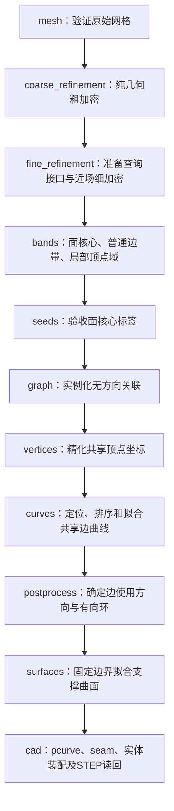

# 从网格与连续 E/V 距离场到 STEP：后处理逐步详解

代码核对：2026-11-04，模块版本0.5.0。本文按 [reconstruct.py](../band_brep_reconstruction/bandbrep/reconstruct.py) 的实际调用顺序，解释每个阶段解决的问题、算法、输出和验收条件。数据目标与字段见 [Pre.md](Pre.md)，历史成绩见 [Experiment.md](Experiment.md)，安装和模型接入命令见[模块 README](../band_brep_reconstruction/README.md)。

这里的“后处理”是整个 `band_brep_reconstruction` 流程，不仅指其中名为 `postprocess` 的单个阶段。当前入口直接使用输入网格，不通过SDF或Marching Cubes重新生成表面，也不使用原DualBrep的面网络预测邻接。

<a id="input"></a>
## 0. 先理解输入、状态和执行顺序

### 0.1 两份外部输入，三个内部距离通道

Python入口是：

```python
reconstruct(mesh, udf, cfg, output_dir, resume=False)
```

- `mesh`：闭合、定向、已归一化的三角网格，包含顶点、三角形和可选归一化元数据。
- `udf`：对新坐标连续返回metric `[dE,dV]`，分别是到有效面间边、必要顶点的距离。距离与输入坐标使用同一尺度。
- `cfg`：配置；`output_dir`：各阶段产物和诊断的保存目录。

内部 `MeshFieldProvider` 将两通道组合为 `[s_mesh,dE,dV]`。`s_mesh` 的距离、符号和梯度始终来自**原始输入网格**；粗／细网格只是后续采样载体。由此形成两份职责不同的几何：

| 对象 | 用途 | 后续是否改变 |
|---|---|---|
| 原始 `input_mesh` | 模型condition、坐标身份、mesh SDF基准 | 不因加密改变 |
| 工作 `mesh` | 查询位置、面核心、边／顶点域及邻接 | 在粗、细阶段增加三角形 |

目标边排除同一面参数seam，保留不同面之间的相切／共面边；完整闭环可以没有生成顶点。后处理可增加参数锚点和seam，不要求复原源CAD的编号或切口。真实实例ID、最近点和关联不跨入重建算法；oracle或VAE重建评估的输入来源由调用端显式区分。

<a id="stages"></a>
<a id="2-阶段代码与产物"></a>
### 0.2 实际阶段与输出



| 顺序／阶段 | 本阶段建立什么 | 主要产物 |
|---|---|---|
| 1 `mesh` | 验收原始网格及其度量 | `input_mesh.npz` |
| 2 `coarse_refinement` | 满足全局粗边长的工作网格 | `coarse_mesh.npz`、`coarse_refinement_progress.json` |
| 3 `fine_refinement` | 满足近场细边长的网格及最终中心场 | `working_mesh.npz`、`center_fields.npz`、`fine_refinement_progress.json` |
| 4 `bands` | 面核心、排除原因、E/V掩码和局部顶点域 | `bands.npz` |
| 5 `seeds` | 可用的面核心标签 | `face_seeds.npz` |
| 6 `graph` | 无方向面／边／顶点实例关联 | `topology_labels.npz`、`incidence.json` |
| 7 `vertices` | 每个候选顶点的三维坐标 | `vertices.json` |
| 8 `curves` | 共享曲线、端点使用及覆盖诊断 | `logical_graph.json`、`curves.json`、`refined_geometry.npz` |
| 9 `postprocess` | 每个面的有向边界环 | `cad_graph.json` |
| 10 `surfaces` | 固定共享曲线下的参数曲面 | `face_patches.json` |
| 11 `cad` | OCC共享实体及读回通过的STEP | `curves_and_faces.brep`、`logical_to_cad.json`、`reconstruction.step` |

关联、几何和CAD逐步建立，不能把前一层完成理解为后一层通过。`logical_graph_ready` 可以含未解决的边；只有 `solid_validated` 表示整套CAD和读回检查完成。相对真实CAD的实例是否全部恢复，仍需离线一对一评分。

<a id="mesh"></a>
## 1. `mesh`：接收并验证原始网格

代码：[surface_mesh.py](../band_brep_reconstruction/bandbrep/surface_mesh.py) 的 `load_mesh()`、`validate_mesh()`，以及 [mesh_densification.py](../band_brep_reconstruction/bandbrep/mesh_densification.py) 的 `mesh_metrics()`。

**目的。** 后续传播依赖表面连接，SDF符号又依赖闭合和方向，因此先排除不能支持这些操作的输入。这里验收已有几何，不自动补洞、重建或重新归一化。

### 1.1 读取与坐标身份

CLI先通过 `load_mesh()` 读入网格：

- 生产condition目录：读取 `vertices.npy / triangles.npy / meta.json`；检查geometry版本、float64顶点、int64三角形及mesh SHA-256。资产目录可自动进入其 `condition/`。
- 普通网格文件：用trimesh读取，`process=False`，不隐式合点或修改拓扑；调用者须提供模型使用的坐标。

进入 `reconstruct()` 后，`validate_mesh()` 检查有限的 `[N,3]` 顶点、有效整数三角形索引、非空网格，以及坐标是否位于约 `[-1,1]^3`。同一模型如果被再次缩放，即使形状相似，也不再是同一个距离场输入。

### 1.2 表面结构检查

对全局无向边建立索引，检查：

1. 每条边恰好被两个三角形使用，排除开放边和边非流形。
2. 两次半边方向相反，避免相邻三角形朝向冲突。
3. 每个三角形面积为正，拒绝零面积面。
4. 总有向体积为正，计算连通分量、欧拉特征、面积和边长／面积分位数。

这些统计写入mesh报告，并保存 `input_mesh.npz`。多壳嵌套方向的进一步检查在第3步创建 `MeshSDFOracle` 时进行；第1步不会仅凭总正体积就证明所有壳的嵌套正确。

**常见失败。** `invalid_mesh`、`mesh_scale`、`refinement_nonmanifold`、`refinement_orientation`、`refinement_degenerate`、`mesh_orientation`。此时先检查输入和预处理，后续标签传播不能修复这些结构问题。

<a id="refinement"></a>
<a id="coarse-refinement"></a>
## 2. `coarse_refinement`：不查询场，先把过长边切短

代码：`mesh_densification.py::coarse_refine_surface()`、`marked_long_edges()`、`split_edges()`。

**输入。** 已验收的原始网格；默认 `refinement_coarse_edge=0.02`。

**目的。** 原生CAD三角化可以包含极长的平面边。先纯几何降低跨度，避免直接在这些长三角形上反复查询E/V。粗阶段没有场查询，因而尚不需要推断E/V是否存在。

### 2.1 一轮如何细分

1. 建立本轮全局共享边索引，计算每条边的长度。
2. 标记 `length > coarse_edge*(1+1e-10)` 的边；已经足够短的边不标记。
3. 每条标记边只创建一个中点，邻接三角形复用同一顶点。
4. 按一个三角形有0／1／2／3条切边，分别保留或拆成1／2／3／4个子三角形；两条切边时选择较短的剩余四边形对角线。
5. 重建共享边，迭代到全局最长边达标。

相邻未主动细分的三角形也按共享切边过渡剖分，避免T接头。它不是把所有三角形统一一分四；细密曲面区域可以直接保留。

### 2.2 为什么几何不变，如何追溯父面

新增顶点是原边中点，子面仍位于原父三角形内部，没有平滑、投影或跨父面重三角化。函数逐轮组合父ID，得到粗三角形到原三角形的 `coarse_parent`。

结束时再次检查闭合、方向和非零面积，并核对连通分量、欧拉特征、面积及有向体积不变。面积／体积比较允许 `1e-10 + abs(original)*1e-9` 的数值差异。这是线性细分的不变性检查，不表示原网格更接近真实CAD。

**输出。** `coarse_mesh.npz` 含顶点、三角形和 `parent_triangles`；进度写入 `coarse_refinement_progress.json`，完成报告进入 `run.json`。失败或尚未达标的进度文件不能当成可恢复的完整阶段缓存。

<a id="fine-refinement"></a>
## 3. `fine_refinement`：建立查询接口，再按 E 近场细化

代码：[field_provider.py](../band_brep_reconstruction/bandbrep/field_provider.py)、`mesh_densification.py::fine_refine_surface()`。

这个阶段先创建绑定原网格的provider，再执行场引导细分。把查询接口的准备放在这里，才能解释为什么粗阶段不查场，而细阶段开始需要有效域、存在性和梯度契约。

<a id="查询接口"></a>
### 3.1 组合原网格 SDF 与外部 E/V

`MeshFieldProvider(input_mesh, udf, cfg)` 做以下准备：

- 核对外部adapter的condition指纹，要求与原始输入网格完全一致。
- 用原网格创建生产 `MeshSDFOracle`，建立AABB最近距离树与绕数BVH。距离幅值来自最近三角形，符号按绕数判断，实体内负外正；同时进一步检查网格和多壳方向。
- 将外部E/V查询包装为内部 `[s_mesh,dE,dV]`，指纹包含原mesh、模型、有效带、归一化及存在性策略。

| 外部provider | 值与梯度的来源 |
|---|---|
| `CallableUDFProvider` | 用户提供metric `[N,2]` 查询函数与可选mask；梯度统一由采样值中心差分得到 |
| `TorchScriptUDFProvider` | 已冻结condition/latent的两通道decoder；无梯度模式查询UDF，再中心差分 |
| `ProductionUDFProvider` | 只包装生产 `FieldProviderAdapter` 的E/V和mask，不调用其梯度；要求 `sdf_source='condition'` |

外部梯度channel为E=0、V=1；内部为SDF=0、E=1、V=2。E/V不接受独立梯度回调，不依赖autograd或最近CAD实体的解析导数。网格SDF仍使用独立的 `MeshSDFOracle`，不参与这两个UDF的差分。

### 3.2 确定 E/V 是否存在

外部 `presence()` 已给出两个 `present/absent` 时直接使用。返回 `None` 时，provider在**原网格**上确定性采样，默认：

- `presence_samples=393216`；
- 只统计有效、未饱和、有限值；
- `d < presence_tau=0.005` 的支撑数达到 `presence_min_points=16`，判为present，否则absent；
- 每通道有效样本不足16时失败，不能把“查询全部无效”解释为不存在。

外部显式返回unknown不会自动走上述推断，需要先解决。`E absent、V present` 不符合目标定义，报 `invalid_presence`。有限表面支撑可能漏掉微小特征，报告中保留推断支撑数；它不是不存在的数学证明。

### 3.3 每次查询如何验收

E/V有效域为立方域内且 `abs(s_mesh) <= udf.band_width`；TorchScript默认带宽0.02，生产bundle使用自己的配置。

- `valid` 描述可查询性与有限性，`saturated` 描述截断／负值等不能可靠用于定位的值。
- absent通道用 `2*sqrt(3)` 哨兵且标invalid，不能把它当几何距离；`checked_values()`只要求SDF及present通道有效、未饱和、有限。
- 每次计算E/V梯度时，中心及各轴正负扰动都必须落在有效域内；先检查完整采样范围，再调用decoder。
- 定位移动用 `bounded_update()` 在越带时最多16次二分回退，仍无效则回到当前位置，不把候选吸附到原网格掩盖误差。

默认 `save_queries=True`，包装器将部分实际调用记录到 `queries/`，包括坐标、metric值、valid和saturated；仅SDF查询的E/V列为NaN。梯度内部查询并非全部由该记录器拦截，不能把日志视作所有底层运算的完整追踪或新的完整训练集。

**从采样UDF计算梯度。** 以顶点场为例，固定模型权重、condition和latent，在当前位置 $p$ 周围沿三个坐标轴各取两个空间点：$p\pm h e_x$、$p\pm h e_y$、$p\pm h e_z$。对这6个位置直接解码距离，再计算：

$$
\nabla d_V(p)\approx\left(
\frac{d_V(p+h e_x)-d_V(p-h e_x)}{2h},
\frac{d_V(p+h e_y)-d_V(p-h e_y)}{2h},
\frac{d_V(p+h e_z)-d_V(p-h e_z)}{2h}
\right).
$$

通俗地说，就是分别向左右、前后、上下挪一小步，比较每个方向两侧的距离变化。边场同样计算，只需把 $d_V$ 换成 $d_E$。当前默认 `h=1e-5`，单位与归一化模型坐标一致；`gradient(..., step=...)` 可显式指定正的有限步长，主流程使用默认值。过小步长会放大解码舍入误差，过大步长会混合更远位置的变化；默认值并不保证适用于所有模型精度。

每个待求梯度的位置先查中心UDF，再查6个邻点，最多查询7个位置。中心用于检查距离和mask，不进入上述差分公式；中心距离不大于 `1e-8` 时不用于定位。中心或任一邻点无效、饱和、非有限，或差分梯度长度不大于 `1e-8`，均返回无效梯度。内部按 `query_batch_size` 分批，越界时不改用单侧差分或解析梯度。

这些邻点是**空间采样点**，即使中心位于网格表面，也不把邻点投影回表面；它们通常偏离表面，但必须位于有效带。模型接入与当前CAD场实验共用这一计算路径，CAD实验仅提供采样位置上的距离值。它不要求预存空间UDF数组，也不从已有表面点的离散UDF拟合梯度。该方法测量的是模型在附近空间的实际预测变化，不能弥补模型在这些位置预测不准的问题；最近目标切换处也不能保证存在唯一真实梯度。历史实验仍按当时的解析梯度口径解释，见[实验记录](Experiment.md)。

### 3.4 近场细分的选择与停止

默认 `refinement_target_edge=0.005`、`refinement_rho_edge=0.02`。自2026-11-06起，细加密只用E场判断近场，不再用V场增加选区；必要顶点属于目标边，故顶点零集也包含在边零集中。旧 `refinement_rho_vertex` 参数仅为读取已有配置保留，不再影响细加密。

当E存在时，令一个三角形最长边为L、三顶点最小dE为m、中心dE为d，则近场判断为：

$$
\mathrm{near}=(m-L\le\rho_E)\ \lor\ (d\le\rho_E).
$$

`m-L`让长三角形即使中心没落在低距离区，也能保守进入候选。对精确欧氏距离场，距离变化不超过空间位移，三角形内任意位置到其顶点的距离不超过L，因此三角形内的距离至少为 `m-L`。若三角形包含零集，必有 `m-L <= 0`，不会被判为非近场；这个结论对相邻三角形同样成立。学习场高估距离时可能误排除，不能把上述精确距离性质当作预测场保证。若另有可信的绝对误差上界ε，应采用更保守的 `m-L-ε`；当前代码没有这样的误差证书。

代码实际选择为：

```text
selected_face = near AND longest_edge > fine_edge*(1+1e-10)
marked_edge = touches_selected_face AND edge_length > fine_edge*(1+1e-10)
```

只切选中面中的超长边，邻面仍作必要过渡。原顶点字段复用，新增顶点重新查询；每一轮重新查询当前全部中心。没有selected面时停止，报告 `target_reached=True` 和近场最长边。粗／细阶段都没有轮数、三角形数或RSS硬上限，受单样本总时间预算控制。

注意“不入选细分”与“非近场”不同：近场中已经足够小的三角形也不入选，但仍可能经过零集。邻面过渡细分用于避免裂缝，不构成学习场零集的覆盖保证。

**当前查询接口的范围。** 本次调整的是选区依据。现有provider仍在顶点和三角形中心联合查询、校验 `[s_mesh,dE,dV]`，最后一轮保留完整中心字段供后续复用，并未实现按需分通道解码。因此它尚不支持“边带外V无效、仅在边带内查询V”的完整推理契约；实现该契约还需同步调整decoder接口、presence推断、中心缓存及面分割后V查询的位置，不能仅改近场公式就声称已经支持。

### 3.5 保存最终网格与中心字段

细分函数返回细网格、相对粗网格的 `fine_parent`、报告及最后一轮的 `CenterFields`。最终映射组合为：

```text
original_parent = coarse_parent[fine_parent]
```

`working_mesh.npz` 保存最终网格和这个原父面映射；`center_fields.npz` 保存最终中心坐标、三通道值及provider指纹。第4步复用前检查指纹、坐标逐项相等、顺序、形状及必要通道数值，防止网格变了却仍使用旧中心场。

**常见失败。** `condition_mismatch`、`presence_unknown`、`invalid_presence`、`invalid_field_query`、`center_fields_identity`、`center_fields_alignment`，或细分不变性／超时错误。有效域不足与模型没预测出某个结构，是不同问题。

<a id="bands"></a>
## 4. `bands`：分割面核心，再建立边带与顶点域

代码：入口为 [bands.py](../band_brep_reconstruction/bandbrep/bands.py) 的 `build_bands()`，调用 [dualbrep_segmentation.py](../band_brep_reconstruction/bandbrep/vendor/dualbrep_segmentation.py) 的面分割，以及 [vertex_domains.py](../band_brep_reconstruction/bandbrep/vertex_domains.py) 的局部域构建。面分割默认执行两阶段，也可只执行第一阶段。

**输入。** 最终工作网格和经过核验的三角形中心场；没有 `CenterFields` 时自行查询。每个图节点是一个三角形中心，不是网格顶点。

**目的。** 面内部远离真实边，dE较大，可作为面标签的来源；接近边、顶点的区域暂时留出来，用于之后收集多标签关联。此时只产生核心和候选域，不拟合真实曲线。

### 4.1 第一阶段：形成父面核心

1. 保留 `dE >= face_threshold1` 的三角形，默认阈值0.005。
2. 按三角形共享边求连通分量，孤立三角形也先作为分量参与统计。
3. 保留大小 `>= face_filter_size=10` 且平均dE `> face_avg_udf_threshold=0.003` 的分量。

面核心连通始终按共享边计算，与后面边带默认的共享顶点连通不同。在默认阈值下，已保留点的dE至少0.005，均值门槛通常不再额外过滤；改变阈值后它仍可能生效。

### 4.2 第二阶段：有条件拆分父核心

开关为 `face_second_pass`，默认 `true`。只做第一阶段时，任选一种方式：

- Python：`Config(face_second_pass=False)`。
- `--config` 对应的JSON：`{"face_second_pass": false}`。
- 原CLI运行命令追加：`--no-face-second-pass`。对应的 `--face-second-pass` 可显式开启，CLI优先于JSON。

关闭后，在第4.1节的大小和均值过滤之后直接返回保留的完整父核心，跳过第二阶段图构建、阈值筛选和拆分。输出face ID仍重编号为连续整数；不产生排除原因2或5，第一阶段的原因1、3、4照常保留。后续边带、局部顶点域与关联恢复使用这份面核心，不会补做第二阶段。配置变化会改变缓存键，切换时使用新输出目录。

开启时按以下规则执行：

对合格父分量，在其内部保留 `dE >= face_threshold2=0.01` 再求共享边连通分量。只有至少两个子分量满足最小大小，才用子分量替换父分量；否则保留完整父核心。最后将face ID重编号为连续整数。

阶段报告 `segmentation.second_pass_enabled` 保存开关状态；`method` 为 `dualbrep_two_pass_triangle_components` 或 `dualbrep_first_pass_triangle_components`。只做第一阶段时 `split_parents` 为空。`face_threshold2` 不再参与第二阶段分割，但仍保留在配置中并接受原有合法性校验。

这个拆分判据只使用距离和连通性，没有验证分隔处一定存在真实边。窄面无核心、细颈面被误拆等仍会发生；关闭第二阶段可保留原父核心，但也可能保留本应拆开的面域。代码不按GT面数修复、合并或回填。

### 4.3 排除原因与传播／支撑的区别

| `exclusion_reasons` | 含义 | 后续用途 |
|---:|---|---|
| 0 | 最终保留面核心 | 提供face标签及面内部采样 |
| 1 | 第一阶段低距离 | 可作边／顶点几何支撑 |
| 2 | 成功拆分父域中的第二阶段低距离 | 可作边／顶点几何支撑 |
| 3 | 第一阶段大小过滤 | 可传播但不作几何支撑，取决于配置 |
| 4 | 第一阶段均值过滤 | 同上 |
| 5 | 成功拆分时第二阶段子分量大小过滤 | 同上 |

默认 `band_propagation='noncore'` 且边存在时：

```text
core_mask = face_labels >= 0
edge_band = ~core_mask
support = exclusion_reasons in {1, 2}
```

上式区分“允许收集标签”和“距离上确实接近边”。原因3/4/5可以连接传播区域，但不能直接拿来拟合边或顶点。可选 `distance_only` 则仅原因1/2进入边带，其他过滤区域独立排除。边不存在时边带为空，面核心按网格连通性及相同分量过滤产生，不强制整张表面只算一个面。

### 4.4 在边带中划出局部顶点域

默认 `vertex_domains='local'`。从边带的距离支撑中选择 `dV < tau_vertex=0.02` 的点，以梯度产生候选投票：

$$
v_i^{vote}=x_i-d_V(x_i)\frac{g_i}{\|g_i\|}.
$$

投票按半径 `max(2*localization_tolerance, 4*field_error)` 聚类，默认0.002；至少3票的簇以中位数作候选中心。对每个候选j，设最近其他候选间距为gap、附近距离支撑的dE第95百分位为w，则：

$$
r_j=\min\bigl(\tau_V,\max(0.45\,gap_j,1.5\,w_j)\bigr).
$$

系数分别由 `vertex_radius_fraction`、`vertex_cut_factor` 配置。边带节点归属最近候选，小于其半径才进入该顶点域；无其他候选时gap为无穷。不同域即使几何相接也保留不同ID，避免整个阈值带把相邻顶点吞成一个分量。

`vertex_band`是所有局部域成员，`edge_region = edge_band & ~vertex_band`是普通边带。可选threshold模式才直接用 `edge_band & (dV<tau_vertex)`。始终保持顶点域嵌套在边带内；当前局部规则没有夹角控制，也不保证所有近邻顶点都可区分。

**输出。** `bands.npz` 保存点、场值、三类掩码、核心标签、原因码及可选局部域标签／中心；报告保存各类计数、分割参数和字段复用情况。

<a id="seeds"></a>
## 5. `seeds`：验收已有面核心标签

代码：[face_seeds.py](../band_brep_reconstruction/bandbrep/face_seeds.py) 的 `extract_face_seeds()`。

这个阶段不重新分割，也不训练或运行面网络。它读取第4步已有的 `bands.face_labels`，要求标签存在且至少一个节点具有非负face ID，再保存 `face_seeds.npz`。

- 标签不存在：`missing_face_segmentation`。
- 全部被排除：`no_face_core`，附带分割与原因计数。

这里的seed是整块核心标签，不是每个面的单个种子点。继续执行时，这些核心是第6步关联与第10步面内部采样的来源；`--stop-after seeds` 在此返回 `face_seeds_ready`。

<a id="graph"></a>
## 6. `graph`：从域接触建立无方向实例关联

代码：[topology.py](../band_brep_reconstruction/bandbrep/topology.py) 的 `collect_labels()`、`recover_topology()`、`infer_short_edges()`。

**输入。** 最终网格、面核心标签、普通边带和顶点域。默认普通带连接按共享网格顶点构图，禁止用空间kNN连接彼此靠近但表面不相邻的区域。

### 6.1 先确定普通边实例，再汇总顶点关联

1. 对普通边带求连通分量，每个分量获得独立 `edge_id`。
2. 每个edge收集直接接触的全部面核心标签，不只保留两个“获胜者”。
3. 每个顶点域收集直接接触的面标签和实际 `edge_id`，再并入这些edge的完整面集合。
4. 域内每个节点通过组件引用读取相同完整集合；顶点域不向普通边带反向转发标签。

因此从A/B边进入某顶点的标签，不会穿过顶点跑到B/C边上。实现按组件求集合并集，不必模拟逐点消息队列，也不会丢弃晚到标签。`BandTopology.node_labels(node)`按组件返回集合，不复制稠密face×node矩阵。

同一对面之间两条独立孔口圆环仍有两个edge ID；面标签对和端点对都不能当唯一边身份。

### 6.2 当前能确定与暂不要求的内容

恰好收到两个面标签的普通边标 `supported`，其他情况保留完整集合并标 `unresolved`。顶点域保存入射edge与面集合，得到无方向E–F、V–E、V–F关联；成员中只有原因1/2被列为 `support_nodes`。

此时不要求边有两个端点、端点使用次数、方向或闭合wire。没有几何支撑、多邻面、没有入射边的顶点域等都写入诊断。关联图可以落盘供检查，再由几何阶段拒绝无法确认的结构。

### 6.3 两个顶点域直接相接时推断短边

默认 `infer_short_edges=True`：

1. 找到不同局部顶点域之间的直接网格接触；已有edge连接的顶点对跳过。
2. 用第4步的候选中心连接线采33点，先检查有效域，再查场。
3. 需要恰好两个共享面标签；超过两个时，以面核心到线段中部的最近距离排序，第三近至少为第二近的1.5倍才取最近两面，否则拒绝。
4. 要求沿线 `max(dE) <= 2*localization_tolerance` 且 `max(abs(s_mesh)) <= feature_sdf_limit`。

通过者新增 `inferred_short`，更新两个域的入射edge；拒绝原因也记录。这时使用的是候选中心而非第7步最终顶点，后续仍重新拟合和验收。它是直段假设，不是通用短曲边追踪。

**输出。** `topology_labels.npz` 保存节点到face/edge/vertex域的映射及跨域contacts；`incidence.json`保存实例、成员、支撑、标签集合、反向关联和未决诊断。`--stop-after graph` 返回 `logical_graph_ready`，不表示CAD有效。

<a id="vertices"></a>
<a id="51-v-udf-定位"></a>
## 7. `vertices`：把候选顶点域精化为共享三维坐标

代码：[vertex_localization.py](../band_brep_reconstruction/bandbrep/vertex_localization.py) 的 `localize_vertices()`、`distance_center()`。

**目的。** 第4步中心仅用于区域划分，第6步只确定连接关系；现在为每个已实例化顶点求唯一坐标，所有入射边之后引用它。

### 7.1 初始化与追加三维观测

每个顶点域只取其距离支撑，读取dV及有效梯度，以归一化梯度投票的中位数初始化v。没有支撑或梯度时分别报 `vertex_support_insufficient`、`vertex_gradient_invalid`。

初始查询半径为 `max(8*localization_tolerance, min(0.2*tau_vertex, 0.01))`，默认0.008。每次在半径0.5r到r的三维壳层随机取120点；全部点须在有效域内，否则缩小半径，最多8次尝试。比仅用表面上的单侧／共面点，这些三维观测更有利于确定距离中心。

### 7.2 距离中心拟合

距离平方差给出线性初值：

$$
2(x_i-x_0)^Tv=\|x_i\|^2-\|x_0\|^2-(d_i^2-d_0^2).
$$

秩不足时使用已有初值，然后以 `soft_l1` 鲁棒最小二乘优化：

$$
\min_v\sum_i\rho\bigl(\|x_i-v\|-d_V(x_i)\bigr).
$$

当前调用不设置额外权重，也不把SDF放进优化目标；SDF在拟合后单独验收。多个真实顶点混入同一域时，不能靠平均坐标伪造一个共享点。

### 7.3 验收与输出

最大距离模型残差须不超过 `localization_tolerance=0.001`，否则 `vertex_mixed_support`。最终中心还需满足dV、dE均不超过该容差，且 `abs(s_mesh) <= feature_sdf_limit`，否则 `vertex_geometry_invalid`。

`vertices.json`保存ID、position、residual和support_radius。`--stop-after vertices`返回 `vertices_ready`。这些位置之后被冻结为共享端点，不由第一条拟合边决定其他边的交点。

<a id="curves"></a>
<a id="5-顶点与共享曲线"></a>
## 8. `curves`：定位边支撑、排序并拟合共享曲线

代码：[edge_geometry.py](../band_brep_reconstruction/bandbrep/edge_geometry.py)、[curve_fitting.py](../band_brep_reconstruction/bandbrep/curve_fitting.py)、[geometry_refinement.py](../band_brep_reconstruction/bandbrep/geometry_refinement.py)。

调用顺序为 `build_edge_geometry()` → `fit_shared_curves()` → `validate_structure_coverage()`：先把宽边带定位到一维边、建立单条边的点列顺序，再拟合唯一共享曲线并检查覆盖。全局面环的顺序和方向留到第9步。
   
### 8.5 独立结构覆盖检查

`validate_structure_coverage()`从工作网格中心中选 `dE<0.6*tau_edge` 的点，最多2048个，不依赖已恢复face标签选点。做最多8步受域约束的e-UDF定位，再将有效探针与所有曲线每条4097个采样比较，最远距离须不超过 `3*curve_tolerance`。

这能发现“每条已拟合边都不错，但另一个边低谷根本没有实例”的情况，报 `edge_valley_unrepresented`。它仍受有限中心和探针覆盖限制，报告 `continuous_coverage_certified=False`。

**输出。** `logical_graph.json`保存共享顶点、边点列和端点使用；`curves.json`保存曲线参数；`refined_geometry.npz`保存支撑。`--stop-after curves`在覆盖验收后返回 `curves_ready`。

<a id="postprocess"></a>
## 9. `postprocess`：确定每个面的边使用方向并串成环

代码：[postprocess.py](../band_brep_reconstruction/bandbrep/postprocess.py) 的 `orient_boundaries()`、[boundary_cycles.py](../band_brep_reconstruction/bandbrep/boundary_cycles.py)。

**目的。** 一条共享边在两侧面的使用方向应相反。前面只有无方向关联和曲线参数顺序，现在利用面核心和网格法向确定coedge方向，再按共享端点连接有向环。

### 9.1 判断边的左、右面

每条曲线在参数0.05到0.95内采64点，避开顶点交汇。对每个邻面，找到最近面核心中心，以网格法向n、曲线切向t及“曲线指向面内部”的向量a计算：

$$
\mathrm{score}_f=\operatorname{median}\bigl((n\times t)\cdot a\bigr).
$$

两邻面的score必须异号，否则 `boundary_orientation_ambiguous`。正号一侧记录为 `left_face`，从而建立 `CoedgeUse(face, edge, forward)`；同一条三维边在两面的方向相反。

### 9.2 按共享顶点连接有向环

每个面先收集其coedge。无顶点闭环可直接形成单边cycle；其他边按本面方向选择起、终顶点，从一条边的终点寻找下一条起点相同的未使用coedge，直到回到起点。

- 找不到唯一下一条：`face_sector_ambiguous`。
- 在闭合前重复使用：`wire_repeated_use`。
- 超过允许步数仍不闭合：`wire_not_closed`。

同一顶点可能连接多条边，但对某个已定向面扇区，下一次使用必须唯一；不会按空间最近边任意接线。

**输出与边界。** `cad_graph.json`保存每个面的有向cycles。此函数不重新扩展完整面三角形区域，也不显式给每个cycle标“外环/孔环”；它们作为有向边界交给曲面和OCC裁剪。周期展开、pcurve及seam尚未建立，不能在这里就视为完成CAD面。

<a id="surfaces"></a>
<a id="6-面环曲面与-cad"></a>
## 10. `surfaces`：固定共享曲线，拟合每个面的支撑曲面

代码：[surface_fitting.py](../band_brep_reconstruction/bandbrep/surface_fitting.py) 的 `sample_face_regions()`、`initialize_face_surfaces()`、`fit_general_spline()`。

**输入。** 原核心标签、工作网格、有向关联图及冻结的共享曲线。每个面独立求支撑曲面，但不能独立移动公共三维边。

### 10.1 取面内部样本与完整边界

在该face的核心三角形内，按面积随机采样 `face_samples=1200` 点，使用对应三角形法向。边存在时尝试保留 `dE>tau_edge/2` 的可信内部点；至少有20个才启用此筛选，否则保留原采样。

每条关联曲线采65点组成初始边界约束。面内只取本face核心，不把整片多标签边带同时当成两个面的内部点；当前没有另做完整面域回填。

### 10.2 优先选择相容的解析曲面

基础候选包括平面、球面和圆柱；平面由点／边界统计得到，球与圆柱作几何最小二乘。两条同半径圆边还可提供圆柱初值。

候选先检查内部点到曲面的最大偏差不超过 `2*surface_tolerance`、边界偏差不超过 `boundary_tolerance`。默认 `surface_candidates='revolution'` 时，对浅曲面避免过早选不够贴边的平面；基础候选失败后，联合轴线和母线轮廓尝试圆柱、圆锥、圆环，边界点在该拟合中权重更高。

只有通过内部和边界门槛才接受解析面，不能因为点云看起来近似平面就压平冻结曲线。

### 10.3 解析候选失败，回退受约束 B-spline

先用PCA平面投影建立UV初值，将内部点和边界范围归一化，再求三次张量样条控制网格。默认控制数从8到16每次增加2，`uv_iterations=4`。

固定UV时，设内部基矩阵为A、边界基矩阵为B、控制点为P，求：

$$
\min_P\|AP-X\|^2+\lambda\|P\|^2,
\qquad BP=C_{boundary}.
$$

`constrained_lstsq()`先求边界可行解，再在B的零空间拟合内部，因此边界是等式约束而非大权重软惩罚。更新内部／边界UV后会重新解约束，不保留已经过期的对应。

边界不相容或控制预算不足时失败，不退回无约束曲面。辅助 `fit_four_sided_bezier()`只对相容四边提供控制网格锁定，主流程不会强制所有多边、带孔面进入四边模板。无边界且无法识别解析面的情形当前报 `surface_initialization_failed`。

### 10.4 独立验收支撑曲面

对每条冻结曲线，依次在129、257、513点参数网格上检查 `||S_f(uv(C_e(t)))-C_e(t)||`，最大值须不超过 `boundary_tolerance=0.001`。

内部点投影误差和投影点的mesh SDF残差均不超过 `2*surface_tolerance=0.006`；在这些内部参数位置作有限差分，要求雅可比叉积模大于 `1e-10`。

失败可能是 `boundary_constraints_conflict`、`surface_boundary_incompatible`、`surface_fit_failed`、`surface_fold`。`face_patches.json`保存面类型、参数、法向、参考内部点和误差报告；`--stop-after surfaces`返回 `surfaces_ready`。

这里检验的是冻结边界和采样内部的工程相容性，没有证明连续全边界误差、参数全域无折叠或无自交。UV中的pcurve及最终裁剪实体仍在第11步建立。

<a id="cad"></a>
## 11. `cad`：周期规划、共享 OCC 实体与 STEP 读回

代码：[occ_assembly.py](../band_brep_reconstruction/bandbrep/occ_assembly.py) 的 `assemble_brep()`、`make_pcurve()`、`verify_export_and_roundtrip()`。

这一阶段将数值图、曲线和曲面转成内核拓扑。共享坐标还不够：两邻面必须真正引用同一个OCC Edge和Vertex对象，才能保持共享关系。

### 11.1 先规划周期参数，保持三维几何不变

圆柱、球、圆锥、圆环有周期参数。同一三维点可以有多个等价UV，切口不合理时，一条连续三维边会在UV中跨越周期并诱发错误seam修复。

默认 `periodic_frame_planning=True`：

- 协调关联周期圆环面的参考方向和闭环参数起点，让辅助锚点落在相容的子午方向。
- 边界留有足够角空隙时，把参数切口放入空隙，避免不必要的seam。
- 对完整绕转的有向环按整周期平移UV，保持相邻pcurve连续；适用的双绕转圆柱／圆锥环可规划显式带状seam。

代码深拷贝曲线／曲面记录后调整参数框架和闭环起点，不改变真实共享边的几何集合。因此 `curves.json` 的闭环参数起点可能与装配内部使用的等价起点不同。

### 11.2 只构造一次真实共享顶点和边

将每个 `VertexNode`建成一个OCC Vertex，每条 `CurveRecord`转成OCC三维曲线及参数范围，再创建唯一Edge：

- 两端点或self-loop使用已经创建的共享Vertex。
- 无生成顶点闭环补一个 `closed_loop_anchor`，同一锚点作首尾，不计入逻辑vertex。
- 直线用一次B-spline保留主参数区间；圆转解析圆；分段Bézier转B-spline。

后续面只引用这些Edge的正／反向使用，不再由每个面重建一条近似边。构造失败报 `cad_edge_failed`。

### 11.3 为每个边—面使用建立 pcurve

三维曲线 `C_e` 只存几何，pcurve `gamma_fe`描述它在某个支撑曲面UV中的轨迹；两侧面需要各自的pcurve，但共用同一条三维Edge：

$$
S_f(\gamma_{fe}(t))\approx C_e(t).
$$

适用的平面圆可用解析二维圆。其他情况从65点开始，按129、257、513、1025加密，将已展开的UV插值为分段一次B-spline，独立检查各段中点的三维回代误差。达到半个boundary容差时可提前停止，最终仍须不超过完整容差，否则 `pcurve_fit_failed`。

pcurve附着到共享Edge的具体Face，并设置与OCC三维曲线一致的参数范围；不能只把三维曲线投到UV就忽略参数对应。

### 11.4 组装 wire、裁剪面与允许的辅助结构

通常按第9步cycles添加正／反向Edge组成wire，再加入支撑曲面。必要时同步调整face与wire方向，使参数法向和工作网格的物理法向一致。

周期及无边界情况使用专门分支：

- 无逻辑边的闭合支撑面仅允许球或环面，由OCC建立自然参数边界。
- 两条闭合圆限定的适用周期面，显式生成连接两个环锚点的seam；圆柱／圆锥为母线，球／环面为子午曲线。
- 单圆球冠补seam、极点及参数退化边；这些是CAD辅助结构，不是距离场生成的真实面间边或顶点。
- 已规划的双绕转圆柱／圆锥带，显式构造矩形参数环和必要孔环。

未走显式分支且确需补缝的周期面，才尝试 `FixMissingSeam()`；随后按对象身份检查所有原逻辑Edge仍存在。修复替换共享边时立即报 `repair_changed_shared_edge`，不能用较大容差悄悄缝合。

执行 `SameParameter` 协调三维边和pcurve；它不负责让不相容的曲面自动经过边。各face必须通过 `BRepCheck_Analyzer`，失败保存 `rejected_face_<id>.brep` 并报 `cad_face_invalid`。

### 11.5 从面邻接构壳和单实体

按逻辑edge的面邻接求面连通分量，每个分量构造shell，再装进solid。要求恰好一个正体积外壳，允许向内的空腔壳；否则 `unsupported_multi_solid`。用 `OrientClosedSolid`协调实体方向，不运行不受约束的全局ShapeFix替换共享结构。

装配后再次核验每条真实逻辑Edge：必须恰好在两个不同Face中使用，且方向相反。检查最大OCC容差不超过 `1.01*cad_tolerance`，并要求实体内核有效。

通过后写 `curves_and_faces.brep`，映射记录真实边、face、辅助顶点、后处理边、周期规划、修复和壳体积。CAD辅助边数可以多于逻辑边数，不能仅比较总边数判断拓扑是否恢复。

### 11.6 先写未验收 STEP，再读回通过后改名

`verify_export_and_roundtrip()`顺序执行：

1. 要求正体积，并以 `surface_tolerance` 对最终solid做CAD三角化检查。
2. 导出 `reconstruction.unverified.step`，读取、TransferRoots，要求读回shape有效。
3. 比较体积，预算为 `max(1e-7, abs(volume)*1e-5, area*boundary_tolerance)`。
4. 要求读回face数等于逻辑face数。
5. 每条逻辑曲线采33点，对读回所有Edge求最近CAD距离，最大值不超过 `cad_tolerance=0.002`。STEP可能重编号，因此不按原OCC ID匹配。
6. 全部通过才将未验收文件改名为 `reconstruction.step`。

随后保存 `logical_to_cad.json`，标记CAD阶段产物哈希并完成 `solid_validated`。读回几何检查不证明Edge一对一匹配或全域连续误差；正式完成状态仍以 `run.json / quality.json`为准，避免将中断留下的部分文件当作成功。

<a id="implementation"></a>
<a id="cache"></a>
## 12. 阶段之间如何停止、恢复和定位失败

### 12.1 缓存验收先于重建阶段

`reconstruct()`先验证配置，计算缓存键，再读取旧 `run.json`。键包含原网格及归一化、外部UDF指纹／带宽／声明存在性、配置（排除 `stop_after`）、`bandbrep`源码哈希、生产geometry版本以及mesh oracle／表面采样实现哈希。

有旧输出却未加resume：`output_exists`；输入／配置／实现变化：`cache_mismatch`；已记录产物缺失或哈希不符：`cache_corrupt`。只有通过身份与完整性检查的阶段才进入accepted集合，从JSON/NPZ恢复对象。已完成solid同样先验哈希再直接返回。

原始mesh仍会重新验收；粗阶段完成而细阶段失败时，可以复用粗阶段。恢复细阶段会重新建立绑定原mesh的provider，并验证中心场身份与坐标。进度文件、查询chunks和未验收STEP不充当完成阶段标记。

### 12.2 可停止的位置

| `--stop-after` | 完成至 | 状态 |
|---|---|---|
| `seeds` | 核心标签验收 | `face_seeds_ready` |
| `graph` | 无方向实例关联 | `logical_graph_ready` |
| `vertices` | 顶点定位 | `vertices_ready` |
| `curves` | 曲线及独立覆盖验收 | `curves_ready` |
| `surfaces` | 有向环及曲面验收 | `surfaces_ready` |
| `solid` | CAD及STEP读回 | `solid_validated` |

不能直接指定 `bands`、`postprocess` 或单个加密阶段。只改变停止位置不改变缓存键，其他配置／模型／几何变更通常需要新输出目录。

### 12.3 时间与错误报告

默认 `sample_timeout_seconds=10800`，`deadline.py`为一次调用建立协作式总时间预算，在阶段、细分及场查询检查点检查；嵌套预算不能延长外层期限。原生库调用可能延迟Python检查，批量runner另用独立worker进程树超时监督。CLI加载模型等调用前工作不自动算入库函数装饰器的时间，批次总超时范围以runner协议为准。

初始化诊断后发生异常，`run.json`记录 `status='failed'`、`failed_stage`及带code/message/details的错误，`quality.json`也保存失败信息。配置、缓存验收等更早错误可能发生在阶段诊断初始化前，不能保证所有启动失败都有新的quality文件。

排查时先找第一个阻断阶段，再看具体实例ID、残差、域和支撑数量。`edge_neighbors_unresolved`虽可能源自面核心错误，但在 `curves`阶段才要求两邻面；程序首个报错不一定是最早的拓扑错误。

<a id="parameters"></a>
## 13. 参数分别控制哪一步

配置入口为 [config.py](../band_brep_reconstruction/bandbrep/config.py)，优先级为代码默认值 < JSON < 显式CLI参数。当前没有preset、MC分辨率或旧递归近带细分配置；未知键拒绝。

| 参数及默认值 | 实际职责 |
|---|---|
| `refinement_coarse_edge=0.02` | 全网格纯几何粗目标 |
| `refinement_target_edge=0.005` | 近场细目标，须不大于粗目标 |
| `refinement_rho_edge=0.02` | 仅按E场选近场；旧 `refinement_rho_vertex` 不再影响选区 |
| `face_threshold1/2=0.005/0.01`、`face_filter_size=10`、`face_avg_udf_threshold=0.003` | 两阶段核心提取 |
| `face_second_pass=true` | 默认启用第二阶段拆分；设为false时只保留第一阶段过滤后的核心 |
| `tau_vertex=0.02`、局部域系数0.45/1.5、`vertex_min_votes=3` | 顶点候选和局部截断 |
| `tau_edge=0.025` | 边定位／覆盖半径、面内部可信点筛选，不定义传播边带 |
| `localization_tolerance=0.001`、`curve_tolerance=0.001` | 距离中心、边支撑、排序、曲线及覆盖检查 |
| `feature_sdf_tolerance=None` | 特征SDF相容性；`feature_sdf_limit`默认回退0.003 |
| `surface_tolerance=0.003` | 曲面内部误差和SDF预算的基值、部分几何半径及最终CAD三角化 |
| `boundary_tolerance=0.001` | 曲线—曲面、pcurve及共享边界相容性 |
| `cad_tolerance=0.002` | 内核容差和STEP读回曲线检查 |
| `query_batch_size=8192`、`save_queries=True` | 场查询批量与记录 |

`feature_sdf_tolerance=0.004`是部分历史实验的显式候选，不是当前代码默认；调它不等于放宽曲面内部、boundary或CAD容差。圆弧／回转面与周期规划应配套评估，配置校验不自动禁止可能退化的组合。

## 14. 如何理解完整流程的能力边界

这套流程先恢复实例关联，再精化共享几何，最后补齐CAD使用关系。完整STEP通过表示有限采样、容差、内核及读回条件均已满足，不证明真实实例全部恢复、连续边界全域正确或模型无自交。

当前仍需单独研究窄面核心找回、同面碎裂修复、相接顶点多面歧义、通用短曲边、无边界非解析面、复杂自由曲面及逐实例局部重试。相关失败证据见 [Experiment.md](Experiment.md#segmentation-failures)；直接先提边图的研究路线见 [Pipeline.md](Pipeline.md)，不把它与本文已实现的阶段混为同一算法。
