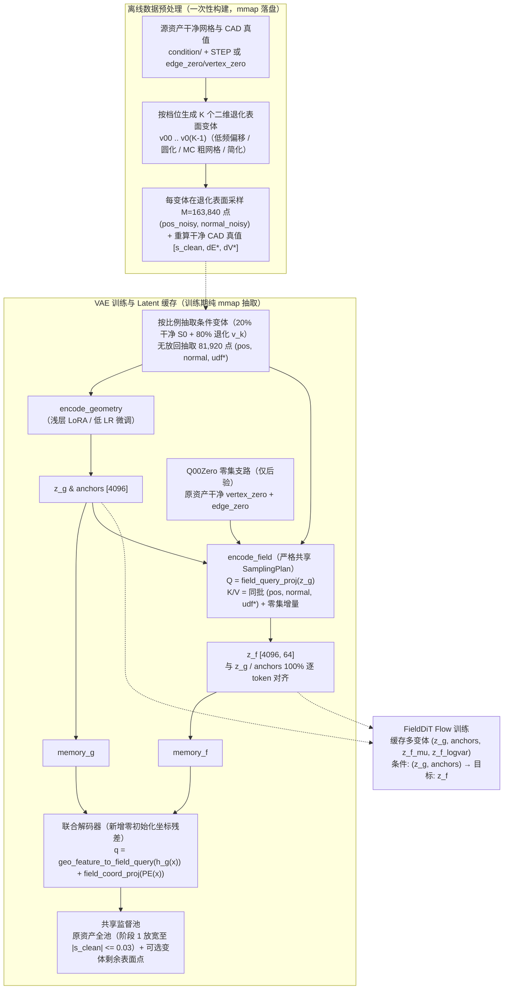

# 非精确扫描件条件下的配对 VAE / Flow 训练、退化边处理与后处理协同方案

设计稿，2026-11-21。本文档针对“非精确扫描件 / 粗网格重建 B-Rep（重建结果不强贴输入表面，在近表面三维空间恢复干净 CAD）”这一核心目标，系统分析“仅在 Flow 训练阶段对条件点云加噪”的架构与几何局限，论证为什么不能直接用近表面点池 `N` 替换输入点云，给出**严格 NaTex 对齐 + 离线预处理多档退化变体 + `Q00Zero` 零集补全 + 配对 VAE / Flow + 后处理协同**的完整实施方案，并统一明确 **退化边（Degenerate Edge）** 的 V-UDF 采样策略及预处理/后处理代码级改造清单。

关联文档：
- 边优先扫描件重建方案：[Post1121.md](Post1121.md)
- 边优先优化方案：[MCShellCenterline.md](MCShellCenterline.md)
- Pipeline 层优化分析（结合前沿工作）：[Opt.md](Opt.md)
- 数据生产规范：[Pre.md](Pre.md)
- 上游 ShapeVAE 与零集编码：[Hunyuan3D VAE.md](../../Hunyuan3D/docs/VAE.md)

---

## 1. 背景与问题定义

当前两套仓库的分工如下：
- **上游生成网络（`Hunyuan3D/hy3dshape`）**：基于 `EdgeVertexShapeVAE`（Q00 / Q00Zero）与 `FieldDiT` 条件 Flow，从输入几何条件编码 $z_g$，生成并解码近表面带内的连续 E/V UDF（$\hat d_E, \hat d_V$）。
- **下游后处理（`DualBrep/band_brep_reconstruction`）**：采用边优先流水线（`scout → wireframe → split_mesh / fast_faces → solid`），在近表面三维带内提取边骨架、顶点球壳与参数曲线，再投影到输入网格划分面域、拟合曲面并装配为 STEP。

为了让生成网络学会从**含噪、偏移或圆钝的扫描件 / 粗网格** $C_{\text{noisy}}$ 恢复出**干净、锐利、易装配为有效 B-Rep 的 CAD E/V 场** $B^*$，需要打通从条件退化、VAE 编解码、Flow 生成到下游面拟合的全链路一致性。

---

## 2. 为什么不能“只改 Flow 条件加噪、冻结干净 VAE”

若仅在 Flow 训练阶段对控制条件点云施加 $\le 0.02$ 的扰动，同时沿用干净点云训练的冻结 VAE 与干净目标潜变量 $z_f^{\text{clean}}$，会在当前代码架构下触发五个硬性瓶颈：

### 2.1 VAE 解码器几何强耦合导致「训练-推理失配」（最核心）
在 [shapevae.py](../../Hunyuan3D/hy3dshape/hy3dshape/models/autoencoders/edge_vertex/shapevae.py#L193-L200) 中，联合解码查询路径为：
```python
h = self.geo_query_decoder.forward_features(queries=x.float(), latents=memory_g)
q = self.geo_feature_to_field_query(h)
field = self.field_query_decoder(query_embeddings=q, latents=memory_f)
```
- `field_query_decoder` **不直接接收坐标 `x`**，所有空间定位信息均经由 `memory_g` 生成的几何特征 $h_g(x)$ 传递。
- 在 [pipeline.py](../../Hunyuan3D/hy3dshape/hy3dshape/inference/pipeline.py#L325-L327) 推理时，`prepare_decode(geo.z_g, z_f_pred, geo.anchors)` 喂入的是**退化条件编码出的 `memory_g_noisy`**。
- 干净 VAE 中的 $z_f^{\text{clean}}$ 仅与 `memory_g_clean` 协同工作。即便 Flow 完美预测出 $z_f^{\text{clean}}$，将 `(memory_g_noisy, z_f_clean)` 配对解码仍会因 $h_g(x)$ 分布偏移导致 E/V 场扭曲、模糊或被拉回噪声表面；而 Flow 在 [flow_matching.py](../../Hunyuan3D/hy3dshape/hy3dshape/models/diffusion/flow_matching.py#L54-L62) 中仅在 latent 空间做速度匹配，无法感知或补偿解码器失配。

### 2.2 Token / Anchor 空间对齐被破坏（`FieldDiT` 硬约束）
- [field_dit.py](../../Hunyuan3D/hy3dshape/hy3dshape/models/denoisers/field_dit.py#L168-L188) 通过**逐 token 通道拼接** `torch.cat((z_t, z_g), -1)` 注入几何条件，并对两者共享同一组 `SurfaceRoPE(anchor_xyz)`（`rope_coord_scale = 100.0`）。
- [shapevae.py](../../Hunyuan3D/hy3dshape/hy3dshape/models/autoencoders/edge_vertex/shapevae.py#L124-L138) 中，目标 $z_f^{\text{clean}}$ 的 4,096 个 token 严格绑定在干净点云经 FPS 采出的 `anchors_clean` 顺序与位置上。
- 若对加噪点云重新跑 FPS 编码 `z_g_noisy`，4,096 个 anchor 的顺序和 3D 位置与 $z_f^{\text{clean}}$ 完全错位，逐 token 拼接直接失效；若训练时复用干净 `anchor_idx`，推理面对真实扫描件时仍须独立跑 FPS（且 FPS 天然偏好向外凸出的噪点），同样存在严重的训练-推理分布落差。

### 2.3 偏移上限 `0.02` 与查询带宽 `0.02` 的几何冲突及双重外推
- **管壳截断**：按 [Post1121.md §1](Post1121.md) 的几何预算，默认带宽 $w = 0.02$、管壳/球壳半径 $r = 0.005$、细格步长 $h = 0.003$ 时，保证完整管壳和一层细格角点不越界的保守条件为：
  $$\delta + r + \sqrt{3}h \le w \implies \delta \lesssim 0.0098$$
  偏移达到 `0.01 ~ 0.02` 时，真实边/顶点管壳会被带边界裁断（`valid=False`），导致漏边、断链或球壳残缺。
- **解码器 OOD 外推**：现有 `veudf` 空间监督点仅覆盖距**干净表面** `0.03` 以内（VAE 训练默认截到 `0.02`，见 [Pre.md §4](Pre.md#L59)）。若输入点云偏离干净表面 `0.02`，推理在退化点云 `0.02` 带内查询时，查询点距干净表面可达 `0.04`，落入解码器未训练区。
- **`presence` 漏判**：[pipeline.py](../../Hunyuan3D/hy3dshape/hy3dshape/inference/pipeline.py#L73-L77) 仅在输入表面 `S0` 上采样估计存在性，大偏移下小顶点可能被误判为 `absent`。

### 2.4 点级白噪声的法向陷阱与 Domain Gap
- `encode_geometry` 同时接收 3D 坐标 `pos` 与法向 `normal`。
- 纯逐点 i.i.d. 随机加噪存在两难：**不改法向**会泄露精确干净 CAD 法向导致过拟合作弊；**对抖动点云重算 PCA 法向**（当抖动幅度接近 `0.02`，远大于 81,920 点的局部点距 `~0.005`）会使法向退化为纯噪声，破坏预训练 ShapeVAE 几何主干。
- 真实扫描件/粗网格的核心退化是**空间相关的低频偏移**（壁厚偏差、锐边圆化、网格简化收缩、局部缺测），而非高频白噪声。

### 2.5 下游面拟合的隐藏硬门限
- 在 [surface_fitting.py](file:///opt/data/private/yihengxu/DualBrep/band_brep_reconstruction/bandbrep/surface_fitting.py#L493-L561) 中，尽管 `scan_offset_tolerance = 0.02` 放宽了 `.max()` 上限，但 **90%/95% 分位点内点误差和输入网格 `provider.sdf(q)` 仍硬卡在 `2 * surface_tolerance = 0.006`**。当干净边界曲线与系统性偏移的扫描内点相差超过 `0.006` 时，会触发 `surface_fit_failed` 或 `surface_boundary_incompatible`。

---

## 3. 为什么不能直接用近表面点池 `N` 替换输入点云

在重训路径 A 的 VAE 时，**不建议**直接拿磁盘上已有的 `near_surface` 点池（`N`）随机替换 `S0` 作为编码器输入：

1. **`N` 是双侧对称的三维厚点雾，存在零均值捷径**：
   - 见 [sampling.py](../../Hunyuan3D/veudf/src/veudf/preprocess/sampling.py#L314-L343)：`near_surface` 由 80% 沿法向**等概率 `±1` 双侧扰动**（`[0, 0.002]` 30%、`[0.002, 0.01]` 40%、`[0.01, 0.03]` 30%）与 20% 各向同性高斯扰动组成，厚度达 `0.04 ~ 0.06`。
   - 其局部空间均值精确落在干净 CAD 表面 `S0` 上，`geo_cross`（20:1 聚合）极易通过局部平均直接滤回干净表面，无法学会处理真实扫描件的**单侧系统性偏移**。
2. **FPS Anchor 退化为双层体壳**：对三维厚雾跑 FPS 会优先选出内外最外缘极值点，与推理期单层二维扫描表面的 anchor 分布完全不同。
3. **补法向陷入两难**：`N` 未保存 `normals` 与 `triangle_ids`；从最近干净面补法向会泄露干净 CAD 法向，对三维点雾做 PCA 估算法向则极不稳定。

---

## 4. 推荐方案：路径 A（离线预处理配对退化资产 + 严格 NaTex 对齐 + `Q00Zero`）

核心思路：
1. **严格保留 NaTex 对齐契约**（与 [Post1121.md](Post1121.md) 和 [shapevae.py](../../Hunyuan3D/hy3dshape/hy3dshape/models/autoencoders/edge_vertex/shapevae.py#L124-L138) 一致）：随机采样主路中，`encode_geometry` 与 `encode_field` 共享同一批退化表面采样点 `(pos_noisy, normal_noisy)` 和同一 `SamplingPlan`，而 `field_udf` 是在 `pos_noisy` 坐标处针对**干净 CAD $B^*$** 预先算好的真值距离。
2. **数据预处理阶段完成全部退化、采样与真值 UDF 标注**：训练时仅做高速 `mmap` 随机抽取，零在线 CPU 瓶颈、100% 可复现、严格继承源 CAD 家族的 `train / val` 划分。
3. **搭配 `Q00Zero` 零集支路**：当退化表面偏移干净边 `0.005 ~ 0.02` 时，主路表面点不再包含 `dE ≈ 0` 的精确零点观测；`Q00Zero` 的独立零集支路继续输入干净 CAD 精确零集（仅 VAE 后验训练和 latent 缓存使用，Flow 推理不用），恰好补足后验压缩的零集保真度。

### 4.1 整体数据流



### 4.2 离线预处理与存储方案

#### (1) 独立配对扩展目录（不破坏原冻结 v3 资产哈希）
遵循 [Pre.md §7](Pre.md#L119)“不在旧根原地改写已发布资产”的原则，将预处理生成的退化变体存为**独立的配对扩展目录**（或新版本数据集根）：
```text
paired_conditions/
  config.json                 # 退化档位、偏移上限、采样点数 M、标注后端等冻结配置
  paired_index.json           # 关联原 v3 资产的 asset_id / family_id / split / sha256 与各变体元信息
  assets/<asset_id>/
    v00/                      # 变体 0（例如档位 1：轻度偏移）
      surface/
        points.npy            # float32 [M, 3]，退化表面采样坐标 pos_noisy
        normals.npy           # float32 [M, 3]，退化网格自身真实法向 normal_noisy（非干净法向）
        fields.npy            # float32 [M, 3]，[s_clean, min(dE*, cap), min(dV*, cap)]（干净 CAD 真值）
        saturated.npy         # bool    [M, 2]，E/V 截断饱和标记
      mesh/                   # （val 必存，train 可选）退化后的闭合三角网格，用于下游 B-Rep 闭环评测
        vertices.npy          # float64
        triangles.npy         # int64
      meta.json               # 退化类型、随机种子、实测偏移统计（rms/p95/max）、闭合检查、源哈希
    v01/ ... v0(K-1)/
```

#### (2) 变体数量 $K$、点数 $M$ 与存储预算
- **每资产变体数 $K$**：
  - `train`：每资产预生成 **`K = 6 ~ 8`** 个退化变体（外加原资产自带的干净 `S0`）。
  - `val`：每资产固定生成 **`K = 3`** 个确定性分档变体（`low / mid / high` 三档），外加干净 `S0`，支持按偏移分桶评测和下游 `band_brep_reconstruction` 端到端闭环对照。
  - **严格防泄露**：完全继承原 v3 索引的 `family_id → split` 映射，绝不跨 split 共享同一源 CAD。
- **每变体采样点数 $M$**：
  - 设为 **`M = 163,840`**（`2 × 81,920`），既保证训练每个 epoch 可从该变体无放回随机抽取不同的 81,920 点子集（增强采样多样性），又将磁盘占用控制在原 `S0`（393,216 点）的一半以下。
  - **存储估算**：单变体 `surface/` 约 **6.5 MB**（`points + normals + fields` 各 ~2 MB + `saturated` 0.3 MB）；6 个变体合计约 **~40 MB / 资产**，远小于原 157 万点的干净监督池（所有 $K$ 个变体**共享同一份干净监督池**，不重复存储空间/特征查询池）。

#### (3) 四类结构化退化档位设计
所有退化均在原资产已归一化坐标系 `[-0.9, 0.9]^3` 内直接施加（保持统一相似变换，不重新独立缩放），并实测记录到干净网格的偏移统计量（超出当前阶段偏移上限 $\delta_{\max}$ 则裁剪位移幅度或重采）：

| 档位 | `train` 占比 | 退化构造方法 | 阶段 1 偏移 ($\delta_{\max} \le 0.01$) | 阶段 2 偏移 ($\delta_{\max} \le 0.02$) | 模拟目标 |
|---|---|---|---|---|---|
| **Tier 1：轻度漂移 + 测量微扰** | 25% | 低频光滑 3D 位移场（少量 RBF / 正弦基）+ 轻度 Taubin 平滑（1–2 步）+ 小幅高频噪声 `0.0005~0.001` | `[0.002, 0.004]` | `[0.003, 0.006]` | 高精度工业扫描残差 |
| **Tier 2：中度偏移 + 锐边圆化** | 35% | 低频光滑位移场 + 中度平滑/局部边坍缩简化 + 非均匀采样密度 | `[0.004, 0.008]` | `[0.006, 0.013]` | 常见扫描件锐边变圆角、三角化偏粗 |
| **Tier 3：极限偏移 + 壁厚偏置** | 25% | 低频光滑位移 + 法向系统性膨胀/收缩（模拟单侧壁厚误差）+ 局部小片低密度/遮挡（网格保持闭合以兼容现有后处理） | `[0.007, 0.010]` | `[0.013, 0.020]` | 困难扫描偏移边界测试 |
| **Tier 4：MC / 体素重建粗代理** | 15% | 对干净网格做多分辨率体素化 + Marching Cubes（如 `64³ / 96³ / 128³`）或 QEM 简化再平滑 | 实测过滤 `<= 0.01` | 实测过滤 `<= 0.02` | 上游 3D 生成/体素重建网格的阶梯与收缩 |

> 约束检查：每个退化网格采样前统一检查有限值、非退化面积与法向一致性；`normals.npy` 严格取自**退化网格自身**的面法向（或平滑顶点法向），绝不混入干净 CAD 法向。

#### (4) 退化表面真值 `[s_clean, dE*, dV*]` 的两种离线标注模式
两种模式输出完全一致的 `fields.npy` 契约，按数据源按需选择：

1. **精确 OCC 标注模式（有源 STEP 时首选，推荐用于正式全量库）**：
   - 直接复用 `veudf` 现有的 `MeshSDFOracle`（算 `s_clean`）和 `FeatureUDFOracle`（算精确 OCC `[dE*, dV*]`，截断 `0.05`）。
   - 由于单变体只需标注 $M = 163,840$ 点（约为原全量池 157 万点的 10%），且无特征池细分采样开销，整体速度远快于从零构建全量池。
2. **基于已发布 v3 资产的极速增量标注模式（无需 STEP / OCC，适合快速迭代阶段 1）**：
   - `s_clean`：直接用原资产 `condition/{vertices.npy, triangles.npy}` 建 `MeshSDFOracle` 精确求解。
   - `dV*`：原资产 `pools/vertex_zero/points.npy` 保存了**全部**必要 CAD 顶点，用 `cKDTree(vertex_zero).query(pos_noisy, distance_upper_bound=0.05)` 即可得到 **100% 精确 `dV*`**。
   - `dE*`：原资产 `pools/edge_zero/points.npy` 保存了 **65,536 个按边等弧长有序采样点**（见 [sampling.py](../../Hunyuan3D/veudf/src/veudf/preprocess/sampling.py#L71-L76)），先用 `cKDTree(edge_zero)` 粗筛截断 `0.05` 内的候选点，再按 `source_instance` 对最近点前后相邻折线段计算精确点到线段距离——直线边误差为 `0`、曲线边误差 $< 10^{-5}$，单变体 CPU 耗时不足 1 秒。

### 4.3 模型侧与训练抽样改动

#### (1) `SurfacePoolDataset` 抽样策略（零在线退化开销）
- **编码器输入抽取**：
  - `train`：每个样本以 `20%` 概率抽原资产干净 `S0`（`pools/surface`），以 `80%` 概率等权（或按课程权重）随机选择一个预生成退化变体 `v_k`，从其 `M = 163,840` 点中无放回随机抽 `81,920` 个 `(pos, normal, udf*)`，**同时送入 `encode_geometry` 和 `encode_field`**（严格维持 `geo_pos == field_pos` 与共享 `SamplingPlan`）。
  - **Normal Dropout**：训练时以 `15%` 概率将 `geo_normal` 和 `field_normal` 同步置零，使模型兼容无可靠法向的原始点云。
  - **`Q00Zero` 零集支路**：始终从原资产 `edge_zero / vertex_zero` 按原有逻辑抽取精确干净零集（预算 20,480），不随退化变体改变。
- **Decoder 监督点抽取**：
  - 继续复用原资产共享监督池（`S / N / edge_neighborhood / vertex_neighborhood / edge_zero / vertex_zero`）；
  - **阶段 1 关键改动**：将 [surface_pools.py](../../Hunyuan3D/hy3dshape/hy3dshape/data/surface_pools.py#L361) 中加载 decoder 监督池的 `|s_clean|` 过滤上限放宽至磁盘已存上限 **`0.03`**（与 `cfg.data.band_width = 0.02` 解耦，改为独立的 `cfg.data.supervision_band_width = 0.03`）；
  - 可选地将当前抽中变体 `v_k/surface/` 中**未进入 encoder 的剩余点**（`M - 81,920` 点）按 `10%` 配额混入 decoder 查询点，强化退化表面本身的预测精度。

#### (2) VAE 解码器坐标残差与几何主干微调
- **坐标直连残差**：在 [shapevae.py](../../Hunyuan3D/hy3dshape/hy3dshape/models/autoencoders/edge_vertex/shapevae.py#L199-L200) 中，将
  ```python
  q = self.geo_feature_to_field_query(h)
  ```
  升级为
  ```python
  q = self.geo_feature_to_field_query(h) + self.field_coord_proj(self.pe(x.float()))
  ```
  新投影层 `field_coord_proj` 采用**零初始化**，可无缝从现有 Q00 / Q00Zero checkpoint 热启，防止查询坐标定位过度受限于含噪 `memory_g`。
- **几何编码器轻量微调**：对 `geo_input_proj` 与浅层 `geo_cross` 开放 LoRA 或低学习率微调（例如主学习率的 `0.1×`），使预训练 ShapeVAE 几何编码器适应退化表面与圆化法向。

#### (3) 两阶段带宽与偏移规划
| 阶段 | 预处理变体偏移上限 $\delta_{\max}$ | 共享监督池覆盖（距干净面） | 推理查询带 $w$（距退化面） | 是否需要重跑全量干净监督池 |
|---|---|---|---|---|
| **阶段 1（立即落地）** | `<= 0.01`（满足 $\delta + r + \sqrt{3}h \lesssim 0.02$） | 复用磁盘已有 **`0.03`**（`supervision_band_width=0.03`） | 保持 **`0.02`** | **否（只需增量生成 `paired_conditions/`）** |
| **阶段 2（拉满 0.02 偏移）** | `<= 0.02` | 扩至 **`0.05`** | 扩至 **`0.032 ~ 0.035`** | 是（扩 `band_max=0.05` 并随新库一并生成变体） |

> 阶段 1 中，推理在退化表面 `0.02` 带内查询的任意点，距干净表面必然 $\le 0.01 + 0.02 = 0.03$，实现**零 OOD 外推**与**零管壳截断**，且无需重跑全量 157 万点干净池。

### 4.4 Latent 缓存、Flow 训练与下游后处理协同

1. **多变体 Latent 缓存**：扩展 [latent_cache.py](../../Hunyuan3D/hy3dshape/hy3dshape/data/latent_cache.py#L59-L125)，遍历每个资产的 `[clean, v00, ..., v0(K-1)]` 分别缓存 `(z_g_raw, anchor_xyz, z_f_mu, z_f_logvar, variant_id, offset_tier)`。`stats_f` / `stats_g` 仍仅在 `train` split 上拟合。
2. **拓扑敏感加权 Flow Loss**：按每个 `anchor` 处对应输入点的最小 `dE*` / `dV*`（或近邻最小距离）分桶加权 Flow Matching 损失，把生成容量集中在决定拓扑成败的管壳与交汇区。
3. **重建导向选优与微调（Best-of-N / DPO）**：推理期对同一扫描输入采样 $K = 4\text{--}8$ 组 $z_f$，以 `band_brep_reconstruction` 的快速 `wireframe` 指标（`unresolved` 数量、闭环完整度、骨架连通性）选优；进一步可将后处理验收通过/失败构造为偏好对，对 Flow 做轻量 DPO / RFT 微调。
4. **下游 `band_brep_reconstruction` 协同适配**：
   - 在 [surface_fitting.py](file:///opt/data/private/yihengxu/DualBrep/band_brep_reconstruction/bandbrep/surface_fitting.py#L493-L561) 中，将硬编码的 `2 * surface_tolerance = 0.006` 内点 90%/95% 分位阈值与 `scan_offset_tolerance` 联动，避免偏移 `0.006 ~ 0.02` 的有效干净面被误拒；
   - 对偏移较大的扫描面，提高干净三维边界曲线对平面/柱面/锥面参数的约束优先级，扫描内点主要用于法向定向与离群过滤；
   - 在 `scout` 阶段结合三维体素格点最小值辅助判定 E/V `presence`，避免大偏移下在输入表面 `S0` 误判顶点缺失；
   - 中长期可在路径 A 基础上开启 VAE 几何头（或联合预测干净 SDF），同步输出**去噪后的干净表面网格代理**供下游切面与面拟合使用。

> **备选消融（方案 A2：解耦 `encode_field` K/V）**：如果仅做极速概念验证、连退化表面 UDF 都不想预计算，可在 `shapevae.py` 中临时放开 `encode_field` 坐标一致断言，让 `encode_field` 的 K/V 直接读干净 `S` 池、Query 仍用 `geo.z_g`。但该方案破坏了 NaTex 主路逐点对齐契约，正式训练仍以本节的**离线预处理 + 严格 NaTex 对齐**为主方案。

---

## 5. 退化边（Degenerate Edge）处理与 V-UDF 采样策略

### 5.1 概念厘清：什么是退化边？

在 B-Rep（尤其是 OpenCASCADE）中，**退化边**（`BRep_Tool.Degenerated(edge) == True`）是指在二维 UV 参数域中具有非零参数长度的 pcurve，但映射到三维空间后**缩成单个点（三维长度为 0、无 3D 曲线）**的拓扑边。工业 CAD 中常见三类退化边：

1. **完整解析旋转面极点**：如完整圆锥的尖顶（$v = v_{\text{apex}}, u \in [0, 2\pi]$）、球冠极点（$v = \pm\pi/2, u \in [0, 2\pi]$）、完整球体南北两极。
2. **部分解析旋转面极点**：如被平面切开的半圆锥尖顶、切分球面过极点（此时极点连着两条及以上普通面间边，但在 UV 域中仍跨 $u \in [u_1, u_2]$）。
3. **退化 B-spline / 扫掠片收缩边**：四边张量曲面将一条参数边界的所有控制点重合为同一 3D 顶点（如三边面用四边 B-spline 表示）。

### 5.2 核心问题：是否应把 seam 加入 E-UDF？圆锥顶点 / 球面极点是否纳入 V-UDF？

#### (1) 强烈不建议将 seam 作为普通边加入 E-UDF
1. **几何不可辨识（无限多解），破坏生成网络训练**：如 [DualBrep.md §5.1](../legacy_dualbrep/DualBrep.md#L637) 所述，完整圆柱、圆锥、球面和圆环的 seam 位于 $u \in [0, 2\pi)$ 的哪条母线/经线上，三维外形完全相同。将 seam 加入 E-UDF 会迫使 VAE/Flow 在光滑无特征的旋转面上猜测随机母线，导致光滑曲面上的预测 E-UDF 出现模糊低谷或虚假断续骨架。
2. **引入大量伪顶点，污染 V-UDF**：seam 另一端落在底面圆环上的交点是没有几何特征的任意圆环锚点（现行 [cad.py:312-320](../../Hunyuan3D/veudf/src/veudf/preprocess/cad.py#L312-L320) 已规范化移除），强行保留会在光滑圆环上引入随机三度伪顶点。
3. **破坏下游拓扑假设**：[boundary_cycles.py](../band_brep_reconstruction/bandbrep/boundary_cycles.py)、[edge_first_embedding.py](../band_brep_reconstruction/bandbrep/edge_first_embedding.py) 与 [occ_assembly.py:552](../band_brep_reconstruction/bandbrep/occ_assembly.py#L552) 均假设逻辑边分隔**两个不同面**（`len(uses)==2 and uses[0][0]!=uses[1][0]`）。
4. **技术上无需借助 seam**：[edge_first_grid.py:185](../band_brep_reconstruction/bandbrep/edge_first_grid.py#L185) 的 `scout` 筛块本就是 `E` / `V` 通道取并集（`.any(1)`），且圆锥尖顶与球面极点完全由单环解析面拟合闭式反推。

#### (2) 圆锥顶点、球面极点是否纳入 V-UDF 采样？
按**“是否有普通面间边连接到该点”**统一判定，不引入孤立顶点特判：

| 几何情形 | 是否纳入 `V-UDF` | 原因 |
|---|---|---|
| **球冠极点 / 完整球南北极** | **否** | 三维上是光滑球面内部的普通点，无几何棱角，纯属参数原点；纳入 `V-UDF` 模型无法从几何定位。 |
| **完整圆锥尖顶**（仅连退化边与 seam，无普通面间边） | **否** | ① [veudf/preprocess/pipeline.py:146-149](../../Hunyuan3D/veudf/src/veudf/preprocess/pipeline.py#L146-L149) 强制校验全局不变量 **`dE <= dV + label_tolerance`**，孤立尖顶处 $d_V = 0, d_E > 0$ 会直接报 `quality_failed: dE > dV`；② 下游 `edge_first_graph.py` 不允许 degree=0 孤立顶点进入逻辑线框图；③ 单环圆锥面在 `surface_fitting.py` 解析拟合后，尖顶直接由闭式公式 $P_{\text{apex}} = O - \frac{R}{\tan\alpha}\mathbf{a}$ 反推，精度更高且抗扫描磨圆。 |
| **半圆锥尖顶 / 切分球极点 / 退化 B-spline 收缩点**（连着 $\ge 2$ 条普通面间边） | **是（自动纳入）** | 本身就是真实普通边（如半圆锥的两条母线边）的交汇端点，天然满足 $d_E \le d_V$，现行 [cad.py:297-322](../../Hunyuan3D/veudf/src/veudf/preprocess/cad.py#L297-L322) 顶点筛选逻辑**自动保留**。 |

> 排除退化边（与 seam 同级）后，全圆锥的目标语义与圆柱一致（`has_edges=True, has_vertices=False`），现有 `veudf` 与 `hy3dshape` 已原生支持空 V 通道。

### 5.3 分场景恢复方案

#### 场景 A：完整圆锥尖顶 / 球冠极点 / 完整球体（无普通边连到极点）
* **拓扑切分**：底面圆环边将网格切分为 `Face 0（底面）` 与 `Face 1（单环圆锥/球冠侧面）`。
* **几何恢复**：[surface_fitting.py:338-423](../band_brep_reconstruction/bandbrep/surface_fitting.py#L338-L423) 的 `revolution_candidates` 已支持单圆环边界圆锥拟合（输出 `origin` $O$、`axis` $\mathbf{a}$、`angle` $\alpha$、`radius` $R$），尖顶解析解为：
  $$v_{\text{apex}} = -\frac{R}{\sin\alpha}, \qquad P_{\text{apex}} = O - \frac{R}{\tan\alpha}\,\mathbf{a}$$
* **OCC 装配**：仿照 [occ_assembly.py:267-301](../band_brep_reconstruction/bandbrep/occ_assembly.py#L267-L301) 已实现的 `make_spherical_cap()`，对称新增 **`make_conical_cap()`**：
  1. 触发条件：`patch.kind == 'cone' and len(incident) == 1 and incident[0].closed and curves[incident[0].id].kind == 'circle'`；
  2. 求尖顶参数 $v_{\text{apex}} = -R / \sin\alpha$（OCC 中 $\alpha \in (-\pi/2, \pi/2)\setminus\{0\}$ 可正可负，故需以 `apex_above = v_apex > v_ring` 确定 `(low, high)`）与 3D 顶点 `apex = BRepBuilderAPI_MakeVertex(surface.Value(0, v_apex)).Vertex()`；
  3. 用 1 次 `Geom_BSplineCurve`（`surface.Value(0, low)` 到 `surface.Value(0, high)`，节点 `[low, high]`）构造直线母线 `seam`，挂两条 UV pcurve（$u = 0$ 与 $u = 2\pi$）；
  4. 构造 `apex` 处的退化边 `degen`（`builder.Degenerated(degen, True)`，两端绑定 `apex`，挂 pcurve $(0, v_{\text{apex}}) \to (2\pi, v_{\text{apex}})$）；
  5. 按 `apex_above` 组装闭合 wire `(plus, seam, degen.Reversed(), seam.Reversed())` 或 `(degen, seam, minus, seam.Reversed())`，并按 `orientation_point` 与 `patch.normal` 校验面朝向。
  * *扩展*：若全圆锥侧面带有侧孔（`len(wraps) == 1` + 若干 `holes`），可在 `plan_periodic_band` 中同样把孔环附着到 `make_conical_cap` 建出的面上。

#### 场景 B：半圆锥 / 切分球等部分旋转面（极点连着普通面间边）
* **拓扑与几何**：极点是多条普通面间边的交汇点，天然存在于 E-UDF 与 V-UDF 中，被正常恢复为共享顶点 `occ_vertices[vid]`。
* **OCC 装配**：在组装 `cone` / `sphere` 的普通 wire 时，检查环上相邻两条 coedge `(u_prev, u_next)`：若共享 3D 顶点落在解析极点（$|v - v_{\text{pole}}| < \text{tol}$）且前后 pcurve 方位角存在跳变（$|u_{\text{prev,end}} - u_{\text{next,start}}| > 10^{-5}$），在两者之间自动插入一条绑定到该共享 `occ_vertices[vid]` 的退化边（`Degenerated=True`，pcurve 为直线段 $(u_{\text{prev,end}}, v_{\text{pole}}) \to (u_{\text{next,start}}, v_{\text{pole}})$）。

#### 场景 C：一般 B-spline 自由曲面上的退化边（如四边片收缩成的三边面）
* **预处理**：将 `BRep_Tool.Degenerated(edge)` 排除出 E-UDF；对应收缩顶点因连着相邻面的真实边，自动保留在 V-UDF 中。
* **后处理**：[surface_fitting.py:434-497](../band_brep_reconstruction/bandbrep/surface_fitting.py#L434-L497) 直接拟合裁剪张量 B-spline 曲面（由三条非退化真实边的 pcurve 裁剪），无需构造奇异退化参数边界。

### 5.4 预处理与后处理代码修改清单

#### A. 预处理逻辑（`Hunyuan3D/veudf`，改完后运行 `python sync_veudf.py --apply` 同步至 `DualBrep/veudf`）
| 序号 | 文件与位置 | 当前行为 | 目标改动 |
|---|---|---|---|
| 1 | [veudf/src/veudf/preprocess/cad.py:231-274](../../Hunyuan3D/veudf/src/veudf/preprocess/cad.py#L231-L274) | 第 232 行遇到 `BRep_Tool.Degenerated(edge)` 直接抛出 `PreprocessError("degenerate_edge")` | 保留在 `BRepAdaptor_Curve(edge)` 之前拦截；校验合法性（`len(use_list) == 1`、`len(fids) == 1`、`vids[0] == vids[1]`）后，记录到 `source_edges`（`degenerate=True, curve_type=-1, parameter_range=None`）与 `dropped`（`reason="degenerate_excluded"`）并 `continue`；第 297-326 行顶点筛选无需改动 |
| 2 | [veudf/src/veudf/preprocess/filtering.py:71-81](../../Hunyuan3D/veudf/src/veudf/preprocess/filtering.py#L71-L81) | `audit_shape` 第 74-75 行同样对退化边抛出 `degenerate_edge`，并对所有边算弧长与 `min_edge_length` 检查 | 遍历 `edges` 计算 `lengths` 时，遇到 `BRep_Tool.Degenerated(topods.Edge(edge))` 直接 `continue` 跳过弧长积分 |

> `pipeline.py`、`sampling.py`、`cad_source.py` 与 `evaluate_step.py` 复用同步后的 `veudf`，`dE <= dV` 校验与空 V 通道处理自动兼容，无需额外改动。

#### B. 后处理逻辑（`DualBrep/band_brep_reconstruction`）
| 序号 | 文件与位置 | 当前行为 | 目标改动 |
|---|---|---|---|
| 1 | [bandbrep/surface_fitting.py:73-87](../band_brep_reconstruction/bandbrep/surface_fitting.py#L73-L87) | `FacePatch.uv(points, ordered=True)` 对 `cone`/`sphere` 直接用 `np.arctan2(y, x)`，母线终点落在尖顶（$x=0, y=0$）时 `u` 突跳为 `0.0` | 在 `ordered=True` 且 `self.kind in ('cone', 'sphere')` 时，对径向距离 $\rho = \sqrt{x^2 + y^2} < 10^{-7}$ 的极点采样，沿有序曲线从相邻非极点继承 `u`（起点取 `u[1]`，终点取 `u[-2]`） |
| 2 | [bandbrep/surface_fitting.py:290-292](../band_brep_reconstruction/bandbrep/surface_fitting.py#L290-L292) | 球面候选硬编码 `axis = [0., 0., 1.]`，倾斜球冠底圆纬度不恒定会导致 `make_spherical_cap` 失败 | 当球面仅有 1 个（或同轴 2 个）圆环边界时，将 `axis` 对齐到该圆环法向并重建 `frame(axis)` |
| 3 | [bandbrep/surface_fitting.py:562-566](../band_brep_reconstruction/bandbrep/surface_fitting.py#L562-L566) | 对全部 `p_core` 强制检查 `jac > 1e-10`，极点处解析 Jacobian 趋于 0 易误报 `surface_fold` | 对 `patch.kind in ('cone', 'sphere')`，在折叠检查中排除距解析极点/尖顶 `< 1e-4` 的采样点 |
| 4 | [bandbrep/occ_assembly.py:267-301, 338, 471-475](../band_brep_reconstruction/bandbrep/occ_assembly.py#L471-L475) | `ring_face` 与 `explicit_periodic` 仅对 `sphere` 支持单环 `len(incident) == 1` | 将单环支持扩展到 `patch.kind in ('sphere', 'cone')`，对称新增 `make_conical_cap()` |
| 5 | [bandbrep/occ_assembly.py:480-485](../band_brep_reconstruction/bandbrep/occ_assembly.py#L480-L485) | 普通 wire 直接按 `graph.cycles[fid]` 顺序添加非退化边 | 对 `cone` / `sphere` 非单环 wire 增加极点 UV 跳变检测，按需自动插入绑定到共享顶点的退化 pcurve 边 |
| 6 | [bandbrep/occ_assembly.py:513-517](../band_brep_reconstruction/bandbrep/occ_assembly.py#L513-L517) | 对面上的每条拓扑边均调用 `breplib.SameParameter` / `FixSameParameter` | 循环开头增加 `if BRep_Tool.Degenerated(te): continue`，跳过无 3D 曲线的退化边 |

#### C. 退化边最小单元测试（重跑全量数据前先验通）
在 `band_brep_reconstruction/tests/` 中用 OCC 构造 3 个极简合成 STEP 验证全链路（`veudf` → `band-brep-reconstruct` → `BRepCheck_Analyzer` → STEP 读回 → `evaluate_step.py`）：
1. **完整圆锥体**（底平面 + 圆锥侧面，1 退化边 + 1 seam，`has_vertices=False`）；
2. **倾斜半圆锥体**（底半圆 + 轴向三角面 + 半圆锥侧面，尖顶连 2 条普通母线，`has_vertices=True`）；
3. **倾斜半球冠**（底平面 + 倾斜球冠面，验证球 `axis` 对齐修复）。

---

## 6. 验证与实施顺序

1. **基线诊断与退化边单测**：
   - 先合入第 5 节的 `veudf` 与 `band_brep_reconstruction` 退化边改造并通过上述 3 个合成 STEP 单测；
   - 取现有干净 VAE，在 `val` 集上用 4.2 节的退化脚本生成 `low / mid / high`（`0.005 / 0.01 / 0.02`）三档退化网格，对比 `(memory_g_clean, z_f_clean)` 与 `(memory_g_noisy, z_f_clean)` 的 E/V MAE 和后处理通过率，量化解码器失配基线。
2. **阶段 1 离线预处理**：编写增量预处理脚本，基于已发布 v3 资产生成 `paired_conditions/`（`train` 每资产 `K=6`，`val` 每资产固定 3 档，`M=163,840`，偏移 `<= 0.01`，先用 `edge_zero` 折线 + `vertex_zero` 或 `FeatureUDFOracle` 标注真值 UDF），并校验 `family_id` 零跨 split 泄露与偏移分布；若同步全量重跑 `veudf`，按甜点配置（`δ_max=0.015`、`w_infer=0.026`、`band_max=0.040`、`udf_truncation=0.05`）一次性纳入退化边样本。
3. **阶段 1 重训配对 VAE**：在 `Q00Zero` 基础上接入 `paired_conditions/` 抽取（20% 干净 + 80% 退化 + 15% Normal Dropout），加入解码器零初始化 `PE(x)` 残差、浅层 `geo_encoder` 低 LR 微调，并放宽 decoder 监督过滤至 `0.03`（或重跑后的 `0.04`）；在 `val` 集按 `clean / low / mid / high` 四档评测。
4. **多变体 Latent 缓存与 Flow 训练**：缓存所有变体的潜变量并训练配对 `FieldDiT` Flow（含特征区加权 loss），在 `val` 退化网格上联调 `band_brep_reconstruction`（同步放宽 `surface_fitting.py` 内点分位门限），统计分层 STEP 通过率与相对目标 CAD 的纠偏改善量。
5. **阶段 2 扩带与真实扫描验证**：阶段 1 闭环达标后，按需扩 `band_max = 0.05`、推理带宽 `0.032 ~ 0.035` 以覆盖 `δ <= 0.02`，并接入注册真实扫描件验证。
