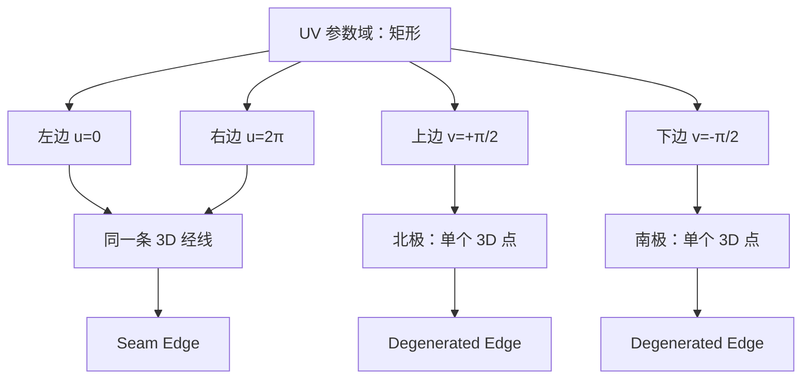

# CAD B-Rep 中球面 Seam、退化边与 Wireframe 表示

## Executive summary

对完整球面这类闭合解析曲面，最容易混淆的是三件完全不同的事：**曲面参数化的周期 seam、Face 的拓扑边界、以及 B-Rep kernel 为了让二维参数域形成合法拓扑而实际创建的 Edge/Coedge**。它们不能简单等同。

完整球面的标准参数化通常在经度方向 $u$ 上周期，在南北极存在参数奇异点。于是，在 OCCT 的典型 B-Rep 表示中，一个完整球面 Face 通常同时具有一条**seam edge**和两条**degenerated edges**：seam 是一条真实的三维经线，在同一个 Face 中以两个方向相反的 coedge 被使用；两极对应的 degenerated edge 则在参数域中是一条边，但在三维空间中塌缩为一个点，OCCT 可将其标记为 `Degenerated=true`，而且这种 edge 可以没有 3D curve、只保留 pcurve。OCCT 官方仓库的 B-Rep 数据结构说明明确区分了这两类特殊边。

但这**不是所有 kernel 都必须采用的唯一拓扑表示**。公开的 Parasolid XT 格式规范明确允许一个 Face 拥有零个 loop，并以“full spherical face”为例，因此在 Parasolid 的数据模型中，完整球面可以天然表示为**无拓扑边界的 Face**，不必强制生成 seam edge 或 pole edge。

因此，对你的神经网络 wireframe/UDF 数据集，最稳妥的原则是：

> **把“真实三维曲线几何”和“为了参数域闭合而存在的拓扑辅助边”分开编码。**

对于 UDF 几何监督，普通 edge 和 seam edge 可以作为三维曲线参与；真正的 degenerated edge 不应该当成一条长度为零的“曲线”重复贡献距离，而应归并到其对应的拓扑 vertex / singular point。与此同时，如果你希望网络还能恢复 B-Rep 拓扑，那么 `is_seam`、`is_degenerate`、coedge multiplicity、face incidence 和 pcurve 信息应该保留。这个区分会直接避免球面、圆锥、旋转曲面在 wireframe 学习中的大量伪特征。

## Seam、拓扑边界与参数奇异性不是同一个概念

考虑半径为 $R$ 的标准球面参数化：

$$
S(u,v)=
\begin{bmatrix}
R\cos v\cos u\\
R\cos v\sin u\\
R\sin v
\end{bmatrix},
\qquad
u\in[0,2\pi],\quad
v\in[-\pi/2,\pi/2].
$$

这里有两个不同现象。

第一，$u$ 方向是周期的：

$$
S(0,v)=S(2\pi,v).
$$

所以二维参数域中的左、右边界代表空间中的**同一条经线**。这就是参数化意义上的 seam。OCCT 的说明中，球面的 seam edge 对应 $u=0$ 和 $u=2\pi$ 两条 pcurve，但三维空间里它们是同一条曲线；seam edge 在同一 Face 内被使用两次，并具有相反 orientation。

第二，在极点

$$
v=\pm\frac{\pi}{2}
$$

处，

$$
S(u,\pm\pi/2)
$$

对任意 $u$ 都是同一个三维点。也就是说，参数域中的整条水平边在 3D 中塌缩成一个点。这不是 seam，而是 **surface singularity**，对应的是 degenerated edge。OCCT 的 `ShapeAnalysis_Wire` 文档明确把 degenerated edge 与参数曲面 singularity 联系起来；官方仓库也说明 degenerate edge 可以是 `Degenerated(true)` 且没有 3D curve。

可以把完整球面的参数域理解成：



因此，一个很有用的判断是：

| 类型 | 参数域中是否是一条边 | 3D 中是否为曲线 | 是否有长度 | 同 Face 是否重复使用 |
|---|---:|---:|---:|---:|
| 普通 edge | 是 | 是 | $>0$ | 通常否 |
| seam edge | 是，通常有两条对应 pcurve | 是 | $>0$ | **是，两次** |
| degenerated edge | 是 | **退化成点** | $0$ | 不要求 |
| 真正拓扑边界 edge | 是 | 通常是 | $>0$ | 通常属于相邻 Face |

OCCT 官方文档提供 `BRepTools::IsReallyClosed(E,F)`，其实现语义正是先确认 edge 在该 face 中出现两次，再进一步检查 closed 性质；这正说明 seam 的核心是**拓扑使用次数**，而不是简单的“3D curve 是闭合曲线”。

## 完整球面在 OCCT 与 Parasolid 中怎么表示

在 **Open CASCADE** 中，典型完整 spherical face 的 natural bound 是“一条 seam 加两个 pole degeneracies”。OCCT 官方仓库 2026 年关于 STEP natural-bound 的 issue 甚至直接用完整 spherical face 做例子，并写明其 natural bound 包含 seam 和两个 pole degeneracies。

OCCT 的 `BRepBuilderAPI_MakeFace` 也专门暴露 `TolDegen` 参数，用于构造曲面 Face 时解析 degenerated edges；这说明 degenerated edge 在 OCCT 的 Face 构造中是显式拓扑对象，而不是纯显示层概念。

因此，一个常见 OCCT 球面拓扑可以抽象成：

```text
Face Sphere
└── Wire
    ├── Seam Edge       : NorthPole -> SouthPole
    ├── Degenerate Edge : SouthPole -> SouthPole
    ├── Seam Edge       : SouthPole -> NorthPole   [same TopoDS_Edge, opposite coedge]
    └── Degenerate Edge : NorthPole -> NorthPole
```

这里 seam 在 `TopoDS_Edge` 层面通常只有一个 edge identity，但在 Face/Wire 中有两个 usage，也就是两个 coedge 意义上的 occurrence。OCCT 新的 BRep graph 说明明确表述为“same edge + same face + opposite orientation”的两个 CoEdge。

而 pole degenerate edge 的两个 endpoint 可以拓扑上指向同一个 vertex：

$$
v_{\text{start}}=v_{\text{end}},
$$

但更关键的不是 endpoint 相同，而是 `BRep_Tool::Degenerated(E)` 返回 true。因为“普通闭合 edge 的起终点相同”和“degenerated edge”不是一个概念。

**Parasolid 则允许另一种更抽象的表示。** Parasolid XT 格式规范定义 Face 可以有零个 loop，并明确举 full spherical face 为例。也就是说，在 Parasolid 的拓扑模型里，完整球面可以是：

```text
Face
 ├── Surface = Sphere
 └── Loops = ∅
```

而不是必须人为切出一条经线 seam 和两个 pole edges。

这意味着：

> “完整球面一定有 seam edge”在**几何参数化层面**通常成立，但在**B-Rep 拓扑层面**不成立；是否显式 materialize seam/degenerate edge 是 kernel 和交换格式相关的表示选择。

这也是为什么 STEP/IGES/XT/OCCT BREP 之间来回转换可能改变 edge 数量。OCCT 最近的 STEP issue 就展示了 natural bound、seam 与 `VERTEX_LOOP` 在转换时可能发生表示变化。

## Wireframe 中应该怎样表示 degenerated edge

如果你的 wireframe 定义是：

$$
W=(V,E)
$$

且 $E$ 代表真实空间中的一维曲线，那么**degenerated edge 不应该被当成普通三维 curve 处理**。

OCCT 自己的底层语义支持这一点：官方 BRep graph 说明中，degenerated edge 可以通过 `MakeEdge()` 后设置 `Degenerated(true)`，且没有 3D curve；BRep 文件格式也把 “degenerated flag” 单独存储，并把 3D curve representation 和 2D curve-on-surface representation 分开存储。

因此实际可能遇到以下表示：

| 情形 | 3D Curve | PCurve | Vertex | 推荐 wireframe 处理 |
|---|---|---|---|---|
| 普通 edge | 有 | 通常有 | 2 个 | 保留 curve |
| seam edge | 有 | 同 Face 常有 2 条 | 通常 2 个 | 保留一次 3D curve，并记录 seam usage |
| degenerated edge | **可能无** | 通常有 | 常为同一 vertex | 不作为 3D curve 采样 |
| 极点 singularity | 无真实 1D 几何 | 参数域上有边 | 单个 3D point | 作为 vertex/singularity 保留 |

这里尤其要避免以下错误：

```cpp
Handle(Geom_Curve) c = BRep_Tool::Curve(edge, first, last);
c->Value(...);   // 对 degenerated edge 可能 c.IsNull()
```

OCCT 的公开 issue 中已有真实例子：某些 degenerate edge 只有 curve-on-surface representation 而没有 3D curve，因此直接走假设存在 `Geom_Curve` 的路径会导致错误。

所以对于 wireframe 几何，你可以定义两个集合：

$$
E_{\text{geom}}
=
\{e\mid \neg \mathrm{Degenerated}(e)\},
$$

$$
V_{\text{sing}}
=
\{\text{3D point corresponding to degenerated edges}\}.
$$

UDF 则建议定义为：

$$
d(\mathbf x)
=
\min
\left(
\min_{e\in E_{\text{geom}}}
d(\mathbf x,e),
\;
\min_{v\in V_{\text{isolated/sing}}}
\|\mathbf x-v\|
\right).
$$

如果一个 pole vertex 已经是 seam edge 的端点，那么它本来就属于 seam curve，因此**无需额外让 degenerated edge 再贡献一次 UDF**。对纯几何 UDF 来说，重复贡献不会改变数学上的 min，但会污染采样数量、loss weighting 和 edge statistics。

## OCCT 中如何可靠遍历和判定

核心原则是：**先看 topological flags，再尝试取 3D curve；seam 必须结合 Face 判断。**

一个实用的遍历框架如下：

```cpp
#include <TopExp_Explorer.hxx>
#include <TopoDS.hxx>
#include <TopoDS_Face.hxx>
#include <TopoDS_Edge.hxx>

#include <BRep_Tool.hxx>
#include <BRepTools.hxx>
#include <BRepAdaptor_Curve.hxx>

for (TopExp_Explorer fexp(shape, TopAbs_FACE);
     fexp.More(); fexp.Next())
{
    TopoDS_Face face = TopoDS::Face(fexp.Current());

    for (TopExp_Explorer eexp(face, TopAbs_EDGE);
         eexp.More(); eexp.Next())
    {
        TopoDS_Edge edge = TopoDS::Edge(eexp.Current());

        const bool isDeg =
            BRep_Tool::Degenerated(edge);

        // "closed on this face" is a face-relative property.
        const bool isClosedOnFace =
            BRep_Tool::IsClosed(edge, face);

        // Stronger seam test: edge actually occurs twice in face.
        const bool isSeam =
            BRepTools::IsReallyClosed(edge, face);

        if (isDeg)
        {
            // Do not assume a valid 3D Geom_Curve.
            // Retrieve pcurve if topology/UV representation is needed.
            Standard_Real f, l;
            Handle(Geom2d_Curve) pc =
                BRep_Tool::CurveOnSurface(edge, face, f, l);

            continue;
        }

        Standard_Real first, last;
        Handle(Geom_Curve) curve3d =
            BRep_Tool::Curve(edge, first, last);

        if (!curve3d.IsNull())
        {
            // geometric wireframe edge
        }
    }
}
```

`BRep_Tool::Degenerated()` 是官方 API 用于识别退化 edge；`BRepTools::IsReallyClosed()` 的文档明确表示它会检查 edge 是否在 Face 中找到两次。

对于 seam，更推荐：

```cpp
bool seam = BRepTools::IsReallyClosed(edge, face);
```

而不要单独依赖：

```cpp
BRep_Tool::IsClosed(edge, face);
```

因为你的真正目标是判断“是不是同一个 Face 上的重复 edge usage”。OCCT 专门提供 `IsReallyClosed` 来做这一层验证。

如果你需要参数域拓扑，则应该取 pcurve：

```cpp
Standard_Real first, last;
Handle(Geom2d_Curve) pc =
    BRep_Tool::CurveOnSurface(edge, face, first, last);
```

OCCT 的 BRep 数据模型本身就是同时允许 3D curve representation 与 2D curve-on-surface representation 的。

对于 seam edge，还可能存在同一 closed surface 上的两条 pcurve。OCCT 的 `ShapeAnalysis_Wire::CheckSeam` 文档明确区分 forward 与 reversed seam pcurve。

如果只是想对**非退化 edge**进行统一曲线访问，`BRepAdaptor_Curve` 很方便；但不要假定所有 edge 都有独立 3D `Geom_Curve`，因为 curve-on-surface-only edge 是允许存在的。OCCT 近年的 bug report 也说明 `BRepAdaptor_Curve` 内部有专门处理 curve-on-surface 的路径。

## 对你的 neural wireframe / UDF 数据表示的建议

对于你的目标，我不建议把 OCCT/Parasolid 的原生 topology 直接等价成“所有 Edge 都采样成一组 3D polyline”。这会把 kernel 的参数化实现细节注入几何学习目标。

更稳妥的是建立两层表示。

第一层是**几何 wireframe**：

```text
vertices_xyz        [Nv, 3]

edges:
    edge_vertex_ids [Ne, 2]
    curve_samples   [Ne, K, 3]
    curve_mask      [Ne, K]
```

这里只放真正具有一维 3D 几何的 edge。普通 edge 和 seam edge 都属于这一层；degenerated edge 不进入 `curve_samples`。

第二层是**topology metadata**：

```text
edge_type           [Ne_topo]
# 0 normal
# 1 seam
# 2 degenerated

edge_vertex_ids     [Ne_topo, 2]
edge_face_ids       [Ne_topo, 2]       # 或 variable incidence

is_seam             [Ne_topo, 1]
is_degenerated      [Ne_topo, 1]

coedge_edge_id      [Nc]
coedge_face_id      [Nc]
coedge_orientation  [Nc]               # +1 / -1
coedge_pcurve_feat  [Nc, ...]           # 可选
```

这里对于 seam：

```text
edge_id = 17

coedge A:
    edge_id = 17
    face_id = 4
    orientation = +1

coedge B:
    edge_id = 17
    face_id = 4
    orientation = -1
```

这能够正确表达“**一个 3D curve，两个 Face-relative usage**”，与 OCCT 的 seam 语义一致。

对于 degenerated edge：

```text
edge_id = 18
is_degenerated = 1
v_start = 32
v_end   = 32
curve_samples = NONE
```

如果你需要恢复 B-Rep，它仍应保留在 topology token 中；如果目标只是空间 wireframe 几何，则它可以被折叠成 vertex：

```text
singularity_vertex_id = 32
```

对于你的 **UDF decoder**，我会采用：

$$
d_W(\mathbf x)
=
\min_{e\in E_{\text{3D}}}
d(\mathbf x,\gamma_e),
$$

其中

$$
E_{\text{3D}}
=
E_{\text{normal}}\cup E_{\text{seam}},
$$

但排除：

$$
E_{\text{degenerate}}.
$$

原因是 seam 在 3D 中确实是一条经线，因此如果你的目标是“**B-Rep wireframe 的所有显式 3D edge**”，它应该参与 UDF；而 degenerated edge 的几何像集只是一个 vertex，不应该人为产生一条额外曲线。OCCT 对 seam 与 degenerated edge 的底层表示正好支持这种划分。

不过这里还有一个更重要的研究选择：

如果你的目标是学习**模型真实 shape feature wireframe**，而不是学习 kernel 的 parameterization artifacts，那么 seam 本身通常也应该从 UDF target 中移除。例如一个完全球在几何意义上并没有一条“真实特征经线”；这条 seam 只是球面参数域切开的地方。Parasolid 甚至允许完整球面 Face 没有 loop，这进一步说明 seam 并不是 intrinsic geometry。

因此，我建议你实际上维护两个 edge mask：

$$
m_{\text{brep}}
=
\{\text{normal, seam}\},
$$

$$
m_{\text{intrinsic}}
=
\{\text{真实 Face 间边界 / feature edges}\}.
$$

然后训练时根据任务切换：

| 任务 | 普通 edge | Seam | Degenerated |
|---|---:|---:|---:|
| 复刻 OCCT B-Rep wireframe | ✓ | ✓ | topology only |
| 学习 kernel-independent wireframe | ✓ | **通常 ×** | × |
| UDF 表示真实 CAD 特征线 | feature edges | × | × |
| B-Rep topology autoencoder | ✓ | ✓ | ✓ |
| 显式曲线生成 | ✓ | 可单独预测 | 不作为 curve |

这对跨 kernel 训练尤其重要。否则同一个球体：

```text
OCCT sample:
1 seam + 2 degenerate edges

Parasolid sample:
possibly 0 loops / 0 boundary edges
```

会被网络当成两个完全不同的 wireframe target，尽管它们代表同一个几何实体。Parasolid XT 对 full spherical face 零 loop 的明确支持正是这个问题的典型案例。

## 参考资料与结论

最关键的官方与一手资料如下。

Open CASCADE `BRep_Tool` Reference Manual：  
`https://dev.opencascade.org/doc/refman/html/class_b_rep___tool.html`  
其中 `Degenerated()` 是判断退化边的标准 API。

Open CASCADE `BRepTools` Reference Manual：  
`https://www.occt3d.com/dev/doc/refman/html/class_b_rep_tools.html`  
其中 `IsReallyClosed(E,F)` 用来确认 edge 在 Face 内出现两次，是识别 seam usage 很实用的接口。

OCCT 官方 GitHub BRep graph 说明：  
`https://github.com/Open-Cascade-SAS/OCCT/blob/master/src/ModelingData/TKBRep/BRepGraphInc/README.md`  
它明确把 seam 定义为同 edge / 同 face / opposite orientation 的两个 CoEdge，并说明 degenerate edge 可没有 3D curve。

OCCT BREP 文件格式：  
`https://github.com/Open-Cascade-SAS/OCCT/wiki/brep_format`  
其中 edge 的 degenerated flag 与 3D curve、pcurve representation 分开存储。

OCCT `ShapeAnalysis_Wire`：  
`https://dev.opencascade.org/doc/occt-7.6.0/refman/html/class_shape_analysis___wire.html`  
包含 `CheckSeam()` 和 `CheckDegenerated()`，并明确把 degenerated edge 与 surface singularity 联系起来。

Parasolid XT Format Reference：  
`https://ww3.cad.de/foren/ubb/uploads/Rainer%2BSchulze/XT_Format_April_2008_tcm73-62642.pdf`  
该规范明确允许 Face 有零个 loop，并以 full spherical face 为例。

综合这些资料，可以把结论压缩成一句话：

**球面在参数化上有 seam 和 pole singularities；OCCT 通常把它们显式编码为一条 seam edge 加两条 degenerated edges，而 Parasolid 的拓扑模型允许完整球面 Face 没有 loop。对于 neural wireframe，seam 应作为“可选的 B-Rep 参数化边”单独标记，degenerated edge 应作为 topology/singularity 记录而非普通 3D curve；若目标是 kernel-independent 几何 UDF，则通常应同时去除 seam 与 degenerate edge，仅保留真正的几何/特征边。**
